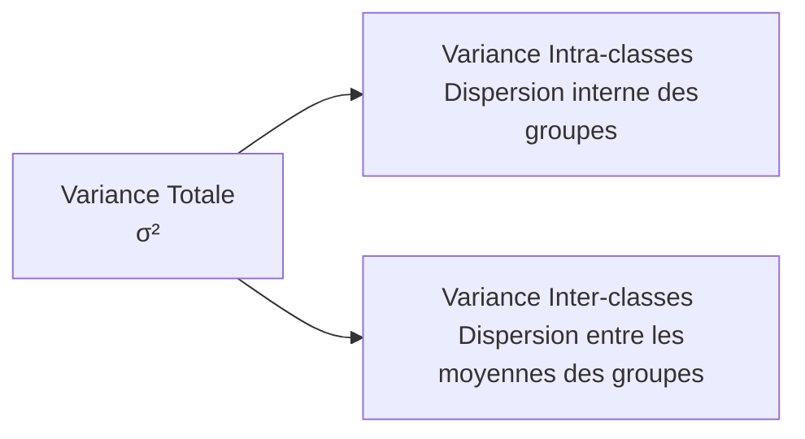

Tags: [[Statistique Descriptive]], [[Probabilités]], [[Data Analysis]], [[Mathematics]], [[ENSAM]]

# Statistique Descriptive

## 1. Généralités et Vocabulaire Fondamental

> [!info] Définition : Statistique Descriptive vs Inférentielle
> - **Statistique descriptive** : Étude et résumé de la **totalité** de la population (recensement).
> - **Statistique inférentielle** : Étude d'un **échantillon** (sous-ensemble) dans le but de généraliser les conclusions à l'ensemble de la population (sondage, tests, estimations).

> [!abstract] Pourquoi l'échantillonnage ?
> 1. **Optimisation** des coûts et des ressources (humaines, matérielles, temporelles).
> 2. **Nécessité** lorsque la population est infinie, inaccessible, ou lorsque le test est destructif (ex: contrôle qualité d'ampoules).
> 3. **Rapidité** d'obtention des résultats.

### 1.1 Le Lexique Statistique

> [!info] Définition : Concepts de base
> - **Population ($\Omega$)** : Ensemble fini (ou infini) des éléments soumis à l'étude statistique.
> - **Individu (ou Unité statistique, $\omega$)** : Un élément particulier de la population ($\omega \in \Omega$).
> - **Caractère (ou Variable statistique, $X$)** : Propriété ou trait mesuré sur chaque individu de la population.
> - **Modalités ($x_i$)** : Les différentes valeurs ou catégories possibles que peut prendre le caractère $X$.
> - **Observation** : La valeur effective prise par le caractère pour un individu donné.

> [!warning] Règles d'Or d'un Caractère Statistique
> Pour qu'un caractère soit **bien défini** et exploitable, il doit respecter deux conditions strictes :
> 1. **Exhaustivité** : Le caractère doit être défini pour **tous** les éléments de la population.
> 2. **Exclusivité** : Un élément ne peut prendre qu'**une seule et unique** modalité à la fois (pas d'ambiguïté de classement).

### 1.2 Typologie des Variables Statistiques

| Type de Variable | Nature des Modalités | Exemples |
| :--- | :--- | :--- |
| **Qualitative** | Non mesurables, catégories | Sexe, Couleur des yeux, CSP |
| ↳ *Nominale* | Pas d'ordre naturel | Groupe sanguin (A, B, O) |
| ↳ *Ordinale* | Ordre naturel, pas de distance | Niveau d'étude, Mention |
| **Quantitative** | Mesurables, valeurs numériques | Poids, Salaire, Température |
| ↳ *Discrète* | Valeurs isolées (dénombrables) | Nombre d'enfants, Note sur 20 |
| ↳ *Continue* | Valeurs dans un intervalle réel $\mathbb{R}$ | Taille, Temps de trajet, PIB |

---

## 2. Représentations Graphiques

Le choix du graphique dépend strictement de la nature de la variable (qualitative, quantitative discrète, quantitative continue).

### 2.1 Variables Qualitatives
> [!info] Types de graphiques
> - **Diagramme en bâtons** : Modalités en abscisse (ordre arbitraire), effectifs/fréquences en ordonnée (segments).
> - **Tuyaux d'orgue (Barres)** : Rectangles de largeur égale, hauteur proportionnelle à l'effectif.
> - **Diagramme circulaire (Secteurs)** : L'angle au centre est proportionnel à la fréquence ($\alpha_i = f_i \times 360^\circ$). Idéal pour les parts de marché ou les données politiques.
> - **Cartogramme** : Utilisé lorsque le caractère étudié est une répartition géographique.

> *![[PLACEHOLDER_Graphiques_Qualitatifs.png]]*
> *(Description : Comparaison visuelle entre un diagramme en bâtons, un diagramme en barres (tuyaux d'orgue) et un diagramme circulaire pour une variable qualitative nominale)*

### 2.2 Variables Quantitatives Discrètes
> [!info] Représentations
> - **Diagramme en bâtons** : Les abscisses sont ici les **valeurs numériques réelles** ($x_i$), contrairement au qualitatif.
> - **Courbe en escaliers** : Représentation des **effectifs cumulés** ($N_i$) ou **fréquences cumulées** ($F_i$). C'est l'équivalent empirique de la fonction de répartition.

### 2.3 Variables Quantitatives Continues
Les observations sont regroupées en **classes** (intervalles $[x_i, x_{i+1}[$). L'amplitude de la classe est $a_i = x_{i+1} - x_i$.

> [!warning] Piège / Concept Crucial : La Densité
> Lorsque les classes ont des **amplitudes différentes**, on ne peut pas tracer la hauteur du rectangle proportionnellement à l'effectif. Il faut utiliser la **densité**.
> $$d_i = \frac{n_i}{a_i} \quad \text{(Densité d'effectif)} \qquad \text{ou} \qquad d_i = \frac{f_i}{a_i} \quad \text{(Densité de fréquence)}$$
> Dans un **histogramme**, c'est l'**aire** du rectangle (et non la hauteur) qui est proportionnelle à l'effectif de la classe.

> *![[PLACEHOLDER_Histogramme_Densite.png]]*
> *(Description : Histogramme d'une variable continue avec des classes d'amplitudes inégales. L'axe des ordonnées indique la densité $d_i = n_i/a_i$, garantissant que l'aire totale est proportionnelle à l'effectif total $N$)*

---

## 3. Paramètres de Position

Ces paramètres résument la distribution par une valeur centrale ou typique autour de laquelle s'organisent les données.

### 3.1 Le Mode ($M_0$)
> [!info] Définition : Le Mode
> Le **mode** est la modalité qui possède le **plus grand effectif** (ou la plus grande fréquence).
> - **Distribution unimodale** : Un seul pic, population homogène.
> - **Distribution multimodale** : Plusieurs pics, population hétérogène (mélange de sous-populations).

> [!example] Calcul du Mode pour une Variable Continue (Interpolation)
> Pour une variable groupée en classes, on identifie la **classe modale** (celle ayant la plus forte densité). Le mode exact $M_0$ est estimé par interpolation géométrique (formule de King ou du trapèze) :
> $$M_0 = x_i + \frac{\Delta_1}{\Delta_1 + \Delta_2} \times a_i$$
> Où $x_i$ est la borne inférieure de la classe modale, $a_i$ son amplitude, $\Delta_1$ la différence de densité avec la classe précédente, et $\Delta_2$ la différence de densité avec la classe suivante.

### 3.2 La Médiane ($M_e$)
> [!info] Définition : La Médiane
> La médiane est la valeur qui partitionne la population triée par ordre croissant en **deux sous-ensembles de même effectif** (50% en dessous, 50% au-dessus).
> **Condition :** Nécessite une relation d'ordre (variable quantitative ou qualitative ordinale).

**Calcul pour une série discrète de taille $N$ :**
$$
\text{Si } N \text{ est impair : } M_e = x_{\frac{N+1}{2}}
$$
$$
\text{Si } N \text{ est pair : } M_e = \frac{x_{\frac{N}{2}} + x_{\frac{N}{2} + 1}}{2}
$$

> [!example] Calcul pour une Variable Continue (Interpolation Linéaire)
> On repère la **classe médiane** (première classe dont la fréquence cumulée dépasse 0,5). On applique l'interpolation linéaire :
> $$M_e = x_i + \frac{0,5 - F_{i-1}}{f_i} \times a_i$$
> *(Avec $F_{i-1}$ la fréquence cumulée avant la classe médiane, et $f_i$ la fréquence de la classe médiane).*

> *![[PLACEHOLDER_Interpolation_Mediane.png]]*
> *(Description : Courbe des fréquences cumulées croissantes (ogive). Une ligne horizontale à $F=0,5$ coupe la courbe, et la projection sur l'axe des abscisses donne la médiane $M_e$ par interpolation)*

### 3.3 La Moyenne Arithmétique ($\overline{X}$)
> [!info] Définition : Moyenne Arithmétique
> Définie uniquement pour les variables **quantitatives**. C'est le centre de gravité de la distribution.
> $$\overline{X} = \frac{1}{N} \sum_{i=1}^{k} n_i x_i = \sum_{i=1}^{k} f_i x_i$$

> [!abstract] Propriétés Fondamentales de la Moyenne
> 1. **Linéarité (Somme)** : $\overline{X + Y} = \overline{X} + \overline{Y}$
> 2. **Homogénéité (Scalaire)** : $\overline{\lambda X} = \lambda \overline{X}$
> 3. **Écart moyen nul** : La moyenne des écarts à la moyenne est toujours nulle. $\overline{(X - \overline{X})} = 0$
> 4. **Propriété de Huygens (Minimum)** : La somme des carrés des écarts est minimale lorsqu'elle est calculée par rapport à la moyenne. $\forall a \in \mathbb{R}, \sum n_i(x_i - \overline{X})^2 \le \sum n_i(x_i - a)^2$

> [!info] Définition : Moyenne Conditionnée (Théorème de la Moyenne Totale)
> Si la population $\Omega$ est partitionnée en $g$ sous-populations $\Omega_j$ de tailles $n_j$ et de moyennes $\overline{X}_j$, la moyenne globale est la **moyenne pondérée** des moyennes conditionnées :
> $$\overline{X} = \frac{1}{N} \sum_{j=1}^{g} n_j \overline{X}_j \quad \text{avec } N = \sum n_j$$

---

## 4. Généralisation : Les $\psi$-Moyennes

> [!info] Définition : La $\psi$-moyenne
> Soit $\psi : \mathbb{R} \to \mathbb{R}$ une fonction continue strictement monotone. La $\psi$-moyenne d'une variable $X$ est définie par :
> $$\overline{X}^\psi = \psi^{-1} \left( \frac{1}{N} \sum_{i=1}^{k} n_i \psi(x_i) \right)$$

| Nom | Fonction $\psi(x)$ | Formule de la Moyenne | Usage Principal |
| :--- | :--- | :--- | :--- |
| **Arithmétique** | $\psi(x) = x$ | $\overline{X} = \frac{1}{N} \sum n_i x_i$ | Standard, additive |
| **Quadratique** | $\psi(x) = x^2$ | $\overline{X}_q = \sqrt{\frac{1}{N} \sum n_i x_i^2}$ | Physique (RMS), énergie |
| **Géométrique** | $\psi(x) = \ln(x)$ | $\overline{X}_g = \left( \prod x_i^{n_i} \right)^{\frac{1}{N}}$ | Taux de croissance, indices |
| **Harmonique** | $\psi(x) = \frac{1}{x}$ | $\overline{X}_h = \frac{N}{\sum \frac{n_i}{x_i}}$ | Vitesses moyennes, prix |

> [!warning] Inégalité des Moyennes (Théorème)
> Pour toute distribution à valeurs strictement positives, on a toujours la chaîne d'inégalités suivante :
> $$\overline{X}_h \le \overline{X}_g \le \overline{X} \le \overline{X}_q$$
> *L'égalité n'est vérifiée que si toutes les valeurs $x_i$ sont identiques.*

---

## 5. Paramètres de Dispersion

Les paramètres de position ne suffisent pas : une moyenne de 10/20 peut cacher une classe homogène (tous à 10) ou hétérogène (moitié à 0, moitié à 20).

### 5.1 Étendue et Quantiles
- **Étendue ($w$)** : $w = x_{max} - x_{min}$. Très sensible aux valeurs aberrantes (outliers).
- **Quartiles ($Q_1, Q_2, Q_3$)** : Valeurs divisant la série ordonnée en 4 parts égales (25%, 50%, 75%). Notez que $Q_2 = M_e$.
- **Écart Interquartile ($IQR$)** : $IQR = Q_3 - Q_1$. Contient 50% des effectifs centraux. Robuste aux outliers.
- **Déciles ($D_1 \dots D_9$)** et **Percentiles ($P_1 \dots P_{99}$)** : Divisent la série en 10 ou 100 parts égales.

> *![[PLACEHOLDER_Boxplot_Moustaches.png]]*
> *(Description : Diagramme en boîte (Boxplot) illustrant le minimum, $Q_1$, la Médiane, $Q_3$, le maximum, et la détection visuelle des outliers au-delà de $1,5 \times IQR$)*

### 5.2 Variance et Écart-Type

> [!info] Définition : Variance ($V(X)$ ou $\sigma^2$)
> Mesure la dispersion moyenne quadratique autour de la moyenne.
> $$V(X) = \frac{1}{N} \sum_{i=1}^{k} n_i (x_i - \overline{X})^2$$
> **Formule de König-Huygens (Formule pratique)** : La variance est la moyenne des carrés moins le carré de la moyenne.
> $$V(X) = \overline{X^2} - (\overline{X})^2 = \left( \frac{1}{N} \sum n_i x_i^2 \right) - \overline{X}^2$$

> [!info] Définition : Écart-Type ($\sigma(X)$)
> L'écart-type ramène la dispersion à l'unité de mesure originale de la variable.
> $$\sigma(X) = \sqrt{V(X)}$$

> [!abstract] Propriétés de la Variance
> 1. **Positivité** : $V(X) \ge 0$.
> 2. **Nullité** : $V(X) = 0 \iff X$ est constante.
> 3. **Invariance par translation** : $V(X + b) = V(X)$ (ajouter une constante ne change pas la dispersion).
> 4. **Homogénéité quadratique** : $V(aX) = a^2 V(X)$.

---

## 6. Décomposition de la Variance (Théorème de Huygens)

> [!info] Théorème de Décomposition (ANOVA à 1 facteur)
> Si la population est partitionnée en $g$ sous-groupes, la variance totale se décompose exactement en deux termes :
> $$V_{totale}(X) = V_{intra}(X) + V_{inter}(X)$$
> $$\underbrace{\sigma^2(X)}_{\text{Variance Totale}} = \underbrace{\frac{1}{N} \sum_{j=1}^{g} n_j \sigma_j^2(X)}_{\text{Variance Intra-classes (Moyenne des variances)}} + \underbrace{\frac{1}{N} \sum_{j=1}^{g} n_j (\overline{X}_j - \overline{X})^2}_{\text{Variance Inter-classes (Variance des moyennes)}}$$

> [!warning] Interprétation et Rapport de Corrélation ($\eta^2$)
> Le **rapport de corrélation** mesure la part de la variance totale expliquée par la partition (le regroupement en classes) :
> $$\eta^2_{X|Y} = \frac{V_{inter}}{V_{totale}} = 1 - \frac{V_{intra}}{V_{totale}} \in [0, 1]$$
> - Si $\eta^2 = 0$ : $V_{inter} = 0$, toutes les sous-populations ont la même moyenne. **Aucune liaison** entre $X$ et la partition $Y$.
> - Si $\eta^2 = 1$ : $V_{intra} = 0$, il n'y a aucune dispersion à l'intérieur des classes. **Liaison fonctionnelle parfaite** (connaître la classe donne exactement la valeur de $X$).

---

## 7. Moments et Distribution Centrée Réduite

### 7.1 Les Moments
> [!info] Définition : Moments
> - **Moment d'ordre $r$ (par rapport à l'origine)** : $m_r = \frac{1}{N} \sum n_i x_i^r$. (Note: $m_1 = \overline{X}$, $m_2 = \overline{X^2}$).
> - **Moment centré d'ordre $r$ (par rapport à la moyenne)** : $\mu_r = \frac{1}{N} \sum n_i (x_i - \overline{X})^r$.
>   - $\mu_1 = 0$ (toujours).
>   - $\mu_2 = V(X) = \sigma^2$ (la variance).

### 7.2 Centrage et Réduction
> [!info] Définition : Variable Centrée Réduite ($Z$)
> Transformer $X$ en une nouvelle variable $Z$ sans unité, de moyenne 0 et de variance 1.
> $$Z = \frac{X - \overline{X}}{\sigma(X)} \implies \overline{Z} = 0 \quad \text{et} \quad V(Z) = 1$$
> **Utilité absolue** : Permet de comparer des variables de natures et d'unités différentes (ex: comparer un poids en kg avec un salaire en MAD) ou de se ramener à la **Loi Normale Centrée Réduite $\mathcal{N}(0,1)$**.

> *![[PLACEHOLDER_Loi_Normale_Centree_Reduite.png]]*
> *(Description : Courbe en cloche de Gauss. Passage d'une loi normale quelconque $\mathcal{N}(\mu, \sigma^2)$ à la loi centrée réduite $\mathcal{N}(0,1)$ par transformation affine)*

---

## 8. Paramètres de Forme

Ces paramètres comparent la forme de la distribution empirique à la distribution de référence (la Loi Normale).

### 8.1 Coefficient d'Asymétrie (Skewness)
Mesure le déséquilibre de la distribution par rapport à son centre.

| Indicateur | Formule | Interprétation |
| :--- | :--- | :--- |
| **Pearson** | $Sk_p = \frac{\overline{X} - M_0}{\sigma(X)}$ | Basé sur l'écart entre Moyenne et Mode. |
| **Yule (Bowley)** | $Sk_y = \frac{Q_3 + Q_1 - 2M_e}{Q_3 - Q_1}$ | Basé sur les quartiles (robuste aux outliers). |
| **Fisher** | $\gamma_1 = \frac{\mu_3}{\sigma^3}$ | Basé sur le moment centré d'ordre 3. |

> [!warning] Lecture de l'Asymétrie
> - **$\gamma_1 = 0$** : Distribution symétrique (ex: Loi Normale).
> - **$\gamma_1 > 0$** : Asymétrie positive (queue étirée vers la **droite**). Moyenne > Médiane > Mode.
> - **$\gamma_1 < 0$** : Asymétrie négative (queue étirée vers la **gauche**). Moyenne < Médiane < Mode.

> *![[PLACEHOLDER_Skewness_Distributions.png]]*
> *(Description : Trois courbes superposées illustrant une distribution symétrique, asymétrique à droite (Skew > 0) et asymétrique à gauche (Skew < 0))*

### 8.2 Coefficient d'Aplatissement (Kurtosis)
Mesure la concentration des données autour de la moyenne et l'épaisseur des queues de distribution par rapport à la Loi Normale.

> [!info] Définition : Le Kurtosis
> - **Pearson ($\beta_2$)** : $\beta_2 = \frac{\mu_4}{\sigma^4}$
> - **Fisher ($\gamma_2$)** : $\gamma_2 = \frac{\mu_4}{\sigma^4} - 3$ (Le $-3$ sert à ce que la Loi Normale ait un kurtosis de 0).

| Valeur de $\gamma_2$ | Type | Description |
| :--- | :--- | :--- |
| $\gamma_2 = 0$ | **Mésocurtique** | Aplatissement identique à la Loi Normale. |
| $\gamma_2 > 0$ | **Leptocurtique** | Distribution pointue, queues épaisses (risque d'outliers élevé). |
| $\gamma_2 < 0$ | **Platycurtique** | Distribution aplatie, queues fines (données très concentrées). |

---
# ~={red}References=~
*Statistique Descriptive — Cours & Notes Personnelles — ENSAM Casablanca (IAGI)*