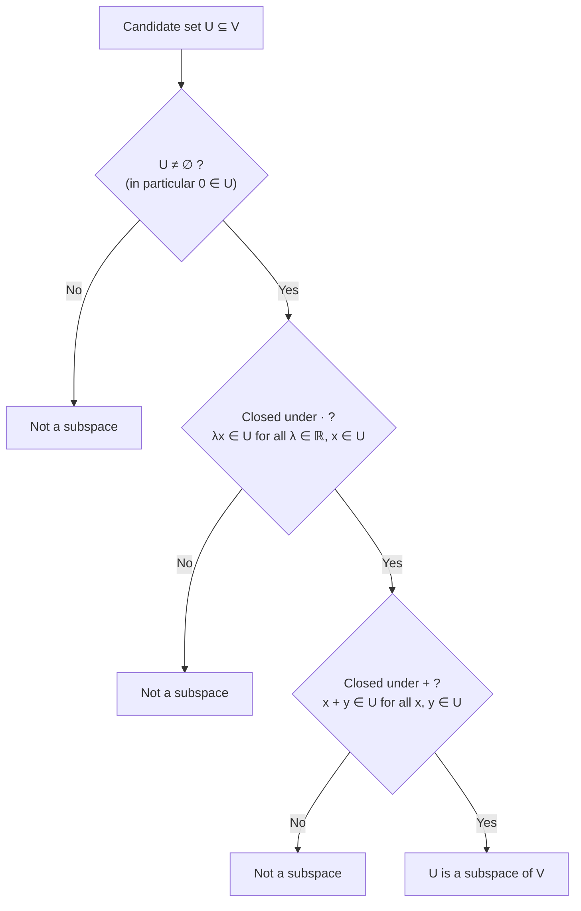

Date: 2026-11-10
Tags: [[Linear Algebra]], [[Vector Subspaces]], [[Mathematics for Machine Learning]], [[Deisenroth]], [[Abstract Algebra]]

# 2.4.3 Vector Subspaces

## 1. Intuition: "Closed" Sets Inside a Vector Space

> [!info] Definition : Vector Subspace (Intuition)
> A vector subspace is a set contained in the original vector space with the property that performing vector space operations on elements **within** this subspace never leaves it — the set is **"closed"** under the operations.
> 
> **Why it matters:** vector subspaces are a key idea in machine learning — e.g., Chapter 10 uses them for **dimensionality reduction** (projecting data onto a lower-dimensional subspace that retains the structure).

---

## 2. Formal Definition and the Subspace Test

> [!info] Definition / Theorem : Vector Subspace (Definition 2.10)
> Let $V = (\mathcal{V}, +, \cdot)$ be a vector space and $\mathcal{U} \subseteq \mathcal{V}$, $\mathcal{U} \neq \emptyset$. Then $U = (\mathcal{U}, +, \cdot)$ is called a **vector subspace** of $V$ (or **linear subspace**) if $U$ is a vector space with the operations $+$ and $\cdot$ **restricted** to $\mathcal{U} \times \mathcal{U}$ and $\mathbb{R} \times \mathcal{U}$:
> $$
> + : \mathcal{U} \times \mathcal{U} \to \mathcal{U}, \qquad \cdot : \mathbb{R} \times \mathcal{U} \to \mathcal{U}
> $$
> We write $U \subseteq V$ to denote a subspace $U$ of $V$.

**Inherited properties.** If $\mathcal{U} \subseteq \mathcal{V}$ and $V$ is a vector space, then $U$ automatically inherits every property that holds for *all* $\boldsymbol{x} \in \mathcal{V}$ — in particular the **Abelian group properties**, **distributivity**, **associativity**, and the **neutral element**. These do *not* need to be re-proven.

> [!abstract] Modélisation : The Subspace Test
> To determine whether $(\mathcal{U}, +, \cdot)$ is a subspace of $V$, it remains to show **only**:
> 1. $\mathcal{U} \neq \emptyset$ — in particular: $\boldsymbol{0} \in \mathcal{U}$;
> 2. **Closure** of $U$:
>    - a. With respect to the **outer operation**: $\forall \lambda \in \mathbb{R},\ \forall \boldsymbol{x} \in \mathcal{U} : \lambda \boldsymbol{x} \in \mathcal{U}$;
>    - b. With respect to the **inner operation**: $\forall \boldsymbol{x}, \boldsymbol{y} \in \mathcal{U} : \boldsymbol{x} + \boldsymbol{y} \in \mathcal{U}$.

---

## 3. Examples and Counterexamples in $\mathbb{R}^2$

> [!example] Application Example : Vector Subspaces (Example 2.12)
> - For every vector space $V$, the **trivial subspaces** are $V$ itself and $\{\boldsymbol{0}\}$.
> - In Figure 2.6, **only example $D$** is a subspace of $\mathbb{R}^2$ (with the usual inner/outer operations): in $A$ and $C$ the **closure property is violated**; $B$ **does not contain** $\boldsymbol{0}$.
> - The solution set of a **homogeneous** system of linear equations $\boldsymbol{Ax} = \boldsymbol{0}$ with $n$ unknowns $\boldsymbol{x} = [x_1, \dots, x_n]^{\top}$ is a subspace of $\mathbb{R}^n$.
> - The solution of an **inhomogeneous** system $\boldsymbol{Ax} = \boldsymbol{b}$, $\boldsymbol{b} \neq \boldsymbol{0}$, is **not** a subspace of $\mathbb{R}^n$.
> - The **intersection of arbitrarily many subspaces** is a subspace itself.

> **Figure 2.6**
> ![[Pasted image 20261025131046.png]]

> [!warning] Pitfall / Cas Particulier : How each counterexample fails
> | Set | Failing condition | Reason |
> | :---: | :--- | :--- |
> | $A$ (box) | Closure (outer operation) | $\boldsymbol{x} \in A$ but $\lambda \boldsymbol{x} \notin A$ for large $\lambda$ — a bounded set cannot be closed under scaling |
> | $B$ (offset line) | Contains $\boldsymbol{0}$ | The line misses the origin, so $\boldsymbol{0} \notin B$ |
> | $C$ (bowtie) | Closure (inner operation) | Sum of a vector from one wedge and a vector from the other can fall outside $C$ |
> | $D$ (origin) | — | Passes all tests: $\{\boldsymbol{0}\}$ is the trivial subspace |

---

## 4. Subspaces and Systems of Linear Equations

> [!info] Definition / Theorem : Homogeneous systems generate subspaces
> The solution set of $\boldsymbol{Ax} = \boldsymbol{0}$, with $\boldsymbol{x} \in \mathbb{R}^n$, is a subspace of $\mathbb{R}^n$: it contains $\boldsymbol{0}$ (since $\boldsymbol{A0} = \boldsymbol{0}$), and sums and scalar multiples of solutions are solutions.
> 
> **Conversely (Remark, p. 40):** *every* subspace $U \subseteq (\mathbb{R}^n, +, \cdot)$ is the solution space of some homogeneous system $\boldsymbol{Ax} = \boldsymbol{0}$ for $\boldsymbol{x} \in \mathbb{R}^n$.
> $$
> \text{Subspaces of } \mathbb{R}^n \quad \Longleftrightarrow \quad \text{Solution spaces of } \boldsymbol{Ax} = \boldsymbol{0}
> $$

> [!warning] Pitfall / Cas Particulier : Inhomogeneous systems are never subspaces
> For $\boldsymbol{Ax} = \boldsymbol{b}$ with $\boldsymbol{b} \neq \boldsymbol{0}$: $\boldsymbol{A0} = \boldsymbol{0} \neq \boldsymbol{b}$, so $\boldsymbol{0}$ is **not** a solution — the solution set fails the very first test of the subspace criterion. (Geometrically: it is an *affine* set — a line/plane displaced from the origin, like set $B$ in Figure 2.6.)

> [!info] Definition / Theorem : Stability under intersection
> The intersection of **arbitrarily many** subspaces is itself a subspace. (Union, by contrast, is generally *not* a subspace — cf. the bowtie set $C$, a union of two half-line spans, which fails closure under $+$.)

---

## 5. Synthesis

> [!abstract] Synthesis : Subspace checklist at a glance
> | Candidate $U \subseteq V$ | Subspace? | Decisive test |
> | :--- | :---: | :--- |
> | $V$ itself; $\{\boldsymbol{0}\}$ | ✅ | Trivial subspaces |
> | Line/plane **through** $\boldsymbol{0}$ | ✅ | Contains $\boldsymbol{0}$; closed under $+$ and $\cdot$ |
> | Solution set of $\boldsymbol{Ax} = \boldsymbol{0}$ | ✅ | Homogeneous system |
> | Intersection of subspaces | ✅ | Stable under intersection |
> | Line/plane **not** through $\boldsymbol{0}$ ($\boldsymbol{Ax}=\boldsymbol{b}, \boldsymbol{b}\neq\boldsymbol{0}$) | ❌ | $\boldsymbol{0} \notin U$ |
> | Bounded region (box, ball) | ❌ | Closure under $\cdot$ fails |
> | Union of wedges / union of subspaces | ❌ | Closure under $+$ fails |
> 
> **Operational rule:** inherited axioms (Abelian group, distributivity, associativity, neutral element) come for free from $V$; a subspace proof is *always* the three checks — $\boldsymbol{0} \in \mathcal{U}$, closure under $\cdot$, closure under $+$.

---
# ~={red}References=~
*Mathematics for Machine Learning, M. P. Deisenroth, A. A. Faisal, C. S. Ong — Section 2.4.3: Vector Subspaces (p. 39–40), Cambridge University Press (2020)*