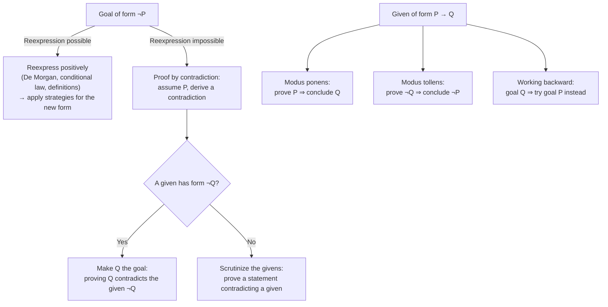

Date: 2026-10-08
Tags: [[Mathematics]], [[Proofs]], [[Logic]], [[Sets]]]

---

# Proofs Involving Negations and Conditionals (§3.2)

## 1. Proving a Goal of the Form $\neg P$

### 1.1 Strategy 1 — Reexpress the Goal

> [!abstract] Proof Strategy : Goal of the form $\neg P$ (Reexpression)
> If possible, reexpress the goal in some other form and then use one of the proof strategies for this other goal form.
> Instead of using a goal that says what *shouldn't* be true, rephrase it as a goal that says what *should* be true, using the equivalences from Chapter 2 (De Morgan's laws, conditional law, definitions).

> [!example] Example 3.2.1 : Reexpressing a negated membership goal
> **Theorem.** Suppose $A \cap C \subseteq B$ and $a \in C$. Prove that $a \notin A \setminus B$.
> 
> **Scratch work.** Because the goal is a negated statement, try to reexpress it:
> $$
> a \notin A \setminus B \;\equiv\; \neg\left(a \in A \land a \notin B\right) \;\equiv\; a \notin A \lor a \in B \;\equiv\; a \in A \rightarrow a \in B
> $$
> (definition of $A \setminus B$, then De Morgan's law, then the conditional law).
> 
> | Givens | Goal |
> | :--- | :--- |
> | $A \cap C \subseteq B$ | $a \notin A \setminus B$ |
> | $a \in C$ | |
> 
> $\Downarrow$ reexpression of the goal:
> 
> | Givens | Goal |
> | :--- | :--- |
> | $A \cap C \subseteq B$ | $a \in A \rightarrow a \in B$ |
> | $a \in C$ | |
> 
> The new goal is a conditional, so add the antecedent to the givens and make the consequent the goal:
> 
> | Givens | Goal |
> | :--- | :--- |
> | $A \cap C \subseteq B$ | $a \in B$ |
> | $a \in C$ | |
> | $a \in A$ | |
> 
> The proof is now easy: from $a \in A$ and $a \in C$ conclude $a \in A \cap C$; then, since $A \cap C \subseteq B$, it follows that $a \in B$.
> 
> **Solution.** *Theorem.* Suppose $A \cap C \subseteq B$ and $a \in C$. Then $a \notin A \setminus B$.
> *Proof.* Suppose $a \in A$. Then since $a \in C$, $a \in A \cap C$. But then since $A \cap C \subseteq B$ it follows that $a \in B$. Thus, it cannot be the case that $a$ is an element of $A$ but not $B$, so $a \notin A \setminus B$. $\blacksquare$

### 1.2 Strategy 2 — Proof by Contradiction

Sometimes a goal of the form $\neg P$ cannot be reexpressed as a positive statement. In that case it is usually best to do a **proof by contradiction**: assume $P$ is true, and try to use this assumption to prove something you know is false (often a statement that contradicts one of the givens). Since the statement proven is false, the assumption that $P$ was true must have been incorrect; the only remaining possibility is that $P$ is false.

> [!abstract] Proof Strategy : Goal of the form $\neg P$ (Contradiction)
> Assume $P$ is true and try to reach a contradiction. Once you have reached a contradiction, you can conclude that $P$ must be false.
> 
> | Givens | Goal |
> | :--- | :--- |
> | — | $\neg P$ |
> 
> $\Downarrow$ after using the strategy:
> 
> | Givens | Goal |
> | :--- | :--- |
> | $P$ | Contradiction |
> 
> **Form of final proof:**
> Suppose $P$ is true.
> [Proof of contradiction goes here.]
> Thus, $P$ is false.

> [!example] Example 3.2.2 : Nested conditional + contradiction
> **Theorem.** If $x^2 + y = 13$ and $y \neq 4$ then $x \neq 3$.
> 
> **Scratch work, step 1** (goal is a conditional: treat antecedent as given, consequent as new goal):
> 
> | Givens | Goal |
> | :--- | :--- |
> | $x^2 + y = 13$ | $x \neq 3$ |
> | $y \neq 4$ | |
> 
> Outline of the final proof at this stage:
> Suppose $x^2 + y = 13$ and $y \neq 4$.
> [Proof of $x \neq 3$ goes here.]
> Thus, if $x^2 + y = 13$ and $y \neq 4$ then $x \neq 3$.
> 
> **Scratch work, step 2.** The goal $x \neq 3$ means $\neg(x = 3)$, but $x = 3$ has no logical connectives, so no equivalence reexpresses it positively. Try proof by contradiction:
> 
> | Givens | Goal |
> | :--- | :--- |
> | $x^2 + y = 13$ | Contradiction |
> | $y \neq 4$ | |
> | $x = 3$ | |
> 
> Refined outline (the inner proof is indented to show it is a sub-proof):
> Suppose $x^2 + y = 13$ and $y \neq 4$.
>  Suppose $x = 3$.
>  [Proof of contradiction goes here.]
>  Therefore $x \neq 3$.
> Thus, if $x^2 + y = 13$ and $y \neq 4$ then $x \neq 3$.
> 
> At this point there is no particular statement as goal: any impossible conclusion will do. Look closely at the givens: the first and third together imply $y = 4$, which contradicts the second.
> 
> **Solution.** *Theorem.* If $x^2 + y = 13$ and $y \neq 4$ then $x \neq 3$.
> *Proof.* Suppose $x^2 + y = 13$ and $y \neq 4$. Suppose $x = 3$. Substituting this into the equation $x^2 + y = 13$, we get $9 + y = 13$, so $y = 4$. But this contradicts the fact that $y \neq 4$. Therefore $x \neq 3$. Thus, if $x^2 + y = 13$ and $y \neq 4$ then $x \neq 3$. $\blacksquare$

> [!info] Why the contradiction step is justified
> When the contradiction was reached, one of the three statements in the second givens list had to be false. There was no need to identify *which* one: the proof only has to guarantee that **if** the original givens ($x^2+y=13$, $y \neq 4$) are true, **then** the goal ($x \neq 3$) is true. If neither of the first two was the culprit, it had to be the third ($x = 3$), and that was all that was required.

> [!warning] Pitfall / Trade-off of proof by contradiction
> - **Advantage:** it allows you to assume your conclusion is false, providing an extra given to work with.
> - **Disadvantage:** it leaves a rather vague goal — produce a contradiction by proving something known to be false. No strategy based on the logical form of the *goal* helps here; you must analyze the **givens** to locate the contradiction.
> - **Common pattern:** if one of the givens has the form $\neg P$, produce the contradiction by proving $P$.

> ![[Pasted image 20261009010938.png]]

---

## 2. Using Givens of the Form $\neg P$

### 2.1 Strategy 3 — Inside a proof by contradiction: prove $P$

> [!abstract] Proof Strategy : Given of the form $\neg P$ (in a proof by contradiction)
> If you're doing a proof by contradiction, try making $P$ your goal. If you can prove $P$, then the proof will be complete, because $P$ contradicts the given $\neg P$.
> 
> | Givens | Goal |
> | :--- | :--- |
> | $\neg P$ | Contradiction |
> 
> $\Downarrow$ after using the strategy:
> 
> | Givens | Goal |
> | :--- | :--- |
> | $\neg P$ | $P$ |
> 
> **Form of final proof:**
> [Proof of $P$ goes here.]
> Since we already know $\neg P$, this is a contradiction.

> [!example] Example 3.2.3 : Definitions unlock the logical form
> **Theorem.** Suppose $A$, $B$, and $C$ are sets, $A \setminus B \subseteq C$, and $x$ is anything at all. Prove that if $x \in A \setminus C$ then $x \in B$.
> 
> **Scratch work, step 1** (conditional goal):
> 
> | Givens | Goal |
> | :--- | :--- |
> | $A \setminus B \subseteq C$ | $x \in B$ |
> | $x \in A \setminus C$ | |
> 
> The goal $x \in B$ contains no logical connectives; no technique applies directly. Try contradiction:
> 
> | Givens | Goal |
> | :--- | :--- |
> | $A \setminus B \subseteq C$ | Contradiction |
> | $x \in A \setminus C$ | |
> | $x \notin B$ | |
> 
> The strategy for $\neg P$ givens (make $P$ the goal, i.e. goal $x \in B$) just gets us back where we started. The key is to **write out the definition** of the second given: $x \in A \setminus C$ means $x \in A$ and $x \notin C$:
> 
> | Givens | Goal |
> | :--- | :--- |
> | $A \setminus B \subseteq C$ | Contradiction |
> | $x \in A$ | |
> | $x \notin C$ | |
> | $x \notin B$ | |
> 
> Now the third given has the form $\neg P$ with $P = (x \in C)$: apply the strategy and make $x \in C$ the goal.
> 
> | Givens | Goal |
> | :--- | :--- |
> | $A \setminus B \subseteq C$ | $x \in C$ |
> | $x \in A$ | |
> | $x \notin C$ | |
> | $x \notin B$ | |
> 
> The goal now follows easily: from $x \in A$ and $x \notin B$ conclude $x \in A \setminus B$; since $A \setminus B \subseteq C$, it follows that $x \in C$.
> 
> **Solution.** *Theorem.* Suppose $A$, $B$, $C$ are sets, $A \setminus B \subseteq C$, and $x$ is anything at all. If $x \in A \setminus C$ then $x \in B$.
> *Proof.* Suppose $x \in A \setminus C$. This means that $x \in A$ and $x \notin C$. Suppose $x \notin B$. Then $x \in A \setminus B$, so since $A \setminus B \subseteq C$, $x \in C$. But this contradicts the fact that $x \notin C$. Therefore $x \in B$. Thus, if $x \in A \setminus C$ then $x \in B$. $\blacksquare$

> [!warning] Pitfall / Rule of proof-writing
> In many cases the logical form of a statement can only be discovered by **writing out the definition** of some mathematical word or symbol occurring in the statement (here: $x \in A \setminus C$). Knowing the precise statements of the definitions of all mathematical terms is extremely important when writing a proof.

### 2.2 Strategy 4 — Outside a contradiction: reexpress the given

> [!abstract] Proof Strategy : Given of the form $\neg P$ (general)
> If possible, reexpress this given in some other form (typically a positive form via De Morgan's laws, the conditional law, or a definition).

---

## 3. Using Givens of the Form $P \rightarrow Q$ : Rules of Inference

Strategies for using givens suggest ways of drawing inferences; such strategies are called **rules of inference**.

> [!info] Definition / Theorem : Modus ponens and modus tollens
> **To use a given of the form $P \rightarrow Q$:**
> - (**Modus ponens**) If you are also given $P$, or if you can prove that $P$ is true, then you can use this given to conclude that $Q$ is true.
> - (**Modus tollens**) Since $P \rightarrow Q$ is equivalent to $\neg Q \rightarrow \neg P$, if you can prove that $Q$ is false, you can use this given to conclude that $P$ is false.
> 
> Usually a given of the form $P \rightarrow Q$ is not of much use until you can prove either $P$ or $\neg Q$. But once $P$ (resp. $\neg Q$) is established, use the given **immediately** to conclude $Q$ (resp. $\neg P$).

> [!warning] Working backward with rules of inference
> If a given has the form $P \rightarrow Q$ and your goal is $Q$: if only you could prove $P$, modus ponens would reach the goal. This suggests **treating $P$ as your goal instead of $Q$**; if you prove $P$, one extra step finishes the proof.

> [!example] Example 3.2.4 : Chaining conditionals with modus ponens and modus tollens
> **Theorem.** Suppose $P \rightarrow (Q \rightarrow R)$. Prove that $\neg R \rightarrow (P \rightarrow \neg Q)$.
> 
> **Scratch work, step 1:**
> 
> | Givens | Goal |
> | :--- | :--- |
> | $P \rightarrow (Q \rightarrow R)$ | $\neg R \rightarrow (P \rightarrow \neg Q)$ |
> 
> The only given is conditional: modus ponens would apply with $P$, modus tollens with $\neg(Q \rightarrow R)$; neither is known yet, so concentrate on the goal.
> 
> **Step 2** (conditional goal: assume antecedent):
> 
> | Givens | Goal |
> | :--- | :--- |
> | $P \rightarrow (Q \rightarrow R)$ | $P \rightarrow \neg Q$ |
> | $\neg R$ | |
> 
> **Step 3** (the goal is again a conditional):
> 
> | Givens | Goal |
> | :--- | :--- |
> | $P \rightarrow (Q \rightarrow R)$ | $\neg Q$ |
> | $\neg R$ | |
> | $P$ | |
> 
> Now the first given becomes usable: $P \rightarrow (Q \rightarrow R)$ and $P$ give $Q \rightarrow R$ by **modus ponens** (any conclusion inferred from the givens can be added to the givens column):
> 
> | Givens | Goal |
> | :--- | :--- |
> | $P \rightarrow (Q \rightarrow R)$ | $\neg Q$ |
> | $\neg R$ | |
> | $P$ | |
> | $Q \rightarrow R$ | |
> 
> Final step: $Q \rightarrow R$ and $\neg R$ give $\neg Q$ by **modus tollens** — the goal.
> 
> **Solution.** *Theorem.* Suppose $P \rightarrow (Q \rightarrow R)$. Then $\neg R \rightarrow (P \rightarrow \neg Q)$.
> *Proof.* Suppose $\neg R$. Suppose $P$. Since $P$ and $P \rightarrow (Q \rightarrow R)$, it follows that $Q \rightarrow R$. But then, since $\neg R$, we can conclude $\neg Q$. Thus, $P \rightarrow \neg Q$. Therefore $\neg R \rightarrow (P \rightarrow \neg Q)$. $\blacksquare$

> [!example] Example 3.2.5 : Reexpressing a negated given, then working backward
> **Theorem.** Suppose that $A \subseteq B$, $a \in A$, and $a \notin B \setminus C$. Prove that $a \in C$.
> 
> **Scratch work, step 1.** The third given is negative, so reexpress it as an equivalent positive statement: by the definition of set difference it means $\neg(a \in B \land a \notin C)$, and by De Morgan's law this is equivalent to $a \notin B \lor a \in C$. Because the goal is $a \in C$, rewrite this in the equivalent conditional form $a \in B \rightarrow a \in C$:
> 
> | Givens | Goal |
> | :--- | :--- |
> | $A \subseteq B$ | $a \in C$ |
> | $a \in A$ | |
> | $a \in B \rightarrow a \in C$ | |
> 
> **Step 2** (strategy for a $P \rightarrow Q$ given with goal $Q$: treat $P$ as the goal instead):
> 
> | Givens | Goal |
> | :--- | :--- |
> | $A \subseteq B$ | $a \in B$ |
> | $a \in A$ | |
> | $a \in B \rightarrow a \in C$ | |
> 
> Now it is clear: since $a \in A$ and $A \subseteq B$, $a \in B$. One modus ponens step then gives $a \in C$.
> 
> **Solution.** *Theorem.* Suppose that $A \subseteq B$, $a \in A$, and $a \notin B \setminus C$. Then $a \in C$.
> *Proof.* Since $a \in A$ and $A \subseteq B$, we can conclude that $a \in B$. But $a \notin B \setminus C$, so it follows that $a \in C$. $\blacksquare$

---

## 4. Strategy Map (Synthesis)

---
# ~={red}References=~
*How to Prove It, 2nd Edition — Daniel J. Velleman* (p. 95–106)

