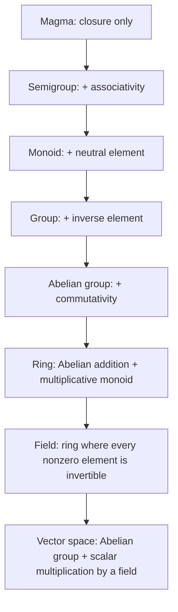

Date: 2026-10-12
Tags: [[Abstract Algebra]], [[Linear Algebra]], [[Groups]], [[MML]], [[Deisenroth]], [[Mathematics]]

---

# Groups — The Algebra of Reversible Operations

## 1. Why Groups Come First

> [!info] Concept : The role of groups
> Groups provide the fundamental framework for **operations on sets**, and are heavily used in **cryptography, coding theory, and graphics**. In [[Machine Learning]] they reappear constantly: symmetries and equivariant networks, optimization over matrix manifolds, and every change of basis you will ever compute lives inside a group.
> 
> **Intuition:** a group is the algebraic formalization of *reversible operations*. The four axioms below answer four questions: Can I combine two operations and stay inside my world? Does grouping matter? Is there a "do nothing"? Can everything be *undone*?

---

## 2. The Definition

> [!info] Definition 2.7 : Group
> Consider a set $\mathcal{G}$ and an operation $\otimes : \mathcal{G} \times \mathcal{G} \rightarrow \mathcal{G}$ defined on $\mathcal{G}$. Then $G := (\mathcal{G}, \otimes)$ is called a **group** if the following hold:
> 1. **Closure** of $\mathcal{G}$ under $\otimes$: $\forall x, y \in \mathcal{G} : x \otimes y \in \mathcal{G}$
> 2. **Associativity**: $\forall x, y, z \in \mathcal{G} : (x \otimes y) \otimes z = x \otimes (y \otimes z)$
> 3. **Neutral element**: $\exists e \in \mathcal{G}\ \forall x \in \mathcal{G} : x \otimes e = x$ and $e \otimes x = x$
> 4. **Inverse element**: $\forall x \in \mathcal{G}\ \exists y \in \mathcal{G} : x \otimes y = e$ and $y \otimes x = e$, where $e$ is the neutral element. We often write $x^{-1}$ to denote the inverse element of $x$.

| Axiom | What it guarantees | What breaks without it |
| :--- | :--- | :--- |
| **Closure** | The operation never leaves the set | Combining two elements can land outside the universe |
| **Associativity** | Parentheses are irrelevant: $x \otimes y \otimes z$ is unambiguous | Repeated composition depends on evaluation order |
| **Neutral element** | A "do nothing" operation exists | No reference point, no way to define inverses |
| **Inverse element** | Every operation can be undone | Irreversible processes (e.g., information loss) |

> [!note] Remark : The inverse is relative to $\otimes$
> The inverse element is defined **with respect to the operation $\otimes$** and does not necessarily mean $\frac{1}{x}$. In an additive group $(\mathcal{G}, +)$ the neutral element is written $0$ and the inverse of $x$ is $-x$; in a multiplicative group $(\mathcal{G}, \cdot)$ they are written $1$ and $x^{-1}$. The symbol follows the operation, not the other way around.

> [!info] Definition : Abelian group
> If additionally $\forall x, y \in \mathcal{G} : x \otimes y = y \otimes x$, then $G = (\mathcal{G}, \otimes)$ is an **Abelian group** (commutative). Named after Niels Henrik Abel.

*(Schematic: each arrow adds exactly one axiom. Vector spaces — the object of MML §2.4 — are therefore built **on top of** an Abelian group.)*

---

## 3. Auditing Examples (Example 2.10)

> [!example] Example 2.10 : Groups — set-by-set audit
> With $\mathbb{N}_0 := \mathbb{N} \cup \{0\}$:
> 
> - $(\mathbb{Z}, +)$ **is an Abelian group.** (Neutral $0$; inverse of $x$ is $-x$; addition commutes.)
> - $(\mathbb{N}_0, +)$ **is not a group:** although it possesses a neutral element ($0$), the inverse elements are missing ($-3 \notin \mathbb{N}_0$).
> - $(\mathbb{Z}, \cdot)$ **is not a group:** although it contains a neutral element ($1$), the inverse elements for any $z \in \mathbb{Z}, z \neq \pm 1$, are missing ($\frac{1}{2} \notin \mathbb{Z}$).
> - $(\mathbb{R}, \cdot)$ **is not a group** since $0$ does not possess an inverse element.
> - $(\mathbb{R} \setminus \{0\}, \cdot)$ **is Abelian.** (Removing the single offender $0$ repairs the inverse axiom.)
> - $(\mathbb{R}^n, +)$, $(\mathbb{Z}^n, +)$, $n \in \mathbb{N}$ **are Abelian** if $+$ is defined componentwise, i.e.,
>   $$(x_1, \cdots, x_n) + (y_1, \cdots, y_n) = (x_1 + y_1, \cdots, x_n + y_n) \tag{2.61}$$
>   Then $(x_1, \cdots, x_n)^{-1} := (-x_1, \cdots, -x_n)$ is the inverse element and $e = (0, \cdots, 0)$ is the neutral element.
> - $(\mathbb{R}^{m \times n}, +)$, the set of $m \times n$-matrices, **is Abelian** (with componentwise addition as defined in (2.61)).
> - $(\mathbb{R}^{n \times n}, \cdot)$, the set of $n \times n$-matrices with matrix multiplication:
>   - **Closure and associativity** follow directly from the definition of matrix multiplication;
>   - **Neutral element:** the identity matrix $I_n$;
>   - **Inverse element:** if the inverse exists ($A$ is regular), then $A^{-1}$ is the inverse element — and **in exactly this case** $(\mathbb{R}^{n \times n}, \cdot)$ is a group, called the **general linear group**.

**Verification table (the audit at a glance):**

| Structure | Closure | Associativity | Neutral | Inverses | Group? | Abelian? |
| :--- | :---: | :---: | :---: | :---: | :---: | :---: |
| $(\mathbb{Z}, +)$ | ✓ | ✓ | $0$ | $-x$ | ✅ | ✅ |
| $(\mathbb{N}_0, +)$ | ✓ | ✓ | $0$ | ✗ |  | — |
| $(\mathbb{Z}, \cdot)$ | ✓ | ✓ | $1$ | ✗ (only $\pm 1$) | ❌ | — |
| $(\mathbb{R}, \cdot)$ | ✓ | ✓ | $1$ | ✗ ($0$ has none) | ❌ | — |
| $(\mathbb{R}\setminus\{0\}, \cdot)$ | ✓ | ✓ | $1$ | $1/x$ | ✅ | ✅ |
| $(\mathbb{R}^n, +)$, $(\mathbb{Z}^n, +)$ | ✓ | ✓ | $\mathbf{0}$ | $-x$ | ✅ | ✅ |
| $(\mathbb{R}^{m \times n}, +)$ | ✓ | ✓ | $\mathbf{0}_{m \times n}$ | $-A$ | ✅ | ✅ |
| $(\mathbb{R}^{n \times n}, \cdot)$ | ✓ | ✓ | $I_n$ | only if regular | ❌ (whole set) | — |
| Regular matrices, $\cdot$ | ✓ | ✓ | $I_n$ | $A^{-1}$ | ✅ | ❌ |

> [!warning] Pitfall / Cas Particulier : One failed axiom is enough
> A single violated axiom destroys the group structure, and it is almost always the **inverse axiom** that fails in natural candidates ($\mathbb{N}_0$, $\mathbb{Z}$ under $\cdot$, $\mathbb{R}$ under $\cdot$). Conversely, non-associativity also disqualifies: $(\mathbb{Z}, -)$ is **not** a group because $(1-2)-3 = -4 \neq 2 = 1-(2-3)$, even though $0$ behaves like a right-neutral element.

---

## 4. The General Linear Group

> [!info] Definition 2.8 : General Linear Group
> The set of **regular (invertible) matrices** $A \in \mathbb{R}^{n \times n}$ is a group with respect to matrix multiplication and is called the **general linear group** $GL(n, \mathbb{R})$. However, since matrix multiplication is not commutative, the group is **not Abelian**.

> [!example] Example d'Application : Non-commutativity of $GL(2, \mathbb{R})$
> $$A = \begin{bmatrix} 1 & 1 \\ 0 & 1 \end{bmatrix}, \quad B = \begin{bmatrix} 1 & 0 \\ 1 & 1 \end{bmatrix} \implies AB = \begin{bmatrix} 2 & 1 \\ 1 & 1 \end{bmatrix} \neq \begin{bmatrix} 1 & 1 \\ 1 & 2 \end{bmatrix} = BA$$
> Both $A, B \in GL(2, \mathbb{R})$ (each has determinant $1$), yet $AB \neq BA$: the group is genuinely non-Abelian.

> [!abstract] Bridge to your Strang track : $\det \neq 0$ is the membership test
> A matrix is regular (invertible) **if and only if** $\det A \neq 0$. Therefore:
> $$GL(n, \mathbb{R}) = \{ A \in \mathbb{R}^{n \times n} : \det A \neq 0 \}$$
> This is exactly the fact you derived in your Week-3 Strang session ("why the determinant should be different than 0"): the determinant is the *gatekeeper* of the group. When you implement your pure-Python `Matrix` class, `is_invertible()` is literally a membership test for $GL(n, \mathbb{R})$, and `inverse()` computes the group's inverse element.

---

## 5. Expansion: Three Properties Worth Proving Now

> [!info] Théorème : Uniqueness of the neutral element
> A group has exactly one neutral element.
> **Proof.** If $e$ and $e'$ are neutral elements, then $e = e \otimes e'$ (since $e'$ is neutral) and $e \otimes e' = e'$ (since $e$ is neutral). Hence $e = e'$. $\blacksquare$

> [!info] Théorème : Uniqueness of the inverse element
> Each $x \in \mathcal{G}$ has exactly one inverse.
> **Proof.** Let $y, y'$ be inverses of $x$. Then $y = y \otimes e = y \otimes (x \otimes y') = (y \otimes x) \otimes y' = e \otimes y' = y'$, using associativity in the middle step. $\blacksquare$

> [!info] Théorème : Cancellation law
> In a group, $x \otimes y = x \otimes z \implies y = z$.
> **Proof.** Multiply both sides on the left by $x^{-1}$: $x^{-1} \otimes (x \otimes y) = x^{-1} \otimes (x \otimes z) \implies (x^{-1} \otimes x) \otimes y = (x^{-1} \otimes x) \otimes z \implies e \otimes y = e \otimes z \implies y = z$. $\blacksquare$
> 
> **Why it matters:** cancellation is what makes "solving equations" legal in a group — and it fails precisely in the non-group structures of Example 2.10 (e.g., $0 \cdot x = 0 \cdot y$ tells you nothing about $x, y$ in $(\mathbb{R}, \cdot)$).

---

## 6. Where This Leads (Bridge to §2.4)

> [!abstract] Modélisation : Groups are the foundation layer of linear algebra
> A **vector space** is an Abelian group $(V, +)$ equipped with a compatible scalar multiplication by elements of a **field** (such as $\mathbb{R}$). Every theorem MML proves about vector spaces, bases, and linear maps therefore inherits the group axioms you just verified. Mastering this page means the rest of Chapter 2 is structure built on structure you already own.

---
# ~={red}References=~
*Mathematics for Machine Learning — Deisenroth, Fagerholm & Shah — §2.4.1 "Groups" (p. 36–37)*
