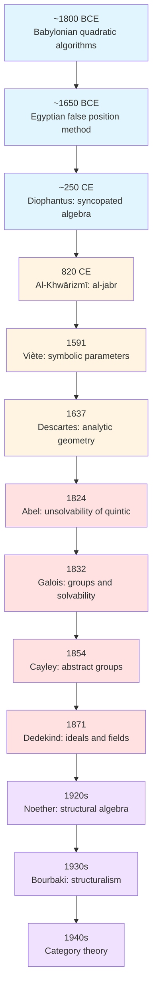
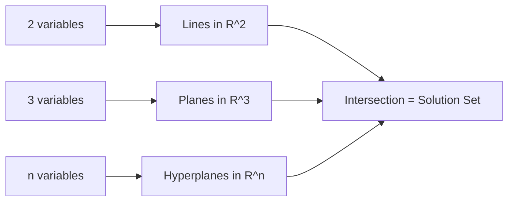
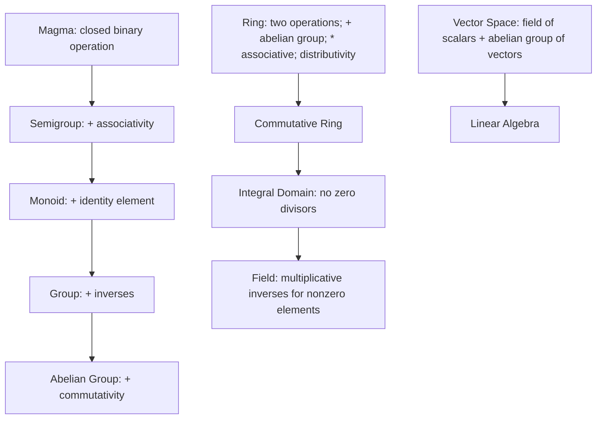

---
title: Algebra: Nature, Evolution & Structure
aliases:
  - Abstract Algebra
  - Elementary Algebra
  - Classical Algebra
  - Modern Algebra
  - History of Algebra
  - Algebraic Thought
tags:
  - [[Mathematics]]
  - abstract-algebra
  - [[History]]
  - epistemology
  - abstraction
created: 2026-05-10
updated: 2026-05-10
sources:
  - "https://en.wikipedia.org/wiki/Algebra"
  - "https://www.britannica.com/science/algebra/Applications-of-group-theory"
  - "https://www.britannica.com/science/mathematics"

prerequisites:
  - "[[Mathematics: Nature & Evolution]]"
  - "[[Arithmetic]]"
  - "[[Mathematical Logic]]"
  - "[[Basic Set Theory|Set Theory]]"
related:
  - "[[Group Theory]]"
  - "[[Ring Theory]]"
  - "[[Field Theory]]"
  - "[[Galois Theory]]"
  - "[[Linear Algebra]]"
  - "[[Category Theory]]"
---

# ~={red} Notes=~

# Algebra: Nature, Evolution & Structure

> [!INFO] Definition
> **Algebra** is the branch of mathematics concerned with the study of *structure, relation, and generalization*. It evolved from practical techniques for solving unknown quantities into a rigorous discipline of **abstract structures** and **symbolic manipulation**. Its trajectory is defined by an increasing degree of **idealization**: from concrete numerical problems to the classification of algebraic systems themselves.

$$
\text{Algebra} = \lim_{\text{abstraction} \to \infty} \left( \text{Arithmetic} + \text{Logic} + \text{Structural Thinking} \right)
$$

![[Pasted image 20260510134626.png|center|366]]

---

## Part I: The Nature of Algebraic Thought

### The Structure of Algebraic Reasoning

Algebra is not merely equation-solving; it is a logical framework for reasoning about operations and their properties.

* **Symbolic Method**: Algebra replaces specific numbers with variables ($x$, $y$, $a$, $b$) to express general relationships. This enables the formulation of identities such as:
  $$
  (a + b)^{2} = a^{2} + 2ab + b^{2} \quad \text{(valid for all } a, b \text{ in a commutative ring)}
  $$

* **Axiomatic Method**: Modern algebra defines structures by specifying operations and axioms. For example, a **group** $(G, \ast)$ satisfies:
  $$
  \begin{aligned}
  &\text{Closure:} & \forall a, b \in G, \quad a \ast b \in G \\
  &\text{Associativity:} & \forall a, b, c \in G, \quad (a \ast b) \ast c = a \ast (b \ast c) \\
  &\text{Identity:} & \exists e \in G \text{ such that } \forall a \in G, \quad e \ast a = a \ast e = a \\
  &\text{Inverses:} & \forall a \in G, \exists a^{-1} \in G \text{ such that } a \ast a^{-1} = e
  \end{aligned}
  $$

* **Philosophical Basis**: The development of algebra reflects a shift from *computation* to *classification*: asking not "what is the solution?" but "what structures admit solutions, and how are they related?"

### Levels of Abstraction

| Level              | Domain                           | Primary Objects                          | Typical Questions                                    |
| ------------------ | -------------------------------- | ---------------------------------------- | ---------------------------------------------------- |
| Arithmetic         | Concrete numbers                 | $\mathbb{Z}$, $\mathbb{Q}$, $\mathbb{R}$ | Computation, numerical relationships                 |
| Elementary Algebra | Variables over number systems    | Polynomials, equations                   | Solution of equations, expression manipulation       |
| Linear Algebra     | Vector spaces over fields        | Vectors, matrices, linear maps           | Systems of linear equations, transformations         |
| Abstract Algebra   | General algebraic structures     | Groups, rings, fields, modules           | Structural classification, homomorphisms, invariants |
| Universal Algebra  | Classes of algebraic structures  | Varieties, identities, free algebras     | General laws, categorical properties                 |
| Category Theory    | Relationships between structures | Objects, morphisms, functors             | Structural equivalence, universal properties         |

---

## Part II: Historical Evolution & Geography

### 1. Origins & Drivers

* **Practical Roots**: Algebraic techniques arose independently in multiple cultures to serve **commerce**, **land measurement**, and **astronomical calculation**.
* **The Abstraction Threshold**: Significant theoretical progress occurred only when societies developed the conceptual infrastructure to treat operations themselves as objects of study—a transition enabled by symbolic notation and philosophical inquiry.

### 2. The Great Transmission (Ancient to Medieval)

#### [[Mathematics in ancient Mesopotamia|Mesopotamia]]: The Algorithmic Foundation
* **The Medium**: **Clay tablets** (c. 1800–1600 BCE)
* **The Achievement**: Babylonian mathematicians developed sophisticated algorithms for solving quadratic equations, expressed rhetorically (without symbolic variables).
* **Example**: To solve $x^{2} + px = q$, they applied a procedure equivalent to:
  $$
  x = \sqrt{\left(\frac{p}{2}\right)^{2} + q} - \frac{p}{2}
  $$
* **Limitation**: No evidence of general proof or abstract justification; methods were procedural, not theoretical.

![[Pasted image 20260510181846.png|center|370]]

#### [[Ancient Egypt]]: Practical Computation
* **The Medium**: **Papyrus scrolls** (e.g., Rhind Mathematical Papyrus, c. 1650 BCE)
* **The Approach**: Algebra was embedded in concrete problems (division of goods, area calculation). Equations were solved by the method of "false position."
* **Example**: To solve $x + \frac{1}{7}x = 19$, they guessed $x = 7$, computed $7 + 1 = 8$, then scaled: $x = 7 \cdot \frac{19}{8}$.
* **Limitation**: No symbolic representation; each problem was treated individually.

![[Pasted image 20260510185050.png|center|485]]

#### [[Ancient Greece]]: The Geometric Sublimation
* **The Shift**: Greek mathematicians, particularly in the Alexandrian tradition, subsumed algebraic problems into **geometry**.
* **Diophantus** (c. 250 CE): In *Arithmetica*, introduced syncopated notation (abbreviated words for unknowns) and studied indeterminate equations.
  $$
  \text{Example: Find } x, y \in \mathbb{Q} \text{ such that } x^{2} + y^{2} = z^{2}
  $$
* **The Gap**: No original Greek algebraic manuscripts survive; knowledge is reconstructed from later commentaries and translations.

#### [[Scribes & Knowledge Transmission|Islamic Golden Age]]: Synthesis and Symbolic Birth
* **The Catalyst**: From the 9th–15th centuries, Islamic scholars synthesized Greek geometry, Indian numerals, and Persian astronomy.
* **Al-Khwārizmī** (c. 820 CE): In *Al-Kitāb al-Mukhtaṣar fī Ḥisāb al-Jabr wal-Muqābalah*, established algebra as an independent discipline.![[Pasted image 20260510184755.png|right]]
  - **Al-jabr** (الجبر): "Restoration" (moving subtracted terms to the other side)
  - **Al-muqābala**: "Balancing" (canceling like terms)
  - Solved linear and quadratic equations geometrically, but with rhetorical algebra.
* **Later Developments**:
  - **Omar Khayyam** (11th c.): Classified cubic equations and solved them via conic sections.
  - **Al-Karajī** (10th c.): Began freeing algebra from geometric justification, introducing arithmetic of polynomials.
  - **Ibn al-Bannā** (13th c.): Used symbolic abbreviations for powers and operations.

 

> [!tldr]
>  Al-Khwarizmi, considered the 'father of algebra' for systematizing algebra as an independent mathematical discipline
>  
>  ![[Pasted image 20260510185121.png|center]]

> [!QUOTE] Transmission Pathway
> Greek geometry + Indian numerals + Persian astronomy + Islamic synthesis → Latin translations (12th c.) → European algebra

![[Pasted image 20260510184442.png|center|355]]

### 3. The European Transformation (16th–19th Centuries)

The Italian mathematician [Fibonacci](https://en.wikipedia.org/wiki/Fibonacci "Fibonacci") brought al-Khwarizmi's ideas and techniques to Europe in books including his _[Liber Abaci](https://en.wikipedia.org/wiki/Liber_Abaci "Liber Abaci")_.
#### Symbolic Revolution
* **Viète** (1591): Introduced systematic use of letters for knowns ($a, b, c$) and unknowns ($x, y, z$), enabling general formulae:
  $$
  ax^{2} + bx + c = 0 \implies x = \frac{-b \pm \sqrt{b^{2} - 4ac}}{2a}
  $$
* **Descartes** (1637): Unified algebra and geometry via coordinate systems, founding analytic geometry.

![[Pasted image 20260510185253.png|center|407]]

#### The Solvability Crisis
* **Cubic and Quartic Formulas** (1545): Cardano, Tartaglia, and Ferrari published general solutions, but no pattern emerged for higher degrees.
* **Lagrange** (1770): Analyzed why previous methods worked, introducing permutations of roots—early group-theoretic thinking.
* **Abel** (1824) and **Galois** (1832): Proved no general solution in radicals exists for degree $\geq 5$, and established the connection between field extensions and permutation groups:
  $$
  \text{Polynomial solvable by radicals} \iff \operatorname{Gal}(f) \text{ is a solvable group}
  $$

#### Structural Abstraction (19th Century)
* **Gauss**: Modular arithmetic and congruences ($a \equiv b \pmod{n}$) as algebraic structures.
* **Hamilton** (1843): Quaternions $\mathbb{H}$, demonstrating non-commutative algebra.
* **Cayley** (1854): First abstract definition of a group via multiplication tables.
* **Dedekind** (1871): Introduced ideals to restore unique factorization in algebraic number fields.
* **Noether** (1920s): Axiomatized ring and module theory, establishing the structuralist paradigm.

### 4. The Modern Era (20th Century–Present)

* **Bourbaki** (1930s–): Sought to rebuild mathematics on set-theoretic foundations with emphasis on structures (groups, rings, fields, modules).
* **Category Theory** (1940s–): Shifted focus from objects to morphisms, providing a language for comparing algebraic structures.
* **Computational Algebra**: Algorithmic methods (Gröbner bases, computer algebra systems) enable exploration of previously intractable problems.

---

## Part III: Elementary Algebra

### 3.1 Core Concepts

Elementary algebra extends arithmetic by introducing **variables**—symbols representing unspecified or unknown quantities—to express general relationships and solve equations.

> [!definition] Algebraic Expression
> An **algebraic expression** is a finite combination of constants, variables, and operations. Example: $5x^{2} + 3xy - 7$.
> 
> ![[Pasted image 20260510190912.png|center|300]]

> [!definition] Equation
> An **equation** is a statement asserting equality between two expressions. Example: $2x + 5 = 13$.

> [!definition] Identity vs. Conditional Equation
> - An **identity** is an equation true for all admissible values of its variables. Example: $a(b + c) = ab + ac$.
> - A **conditional equation** is true only for specific values. Example: $x^{2} = 4$ holds if and only if $x \in \{-2, 2\}$.

### 3.2 Polynomials

> [!definition] Polynomial
> A **polynomial** in variables $x_{1}, \ldots, x_{n}$ is a finite sum of terms of the form $c \cdot x_{1}^{e_{1}} \cdots x_{n}^{e_{n}}$, where $c$ is a constant coefficient and each $e_{i} \in \mathbb{Z}_{\geq 0}$.
> **Example:**
> $$x^{4}+3xy^{2}+5x^{3}-1$$

> [!definition] Degree
> The **degree** of a polynomial is the maximum sum of exponents appearing in any term.

> [!theorem] Fundamental Theorem of Algebra
> Every non-constant univariate polynomial with complex coefficients has at least one complex root. Consequently, every such polynomial factors into linear factors over $\mathbb{C}$.
> 
> Basically, Degree of polynomial = Number of roots

> [!theorem] Abel–Ruffini Theorem
> There exists no general solution in radicals for polynomial equations of degree five or higher. 
> No universal formula exist for such equations.

> [!example] Factorization Strategy
> To solve $p(x) = 0$, factor $p(x)$ into irreducible components over the relevant field:
> $$
> x^{2} - 3x - 10 = (x + 2)(x - 5) \implies x \in \{-2, 5\}
> $$

---

## Part IV: Linear Algebra

### 4.1 Systems of Linear Equations

> [!definition] Linear Equation
> A **linear equation** in $n$ variables has the form:
> $$
> a_{1}x_{1} + a_{2}x_{2} + \cdots + a_{n}x_{n} = b
> $$
> where $a_{i}, b$ belong to a field $F$.

A system of $m$ such equations may be represented in matrix form:
$$
A\vec{x} = \vec{b}
$$
where $A \in M_{m \times n}(F)$, $\vec{x} \in F^{n}$, and $\vec{b} \in F^{m}$.

### 4.2 Solution Methods

| Method | Applicability | Computational Complexity | Notes |
|--------|--------------|-------------------------|-------|
| Substitution | Small systems ($n \leq 3$) | $O(n^{2})$ | Pedagogical clarity |
| Gaussian Elimination | General systems | $O(n^{3})$ | Standard algorithm; yields row-echelon form |
| LU Decomposition | Multiple right-hand sides | $O(n^{3})$ preprocessing, $O(n^{2})$ per solve | Efficient for repeated solves |
| Cramer's Rule | Theoretical analysis | $O(n!)$ | Computationally impractical for $n > 4$ |
| Iterative Methods | Large sparse systems | Depends on convergence | Jacobi, Gauss–Seidel, conjugate gradient |

### 4.3 Vector Spaces and Linear Maps

> [!definition] Vector Space
> A **vector space** $V$ over a field $F$ is an abelian group $(V, +)$ equipped with scalar multiplication $F \times V \to V$ satisfying:
> $$
> \begin{aligned}
> \alpha(u + v) &= \alpha u + \alpha v \\
> (\alpha + \beta)v &= \alpha v + \beta v \\
> (\alpha \beta)v &= \alpha(\beta v) \\
> 1_{F} \cdot v &= v
> \end{aligned}
> $$
> for all $\alpha, \beta \in F$ and $u, v \in V$.

> [!definition] Linear Map
> A **linear map** $T : V \to W$ between vector spaces over $F$ satisfies:
> $$
> \begin{aligned}
> T(u + v) &= T(u) + T(v) \\
> T(\alpha v) &= \alpha T(v)
> \end{aligned}
> $$
> for all $\alpha \in F$, $u, v \in V$.

In finite dimensions, linear maps correspond to matrices relative to chosen bases.

### 4.4 Geometric Interpretation

Each linear equation in $\mathbb{R}^{n}$ defines a hyperplane. The solution set of a system is the intersection of the corresponding hyperplanes.

---

## Part V: Abstract Algebra

### 5.1 Structural Hierarchy

### 5.2 Group Theory

> [!definition] Group
> A **group** is a pair $(G, \circ)$ where $G$ is a set and $\circ : G \times G \to G$ is a binary operation satisfying:
> 1. **Closure**: $\forall a, b \in G$, $a \circ b \in G$
> 2. **Associativity**: $\forall a, b, c \in G$, $(a \circ b) \circ c = a \circ (b \circ c)$
> 3. **Identity**: $\exists e \in G$ such that $\forall a \in G$, $e \circ a = a \circ e = a$
> 4. **Inverses**: $\forall a \in G$, $\exists a^{-1} \in G$ such that $a \circ a^{-1} = a^{-1} \circ a = e$

> [!definition] Group Homomorphism
> Let $(G, \circ)$ and $(H, \ast)$ be groups. A map $\varphi : G \to H$ is a **homomorphism** if:
> $$
> \forall a, b \in G, \quad \varphi(a \circ b) = \varphi(a) \ast \varphi(b)
> $$

> [!definition] Kernel and Image
> For a homomorphism $\varphi : G \to H$:
> $$
> \begin{aligned}
> \ker(\varphi) &= \{ g \in G \mid \varphi(g) = e_{H} \} \\
> \operatorname{im}(\varphi) &= \{ h \in H \mid \exists g \in G : \varphi(g) = h \}
> \end{aligned}
> $$

> [!theorem] First Isomorphism Theorem for Groups
> If $\varphi : G \to H$ is a group homomorphism, then:
> $$
> G / \ker(\varphi) \cong \operatorname{im}(\varphi)
> $$

**Examples**:
- $(\mathbb{Z}, +)$: integers under addition
- $(\mathbb{R} \setminus \{0\}, \times)$: nonzero reals under multiplication
- $S_{n}$: symmetric group on $n$ elements (permutations under composition)
- $D_{n}$: dihedral group of symmetries of a regular $n$-gon

### 5.3 Ring Theory

> [!definition] Ring
> A **ring** is a triple $(R, +, \cdot)$ such that:
> - $(R, +)$ is an abelian group
> - $(R, \cdot)$ is a semigroup (associative multiplication)
> - **Distributivity**: $\forall a, b, c \in R$,
>   $$
>   \begin{aligned}
>   a(b + c) &= ab + ac \\
>   (b + c)a &= ba + ca
>   \end{aligned}
>   $$
> - Optional: multiplicative identity $1$ (ring with unity)

> [!definition] Ring Homomorphism
> Let $(R, +_{R}, \cdot_{R})$ and $(S, +_{S}, \cdot_{S})$ be rings. A map $\psi : R \to S$ is a **ring homomorphism** if:
> $$
> \begin{aligned}
> \psi(a +_{R} b) &= \psi(a) +_{S} \psi(b) \\
> \psi(a \cdot_{R} b) &= \psi(a) \cdot_{S} \psi(b) \\
> \psi(1_{R}) &= 1_{S} \quad \text{(if rings have unity)}
> \end{aligned}
> $$

**Special Classes**:
- **Commutative ring**: $ab = ba$ for all $a, b \in R$
- **Integral domain**: commutative ring with no zero divisors ($ab = 0 \implies a = 0 \text{ or } b = 0$)
- **Field**: commutative ring with unity in which every nonzero element has a multiplicative inverse

Note: $\mathbb{Z}$ is an integral domain but not a field; $\mathbb{Q}$, $\mathbb{R}$, and $\mathbb{C}$ are fields.

### 5.4 Field Theory

> [!definition] Field
> A **field** is a commutative ring with unity in which every nonzero element is invertible under multiplication. Formally, $(F, +, \cdot)$ is a field if:
> - $(F, +)$ is an abelian group with identity $0$
> - $(F \setminus \{0\}, \cdot)$ is an abelian group with identity $1$
> - Distributivity holds

> [!definition] Field Extension
> If $F \subseteq K$ and both are fields, $K$ is an **extension field** of $F$, denoted $K/F$.

> [!definition] Algebraic Element
> An element $\alpha \in K$ is **algebraic over $F$** if there exists a nonzero polynomial $p(x) \in F[x]$ with $p(\alpha) = 0$.

> [!definition] Galois Group
> For a field extension $K/F$, the **Galois group** is:
> $$
> \operatorname{Gal}(K/F) = \{ \sigma : K \to K \mid \sigma \text{ is a field automorphism and } \sigma(a) = a \; \forall a \in F \}
> $$

---

## Part VI: Applications of Group Theory

### 6.1 Geometry: Klein's Erlangen Program (1872)

> [!quote] Klein's Principle
> "Geometry is the study of properties invariant under a specified group of transformations."

| Geometry | Transformation Group | Invariant Properties |
|----------|---------------------|-------------------|
| Euclidean | $E(n) = O(n) \ltimes \mathbb{R}^{n}$ | Distance, angle, area, parallelism |
| Affine | $\operatorname{Aff}(n) = \operatorname{GL}(n, \mathbb{R}) \ltimes \mathbb{R}^{n}$ | Parallelism, ratios of lengths along parallel lines |
| Projective | $\operatorname{PGL}(n+1, \mathbb{R})$ | Collinearity, cross-ratio, incidence |
| Topological | Homeomorphisms | Continuity, connectedness, compactness |

> [!example] Rotation Group $SO(2)$
> The special orthogonal group in dimension 2:
> $$
> SO(2) = \left\{ \begin{pmatrix} \cos \theta & -\sin \theta \\ \sin \theta & \cos \theta \end{pmatrix} : \theta \in [0, 2\pi) \right\}
> $$
> This group acts on $\mathbb{R}^{2}$ by rotation and preserves Euclidean distance.

### 6.2 Number Theory

> [!theorem] Gauss and Modular Arithmetic
> The integers modulo $n$, denoted $\mathbb{Z}/n\mathbb{Z}$, form a cyclic group under addition. The multiplicative group $(\mathbb{Z}/n\mathbb{Z})^{\times}$ consists of residue classes coprime to $n$.

> [!definition] Ideal
> Let $R$ be a commutative ring. A subset $I \subseteq R$ is an **ideal** if:
> - $(I, +)$ is a subgroup of $(R, +)$
> - $\forall r \in R, \forall i \in I$: $ri \in I$

> [!example] Failure of Unique Factorization in $\mathbb{Z}[\sqrt{-5}]$
> In the ring $\mathbb{Z}[\sqrt{-5}] = \{ a + b\sqrt{-5} \mid a, b \in \mathbb{Z} \}$:
> $$
> 21 = 3 \cdot 7 = (4 + \sqrt{-5})(4 - \sqrt{-5})
> $$
> All four factors are irreducible, but $3$ divides the product without dividing either factor. This motivates ideal theory: the principal ideal $(3)$ factors uniquely into prime ideals:
> $$
> (3) = \mathfrak{p}_{1} \mathfrak{p}_{2}
> $$

### 6.3 Cryptography

> [!definition] Discrete Logarithm Problem
> Let $G$ be a cyclic group of order $n$ with generator $g$. Given $h \in G$, the **discrete logarithm problem** is to find $x \in \{0, 1, \ldots, n-1\}$ such that:
> $$
> g^{x} = h
> $$

> [!application] Diffie–Hellman Key Exchange
> Two parties agree on a cyclic group $G$ and generator $g$. Each selects a private exponent ($a$ and $b$), computes $g^{a}$ and $g^{b}$, and exchanges these values. The shared secret is $g^{ab}$, which an eavesdropper cannot compute efficiently without solving the discrete logarithm problem.

---

## Part VII: Structural Tools and Constructions

### 7.1 Homomorphisms and Quotients

> [!theorem] First Isomorphism Theorem (General Form)
> Let $\varphi : A \to B$ be a homomorphism of algebraic structures of the same type. Then:
> $$
> A / \ker(\varphi) \cong \operatorname{im}(\varphi)
> $$
> where $\ker(\varphi)$ is the appropriate congruence relation (normal subgroup, ideal, etc.).

> [!definition] Quotient Structures
> - **Quotient group**: $G/N$ for $N \trianglelefteq G$, with operation $(aN)(bN) = (ab)N$
> - **Quotient ring**: $R/I$ for $I$ an ideal of $R$, with operations $(a+I)+(b+I) = (a+b)+I$ and $(a+I)(b+I) = ab+I$
> - **Quotient vector space**: $V/W$ for $W$ a subspace of $V$, with $(v+W)+(u+W) = (v+u)+W$ and $\alpha(v+W) = \alpha v + W$

### 7.2 Substructures

| Structure | Definition | Example |
|-----------|------------|---------|
| Subgroup | $H \subseteq G$ closed under $\circ$ and inverses | $2\mathbb{Z} \subset \mathbb{Z}$ |
| Ideal | $I \subseteq R$ additive subgroup with $r i \in I$ for all $r \in R, i \in I$ | $n\mathbb{Z} \trianglelefteq \mathbb{Z}$ |
| Subfield | $K \subseteq F$ where both are fields | $\mathbb{Q} \subset \mathbb{R}$ |
| Subspace | $W \subseteq V$ closed under addition and scalar multiplication | $\operatorname{span}\{(1,0)\} \subset \mathbb{R}^{2}$ |

---

## Part VIII: The Nature of Algebraic Sources: Evidence & Lacunae

> [!ABSTRACT] The Core Problem
> Our understanding of algebra's history is mediated by the **material conditions of transmission**: the durability of writing media, the politics of translation, and the selective preservation of texts. These factors create "epistemic shadows"—periods where innovation likely occurred but left no direct trace.

### 8.1 The Ancient Record: Clay, Papyrus, and Loss

#### Mesopotamian Tablets
* **Advantage**: Clay tablets survive in large numbers; many contain sophisticated algorithms.
* **Limitation**: Rhetorical presentation obscures whether practitioners recognized general principles. No evidence of deductive proof.
* **Example**: Plimpton 322 (c. 1800 BCE) lists Pythagorean triples, but whether this reflects theoretical understanding or empirical generation remains debated.

#### Egyptian Papyri
* **Disadvantage**: Papyrus decays in humid climates; only a handful of mathematical texts survive.
* **Consequence**: Egyptian algebra appears more elementary than it may have been; loss of context impedes assessment of theoretical depth.

#### Greek Manuscripts: The 1,300-Year Gap
* **Critical Fact**: No original Greek mathematical manuscripts survive from the classical period (5th–4th c. BCE).
* **Euclid's Elements**: Oldest complete manuscripts date to the 10th century CE (Byzantine era).
  $$
  \text{Composition: c. 300 BCE} \quad \longrightarrow \quad \text{Oldest Copy: c. 900 CE}
  $$
* **Implication**: Claims about Greek algebraic thought (e.g., geometric algebra) rely on later commentaries (Proclus, Pappus) and Arabic translations, introducing interpretive layers.

![[Pasted image 20260510222741.png|center|424]]

### 8.2 The Islamic Transmission: Translation as Transformation

* **Early Period (8th–10th c.)**: Many Greek and Indian works survive only in Arabic translation; original versions are lost.
  - *Challenge*: Distinguishing translation from innovation is often impossible.
* **Later Period (11th–15th c.)**: Vast output of original treatises; most remain unstudied or exist in single manuscripts.
  - *Consequence*: The "European Renaissance" in algebra may have drawn on Islamic sources whose full scope is still being recovered.

> [!WARNING] The Translation Filter
> When a text is translated, notation, emphasis, and even conceptual framing may shift. For example:
> - Greek geometric proofs were often re-expressed rhetorically in Arabic.
> - Indian decimal notation was adapted to Arabic script, altering computational practices.
> These transformations are not neutral; they shape the algebra that reaches later audiences.

### 8.3 The European Print Revolution: Abundance and Selection

* **Advantage**: Printing (post-1450) ensured wider dissemination and preservation.
* **New Problems**:
  1. **Volume**: The exponential growth of algebraic literature means historians must select which works to study, potentially overlooking minor but influential contributions.
  2. **Canon Formation**: The "great names" narrative (Viète, Descartes, Galois) may obscure collaborative or incremental developments.
  3. **Conceptual Anachronism**: Reading modern definitions into historical texts risks misrepresenting past intentions.

### 8.4 Modern Challenges: Digital Access and Interdisciplinarity

* **Digitization**: Projects like the *Digital Library of Mathematical Functions* and *Euclid* archive improve access but require new scholarly skills.
* **Interdisciplinary Gaps**: Historians of mathematics, philologists, and computer scientists often work in isolation, limiting synthetic understanding.
* **The Abstraction Paradox**: As algebra becomes more abstract, its historical development becomes harder to narrate without oversimplifying technical content.

---

## Part IX: Foundational Definitions in Historical Context

> [!definition] Variable
> A symbol representing an unspecified quantity. Historically:
> - Babylonians: rhetorical "the thing" ($\text{šā}$)
> - Diophantus: $\varsigma$ (final sigma for "number")
> - Viète: vowels for unknowns, consonants for parameters
> - Descartes: $x, y, z$ for unknowns; $a, b, c$ for knowns

> [!definition] Equation
> A statement of equality between expressions. Evolution:
> $$
> \begin{aligned}
> &\text{Rhetorical: } \text{"A square and ten roots equal 39"} \quad \text{(al-Khwārizmī)} \\
> &\text{Syncopated: } \varsigma^{2} + 10\varsigma = 39 \quad \text{(Diophantus)} \\
> &\text{Symbolic: } x^{2} + 10x = 39 \quad \text{(post-Viète)}
> \end{aligned}
> $$

> [!definition] Group
> A set with an associative binary operation, identity, and inverses. Historical emergence:
> - Lagrange (1770): Permutations of roots
> - Galois (1832): Groups as tools for solvability
> - Cayley (1854): Abstract definition independent of permutations
> - Noether (1920s): Groups as one structure among many in universal algebra

> [!definition] Ring
> A set with two operations satisfying distributivity. Historical path:
> - Dedekind (1871): Ideals in algebraic number fields
> - Hilbert (1897): Axiomatic treatment of number rings
> - Noether (1921): General definition with ascending chain condition

---

## Part X: Core Branches: A Historical Taxonomy

| Branch | Emergence | Central Question | Key Structures |
|--------|-----------|-----------------|----------------|
| **Elementary Algebra** | 9th–16th c. | How to solve equations with unknowns? | Polynomials, rational expressions |
| **Linear Algebra** | 17th–19th c. | How to solve systems of linear relations? | Vector spaces, matrices, linear maps |
| **Abstract Algebra** | 19th–20th c. | What structures admit algebraic operations, and how are they classified? | Groups, rings, fields, modules |
| **Commutative Algebra** | Late 19th c. | How do ideals and modules behave in commutative settings? | Noetherian rings, localization, dimension theory |
| **Homological Algebra** | Mid-20th c. | How to measure the failure of exactness in algebraic constructions? | Chain complexes, derived functors, Ext/Tor |
| **Category Theory** | 1940s– | How to formalize relationships between algebraic structures? | Categories, functors, natural transformations, adjunctions |

---

## Part XI: Review Questions

### Historical and Conceptual

1. Compare the rhetorical algebra of al-Khwārizmī with the symbolic algebra of Viète. What conceptual advances does symbolic notation enable?
2. Why did Greek mathematicians prefer geometric proofs over algebraic manipulation? How did this preference shape the transmission of algebraic ideas?
3. Explain how the materiality of writing media (clay, papyrus, parchment, paper) influenced the historical record of algebra.
4. Trace the evolution of the concept of "solution" from Babylonian algorithms to Galois theory.
5. How did the failure of unique factorization in $\mathbb{Z}[\sqrt{-5}]$ motivate the development of ideal theory?

### Technical and Structural

6. State the four group axioms. Provide an example of a non-abelian group and verify the axioms.
7. Explain why $\mathbb{Z}$ is not a field. What is the smallest field containing $\mathbb{Z}$?
8. Describe how Klein's Erlangen Program classifies geometries. Give two examples with their associated transformation groups.
9. Define a ring homomorphism. Prove that the kernel of a ring homomorphism is an ideal.
10. State the First Isomorphism Theorem for groups and explain its significance.

> [!solution] Question 1
> Al-Khwārizmī expressed equations in full prose, requiring separate procedures for each equation type. Viète's use of letters for parameters enabled general formulae (e.g., the quadratic formula) and the manipulation of equations as objects. This shift allowed algebra to become a theory of operations, not just a toolkit for problems.

> [!solution] Question 2
> Greek mathematics privileged geometry due to philosophical commitments to spatial intuition and deductive certainty. Algebraic symbolism was absent, so equations were solved via geometric constructions (e.g., completing the square as area manipulation). This delayed the development of abstract algebra but preserved rigorous proof standards.

> [!solution] Question 3
> Clay tablets survive well but are heavy and localized; papyrus decays except in arid climates; parchment is durable but expensive; paper enabled mass production. Each medium shaped what was recorded, how widely it circulated, and what survived. The loss of Greek papyri, for instance, obscures potential algebraic developments.

> [!solution] Question 4
> Babylonians: algorithmic procedures for specific forms. Greeks: geometric existence proofs. Islamic scholars: classification of equation types. Renaissance: general formulae for degrees 3–4. Galois: solvability determined by group structure, not formulae. The concept shifted from "finding a number" to "characterizing the structure of solutions."

> [!solution] Question 5
> In $\mathbb{Z}[\sqrt{-5}]$, $21 = 3 \cdot 7 = (4 + \sqrt{-5})(4 - \sqrt{-5})$ with all factors irreducible but not prime. Dedekind observed that while elements fail to factor uniquely, *ideals* do: $(3) = \mathfrak{p}_{1}\mathfrak{p}_{2}$. This led to the definition of ideals as the proper objects of factorization theory.

> [!solution] Question 6
> The four group axioms are closure, associativity, identity, and inverses. Example: $S_{3}$, the symmetric group on three elements. Non-commutativity: $(1\;2)(1\;3) = (1\;3\;2) \neq (1\;2\;3) = (1\;3)(1\;2)$.

> [!solution] Question 7
> Elements such as $2 \in \mathbb{Z}$ lack multiplicative inverses in $\mathbb{Z}$. The field of fractions of $\mathbb{Z}$ is $\mathbb{Q}$, the smallest field containing $\mathbb{Z}$.

> [!solution] Question 8
> Each geometry corresponds to a transformation group; properties preserved by the group define the geometry. Euclidean: $E(2)$ preserves distance; Projective: $\operatorname{PGL}(3, \mathbb{R})$ preserves collinearity.

> [!solution] Question 9
> A ring homomorphism $\psi : R \to S$ satisfies $\psi(a+b) = \psi(a)+\psi(b)$, $\psi(ab) = \psi(a)\psi(b)$, and $\psi(1_{R}) = 1_{S}$. If $a, b \in \ker(\psi)$, then $\psi(a-b) = 0$, so $a-b \in \ker(\psi)$. For $r \in R$, $\psi(ra) = \psi(r)\psi(a) = 0$, so $ra \in \ker(\psi)$. Thus $\ker(\psi)$ is an ideal. $\blacksquare$

> [!solution] Question 10
> If $\varphi : G \to H$ is a group homomorphism, then $G / \ker(\varphi) \cong \operatorname{im}(\varphi)$. This theorem establishes that every homomorphic image of a group is isomorphic to a quotient of that group, providing a fundamental classification tool. $\blacksquare$

---

## Part XII: Related Concepts and Cross-References

- [[Polynomials]] • [[Equations|Equation Solving]] • [[Polynomials|Factorization]]
- [[Matrix Algebra]] • [[Determinant]] • [[Eigenvalues and Eigenvectors]]
- [[Group Theory]] • [[Ring Theory]] • [[Field Theory]] • [[Galois Theory]]
- [[Module Theory]] • [[Homological Algebra]] • [[Commutative Algebra]]
- [[Category Theory]] • [[Universal Algebra]]
- [[Mathematical Structures]] • [[Philosophy of Mathematics]]

---

## ~={red}References=~

**Primary Historical Sources**:
- al-Khwārizmī, Muḥammad ibn Mūsā. *Al-Kitāb al-Mukhtaṣar fī Ḥisāb al-Jabr wal-Muqābalah*. c. 820 CE.
- Diophantus. *Arithmetica*. c. 250 CE.
- Viète, François. *In artem analyticem isagoge*. 1591.
- Galois, Évariste. *Mémoire sur les conditions de résolubilité des équations par radicaux*. 1832.

**Primary Mathematical Sources**:
- Corry, L. "Algebra." *Encyclopædia Britannica*, 2026.
- "Algebra." *Wikipedia*, 2026.

**Textbooks**:
- Dummit, D. S., & Foote, R. M. *Abstract Algebra*, 3rd ed. Wiley, 2004.
- Lang, S. *Algebra*, 3rd ed. Springer, 2002.
- Axler, S. *Linear Algebra Done Right*, 3rd ed. Springer, 2015.

**Historical and Conceptual Scholarship**:
- Kleiner, I. *A History of Abstract Algebra*. Birkhäuser, 2007.
- van der Waerden, B. L. *A History of Algebra: From al-Khwarizmi to Emmy Noether*. Springer, 1985.
- Corry, L. *Modern Algebra and the Rise of Mathematical Structures*. Birkhäuser, 2004.
- Joseph, G. G. *The Crest of the Peacock: Non-European Roots of Mathematics*. Princeton University Press, 2011.

**Online Resources**:
- MacTutor History of Mathematics Archive: https://mathshistory.st-andrews.ac.uk/HistTopics/Algebra/
- nLab: "Algebra" (category-theoretic perspective): https://ncatlab.org/nlab/show/algebra
- MIT OpenCourseWare: Algebra I and II lecture notes
- 3Blue1Brown: "Essence of Linear Algebra" video series
- Internet Archive: Digitized historical algebra texts
