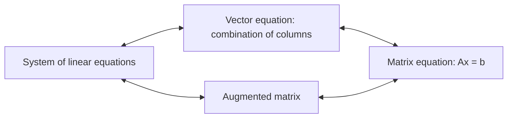
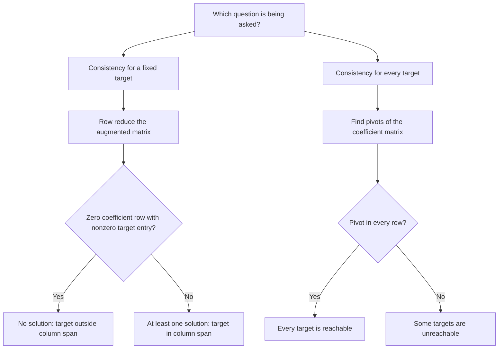

# 2.3 Matrix Equations

**Related:** [[MOC — Linear Algebra]] · [[Vectors and Core Operations]] · [[Matrices and Systems of Linear Equations]] · [[Spaces of Vectors]] · [[The Complete Solution to Ax=b]]

## 1. Learning Objectives and Notation

- Translate between a **linear system**, an **augmented matrix**, a **vector equation**, and a **matrix equation**.
- Compute a matrix-vector product by **column combinations** and by the **row-column rule**.
- Determine which target vectors make a matrix equation consistent.
- Recognize when a matrix equation is solvable for **every** target vector.
- Interpret consistency geometrically through the **span of the columns**.

| Symbol | Meaning | Size / domain |
| --- | --- | --- |
| $A=(a_{ij})$ | Coefficient matrix | $m\times n$ |
| $v_j$ | Column $j$ of $A$ | $\mathbb{R}^m$ |
| $r_i$ | Row $i$ of $A$ | $1\times n$ |
| $x=(x_1,\ldots,x_n)^T$ | Unknown coefficient vector | $\mathbb{R}^n$ |
| $b=(b_1,\ldots,b_m)^T$ | Target / right-hand-side vector | $\mathbb{R}^m$ |
| $[A\mid b]$ | Augmented matrix | $m\times(n+1)$ |

> [!warning] Pitfall: Read Dimensions in Order
> The first dimension counts **rows**; the second counts **columns**. The letters themselves are not fixed: an $n\times m$ matrix has $n$ rows and $m$ columns.
> The unknown vector and target vector need not have the same size.

## 2. The Matrix-Vector Product: Column View

> [!info] Definition: Matrix-Vector Product
> Let $A=[v_1\;v_2\;\cdots\;v_n]\in\mathbb{R}^{m\times n}$ and $x\in\mathbb{R}^n$. Define
> $$
> Ax=x_1v_1+x_2v_2+\cdots+x_nv_n=\sum_{j=1}^n x_jv_j.
> $$
> Thus **multiplying by a matrix forms a linear combination of its columns**. The entries of $x$ supply the coefficients.

> [!abstract] Process: Dimension Check
> $$
> \underbrace{A}_{m\times n}\underbrace{x}_{n\times1}
> =\underbrace{Ax}_{m\times1}.
> $$
> The product is defined precisely when the number of entries in $x$ equals the number of columns of $A$. Each column lies in $\mathbb{R}^m$, so their linear combination also lies in $\mathbb{R}^m$.

### 2.1 Complete Numerical Example: Column Combination

> [!example] Application Example: A Rectangular Matrix Times a Vector
> **Source:** pp. 45 and 48.
>
> Set
> $$
> A=\begin{pmatrix}4&5&6\\7&8&9\end{pmatrix},\qquad
> x=\begin{pmatrix}1\\2\\3\end{pmatrix}.
> $$
> Here $m=2$, $n=3$, and the columns are
> $$
> v_1=\begin{pmatrix}4\\7\end{pmatrix},\quad
> v_2=\begin{pmatrix}5\\8\end{pmatrix},\quad
> v_3=\begin{pmatrix}6\\9\end{pmatrix}.
> $$
> The coefficients are $x_1=1$, $x_2=2$, and $x_3=3$. Therefore
> $$
> \begin{aligned}
> Ax&=1\begin{pmatrix}4\\7\end{pmatrix}
> +2\begin{pmatrix}5\\8\end{pmatrix}
> +3\begin{pmatrix}6\\9\end{pmatrix}\\
> &=\begin{pmatrix}4\\7\end{pmatrix}
> +\begin{pmatrix}10\\16\end{pmatrix}
> +\begin{pmatrix}18\\27\end{pmatrix}\\
> &=\begin{pmatrix}4+10+18\\7+16+27\end{pmatrix}
> =\boxed{\begin{pmatrix}32\\50\end{pmatrix}}.
> \end{aligned}
> $$
> **Interpretation:** three scalar coefficients combine three vectors in $\mathbb{R}^2$ to produce one vector in $\mathbb{R}^2$.

### 2.2 Linearity

> [!info] Theorem: Properties of the Matrix-Vector Product
> For $A\in\mathbb{R}^{m\times n}$, $u,v\in\mathbb{R}^n$, and $c\in\mathbb{R}$:
> $$
> \begin{aligned}
> A(u+v)&=Au+Av,\\
> A(cu)&=cAu.
> \end{aligned}
> $$

**Derivation from the column definition:**

$$
\begin{aligned}
A(u+v)
&=\sum_{j=1}^n(u_j+v_j)a_j\\
&=\sum_{j=1}^nu_ja_j+\sum_{j=1}^nv_ja_j
=Au+Av,\\
A(cu)&=\sum_{j=1}^n(cu_j)a_j
=c\sum_{j=1}^nu_ja_j=cAu.
\end{aligned}
$$

Here $a_j$ denotes column $j$ of $A$, while $u_j$ and $v_j$ denote entries of the input vectors $u$ and $v$.

## 3. Matrix Equations and Vector Equations

> [!info] Definition: Matrix Equation
> A **matrix equation** has the form
> $$Ax=b,$$
> where $A\in\mathbb{R}^{m\times n}$ and $b\in\mathbb{R}^m$ are given, and the entries of $x\in\mathbb{R}^n$ are unknown.
> A system is **consistent** if it has at least one solution; otherwise it is **inconsistent**.

Two complementary questions organize the subject:

1. **Fix $b$:** which vectors $x$ satisfy $Ax=b$?
2. **Fix $A$:** which vectors $b$ can be obtained as $Ax$?

*The first asks for coefficients; the second asks which targets are reachable.* The source points forward to the rank theorem in §2.9 as the connection between these questions.

> [!abstract] Synthesis: Vector Equation ↔ Matrix Equation
> For $v_1,\ldots,v_n,b\in\mathbb{R}^m$,
> $$
> x_1v_1+\cdots+x_nv_n=b
> \quad\Longleftrightarrow\quad
> \underbrace{\begin{pmatrix}|&&|\\v_1&\cdots&v_n\\|&&|\end{pmatrix}}_{A}
> \underbrace{\begin{pmatrix}x_1\\\vdots\\x_n\end{pmatrix}}_x=b.
> $$
> Columns retain their order, and each coefficient remains paired with its corresponding column.

### 3.1 Complete Example: Convert a Vector Equation

> [!example] Application Example: Coefficients Become Entries of the Input Vector
> **Source:** p. 46.
>
> Given $v_1,v_2,v_3\in\mathbb{R}^3$ and
> $$
> 2v_1+3v_2-4v_3=\begin{pmatrix}7\\2\\1\end{pmatrix},
> $$
> define
> $$
> A=[v_1\;v_2\;v_3]\in\mathbb{R}^{3\times3},\qquad
> x=\begin{pmatrix}2\\3\\-4\end{pmatrix},\qquad
> b=\begin{pmatrix}7\\2\\1\end{pmatrix}.
> $$
> Then
> $$
> Ax=[v_1\;v_2\;v_3]\begin{pmatrix}2\\3\\-4\end{pmatrix}
> =2v_1+3v_2-4v_3=b.
> $$
> **Result:** the required matrix equation is $Ax=b$. The source gives no numerical entries for the columns, so $A$ remains expressed in terms of $v_1,v_2,v_3$.

## 4. Four Equivalent Representations of One Linear System

> [!example] Application Example: One System, Four Forms
> **Source:** pp. 46-47.
>
> The unknowns are $x_1,x_2,x_3\in\mathbb{R}$. Define
> $$
> A=\begin{pmatrix}2&3&-2\\1&-1&-3\end{pmatrix},\qquad
> x=\begin{pmatrix}x_1\\x_2\\x_3\end{pmatrix},\qquad
> b=\begin{pmatrix}7\\5\end{pmatrix}.
> $$
>
> **1. System of equations**
> $$
> \begin{aligned}
> 2x_1+3x_2-2x_3&=7,\\
> x_1-x_2-3x_3&=5.
> \end{aligned}
> $$
>
> **2. Augmented matrix**
> $$
> [A\mid b]=\left(\begin{array}{rrr|r}2&3&-2&7\\1&-1&-3&5\end{array}\right).
> $$
>
> **3. Vector equation**
> $$
> x_1\begin{pmatrix}2\\1\end{pmatrix}
> +x_2\begin{pmatrix}3\\-1\end{pmatrix}
> +x_3\begin{pmatrix}-2\\-3\end{pmatrix}
> =\begin{pmatrix}7\\5\end{pmatrix}.
> $$
>
> **4. Matrix equation**
> $$
> \begin{pmatrix}2&3&-2\\1&-1&-3\end{pmatrix}
> \begin{pmatrix}x_1\\x_2\\x_3\end{pmatrix}
> =\begin{pmatrix}7\\5\end{pmatrix}.
> $$
> **All four representations have exactly the same solution set.**

### 4.1 Extended Calculation: Solve the Same System

*Supplement to the source's representation example.* Set the free variable $x_3=t\in\mathbb{R}$. From the second equation,

$$x_1=5+x_2+3t.$$

Substitution into the first equation gives

$$
\begin{aligned}
2(5+x_2+3t)+3x_2-2t&=7,\\
10+5x_2+4t&=7,\\
5x_2&=-3-4t,\\
x_2&=-\frac35-\frac45t,\\
x_1&=5-\frac35-\frac45t+3t
=\frac{22}{5}+\frac{11}{5}t.
\end{aligned}
$$

Thus the common solution set of the four representations is

$$
\boxed{x=\begin{pmatrix}22/5\\-3/5\\0\end{pmatrix}
+t\begin{pmatrix}11/5\\-4/5\\1\end{pmatrix},\qquad t\in\mathbb{R}.}
$$

Verification:

$$
\begin{aligned}
2x_1+3x_2-2x_3
&=\frac{44-9}{5}+\frac{22-12-10}{5}t=7,\\
x_1-x_2-3x_3
&=\frac{22+3}{5}+\frac{11+4-15}{5}t=5.
\end{aligned}
$$

## 5. The Row-Column Rule

> [!info] Definition: Row Vector and Row-Column Product
> A **row vector** is a matrix with one row. For a row vector of length $n$ and a column vector with $n$ entries,
> $$
> \begin{pmatrix}a_1&a_2&\cdots&a_n\end{pmatrix}
> \begin{pmatrix}x_1\\x_2\\\vdots\\x_n\end{pmatrix}
> =a_1x_1+a_2x_2+\cdots+a_nx_n.
> $$
> The result is a **scalar**.

> [!abstract] Process: Compute One Output Entry per Row
> If the rows of $A$ are $r_1,\ldots,r_m$, then
> $$
> Ax=\begin{pmatrix}r_1x\\r_2x\\\vdots\\r_mx\end{pmatrix},
> \qquad (Ax)_i=\sum_{j=1}^n a_{ij}x_j.
> $$
> **Column view:** combine whole vectors. **Row view:** calculate each output coordinate.

> [!example] Application Example: Recompute the Product by Rows
> **Source:** p. 48; same $A$ and $x$ as §2.1.
> $$
> \begin{aligned}
> r_1x&=4\cdot1+5\cdot2+6\cdot3=4+10+18=32,\\
> r_2x&=7\cdot1+8\cdot2+9\cdot3=7+16+27=50,\\
> Ax&=\boxed{\begin{pmatrix}32\\50\end{pmatrix}}.
> \end{aligned}
> $$
> This agrees with $1v_1+2v_2+3v_3$. Both computations use exactly the same products and sums, grouped differently.

## 6. Spans and Consistency

> [!info] Definition: Column Span
> The **span of the columns** is the set of all their linear combinations:
> $$
> \operatorname{Span}\{v_1,\ldots,v_n\}
> =\left\{\sum_{j=1}^n x_jv_j:x_1,\ldots,x_n\in\mathbb{R}\right\}.
> $$
> This is also called the **column space**, denoted $\operatorname{Col}(A)$.

> [!info] Theorem: Spans and Consistency
> $$
> \boxed{Ax=b\text{ is consistent}\iff b\in\operatorname{Span}\{v_1,\ldots,v_n\}.}
> $$

**Complete equivalence chain:**

$$
\begin{aligned}
Ax=b\text{ has a solution}
&\iff \exists x\in\mathbb{R}^n:\ Ax=b\\
&\iff \exists x_1,\ldots,x_n\in\mathbb{R}:\ \sum_{j=1}^nx_jv_j=b\\
&\iff b\text{ is a linear combination of the columns of }A\\
&\iff b\in\operatorname{Col}(A).
\end{aligned}
$$

**Algebraic question:** can the system be solved? **Geometric question:** is the target in the column span?

> ![[Pasted image 20261102220315.png|583]]

## 7. Complete Example: An Inconsistent System

> [!example] Application Example: Target Outside the Column Plane
> **Source:** pp. 48-50.
>
> Let
> $$
> A=\begin{pmatrix}2&1\\-1&0\\1&-1\end{pmatrix},\quad
> v_1=\begin{pmatrix}2\\-1\\1\end{pmatrix},\quad
> v_2=\begin{pmatrix}1\\0\\-1\end{pmatrix},\quad
> b=w=\begin{pmatrix}0\\2\\2\end{pmatrix}.
> $$
> The unknown is $x=(x_1,x_2)^T\in\mathbb{R}^2$. The equation $Ax=b$ asks whether
> $$
> x_1v_1+x_2v_2=w.
> $$
> Geometrically, the columns span a plane through the origin in $\mathbb{R}^3$, and the target lies outside it.

### 7.1 All Row-Reduction Steps

Start with

$$
[A\mid b]=\left(\begin{array}{rr|r}2&1&0\\-1&0&2\\1&-1&2\end{array}\right).
$$

Apply $R_1\leftrightarrow R_2$, followed by $R_1\leftarrow-R_1$:

$$
\left(\begin{array}{rr|r}1&0&-2\\2&1&0\\1&-1&2\end{array}\right).
$$

Apply $R_2\leftarrow R_2-2R_1$ and $R_3\leftarrow R_3-R_1$:

$$
\left(\begin{array}{rr|r}1&0&-2\\0&1&4\\0&-1&4\end{array}\right).
$$

Apply $R_3\leftarrow R_3+R_2$:

$$
\left(\begin{array}{rr|r}1&0&-2\\0&1&4\\0&0&8\end{array}\right).
$$

The third equation already reads $0=8$, so no solution exists. To obtain the exact RREF displayed in the source, apply $R_3\leftarrow\tfrac18R_3$, then $R_1\leftarrow R_1+2R_3$ and $R_2\leftarrow R_2-4R_3$:

$$
\operatorname{rref}[A\mid b]
=\left(\begin{array}{rr|r}1&0&0\\0&1&0\\0&0&1\end{array}\right).
$$

> [!warning] Pitfall: A Pivot in the Augmented Column
> The last row means **$0x_1+0x_2=1$**, not an equation defining a third unknown. The augmented column contains the target, not coefficients of an additional variable.
> Hence $Ax=b$ is **inconsistent** and $w\notin\operatorname{Col}(A)$.

### 7.2 Direct Coordinate Check

The system is

$$
\begin{aligned}
2x_1+x_2&=0,\\
-x_1&=2,\\
x_1-x_2&=2.
\end{aligned}
$$

The second equation gives $x_1=-2$; the first then gives $x_2=4$. But the third left-hand side is $-2-4=-6\ne2$. No coefficients satisfy all three equations.

> ![[Pasted image 20261102220249.png]]
> *(Illustration description: in three-dimensional axes, draw the violet plane spanned by $(2,-1,1)^T$ and $(1,0,-1)^T$. Draw both column vectors from the origin and the target $(0,2,2)^T$ with its endpoint visibly outside the plane. Add a dashed connector from the target to the plane and label the target as unreachable by a linear combination of the two columns. Match the geometric example on source p. 49.)*

## 8. Complete Example: A Consistent System

> [!example] Application Example: Target Inside the Same Column Plane
> **Source:** pp. 50-51.
>
> Keep
> $$
> A=\begin{pmatrix}2&1\\-1&0\\1&-1\end{pmatrix},\quad
> v_1=\begin{pmatrix}2\\-1\\1\end{pmatrix},\quad
> v_2=\begin{pmatrix}1\\0\\-1\end{pmatrix},
> $$
> but change the target to
> $$b=w=\begin{pmatrix}1\\-1\\2\end{pmatrix}.$$
> The unknown is again $x=(x_1,x_2)^T$. Geometrically,
> $$
> v_1-v_2=\begin{pmatrix}2-1\\-1-0\\1-(-1)\end{pmatrix}
> =\begin{pmatrix}1\\-1\\2\end{pmatrix}=w.
> $$
> Thus $w$ lies in the column plane and the expected coefficients are $x_1=1$, $x_2=-1$.

### 8.1 All Row-Reduction Steps

$$
[A\mid b]=\left(\begin{array}{rr|r}2&1&1\\-1&0&-1\\1&-1&2\end{array}\right).
$$

Apply $R_1\leftrightarrow R_2$, then $R_1\leftarrow-R_1$:

$$
\left(\begin{array}{rr|r}1&0&1\\2&1&1\\1&-1&2\end{array}\right).
$$

Apply $R_2\leftarrow R_2-2R_1$ and $R_3\leftarrow R_3-R_1$:

$$
\left(\begin{array}{rr|r}1&0&1\\0&1&-1\\0&-1&1\end{array}\right).
$$

Apply $R_3\leftarrow R_3+R_2$:

$$
\operatorname{rref}[A\mid b]
=\left(\begin{array}{rr|r}1&0&1\\0&1&-1\\0&0&0\end{array}\right).
$$

Therefore

$$\boxed{x=\begin{pmatrix}1\\-1\end{pmatrix}.}$$

There is no free variable: both coefficient columns contain pivots. The solution is unique.

### 8.2 Numerical Verification

$$
\begin{aligned}
Ax
&=\begin{pmatrix}2&1\\-1&0\\1&-1\end{pmatrix}\begin{pmatrix}1\\-1\end{pmatrix}\\
&=\begin{pmatrix}2(1)+1(-1)\\-1(1)+0(-1)\\1(1)-1(-1)\end{pmatrix}
=\begin{pmatrix}1\\-1\\2\end{pmatrix}=b.
\end{aligned}
$$

> ![[Pasted image 20261102220356.png]]
> *(Illustration description: reuse the plane and column vectors of the preceding diagram. Place $(1,-1,2)^T$ inside the plane and construct it by adding $v_1$ to $-v_2$ head to tail. Label the coefficients $1$ and $-1$ and display $w=v_1-v_2$. 

### 8.3 Extended Synthesis: Every Admissible Target for This Matrix

*Supplement derived from the two source examples.* Let $b=(b_1,b_2,b_3)^T$. The first two equations give

$$
\begin{aligned}
-x_1&=b_2 &&\Rightarrow x_1=-b_2,\\
2x_1+x_2&=b_1 &&\Rightarrow x_2=b_1+2b_2.
\end{aligned}
$$

The third equation therefore requires

$$
\begin{aligned}
b_3&=x_1-x_2\\
&=-b_2-(b_1+2b_2)=-b_1-3b_2.
\end{aligned}
$$

Hence the precise plane of admissible targets is

$$
\boxed{\operatorname{Col}(A)
=\left\{b\in\mathbb{R}^3:b_1+3b_2+b_3=0\right\}.}
$$

| Target | Plane test | Conclusion |
| --- | --- | --- |
| $(0,2,2)^T$ | $0+3(2)+2=8\ne0$ | Inconsistent |
| $(1,-1,2)^T$ | $1+3(-1)+2=0$ | Consistent; $x=(1,-1)^T$ |

## 9. When Solutions Exist for Every Target

> [!info] Theorem: Universal Consistency
> Let $A\in\mathbb{R}^{m\times n}$ be a **coefficient matrix**, not an augmented matrix. These conditions are equivalent:
>
> 1. For **every** $b\in\mathbb{R}^m$, the equation $Ax=b$ has a solution.
> 2. The columns of $A$ span all of $\mathbb{R}^m$.
> 3. $A$ has a **pivot position in every row**.
>
> For a fixed matrix, either all three statements hold or all three fail.

### 9.1 Proof: Solvability ↔ Spanning

For each individual target, §6 establishes

$$Ax=b\text{ is consistent}\iff b\in\operatorname{Col}(A).$$

Applying this equivalence to **every** $b\in\mathbb{R}^m$ gives

$$
\bigl(\forall b\in\mathbb{R}^m,\ \exists x\in\mathbb{R}^n:\ Ax=b\bigr)
\iff \operatorname{Col}(A)=\mathbb{R}^m.
$$

### 9.2 Proof: A Pivot in Every Row ⇒ Every Target Works

The source illustrates the coefficient RREF by the schematic matrix

$$
R=\begin{pmatrix}
1&0&\ast&0&\ast\\
0&1&\ast&0&\ast\\
0&0&0&1&\ast
\end{pmatrix}.
$$

Here $\ast$ represents unspecified entries. Applying the same row operations to $[A\mid b]$ gives

$$
\left(\begin{array}{ccccc|c}
1&0&\ast&0&\ast&c_1\\
0&1&\ast&0&\ast&c_2\\
0&0&0&1&\ast&c_3
\end{array}\right),
$$

where $c_1,c_2,c_3$ are the transformed right-hand-side entries. Since every row contains a coefficient pivot, **no row can read $0=c_i\ne0$**. Every target produces a consistent system.

### 9.3 Proof: A Missing Row Pivot ⇒ Some Target Fails

If a row pivot is missing, the coefficient RREF has a zero row; the source uses

$$
R=\begin{pmatrix}
1&0&\ast&0&\ast\\
0&1&\ast&0&\ast\\
0&0&0&0&0
\end{pmatrix}.
$$

A transformed right-hand side may yield

$$
\left(\begin{array}{ccccc|r}
1&0&\ast&0&\ast&0\\
0&1&\ast&0&\ast&0\\
0&0&0&0&0&16
\end{array}\right).
$$

The final equation is $0=16$, which is impossible. The value $16$ is simply a particular nonzero value; any nonzero entry in that position produces a contradiction.

**Why such an original target exists:** write the row operations as an invertible matrix $E$, so $EA=R$. Choose the transformed target $c=(0,0,16)^T$ and define $b=E^{-1}c$. Then $Eb=c$, giving exactly the inconsistent augmented system above. Thus a missing row pivot prevents solvability for **all** targets.

> [!warning] Pitfall: One Target Versus Every Target
> $$
> \begin{aligned}
> \text{Fixed target:}\quad &b\in\operatorname{Col}(A),\\
> \text{Every target:}\quad &\operatorname{Col}(A)=\mathbb{R}^m.
> \end{aligned}
> $$
> A matrix can solve some targets while failing others, as §§7-8 demonstrate. In particular, $Ax=0$ always has the solution $x=0$; this alone says nothing about universal consistency.

> [!warning] Pitfall: Existence Does Not Imply Uniqueness
> A pivot in every **row** guarantees existence for every target. A pivot in every **column** rules out free variables and gives uniqueness whenever a solution exists.
> The theorem's $3\times5$ full-row-pivot schematic has two free variables, so it guarantees existence without uniqueness.

## 10. Geometric Picture and Interactive Demonstrations

The violet region in the source demonstrations represents

$$\{b\in\mathbb{R}^m:\ Ax=b\text{ is consistent}\}=\operatorname{Col}(A).$$

| Demonstration | What to vary | Mathematical meaning |
| --- | --- | --- |
| Three-vector span, p. 44 | Coefficients of three vectors in $\mathbb{R}^3$ | Every point in the highlighted span is a linear combination |
| Inconsistent example, p. 49 | Coefficients of the two columns | No coefficient pair reaches $(0,2,2)^T$ |
| Consistent example, p. 51 | Coefficients of the two columns | Coefficients $(1,-1)^T$ reach $(1,-1,2)^T$ |
| Universal consistency, p. 52 | Target $b$ | Every target remains reachable when the span is the whole output space |
| Failure of universal consistency, p. 52 | Target inside/outside the violet line | Targets on the column line are reachable; targets outside it are not |

> https://textbooks.math.gatech.edu/ila/demos/Axequalsb.html?show=false&closed=true
> ![[Pasted image 20261102220835.png]]

### 10.1 Pivots and Dimension

The source previews the result proved later in §2.7:

$$
\dim\operatorname{Col}(A)=\operatorname{rank}(A)
=\text{number of pivots of }A.
$$

| Number of pivots | Geometry of the column span |
| --- | --- |
| $0$ | Only the origin |
| $1$ | A line through the origin |
| $2$ | A plane through the origin |
| $m$ | All of $\mathbb{R}^m$ |

*The cases may overlap in low-dimensional output spaces: when $m=2$, a two-dimensional plane is the whole output space.*

Since at most one pivot occurs in each column, universal consistency requires $n\ge m$. This dimension condition is **necessary, not sufficient**: dependent columns may still fail to span the output space.

## 11. Exam Workflow and Quick Reference

> [!abstract] Process: Decide Whether a Given Target Is Reachable
> 1. Check $A\in\mathbb{R}^{m\times n}$ and $b\in\mathbb{R}^m$.
> 2. Form $[A\mid b]$ and row reduce.
> 3. If a row has zero coefficients and a nonzero target entry, report **inconsistent**.
> 4. Otherwise express pivot variables in terms of free variables.
> 5. Verify by substitution into $Ax=b$.
> 6. Interpret the conclusion as membership or non-membership in the column span.

| Question                                           | Exact criterion                                       |
| -------------------------------------------------- | ----------------------------------------------------- |
| Is $Ax$ defined?                                   | $x$ has one entry per column of $A$                   |
| What is the output size?                           | One entry per row of $A$                              |
| How is $Ax$ computed by columns?                   | $Ax=\sum_{j=1}^n x_jv_j$                              |
| How is output entry $i$ computed?                  | $(Ax)_i=\sum_{j=1}^n a_{ij}x_j$                       |
| Is a fixed $Ax=b$ consistent?                      | $b\in\operatorname{Col}(A)$                           |
| Is $Ax=b$ consistent for every $b\in\mathbb{R}^m$? | $A$ has a pivot in every row                          |
| How large is the reachable space?                  | Its dimension equals the number of coefficient pivots |

---
# ~={red}References=~
- [[Interactive Linear Algebra — Section 2.3 Matrix Equations.pdf]], §2.3, pp. 44-52 (PDF pp. 1-9).
- **Scope:** all definitions, numerical examples, proof schematics, and interactive captions in the supplied excerpt. Intermediate row operations are expanded; the additional solution in §4.1 and plane characterization in §8.3 are explicitly marked supplements.
