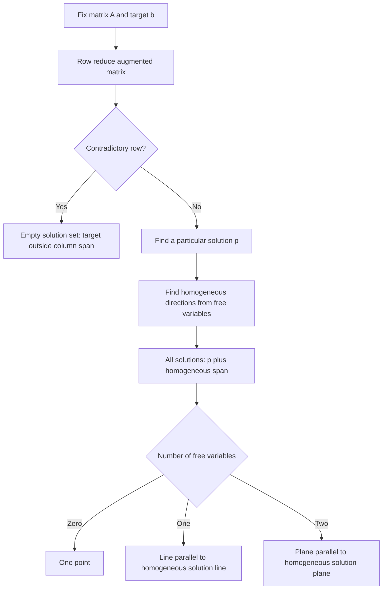

# 2.4 Solution Sets

**Previous:** [[2.3 Matrix Equations]]  
**Related:** [[MOC — Linear Algebra]] · [[The Nullspace of A Solving Ax=0 and Rx=0]] · [[The Complete Solution to Ax=b]] · [[Vector Subspaces]] · [[Independence, Basis and Dimension]]

## 1. Objectives and Notation

- Describe homogeneous solutions as a **span**.
- Convert scalar parametric equations into **parametric vector form**.
- Describe consistent inhomogeneous solutions as a **translated span**.
- Distinguish the **solution set in input space** from the **column span in output space**.

Throughout, $A\in\mathbb{R}^{m\times n}$, $x\in\mathbb{R}^n$, and $b\in\mathbb{R}^m$. Define

$$
S_b=\{x\in\mathbb{R}^n:Ax=b\},\qquad
N(A)=S_0=\{x\in\mathbb{R}^n:Ax=0\}.
$$

The notation $N(A)$ names the **nullspace**. The matrix and target are fixed when studying $S_b$; the unknown input $x$ varies.

## 2. Homogeneous Systems

> [!info] Definition: Homogeneous, Inhomogeneous, and Trivial Solution
> A system $Ax=0$ is **homogeneous**. A system $Ax=b$ with $b\ne0$ is **inhomogeneous**.
> Every homogeneous system has the **trivial solution** $x=0$. Any solution $x\ne0$ is **nontrivial**.

> [!info] Theorem: Existence of Nontrivial Homogeneous Solutions
> $$
> Ax=0\text{ has a nontrivial solution}
> \iff\text{there is a free variable}
> \iff\text{a coefficient column has no pivot}.
> $$
> A free variable can be assigned a nonzero value. Conversely, if every variable is a pivot variable, homogeneous back-substitution forces every variable to be zero.

> [!warning] Pitfall: Homogeneous Does Not Mean Infinitely Many Solutions
> A homogeneous system is always **consistent**, but its solution set may be just $\{0\}$. It has infinitely many real solutions only when at least one variable is free.

### 2.1 Complete Example: No Nontrivial Solutions

> [!example] Application Example: A Homogeneous Solution Set Consisting of One Point
> **Source:** pp. 53-54.
>
> Let
> $$
> A=\begin{pmatrix}1&3&4\\2&-1&2\\1&0&1\end{pmatrix},\qquad
> x=\begin{pmatrix}x_1\\x_2\\x_3\end{pmatrix},\qquad b=0\in\mathbb{R}^3.
> $$
> The system is
> $$
> \begin{aligned}
> x_1+3x_2+4x_3&=0,\\
> 2x_1-x_2+2x_3&=0,\\
> x_1+x_3&=0.
> \end{aligned}
> $$

Start with the augmented matrix:

$$
\left(\begin{array}{rrr|r}1&3&4&0\\2&-1&2&0\\1&0&1&0\end{array}\right).
$$

Apply $R_2\leftarrow R_2-2R_1$ and $R_3\leftarrow R_3-R_1$:

$$
\left(\begin{array}{rrr|r}1&3&4&0\\0&-7&-6&0\\0&-3&-3&0\end{array}\right).
$$

Apply $R_2\leftarrow-\tfrac17R_2$, then $R_3\leftarrow R_3+3R_2$:

$$
\left(\begin{array}{rrr|r}1&3&4&0\\0&1&6/7&0\\0&0&-3/7&0\end{array}\right).
$$

Apply $R_3\leftarrow-\tfrac73R_3$, then $R_2\leftarrow R_2-\tfrac67R_3$:

$$
\left(\begin{array}{rrr|r}1&3&4&0\\0&1&0&0\\0&0&1&0\end{array}\right).
$$

Finally, $R_1\leftarrow R_1-4R_3$, followed by $R_1\leftarrow R_1-3R_2$:

$$
\operatorname{rref}[A\mid0]
=\left(\begin{array}{rrr|r}1&0&0&0\\0&1&0&0\\0&0&1&0\end{array}\right).
$$

Every variable is a pivot variable, so

$$\boxed{x_1=x_2=x_3=0,\qquad N(A)=\{0\}.}$$

> [!abstract] Process: Omit the Zero Augmented Column When Appropriate
> In a homogeneous system, the right-hand-side column remains zero under every elementary row operation: swapping zeros, scaling zero, and adding multiples of zero all preserve zero.
> Therefore reducing $A$ alone is enough to solve $Ax=0$.
> For an inhomogeneous system, carry the right-hand side through the row operations.

## 3. Parametric Vector Form of a Homogeneous Solution Set

### 3.1 Complete Example: Two Parameters in Four-Dimensional Input Space

> [!example] Application Example: Convert Parametric Equations into a Span
> **Source:** pp. 54-55.
>
> The coefficient matrix is already in RREF:
> $$
> A=\begin{pmatrix}1&0&-8&-7\\0&1&4&3\\0&0&0&0\end{pmatrix}.
> $$
> Here $m=3$, $n=4$, and $x=(x_1,x_2,x_3,x_4)^T$. Solve $Ax=0$:
> $$
> \begin{aligned}
> x_1-8x_3-7x_4&=0,\\
> x_2+4x_3+3x_4&=0.
> \end{aligned}
> $$
> The pivot variables are $x_1,x_2$; the free variables are $x_3,x_4$. Write every coordinate, including identities for free variables:
> $$
> \begin{aligned}
> x_1&=8x_3+7x_4,\\
> x_2&=-4x_3-3x_4,\\
> x_3&=x_3,\\
> x_4&=x_4.
> \end{aligned}
> $$
> Collect the coefficient of each parameter:
> $$
> \begin{aligned}
> x&=\begin{pmatrix}8x_3+7x_4\\-4x_3-3x_4\\x_3\\x_4\end{pmatrix}\\
> &=x_3\underbrace{\begin{pmatrix}8\\-4\\1\\0\end{pmatrix}}_{v_3}
> +x_4\underbrace{\begin{pmatrix}7\\-3\\0\\1\end{pmatrix}}_{v_4},
> \qquad x_3,x_4\in\mathbb{R}.
> \end{aligned}
> $$
> Thus
> $$\boxed{N(A)=\operatorname{Span}\{v_3,v_4\}\subseteq\mathbb{R}^4.}$$

**Verification of the direction vectors:**

$$
\begin{aligned}
Av_3&=\begin{pmatrix}8-8(1)-7(0)\\-4+4(1)+3(0)\\0\end{pmatrix}=0,\\
Av_4&=\begin{pmatrix}7-8(0)-7(1)\\-3+4(0)+3(1)\\0\end{pmatrix}=0.
\end{aligned}
$$

The final two coordinates of $av_3+bv_4$ are $a,b$. Consequently $av_3+bv_4=0$ forces $a=b=0$. These two directions are independent; the solution set is a two-dimensional plane **in $\mathbb{R}^4$**.

### 3.2 General Recipe

> [!abstract] Process: Homogeneous Parametric Vector Form
> 1. Compute the RREF of $A$.
> 2. Identify the free variables.
> 3. Express every pivot variable using the free variables.
> 4. Include the identities for the free coordinates, and order all coordinates from $x_1$ to $x_n$.
> 5. Collect coefficients of each free variable into a vector in $\mathbb{R}^n$.
>
> For example, if the free variables are $x_3,x_6,x_8$, the result is
> $$
> x=x_3v_3+x_6v_6+x_8v_8,\qquad
> N(A)=\operatorname{Span}\{v_3,v_6,v_8\}.
> $$
> Each parameter may independently take **any real value**.

> [!info] Theorem: Homogeneous Solution Sets Are Spans
> Every solution of $Ax=0$ is a linear combination of the direction vectors obtained by the recipe. Conversely, every such linear combination solves $Ax=0$.
> The direction vectors produced by this recipe are independent: their free-coordinate entries form an identity pattern. No smaller set of vectors spans the same solution set. The source develops this further in §2.5.

## 4. Complete Example: A Homogeneous Line

> [!example] Application Example: One Free Variable
> **Source:** pp. 55-57.
>
> Let
> $$A=\begin{pmatrix}1&-3\\2&-6\end{pmatrix},\qquad x=(x_1,x_2)^T.$$
> Applying $R_2\leftarrow R_2-2R_1$ gives
> $$
> \begin{pmatrix}1&-3\\2&-6\end{pmatrix}
> \longrightarrow\begin{pmatrix}1&-3\\0&0\end{pmatrix}.
> $$
> The equation is $x_1-3x_2=0$. With the free variable $x_2=t$,
> $$
> \begin{aligned}
> x_1&=3t,\\
> x_2&=t,
> \end{aligned}
> \qquad
> x=\begin{pmatrix}3t\\t\end{pmatrix}=t\begin{pmatrix}3\\1\end{pmatrix}.
> $$
> Hence
> $$\boxed{N(A)=\operatorname{Span}\left\{\begin{pmatrix}3\\1\end{pmatrix}\right\}.}$$
> For every $t\in\mathbb{R}$,
> $$
> A\begin{pmatrix}3t\\t\end{pmatrix}
> =\begin{pmatrix}3t-3t\\6t-6t\end{pmatrix}=0.
> $$
> In particular, setting $x_2=t=1$ gives the nontrivial solution $x=(3,1)^T$.

**Geometry:** the solution set is a line through the origin in $\mathbb{R}^2$, with equation $x_1=3x_2$.

> *![[Pasted image 20261102225005.png]]

## 5. Complete Example: A Homogeneous Plane

> [!example] Application Example: Two Free Variables
> **Source:** pp. 57-58.
>
> Let
> $$
> A=\begin{pmatrix}1&-1&2\\-2&2&-4\end{pmatrix},\qquad
> x=(x_1,x_2,x_3)^T.
> $$
> Apply $R_2\leftarrow R_2+2R_1$:
> $$
> \begin{pmatrix}1&-1&2\\-2&2&-4\end{pmatrix}
> \longrightarrow\begin{pmatrix}1&-1&2\\0&0&0\end{pmatrix}.
> $$
> The only constraint is $x_1-x_2+2x_3=0$. Set $x_2=s$ and $x_3=t$:
> $$
> \begin{aligned}
> x_1&=s-2t,\\
> x_2&=s,\\
> x_3&=t.
> \end{aligned}
> $$
> Collect coefficients:
> $$
> x=\begin{pmatrix}s-2t\\s\\t\end{pmatrix}
> =s\underbrace{\begin{pmatrix}1\\1\\0\end{pmatrix}}_{u}
> +t\underbrace{\begin{pmatrix}-2\\0\\1\end{pmatrix}}_v.
> $$
> Therefore
> $$\boxed{N(A)=\operatorname{Span}\{u,v\},\qquad s,t\in\mathbb{R}.}$$

**Verification:**

$$
\begin{aligned}
Au&=\begin{pmatrix}1-1+0\\-2+2-0\end{pmatrix}=0,\\
Av&=\begin{pmatrix}-2-0+2\\4+0-4\end{pmatrix}=0,\\
Ax&=\begin{pmatrix}(s-2t)-s+2t\\-2(s-2t)+2s-4t\end{pmatrix}=0.
\end{aligned}
$$

The directions are noncollinear: the third coordinate of $u$ is zero, whereas that of $v$ is one, and $u\ne0$. The solution set is a plane through the origin in $\mathbb{R}^3$.

> https://textbooks.math.gatech.edu/ila/solution-sets.html 
> ![[Pasted image 20261102225157.png]]

## 6. Dimension and Free Variables

> [!info] Definition: Dimension of a Consistent Solution Set
> In this section, **dimension** counts the independent free parameters needed to describe a solution. If $A$ has $r$ pivots and $n$ columns, then a consistent system has $n-r$ free variables.
> Thus $\dim N(A)=n-r$. A consistent translated solution set has the same dimension as $N(A)$.

| Free variables | Geometry | Example in this excerpt |
| --- | --- | --- |
| $0$ | One point | $\{0\}$ or one particular solution |
| $1$ | A line | $t(3,1)^T$ |
| $2$ | A plane | $s(1,1,0)^T+t(-2,0,1)^T$ |
| $k$ | A $k$-dimensional solution set | $k$ independent parameters |

*One parameter locates a building along a street; two coordinates locate a street corner in a grid.* The source uses Peachtree Street and Manhattan as these analogies, and postpones a rigorous dimension treatment to §2.7.

> [!warning] Edge Case: An Inconsistent System
> The free-variable count describes the dimension of a **consistent** solution set. If the system is inconsistent, $S_b=\varnothing$; it is not a line or plane with dimension given by that count.

## 7. Inhomogeneous Systems: Translated Lines and Planes

### 7.1 Complete Example: A Translated Line

> [!example] Application Example: Same Direction, Different Target
> **Source:** pp. 59-60.
>
> Let
> $$
> A=\begin{pmatrix}1&-3\\2&-6\end{pmatrix},\qquad
> b=\begin{pmatrix}-3\\-6\end{pmatrix},\qquad x=(x_1,x_2)^T.
> $$
> Row reduction gives
> $$
> \left(\begin{array}{rr|r}1&-3&-3\\2&-6&-6\end{array}\right)
> \xrightarrow{R_2\leftarrow R_2-2R_1}
> \left(\begin{array}{rr|r}1&-3&-3\\0&0&0\end{array}\right).
> $$
> Thus $x_1-3x_2=-3$. Including the free-coordinate identity,
> $$
> \begin{aligned}
> x_1&=3x_2-3,\\
> x_2&=x_2+0.
> \end{aligned}
> $$
> Set $t=x_2\in\mathbb{R}$. Then
> $$
> x=t\begin{pmatrix}3\\1\end{pmatrix}
> +\underbrace{\begin{pmatrix}-3\\0\end{pmatrix}}_p.
> $$
> Setting $t=0$ yields the **particular solution** $p=(-3,0)^T$. Therefore
> $$
> \boxed{S_b=p+\operatorname{Span}\left\{\begin{pmatrix}3\\1\end{pmatrix}\right\}.}
> $$

**Complete output check:**

$$
\begin{aligned}
Ap&=\begin{pmatrix}-3-0\\-6-0\end{pmatrix}=b,\\
A\begin{pmatrix}3t-3\\t\end{pmatrix}
&=\begin{pmatrix}3t-3-3t\\6t-6-6t\end{pmatrix}
=\begin{pmatrix}-3\\-6\end{pmatrix}=b.
\end{aligned}
$$

**Geometry:** translate the homogeneous line by $p$. The new line contains $p$, is parallel to $N(A)$, and excludes the origin. Written in graph form, it is $x_2=x_1/3+1$.

>![[Pasted image 20261102225250.png]]

### 7.2 Complete Example: A Translated Plane

> [!example] Application Example: Two Parameters Plus a Particular Solution
> **Source:** pp. 60-62.
>
> Let
> $$
> A=\begin{pmatrix}1&-1&2\\-2&2&-4\end{pmatrix},\qquad
> b=\begin{pmatrix}1\\-2\end{pmatrix},\qquad x=(x_1,x_2,x_3)^T.
> $$
> Apply $R_2\leftarrow R_2+2R_1$:
> $$
> \left(\begin{array}{rrr|r}1&-1&2&1\\-2&2&-4&-2\end{array}\right)
> \longrightarrow
> \left(\begin{array}{rrr|r}1&-1&2&1\\0&0&0&0\end{array}\right).
> $$
> Hence $x_1-x_2+2x_3=1$. Set $x_2=s$, $x_3=t$:
> $$
> \begin{aligned}
> x_1&=s-2t+1,\\
> x_2&=s+0,\\
> x_3&=t+0.
> \end{aligned}
> $$
> Therefore
> $$
> x=\begin{pmatrix}s-2t+1\\s\\t\end{pmatrix}
> =s\underbrace{\begin{pmatrix}1\\1\\0\end{pmatrix}}_u
> +t\underbrace{\begin{pmatrix}-2\\0\\1\end{pmatrix}}_v
> +\underbrace{\begin{pmatrix}1\\0\\0\end{pmatrix}}_p.
> $$
> Since $s,t\in\mathbb{R}$ are arbitrary,
> $$\boxed{S_b=p+\operatorname{Span}\{u,v\}.}$$

**Verification:**

$$
\begin{aligned}
Ap&=\begin{pmatrix}1\\-2\end{pmatrix}=b,\\
A\begin{pmatrix}s-2t+1\\s\\t\end{pmatrix}
&=\begin{pmatrix}s-2t+1-s+2t\\-2(s-2t+1)+2s-4t\end{pmatrix}
=\begin{pmatrix}1\\-2\end{pmatrix}=b.
\end{aligned}
$$

The solution plane contains $p=(1,0,0)^T$ and is parallel to the homogeneous plane $x_1-x_2+2x_3=0$.

> [!warning] Source Correction: A Direction Vector Is Misprinted on p. 61
> The source correctly derives $(1,1,0)^T$ in its first parametric vector equation, but subsequent descriptions and span expressions on that page print $(1,1,1)^T$.
> The correct vector is **$(1,1,0)^T$**, because the coefficient of $x_2$ in the free coordinate $x_3$ is zero. Direct verification confirms
> $$
> A\begin{pmatrix}1\\1\\0\end{pmatrix}=0,
> \qquad A\begin{pmatrix}1\\1\\1\end{pmatrix}
> =\begin{pmatrix}2\\-4\end{pmatrix}\ne0.
> $$
> The printed vector would not preserve the target when its parameter varies.

> ![[Pasted image 20261102225352.png]]

## 8. The General Relationship: Particular Plus Homogeneous

> [!info] Theorem: Complete Solution of a Consistent Matrix Equation
> If $Ap=b$, then
> $$\boxed{S_b=p+N(A)=\{p+z:z\in N(A)\}.}$$
> Thus every solution is a **particular solution plus a homogeneous solution**.

### 8.1 Proof in Both Directions

**Every translated homogeneous solution works.** If $Az=0$ and $Ap=b$, linearity gives

$$A(p+z)=Ap+Az=b+0=b.$$

Therefore $p+N(A)\subseteq S_b$.

**Every solution has this form.** If $Ax=b$, then

$$A(x-p)=Ax-Ap=b-b=0.$$

So $z=x-p\in N(A)$ and $x=p+z$. Hence $S_b\subseteq p+N(A)$, proving equality.

> [!abstract] Process: General Parametric Vector Form
> If $N(A)=\operatorname{Span}\{v_1,\ldots,v_k\}$ and $Ap=b$, then
> $$x=p+t_1v_1+\cdots+t_kv_k,\qquad t_1,\ldots,t_k\in\mathbb{R}.$$
> Row-reduce $[A\mid b]$, solve for pivot variables, and separate the constant vector from the parameter coefficient vectors. Setting all free parameters to zero selects one particular solution.

### 8.2 The Particular Solution Is Not Unique

The theorem works with **any** particular solution. If $Ap=Ap'=b$, then

$$A(p'-p)=b-b=0,$$

so $p'-p\in N(A)$ and

$$p'+N(A)=p+N(A).$$

Different choices of starting point give the same translated solution set.

> [!warning] Pitfall: A Translated Span Is Not a Span When the Target Is Nonzero
> Every span contains the origin, but $A0=0\ne b$ when $b\ne0$. Therefore a nonempty inhomogeneous solution set excludes the origin and cannot itself be a span.
> It is a **translate of a span**, also called an *affine subspace*. Translation preserves dimension and direction.

## 9. Complete Example: An Inhomogeneous Solution Set Is One Point

> [!example] Application Example: No Free Variables, One Particular Solution
> **Source:** p. 63.
>
> Use the matrix from §2.1 with a new target:
> $$
> A=\begin{pmatrix}1&3&4\\2&-1&2\\1&0&1\end{pmatrix},\qquad
> b=\begin{pmatrix}0\\1\\0\end{pmatrix},\qquad x=(x_1,x_2,x_3)^T.
> $$

Start with

$$
\left(\begin{array}{rrr|r}1&3&4&0\\2&-1&2&1\\1&0&1&0\end{array}\right).
$$

Apply $R_2\leftarrow R_2-2R_1$, $R_3\leftarrow R_3-R_1$:

$$
\left(\begin{array}{rrr|r}1&3&4&0\\0&-7&-6&1\\0&-3&-3&0\end{array}\right).
$$

Apply $R_2\leftarrow-\tfrac17R_2$, then $R_3\leftarrow R_3+3R_2$:

$$
\left(\begin{array}{rrr|r}1&3&4&0\\0&1&6/7&-1/7\\0&0&-3/7&-3/7\end{array}\right).
$$

Apply $R_3\leftarrow-\tfrac73R_3$, then $R_2\leftarrow R_2-\tfrac67R_3$:

$$
\left(\begin{array}{rrr|r}1&3&4&0\\0&1&0&-1\\0&0&1&1\end{array}\right).
$$

Apply $R_1\leftarrow R_1-4R_3$, then $R_1\leftarrow R_1-3R_2$:

$$
\operatorname{rref}[A\mid b]
=\left(\begin{array}{rrr|r}1&0&0&-1\\0&1&0&-1\\0&0&1&1\end{array}\right).
$$

Thus the only solution is

$$\boxed{p=\begin{pmatrix}-1\\-1\\1\end{pmatrix},\qquad S_b=\{p\}.}$$

**Numerical verification:**

$$
Ap=\begin{pmatrix}-1-3+4\\-2+1+2\\-1+1\end{pmatrix}
=\begin{pmatrix}0\\1\\0\end{pmatrix}=b.
$$

Since §2.1 gives $N(A)=\{0\}=\operatorname{Span}\{0\}$, the general theorem becomes

$$S_b=p+\{0\}=\{p\}.$$

Both the homogeneous and inhomogeneous solution sets have dimension zero: translation moves the origin to $p$.

> ![[Pasted image 20261102225424.png|757]]

## 10. Solution Sets Versus Column Spans

> [!warning] Pitfall: These Live in Different Spaces
> For $A\in\mathbb{R}^{m\times n}$, a solution $x$ lives in **input space $\mathbb{R}^n$**, whereas a target $b$ and every column of $A$ live in **output space $\mathbb{R}^m$**.
> Even when $m=n$, these constructions answer different questions.

| Feature | Solution set $S_b$ | Column span $\operatorname{Col}(A)$ |
| --- | --- | --- |
| Question | Which $x$ solve the equation for this fixed $b$? | Which $b$ are reachable for some $x$? |
| Definition | $\{x:Ax=b\}$ | $\{Ax:x\in\mathbb{R}^n\}$ |
| Ambient space | $\mathbb{R}^n$ | $\mathbb{R}^m$ |
| What varies? | Input $x$; target $b$ is fixed | Output $b$ as inputs vary |
| Shape | A span if $b=0$; a translated span if $b\ne0$ and consistent; empty if inconsistent | Always a span |
| Direct description | Solve the system and collect free-parameter vectors | Take all linear combinations of the original columns |
| Dimension | $n-r$ when consistent | $r$, the number of coefficient pivots |

> [!abstract] Synthesis: What Row Reduction Does Here
> The source emphasizes that defining the column span does not require solving a system: the columns themselves already specify it.
> Row reduction remains useful for testing whether a particular target belongs to that span or for selecting pivot columns of the **original matrix** as a basis. Do not replace the original columns by reduced columns and assume the geometric column space is unchanged.

## 11. Exam Checklist

> [!abstract] Synthesis: The Five Essential Rules
> 1. **Homogeneous ⇒ consistent:** $x=0$ always works.
> 2. **Nontrivial homogeneous solutions ⇔ free variables.**
> 3. **Homogeneous solution set = span of free-parameter directions.**
> 4. **Consistent general solution = particular solution + homogeneous solution.**
> 5. **Solution sets describe inputs; column spans describe reachable outputs.**

Before accepting a parametric answer, check $Ap=b$ and $Av_j=0$ for every direction vector. Check that each vector has $n$ entries, and that the number of independent parameters equals the number of free variables. For $b\ne0$, the origin must not belong to the solution set.

---
# ~={red}References=~
- [[Interactive Linear Algebra — Section 2.4 Solution Sets.pdf]], §2.4.1-2.4.3, pp. 53-64 (PDF pp. 1-12).
- **Source correction:** the later span expressions on p. 61 misprint $(1,1,1)^T$ in place of $(1,1,0)^T$; the corrected vector is verified by substitution above.
- **Scope:** all seven worked algebraic examples, both directions of the translation proof, the general free-variable recipe, and the supplied figure and interactive captions. Row operations and numerical verification steps are expanded for study.
