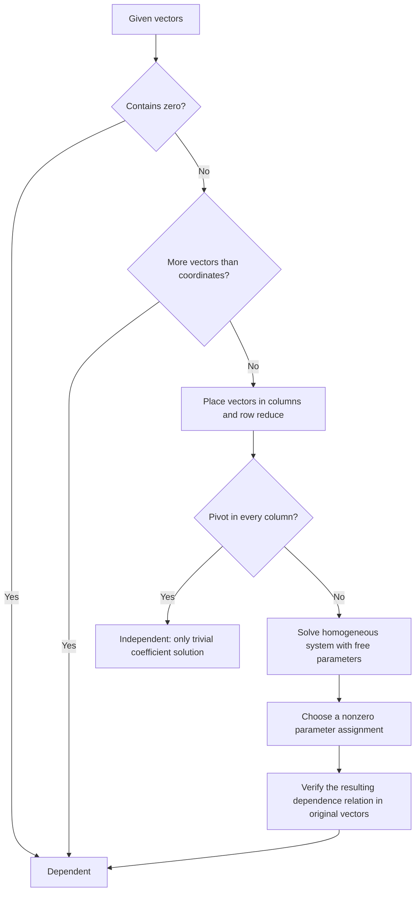

# 2.5 Linear Independence

**Previous:** [[2.4 Solution Sets]]  
**Related:** [[2.3 Matrix Equations]] · [[MOC — Linear Algebra]] · [[Independence, Basis and Dimension]] · [[Vector Subspaces]]

## 1. Core Idea: Does Every Vector Contribute a New Direction?

A collection is **redundant** when one of its vectors can be removed without changing its span. Linear independence formalizes the absence of such redundancy.

Let $v_1,\ldots,v_k\in\mathbb{R}^n$ and form the matrix

$$A=[v_1\;v_2\;\cdots\;v_k]\in\mathbb{R}^{n\times k}.$$

The coefficient vector is $x=(x_1,\ldots,x_k)^T\in\mathbb{R}^k$. Each column is a vector in $\mathbb{R}^n$, whereas the coefficients live in $\mathbb{R}^k$.

![[Pasted image 20261102234938.png]]

> [!info] Definition: Linear Independence
> The collection $\{v_1,\ldots,v_k\}$ is **linearly independent** when
> $$x_1v_1+\cdots+x_kv_k=0$$
> forces $x_1=\cdots=x_k=0$. In other words, the homogeneous equation has **only the trivial solution**.

> [!info] Definition: Linear Dependence Relation
> The collection is **linearly dependent** when there exist scalars $x_1,\ldots,x_k$, **not all zero**, such that
> $$x_1v_1+\cdots+x_kv_k=0.$$
> Such an equation is a **linear dependence relation**. Individual coefficients may be zero; only the entire coefficient vector must be nonzero.

> [!warning] Pitfall: Independence Describes a Collection
> Specify “these vectors are independent” or “the columns of this matrix are independent.” A matrix can have independent columns and dependent rows. A single vector is handled as the one-element collection $\{v\}$.
> Finding the trivial solution proves nothing: it exists for every homogeneous equation. The question is whether a **nontrivial** solution also exists.

## 2. Algebraic Test: Pivots and Free Variables

> [!info] Theorem: Equivalent Tests for Independence
> $$
> \begin{aligned}
> \{v_1,\ldots,v_k\}\text{ independent}
> &\iff Ax=0\text{ has only }x=0\\
> &\iff\text{there are no free variables}\\
> &\iff A\text{ has a pivot in every column}.
> \end{aligned}
> $$
> A free coefficient variable gives a nonzero solution by assigning it a nonzero value and solving for the pivot variables.

> [!abstract] Process: Test Independence and Produce a Relation
> 1. Put the vectors into the **columns** of $A$.
> 2. Row reduce $A$. The zero augmented column may be omitted because row operations preserve it.
> 3. If every column has a pivot, report **independent**.
> 4. Otherwise solve $Ax=0$ parametrically.
> 5. Choose a nonzero assignment of free parameters to obtain a nontrivial coefficient vector.
> 6. Substitute those coefficients into the **original vectors** and verify that their combination is zero.

### 2.1 Complete Example: A Dependent Triple

> [!example] Application Example: Find an Explicit Dependence Relation
> **Source:** pp. 66-67.
>
> Define
> $$
> v_1=\begin{pmatrix}1\\1\\1\end{pmatrix},\quad
> v_2=\begin{pmatrix}1\\-1\\2\end{pmatrix},\quad
> v_3=\begin{pmatrix}3\\1\\4\end{pmatrix}.
> $$
> Seek coefficients $x,y,z\in\mathbb{R}$ with $xv_1+yv_2+zv_3=0$:
> $$
> \begin{aligned}
> x+y+3z&=0,\\
> x-y+z&=0,\\
> x+2y+4z&=0.
> \end{aligned}
> $$

Start with $A=[v_1\;v_2\;v_3]$ and apply $R_2\leftarrow R_2-R_1$, $R_3\leftarrow R_3-R_1$:

$$
\begin{pmatrix}1&1&3\\1&-1&1\\1&2&4\end{pmatrix}
\longrightarrow
\begin{pmatrix}1&1&3\\0&-2&-2\\0&1&1\end{pmatrix}.
$$

Apply $R_2\leftarrow-\tfrac12R_2$, then $R_3\leftarrow R_3-R_2$, and $R_1\leftarrow R_1-R_2$:

$$
\operatorname{rref}(A)=\begin{pmatrix}1&0&2\\0&1&1\\0&0&0\end{pmatrix}.
$$

Thus $x=-2z$, $y=-z$, with $z=t$ free:

$$\begin{pmatrix}x\\y\\z\end{pmatrix}=t\begin{pmatrix}-2\\-1\\1\end{pmatrix}.$$

Take $t=1$. This gives

$$\boxed{-2v_1-v_2+v_3=0.}$$

**Coordinate verification:**

$$
-2\begin{pmatrix}1\\1\\1\end{pmatrix}
-\begin{pmatrix}1\\-1\\2\end{pmatrix}
+\begin{pmatrix}3\\1\\4\end{pmatrix}
=\begin{pmatrix}-2-1+3\\-2+1+1\\-2-2+4\end{pmatrix}=0.
$$

Equivalently, $v_3=2v_1+v_2$. The third vector adds no new direction; the three vectors lie in the plane spanned by $v_1,v_2$.

![[Pasted image 20261102235015.png]]

### 2.2 Complete Example: An Independent Triple

> [!example] Application Example: A Small Coordinate Change Removes the Dependence
> **Source:** pp. 67-68.
>
> Now use
> $$
> v_1=\begin{pmatrix}1\\1\\-2\end{pmatrix},\quad
> v_2=\begin{pmatrix}1\\-1\\2\end{pmatrix},\quad
> v_3=\begin{pmatrix}3\\1\\4\end{pmatrix}.
> $$
> The coefficient unknowns are $x,y,z$. Test
> $$xv_1+yv_2+zv_3=0.$$

Apply $R_2\leftarrow R_2-R_1$, $R_3\leftarrow R_3+2R_1$:

$$
\begin{pmatrix}1&1&3\\1&-1&1\\-2&2&4\end{pmatrix}
\longrightarrow
\begin{pmatrix}1&1&3\\0&-2&-2\\0&4&10\end{pmatrix}.
$$

Apply $R_2\leftarrow-\tfrac12R_2$, then $R_3\leftarrow R_3-4R_2$:

$$\begin{pmatrix}1&1&3\\0&1&1\\0&0&6\end{pmatrix}.$$

Apply $R_3\leftarrow\tfrac16R_3$, $R_2\leftarrow R_2-R_3$, $R_1\leftarrow R_1-3R_3$, and $R_1\leftarrow R_1-R_2$:

$$\operatorname{rref}(A)=\begin{pmatrix}1&0&0\\0&1&0\\0&0&1\end{pmatrix}.$$

Therefore $x=y=z=0$ is the only solution. There are three pivots and no free coefficient variables:

$$\boxed{\{v_1,v_2,v_3\}\text{ is linearly independent}.}$$

The three vectors do not lie in one plane through the origin; their span is all of $\mathbb{R}^3$.

![[Pasted image 20261102235227.png]]

## 3. Why Parametric Solution Directions Are Independent

> [!example] Application Example: Free Coordinates Force the Coefficients to Vanish
> **Source:** p. 68; continuation of [[2.4 Solution Sets]].
>
> Let
> $$A=\begin{pmatrix}1&-1&2\\-2&2&-4\end{pmatrix}.$$
> Row reduction by $R_2\leftarrow R_2+2R_1$ leaves the equation $x_1-x_2+2x_3=0$. Hence
> $$
> x=\begin{pmatrix}x_2-2x_3\\x_2\\x_3\end{pmatrix}
> =x_2\underbrace{\begin{pmatrix}1\\1\\0\end{pmatrix}}_u
> +x_3\underbrace{\begin{pmatrix}-2\\0\\1\end{pmatrix}}_v.
> $$
> To test the direction vectors, suppose
> $$
> au+bv=\begin{pmatrix}a-2b\\a\\b\end{pmatrix}=0.
> $$
> The second coordinate gives $a=0$; the third gives $b=0$. Thus $\{u,v\}$ is independent.

**Verification as homogeneous directions:**

$$
Au=\begin{pmatrix}1-1\\-2+2\end{pmatrix}=0,\qquad
Av=\begin{pmatrix}-2+2\\4-4\end{pmatrix}=0.
$$

> [!info] Theorem: Directions from the Standard Free-Variable Recipe
> Each direction vector has a $1$ in its own free-coordinate position and $0$ in every other free-coordinate position. In a zero linear combination, those coordinates force every coefficient to vanish.
> Therefore the direction vectors are independent. None can be discarded while preserving the homogeneous solution span.

## 4. Immediate Facts and Their Proofs

### 4.1 Too Many Vectors Force Dependence

> [!info] Theorem: Wide Matrices Have Dependent Columns
> If $A\in\mathbb{R}^{n\times k}$ with $k>n$, it cannot have a pivot in every column: there are at most $n$ pivots, one per row. Thus its columns are dependent.
> In particular, **four vectors in $\mathbb{R}^3$ are always dependent**.

A tall matrix, with $n>k$, may have independent or dependent columns. Having enough rows permits independence but does not guarantee it.

### 4.2 Two Vectors: Scalar Multiples

> [!info] Theorem: Dependence of a Pair
> Two vectors are dependent exactly when **one is a scalar multiple of the other**.

**Proof:** if $v_1=cv_2$, then $v_1-cv_2=0$ is nontrivial because the coefficient of $v_1$ is $1$. Conversely, suppose $a v_1+b v_2=0$ with $(a,b)\ne(0,0)$. If $a\ne0$,

$$v_1=-\frac ba v_2.$$

If $a=0$, then $b\ne0$, so $v_2=0=0v_1$. This includes the zero-vector edge case. The zero vector is a scalar multiple of every vector.

### 4.3 A Zero Vector Forces Dependence

> [!info] Theorem: A Collection Containing Zero Is Dependent
> If $v_1=0$, then
> $$1v_1+0v_2+\cdots+0v_k=0$$
> is a nontrivial relation.

### 4.4 A Dependent Subcollection Forces Dependence

Suppose $a_1v_1+\cdots+a_rv_r=0$ is nontrivial for $r<k$. Extend it by zero coefficients:

$$a_1v_1+\cdots+a_rv_r+0v_{r+1}+\cdots+0v_k=0.$$

This is still nontrivial, so the larger collection is dependent. Equivalently, **every subcollection of an independent collection is independent**.

## 5. First Criterion: Redundancy and Removal

> [!info] Theorem: A Vector Lies in the Span of the Others
> A collection is dependent if and only if **at least one vector belongs to the span of the others**. Such a vector can be removed without changing the span.

![[Pasted image 20261102235512.png]]

### 5.1 Full Symbolic Example: From Redundancy to Dependence

**Source:** pp. 70-71. Suppose

$$v_3=2v_1-\frac12v_2+6v_4.$$

Moving the third vector to the right gives the dependence relation

$$0=2v_1-\frac12v_2-v_3+6v_4.$$

The coefficient of $v_3$ is $-1$, so the relation is nontrivial. For arbitrary scalar coefficients $x_1,x_2,x_3,x_4$,

$$
\begin{aligned}
x_1v_1+x_2v_2+x_3v_3+x_4v_4
&=x_1v_1+x_2v_2+x_3\left(2v_1-\frac12v_2+6v_4\right)+x_4v_4\\
&=(x_1+2x_3)v_1+\left(x_2-\frac12x_3\right)v_2+(x_4+6x_3)v_4.
\end{aligned}
$$

Every combination of all four vectors is therefore a combination of $v_1,v_2,v_4$. Conversely, any combination of $v_1,v_2,v_4$ is a combination of all four with the third coefficient set to zero. Consequently

$$\boxed{\operatorname{Span}\{v_1,v_2,v_3,v_4\}=\operatorname{Span}\{v_1,v_2,v_4\}.}$$

> [!warning] Source Correction: A Missing Factor on p. 70
> The source's final coefficient of $v_4$ is printed as $x_4+6$. The correct coefficient is **$x_4+6x_3$**, since the contribution $6v_4$ is multiplied by $x_3$ during substitution.

### 5.2 Full Symbolic Example: From Dependence to Redundancy

The source uses a separate illustrative relation:

$$0=2v_1-\frac12v_2+v_3-6v_4.$$

Solve for the first vector:

$$
\begin{aligned}
2v_1&=\frac12v_2-v_3+6v_4,\\
v_1&=\frac12\left(\frac12v_2-v_3+6v_4\right)
=\frac14v_2-\frac12v_3+3v_4.
\end{aligned}
$$

Thus $v_1\in\operatorname{Span}\{v_2,v_3,v_4\}$. These two symbolic examples use different relations; they are not simultaneous assumptions about one fixed collection.

**General argument:** from a nontrivial relation $\sum_{i=1}^k a_iv_i=0$, select an index $j$ with $a_j\ne0$. Then

$$v_j=-\sum_{i\ne j}\frac{a_i}{a_j}v_i.$$

### 5.3 Complete Counterexample: Not Every Vector Is Removable

> [!example] Application Example: A Dependent Collection with an Essential Vector
> **Source:** p. 71.
>
> Let
> $$v_1=\begin{pmatrix}1\\0\end{pmatrix},\quad
> v_2=\begin{pmatrix}2\\0\end{pmatrix},\quad
> v_3=\begin{pmatrix}0\\1\end{pmatrix}.$$
> Since $2v_1-v_2+0v_3=0$, the collection is dependent.
> However, every combination of the first two vectors is
> $$av_1+bv_2=\begin{pmatrix}a+2b\\0\end{pmatrix},$$
> whose second coordinate is zero. It cannot equal $v_3=(0,1)^T$.
> Removing $v_3$ shrinks the span from $\mathbb{R}^2$ to the horizontal axis. Removing either $v_1$ or $v_2$ preserves the span.

> [!warning] Pitfall: “At Least One” Does Not Mean “Every”
> A dependence relation lets you solve for a vector only if its coefficient in that relation is **nonzero**. The coefficient of $v_3$ in the counterexample is zero, so that relation cannot express $v_3$ through the others.

## 6. Second Criterion: Increasing Span

> [!info] Theorem: Increasing Span Criterion
> An ordered collection $v_1,\ldots,v_k$ is independent if and only if
> $$v_j\notin\operatorname{Span}\{v_1,\ldots,v_{j-1}\}\quad\text{for every }j.$$
> For $j=1$, interpret the span of no vectors as $\{0\}$, so the first condition is $v_1\ne0$.
> **Each added vector must enlarge the span.**

**Proof:** if some $v_j$ is a combination of its predecessors, moving it across gives a nontrivial dependence relation. Conversely, start with $\sum a_iv_i=0$, where not all coefficients vanish. Choose the **largest index** $j$ for which $a_j\ne0$. Since all later coefficients are zero,

$$v_j=-\sum_{i=1}^{j-1}\frac{a_i}{a_j}v_i.$$

Thus $v_j$ belongs to the span of its predecessors. This proves the contrapositive and the criterion.

*This largest-nonzero-coefficient proof gives the same conclusion as the source's maximal-index argument without its inconsistent index notation.* Reordering an independent collection changes the intermediate spans but preserves independence.

## 7. Geometry in Two and Three Dimensions

All geometric lines and planes below pass **through the origin**. Coplanarity means that the vector arrows, placed at a common origin, lie in one such plane.

| Collection | Independent exactly when | Span in the independent case |
| --- | --- | --- |
| One vector $\{v\}$ | $v\ne0$ | A line |
| Two vectors in $\mathbb{R}^2$ | They are noncollinear | All of $\mathbb{R}^2$ |
| Three vectors in $\mathbb{R}^2$ | Never | At most a plane |
| Two vectors in $\mathbb{R}^3$ | They are noncollinear | A plane |
| Three vectors in $\mathbb{R}^3$ | They are not coplanar | All of $\mathbb{R}^3$ |
| Four vectors in $\mathbb{R}^3$ | Never | At most three-dimensional |

### 7.1 Source Picture Cases: What Each Figure Demonstrates

1. **A single nonzero vector:** $av=0$ forces $a=0$; its span is a line.
2. **Two noncollinear vectors in the plane:** neither is in the other's span. Adding the second enlarges a line to a plane.
3. **Three planar vectors with no collinear pair:** the third lies in the first two vectors' plane. In this pictured case, any one vector can be removed while preserving the plane.
4. **Two collinear vectors:** the second adds no direction; the span remains a line.
5. **A collinear pair plus a third vector outside that line:** the triple is dependent because the pair already is. The third vector is essential for retaining the plane.
6. **Two noncollinear spatial vectors:** they are independent and span a plane.
7. **Three noncoplanar spatial vectors:** the span grows from a line to a plane to all of $\mathbb{R}^3$.
8. **Three coplanar spatial vectors:** the third fails to enlarge the plane. Collinear and zero-vector cases are also dependent and fit inside a plane.
9. **Four spatial vectors, with three in a plane and one outside it:** the collection is dependent by the wide-matrix test, but the vector outside the plane cannot be removed without shrinking the span.

> *![[Pasted image 20261102235618.png]]*
> *Linear Independence in $R^2$*

> *![[Pasted image 20261102235810.png]]*
> *Linear Independence in $R^3$*

## 8. Pivot Columns Identify a Minimal Spanning Collection

> [!info] Theorem: Delete Nonpivot Columns, Retain Original Pivot Columns
> Let $A=[v_1\;\cdots\;v_k]$. The columns indexed by pivot positions span $\operatorname{Col}(A)$ and are independent.
> Delete all nonpivot columns without changing the span. No further column can be removed from the retained collection without shrinking it.

### 8.1 Complete RREF Example

**Source:** p. 79. Consider

$$R=\begin{pmatrix}1&0&2&0\\0&1&3&0\\0&0&0&1\end{pmatrix}.$$

The pivot columns are $r_1=(1,0,0)^T$, $r_2=(0,1,0)^T$, and $r_4=(0,0,1)^T$. The nonpivot column is

$$r_3=\begin{pmatrix}2\\3\\0\end{pmatrix}=2r_1+3r_2+0r_4.$$

For independence of the pivot columns,

$$a r_1+b r_2+c r_4=\begin{pmatrix}a\\b\\c\end{pmatrix}=0
\quad\Rightarrow\quad a=b=c=0.$$

The full homogeneous system reads

$$
\begin{aligned}
x_1+2x_3&=0,\\
x_2+3x_3&=0,\\
x_4&=0.
\end{aligned}
$$

Therefore $x=t(-2,-3,1,0)^T$. Its dependence relation is $-2r_1-3r_2+r_3+0r_4=0$.

### 8.2 Complete Original-Matrix Example: Relations Survive Row Operations

**Source:** pp. 79-80. Now let

$$A=\begin{pmatrix}1&7&23&3\\2&4&16&0\\-1&-2&-8&4\end{pmatrix}=[v_1\;v_2\;v_3\;v_4].$$

Apply $R_2\leftarrow R_2-2R_1$, $R_3\leftarrow R_3+R_1$:

$$\begin{pmatrix}1&7&23&3\\0&-10&-30&-6\\0&5&15&7\end{pmatrix}.$$

Apply $R_2\leftarrow-\tfrac1{10}R_2$, then $R_3\leftarrow R_3-5R_2$:

$$\begin{pmatrix}1&7&23&3\\0&1&3&3/5\\0&0&0&4\end{pmatrix}.$$

Apply $R_3\leftarrow\tfrac14R_3$, $R_2\leftarrow R_2-\tfrac35R_3$, $R_1\leftarrow R_1-3R_3$, and $R_1\leftarrow R_1-7R_2$:

$$\operatorname{rref}(A)=\begin{pmatrix}1&0&2&0\\0&1&3&0\\0&0&0&1\end{pmatrix}=R.$$

The equations $Ax=0$ and $Rx=0$ have identical coefficient solutions, so

$$-2v_1-3v_2+v_3+0v_4=0.$$

Consequently

$$
\boxed{\begin{pmatrix}23\\16\\-8\end{pmatrix}
=2\begin{pmatrix}1\\2\\-1\end{pmatrix}
+3\begin{pmatrix}7\\4\\-2\end{pmatrix}
+0\begin{pmatrix}3\\0\\4\end{pmatrix}.}
$$

**Coordinate check:** $2+21=23$, $4+12=16$, and $-2-6=-8$.

The pivot columns $v_1,v_2,v_4$ are independent: a zero combination with coefficients $(a,b,0,c)$ in the original matrix becomes $(a,b,c)^T=0$ in the reduced matrix. Thus all three coefficients vanish.

**Why relations survive in general:** if $R=EA$ for an invertible row-operation matrix $E$, then

$$Ax=0\iff EAx=0\iff Rx=0.$$

This preserves dependence coefficients and independence of corresponding column subcollections.

> [!warning] Pitfall: Use Pivot Columns of the Original Matrix
> Row reduction identifies **column indices**. Select those columns from $A$, not from its RREF, to describe the original column space.
> Row operations preserve homogeneous column relations but generally move the geometric column span within the output space.

### 8.3 Complete Example: Two Pivot Columns Span a Plane

> [!example] Application Example: Remove Two Redundant Columns
> **Source:** p. 80.
>
> Let
> $$A=\begin{pmatrix}1&2&0&-1\\-2&-3&4&5\\2&4&0&-2\end{pmatrix}=[v_1\;v_2\;v_3\;v_4].$$
> Apply $R_2\leftarrow R_2+2R_1$, $R_3\leftarrow R_3-2R_1$:
> $$\begin{pmatrix}1&2&0&-1\\0&1&4&3\\0&0&0&0\end{pmatrix}.$$
> Apply $R_1\leftarrow R_1-2R_2$:
> $$\operatorname{rref}(A)=\begin{pmatrix}1&0&-8&-7\\0&1&4&3\\0&0&0&0\end{pmatrix}.$$
> The pivot columns are **columns 1 and 2**. Therefore
> $$
> \boxed{\operatorname{Col}(A)
> =\operatorname{Span}\left\{\begin{pmatrix}1\\-2\\2\end{pmatrix},
> \begin{pmatrix}2\\-3\\4\end{pmatrix}\right\}.}
> $$
> These two original columns are independent.

**Full dependence calculations:** the reduced homogeneous equations give

$$
\begin{aligned}
x_1&=8x_3+7x_4,\\
x_2&=-4x_3-3x_4.
\end{aligned}
$$

Choose $(x_3,x_4)=(1,0)$ and then $(0,1)$:

$$
\begin{aligned}
8v_1-4v_2+v_3&=0 &&\Rightarrow v_3=-8v_1+4v_2,\\
7v_1-3v_2+v_4&=0 &&\Rightarrow v_4=-7v_1+3v_2.
\end{aligned}
$$

Verify numerically:

$$
\begin{aligned}
-8\begin{pmatrix}1\\-2\\2\end{pmatrix}
+4\begin{pmatrix}2\\-3\\4\end{pmatrix}
&=\begin{pmatrix}-8+8\\16-12\\-16+16\end{pmatrix}
=\begin{pmatrix}0\\4\\0\end{pmatrix}=v_3,\\
-7\begin{pmatrix}1\\-2\\2\end{pmatrix}
+3\begin{pmatrix}2\\-3\\4\end{pmatrix}
&=\begin{pmatrix}-7+6\\14-9\\-14+12\end{pmatrix}
=\begin{pmatrix}-1\\5\\-2\end{pmatrix}=v_4.
\end{aligned}
$$

The original column plane satisfies $y_3=2y_1$ for output coordinates $(y_1,y_2,y_3)$. The reduced column plane satisfies $y_3=0$. These are different planes, illustrating why reduced columns cannot replace original pivot columns.

## 9. Dimension, Independence, and Solution Sets

> [!info] Definition: Dimension of the Column Span
> If $A$ has $d$ pivots, then its column span has dimension $d$. The independent original pivot columns form a minimal spanning collection, also called a **basis**.

| Pivots $d$ | Column-span geometry |
| --- | --- |
| $0$ | Only the origin |
| $1$ | A line |
| $2$ | A plane |
| $3$ | A three-dimensional space |
| $d$ | A $d$-dimensional span |

For $A\in\mathbb{R}^{n\times k}$ with $d$ pivots,

$$\dim\operatorname{Col}(A)=d,\qquad\dim N(A)=k-d.$$

The first counts **independent output directions**; the second counts **free input coefficients**. The source previews this dimension language and develops it rigorously in §2.7.

> [!warning] Pitfall: Pivot Rows Versus Pivot Columns
> **Every column has a pivot:** the columns are independent; solutions of $Ax=b$, when they exist, are unique.
> **Every row has a pivot:** every target $b\in\mathbb{R}^n$ is reachable.
> A square matrix with a pivot in every row and column has both properties. A rectangular matrix may have just one.

## 10. Exam Decision Tree and Quick Reference

| Task | Reliable method |
| --- | --- |
| Prove independence | Show the zero combination forces all coefficients to zero |
| Prove dependence | Exhibit one nontrivial zero combination |
| Find removable vectors | Identify nonpivot columns, or solve for a vector with nonzero coefficient in a relation |
| Retain a minimal spanning collection | Select original columns at pivot indices |
| Explain independence geometrically | Every newly added vector enlarges the span |
| Check a proposed relation | Compute every coordinate of the combination |

**Critical rules:** zero coefficients are allowed in a dependence relation; all-zero coefficients are not. Dependence guarantees at least one redundant vector, not that every vector is removable. Never infer independence merely because every individual vector is nonzero.

---
# ~={red}References=~
- [[Interactive Linear Algebra — Section 2.5 Linear Independence.pdf]], §2.5.1-2.5.4, pp. 65-80 (PDF pp. 1-16).
- **Source correction:** on p. 70, the final coefficient of $v_4$ after substitution is $x_4+6x_3$, not $x_4+6$.
- **Scope:** all worked numerical examples, symbolic dependence and redundancy examples, proof arguments, geometric cases, and interactive captions in the supplied excerpt. Intermediate row operations and coordinate checks are expanded. The increasing-span proof is rewritten with consistent indices.
