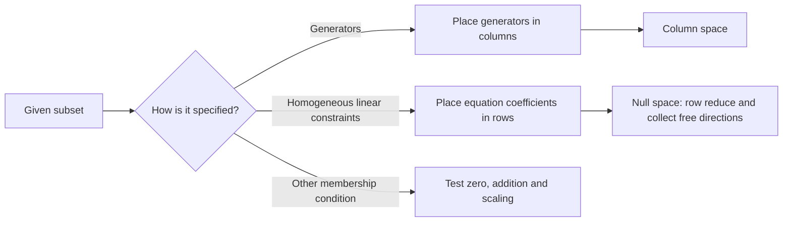

# 2.6 Subspaces

**Previous:** [[2.5 Linear Independence]] · **Related:** [[2.4 Solution Sets]] · [[2.3 Matrix Equations]] · [[MOC — Linear Algebra]]

## 1. The Subspace Test

> [!info] Definition: Subset and Subspace
> A **subset** of $\mathbb R^n$ is any collection of vectors in that space. A subset $V$ is a **subspace** if it satisfies all three conditions:
>
> 1. $0\in V$.
> 2. For all $u,v\in V$, $u+v\in V$.
> 3. For all $v\in V$ and $c\in\mathbb R$, $cv\in V$.

The last two conditions are **closure under addition** and **closure under scalar multiplication**. Together they ensure that $V$ contains every finite linear combination of its vectors: scale each vector first, then add. In particular, if $v\ne0$ belongs to $V$, so does the entire line $\operatorname{Span}\{v\}$.

> [!warning] Pitfall: Nonemptiness Matters
> If $V$ is nonempty and closed under scaling, pick $v\in V$ and use $0v=0$. The empty set satisfies both closure conditions vacuously but is **not** a subspace. The set $\{0\}$ is a subspace.

> [!abstract] Process: Prove or Disprove
> To prove closure, take **arbitrary** members and an arbitrary scalar, then use the membership condition. To disprove closure, a **single counterexample** suffices. If the set is already written as a span or as the solutions of a homogeneous linear system, the subspace theorems below apply directly.

## 2. Examples and Counterexamples

| Set                      | Test and conclusion                                                                                                                                                                                                      |
| ------------------------ | ------------------------------------------------------------------------------------------------------------------------------------------------------------------------------------------------------------------------ |
| $\mathbb R^n$            | Zero is in the space; vector addition and real scaling stay in it. **Subspace.**                                                                                                                                         |
| $\{0\}$                  | $0+0=0$ and $c0=0$ for every real $c$. **Subspace.**                                                                                                                                                                     |
| Line through the origin  | Write it as $\{tv:t\in\mathbb R\}$ for $v\ne0$. Then $0=0v$, $sv+tv=(s+t)v$, and $c(tv)=(ct)v$. **Subspace.** ![[Pasted image 20261103012357.png]]                                                                    |
| Plane through the origin | Write it as $\{su+tv:s,t\in\mathbb R\}$ for independent $u,v$. Zero uses both coefficients zero; adding adds the respective coefficients, and scaling scales both. **Subspace.** ![[Pasted image 20261103012406.png]] |
| Line missing the origin  | For example, $y=1$ excludes $(0,0)^T$. **Not a subspace.** ![[Pasted image 20261103012414.png]]                                                                                                                       |
| Closed first quadrant    | $Q=\{(x,y)^T:x\ge0,\ y\ge0\}$ contains zero and is closed under addition, but $(1,0)^T\in Q$ while $-(1,0)^T\notin Q$. **Not a subspace.** ![[Pasted image 20261103012423.png]]                                       |

> [!example] Application Example: The Unit Circle Fails All Three Tests
> Let $C=\{(x,y)^T\in\mathbb R^2:x^2+y^2=1\}$.
>
> - **Zero:** $0^2+0^2=0\ne1$.
> - **Addition:** $u=(1,0)^T$ and $v=(0,1)^T$ belong to $C$, but $u+v=(1,1)^T$ has squared length $2$.
> - **Scaling:** $2u=(2,0)^T$ has squared length $4$.
>
> Therefore $C$ is a subset of $\mathbb R^2$ and is not a subspace.
> 
> ![[Pasted image 20261103012255.png]]

> [!example] Application Example: A Line Union a Plane
> Take the source's pictured configuration in coordinates: $L$ is the vertical axis and $P$ is the horizontal plane $z=0$. Then $L\cup P$ contains zero and is closed under scaling because each constituent is.
> However, $(0,0,1)^T\in L$ and $(1,0,0)^T\in P$, while their sum $(1,0,1)^T$ lies in neither: its first coordinate is nonzero and its third coordinate is nonzero.
> The union is **not** a subspace. If instead the line is contained in the plane, their union is the plane and **is** a subspace.
> 
> ![[Pasted image 20261103012316.png]]

### 2.1 Verify the Subspace $2a=3b$

> [!example] Application Example: Direct Closure Proof
> Define $V=\{(a,b)^T\in\mathbb R^2:2a=3b\}$. For example:
>
> - $(3,2)^T\in V$ since $2(3)=3(2)=6$.
> - $(1/2,1/3)^T\in V$ since $2(1/2)=3(1/3)=1$.
> - $(2,3)^T\notin V$ since $2(2)=4\ne9=3(3)$.
>
> **Zero:** $2(0)=3(0)$.
>
> **Addition:** let $u=(a,b)^T$ and $v=(c,d)^T$ be arbitrary members, so $2a=3b$ and $2c=3d$. Their sum is $(a+c,b+d)^T$ and
> $$2(a+c)=2a+2c=3b+3d=3(b+d).$$
>
> **Scaling:** for any real $\lambda$, $\lambda u=(\lambda a,\lambda b)^T$, and
> $$2(\lambda a)=\lambda(2a)=\lambda(3b)=3(\lambda b).$$
>
> Thus $V$ is a subspace. With $a$ horizontal and $b$ vertical, $b=\tfrac23a$ is a line through the origin.
> 
> ![[Pasted image 20261103012439.png]]

### 2.2 Disprove the Subspace Condition for $ab=0$

> [!example] Application Example: The Union of the Coordinate Axes
> Let $V=\{(a,b)^T\in\mathbb R^2:ab=0\}$. It contains zero, and scaling preserves membership since $(\lambda a)(\lambda b)=\lambda^2ab=0$ for every member and every real $\lambda$.
>
> Take $u=(1,0)^T$ and $v=(0,1)^T$. Each coordinate product is zero. But
> $$u+v=\begin{pmatrix}1\\1\end{pmatrix},\qquad 1\cdot1=1\ne0.$$
> Addition fails. The union of the axes is **not** a subspace, even though each axis separately is.
> 
> ![[Pasted image 20261103012449.png]]

## 3. Spans and Subspaces Are Equivalent

> [!info] Theorem: Spans Are Subspaces and Subspaces Are Spans
> Every span in $\mathbb R^n$ is a subspace. Conversely, every subspace of $\mathbb R^n$ is generated by an independent list of at most $n$ vectors. A list whose span equals $V$ is a **spanning set** for $V$.

**Proof that a span is a subspace.** Put $V=\operatorname{Span}\{v_1,\ldots,v_p\}$. For $u=\sum_{i=1}^p a_iv_i$, $w=\sum_{i=1}^p b_iv_i$ and $c\in\mathbb R$,
$$
\begin{aligned}
0&=\sum_{i=1}^p0v_i\in V,\\
u+w&=\sum_{i=1}^p(a_i+b_i)v_i\in V,\\
cu&=\sum_{i=1}^p(ca_i)v_i\in V.
\end{aligned}
$$

**Proof of the converse.** The zero subspace is the span of the empty list. Otherwise choose $v_1\ne0$ in $V$. If the current span is strictly smaller than $V$, choose another vector of $V$ outside it. The span stays inside $V$ by closure, and the list stays independent by the [[2.5 Linear Independence#6. Second Criterion Increasing Span|increasing span criterion]]. An independent list cannot have more than $n$ members in $\mathbb R^n$, so this process ends with a list spanning $V$.

## 4. Column Space and Null Space

> [!info] Definition: Two Subspaces Associated with a Matrix
> Let $A\in\mathbb R^{m\times n}$ have columns $a_1,\ldots,a_n$.
> $$
> \begin{aligned}
> \operatorname{Col}(A)&=\operatorname{Span}\{a_1,\ldots,a_n\}
> =\{Ax:x\in\mathbb R^n\}\subseteq\mathbb R^m,\\
> \operatorname{Nul}(A)&=\{x\in\mathbb R^n:Ax=0\}\subseteq\mathbb R^n.
> \end{aligned}
> $$
> The column space contains reachable **outputs**. The null space contains **inputs** that map to zero.

**Proof that both are subspaces.** The column space is a span. For the null space, $A0=0$; if $Au=Av=0$, then $A(u+v)=Au+Av=0$; and if $Av=0$, then $A(cv)=cAv=0$ for every $c\in\mathbb R$.

> [!example] Application Example: Identical Columns
> Let $A=\begin{pmatrix}1&1\\1&1\\1&1\end{pmatrix}$ and $v=(1,1,1)^T$. Both columns are $v$, so $\operatorname{Col}(A)=\operatorname{Span}\{v\}$, a line in $\mathbb R^3$. Explicitly $Ax=(x_1+x_2)v$.
> 
> ![[Pasted image 20261103012539.png]]
>
> Subtract row $1$ from rows $2$ and $3$:
> $$A\longrightarrow\begin{pmatrix}1&1\\0&0\\0&0\end{pmatrix}.$$
> The equation $x_1+x_2=0$ gives $x_1=-x_2$. Taking $x_2=t$ yields $x=t(-1,1)^T$, and $A(-1,1)^T=(0,0,0)^T$. Thus
> $$\operatorname{Nul}(A)=\operatorname{Span}\{(-1,1)^T\},$$
> a line in $\mathbb R^2$, the **input** space.
> ![[Pasted image 20261103012547.png]]

## 5. Compute a Spanning Set for a Null Space

> [!abstract] Process: Free Variables Become Direction Vectors
> Row-reduce $A$, solve $Ax=0$ for the pivot variables, then collect the coefficients of each free variable into a vector. Those vectors span $\operatorname{Nul}(A)$ and are independent because their free coordinates form an identity pattern. Row operations preserve the null space.

> [!example] Application Example: Read a Homogeneous System from a Matrix
> For $A=\begin{pmatrix}1&7&2\\-2&1&3\\4&-2&-3\end{pmatrix}$, the null space is the set of inputs $(x,y,z)^T$ satisfying
> $$
> \begin{aligned}
> x+7y+2z&=0,\\
> -2x+y+3z&=0,\\
> 4x-2y-3z&=0.
> \end{aligned}
> $$
> The source uses this to illustrate translation between matrices and systems. To complete the calculation, add twice the second equation to the third to obtain $3z=0$. Then $z=0$ and $y=2x$. The first equation gives $x+14x=15x=0$, so $x=y=z=0$ and $\operatorname{Nul}(A)=\{0\}$.

> [!example] Application Example: Two Free Variables
> Let $A=\begin{pmatrix}2&3&-8&-5\\-1&2&-3&-8\end{pmatrix}$. Swap the rows and negate the new first row. Then use $R_2\leftarrow R_2-2R_1$:
> $$
> \begin{pmatrix}1&-2&3&8\\2&3&-8&-5\end{pmatrix}
> \longrightarrow\begin{pmatrix}1&-2&3&8\\0&7&-14&-21\end{pmatrix}.
> $$
> Divide row $2$ by $7$, then add twice row $2$ to row $1$:
> $$\operatorname{rref}(A)=\begin{pmatrix}1&0&-1&2\\0&1&-2&-3\end{pmatrix}.$$
> Set $x_3=s$, $x_4=t$. The reduced system gives
> $$
> \begin{aligned}
> x_1&=s-2t, & x_2&=2s+3t, & x_3&=s, & x_4&=t.
> \end{aligned}
> $$
> Therefore
> $$
> x=s\underbrace{\begin{pmatrix}1\\2\\1\\0\end{pmatrix}}_u
> +t\underbrace{\begin{pmatrix}-2\\3\\0\\1\end{pmatrix}}_v,
> \qquad s,t\in\mathbb R.
> $$
> The original equations verify both directions:
> $$
> \begin{aligned}
> Au&=(2+6-8,,-1+4-3)^T=(0,0)^T,\\
> Av&=(-4+9-5,,2+6-8)^T=(0,0)^T.
> \end{aligned}
> $$
> Thus $\operatorname{Nul}(A)=\operatorname{Span}\{u,v\}$, a two-dimensional subspace of $\mathbb R^4$. Coordinates $3$ and $4$ identify the two independent parameters.

> [!example] Application Example: No Free Variables
> Let $A=\begin{pmatrix}1&3\\2&4\end{pmatrix}$. Apply $R_2\leftarrow R_2-2R_1$, divide row $2$ by $-2$, then apply $R_1\leftarrow R_1-3R_2$:
> $$
> A\longrightarrow\begin{pmatrix}1&3\\0&-2\end{pmatrix}
> \longrightarrow\begin{pmatrix}1&3\\0&1\end{pmatrix}
> \longrightarrow\begin{pmatrix}1&0\\0&1\end{pmatrix}.
> $$
> Both variables are pivots, so $x_1=x_2=0$. Hence $\operatorname{Nul}(A)=\{0\}=\operatorname{Span}\{0\}=\operatorname{Span}(\varnothing)$. The empty spanning list has no redundant zero vector.

## 6. Convert Between Descriptions

> [!abstract] Process: Choose a Description That Matches the Data
> **Generators or parameters:** collect the generator vectors as columns. **Homogeneous linear equations:** place each equation's coefficients in a row. Then extract generators for the null space if needed.

> [!example] Application Example: A Plane Given by One Equation
> For $(x,y,z)^T\in\mathbb R^3$, $x+3y+z=0$ says exactly that the vector belongs to $\operatorname{Nul}\begin{pmatrix}1&3&1\end{pmatrix}$. With $y=s$, $z=t$, we have $x=-3s-t$. Hence
> $$ (x,y,z)^T=s(-3,1,0)^T+t(-1,0,1)^T.$$
> The two directions satisfy $-3+3(1)+0=0$ and $-1+3(0)+1=0$. Their last two coordinates are independent, so they span a plane through the origin.

> [!example] Application Example: Rewrite $2a=3b$ as a Null Space
> Take $A=\begin{pmatrix}2&-3\end{pmatrix}$. Then $A(a,b)^T=0$ means $2a-3b=0$. Divide the row by $2$ to get $\begin{pmatrix}1&-3/2\end{pmatrix}$. Therefore $a=\tfrac32b$ and
> $$V=\operatorname{Nul}(A)=\operatorname{Span}\{(3/2,1)^T\}.$$
> Indeed $2(3/2)-3=0$. The generator $(3,2)^T$ from the direct test is twice this one.

> [!example] Application Example: Rewrite a Parametrized Plane as a Column Space
> Let $V=\{(2x+y,x-y,3x-2y)^T:x,y\in\mathbb R\}$. Collect the parameters:
> $$
> \begin{pmatrix}2x+y\\x-y\\3x-2y\end{pmatrix}
> =x\begin{pmatrix}2\\1\\3\end{pmatrix}
> +y\begin{pmatrix}1\\-1\\-2\end{pmatrix}.
> $$
> Since the parameters are arbitrary,
> $$V=\operatorname{Col}\begin{pmatrix}2&1\\1&-1\\3&-2\end{pmatrix}.$$
> The generators are independent: the first two coordinates of a zero combination require $2x+y=0$ and $x-y=0$, so $y=x$ and $3x=0$. Thus $x=y=0$, confirming that $V$ is a plane in $\mathbb R^3$.

### Why Every Subspace Also Has a Homogeneous Description

*Supplement connecting the equivalent descriptions.* If $V$ has an independent spanning list $v_1,\ldots,v_p$, extend that list to a basis of $\mathbb R^n$ by repeatedly choosing vectors outside the current span. Each input then has unique coefficients in that basis. The linear map taking an input to its last $n-p$ coefficients has kernel exactly $V$: those coefficients vanish precisely when the input is in the span of the first $p$ vectors. The matrix of this map therefore has null space $V$. When $p=n$, one can simply use a zero matrix.

> [!warning] Pitfall: Affine and Nonlinear Conditions
> The solutions of $Ax=b$ for $b\ne0$ exclude zero and are not a subspace, even if they form a translated line or plane. The condition $ab=0$ is homogeneous under scaling, but it is **not linear** and does not ensure closure under addition.

## 7. Quick Reference

| Task | Check |
| --- | --- |
| Prove a subset is a subspace | Zero, addition, scaling; or recognize a span or homogeneous linear system |
| Disprove a subspace claim | Give one failed condition with a concrete witness |
| Find a column-space basis | Locate pivots by row reduction; take the corresponding **original** columns |
| Find null-space generators | Solve $Ax=0$ and collect free-variable directions |
| Check the ambient dimensions | For an $m\times n$ matrix: columns live in $\mathbb R^m$, null vectors in $\mathbb R^n$ |

---
# ~={red}References=~
- [[Interactive Linear Algebra — Section 2.6 Subspaces.pdf]], §2.6.1–2.6.2, pp. 81–92.
