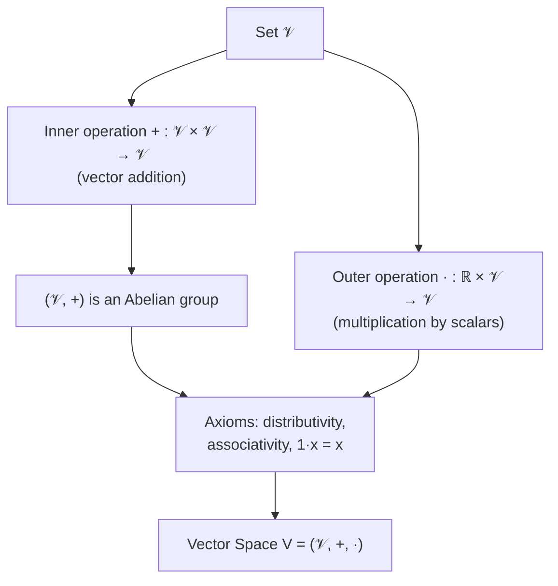

Date: 2026-11-10
Tags: [[Linear Algebra]], [[Vector Spaces]], [[Mathematics for Machine Learning]], [[Deisenroth]], [[Abstract Algebra]]

# 2.4.2 Vector Spaces

## 1. From Groups to Vector Spaces

> [!info] Definition : Inner vs. Outer Operation
> When discussing groups, we considered a set $\mathcal{G}$ with an **inner operation** on $\mathcal{G}$, i.e., mappings $\mathcal{G} \times \mathcal{G} \to \mathcal{G}$ that only operate on elements *within* $\mathcal{G}$.
> A vector space additionally contains an **outer operation** $\cdot$: the multiplication of a vector $\boldsymbol{x} \in \mathcal{G}$ by a **scalar** $\lambda \in \mathbb{R}$.
> - The **inner operation** is thought of as a form of **addition**;
> - The **outer operation** is thought of as a form of **scaling**.
> 
> **Caution:** the inner/outer operations have *nothing* to do with inner/outer **products**.

---

## 2. Definition and Axioms

> [!info] Definition / Theorem : Vector Space (Definition 2.9)
> A real-valued **vector space** $V = (\mathcal{V}, +, \cdot)$ is a set $\mathcal{V}$ with two operations:
> $$
> + : \mathcal{V} \times \mathcal{V} \to \mathcal{V} \tag{2.62}
> $$
> $$
> \cdot : \mathbb{R} \times \mathcal{V} \to \mathcal{V} \tag{2.63}
> $$
> where:
> 1. $(\mathcal{V}, +)$ is an **Abelian group**;
> 2. **Distributivity:**
>    - $\forall \lambda \in \mathbb{R},\ \boldsymbol{x}, \boldsymbol{y} \in \mathcal{V} : \lambda \cdot (\boldsymbol{x} + \boldsymbol{y}) = \lambda \cdot \boldsymbol{x} + \lambda \cdot \boldsymbol{y}$
>    - $\forall \lambda, \psi \in \mathbb{R},\ \boldsymbol{x} \in \mathcal{V} : (\lambda + \psi) \cdot \boldsymbol{x} = \lambda \cdot \boldsymbol{x} + \psi \cdot \boldsymbol{x}$
> 3. **Associativity (outer operation):** $\forall \lambda, \psi \in \mathbb{R},\ \boldsymbol{x} \in \mathcal{V} : \lambda \cdot (\psi \cdot \boldsymbol{x}) = (\lambda \psi) \cdot \boldsymbol{x}$
> 4. **Neutral element (outer operation):** $\forall \boldsymbol{x} \in \mathcal{V} : 1 \cdot \boldsymbol{x} = \boldsymbol{x}$

**Terminology:**

| Object | Name | Meaning |
| :--- | :--- | :--- |
| $\boldsymbol{x} \in V$ | **Vector** | Element of the vector space |
| $\boldsymbol{0} = [0, \dots, 0]^{\top}$ | **Zero vector** | Neutral element of $(\mathcal{V}, +)$ |
| $+$ | **Vector addition** | The inner operation |
| $\lambda \in \mathbb{R}$ | **Scalar** | Real-valued multiplier |
| $\cdot$ | **Multiplication by scalars** | The outer operation |

> [!warning] Pitfall / Cas Particulier : Scalar product ≠ multiplication by scalars
> A **scalar product** is something *different* from multiplication by scalars — it is introduced later (Section 3.2, inner products). Do not conflate the outer operation $\cdot : \mathbb{R} \times \mathcal{V} \to \mathcal{V}$ with an inner product $\langle \cdot, \cdot \rangle : \mathcal{V} \times \mathcal{V} \to \mathbb{R}$.

---

## 3. What Is *Not* Defined: Vector Multiplication

> [!warning] Pitfall / Cas Particulier : No vector–vector multiplication
> A "vector multiplication" $\boldsymbol{a}\boldsymbol{b}$ for $\boldsymbol{a}, \boldsymbol{b} \in \mathbb{R}^n$ is **not defined** in a vector space.
> - One *could* define an element-wise "array multiplication" $\boldsymbol{c} = \boldsymbol{a}\boldsymbol{b}$ with $c_j = a_j b_j$ — common in many programming languages (e.g., NumPy broadcasting) — but it makes **mathematically limited sense** under the standard rules of matrix multiplication.
> - Treating vectors as $n \times 1$ matrices, the dimensions only match for exactly two products:
> $$
> \boldsymbol{a}\boldsymbol{b}^{\top} \in \mathbb{R}^{n \times n} \quad (\text{outer product}), \qquad \boldsymbol{a}^{\top}\boldsymbol{b} \in \mathbb{R} \quad (\text{inner / scalar / dot product})
> $$

---

## 4. Examples of Vector Spaces

> [!example] Application Example : Important Vector Spaces (Example 2.11)
> **1. $\mathcal{V} = \mathbb{R}^n$, $n \in \mathbb{N}$**, with:
> - **Addition:** $\boldsymbol{x} + \boldsymbol{y} = (x_1, \dots, x_n) + (y_1, \dots, y_n) = (x_1 + y_1, \dots, x_n + y_n)$ for all $\boldsymbol{x}, \boldsymbol{y} \in \mathbb{R}^n$
> - **Multiplication by scalars:** $\lambda \boldsymbol{x} = \lambda (x_1, \dots, x_n) = (\lambda x_1, \dots, \lambda x_n)$ for all $\lambda \in \mathbb{R},\ \boldsymbol{x} \in \mathbb{R}^n$
> 
> **2. $\mathcal{V} = \mathbb{R}^{m \times n}$, $m, n \in \mathbb{N}$**, with:
> - **Addition (elementwise):** for all $\boldsymbol{A}, \boldsymbol{B} \in \mathcal{V}$,
> $$
> \boldsymbol{A} + \boldsymbol{B} = \begin{bmatrix} a_{11} + b_{11} & \cdots & a_{1n} + b_{1n} \\ \vdots & & \vdots \\ a_{m1} + b_{m1} & \cdots & a_{mn} + b_{mn} \end{bmatrix}
> $$
> - **Multiplication by scalars:**
> $$
> \lambda \boldsymbol{A} = \begin{bmatrix} \lambda a_{11} & \cdots & \lambda a_{1n} \\ \vdots & & \vdots \\ \lambda a_{m1} & \cdots & \lambda a_{mn} \end{bmatrix}
> $$
> Remember that $\mathbb{R}^{m \times n}$ is equivalent to $\mathbb{R}^{mn}$.
> 
> **3. $\mathcal{V} = \mathbb{C}$**, with the standard definition of addition of complex numbers.

---

## 5. Notational Conventions

> [!info] Definition : Simplified notation
> A vector space $(\mathcal{V}, +, \cdot)$ is denoted simply by $V$ when $+$ and $\cdot$ are the **standard** vector addition and scalar multiplication. Vectors are written $\boldsymbol{x} \in V$.

> [!info] Definition : Column vectors, row vectors, transpose
> The vector spaces $\mathbb{R}^n$, $\mathbb{R}^{n \times 1}$, $\mathbb{R}^{1 \times n}$ differ **only in the way vectors are written**. By convention, $\mathbb{R}^n$ and $\mathbb{R}^{n \times 1}$ are *not* distinguished, so $n$-tuples are written as **column vectors**:
> $$
> \boldsymbol{x} = \begin{bmatrix} x_1 \\ \vdots \\ x_n \end{bmatrix} \tag{2.64}
> $$
> However, $\mathbb{R}^{n \times 1}$ and $\mathbb{R}^{1 \times n}$ (**row vectors**) *are* distinguished, to avoid confusion with matrix multiplication.
> - **Default:** $\boldsymbol{x}$ denotes a column vector;
> - A row vector is denoted $\boldsymbol{x}^{\top}$, the **transpose** of $\boldsymbol{x}$.

> [!abstract] Synthesis : The vector-space checklist
> To verify a candidate structure is a real vector space, confirm:
> 1. Closure under $+$ and under $\cdot$ by reals;
> 2. $(\mathcal{V}, +)$ Abelian group (associativity, commutativity, zero vector, additive inverses);
> 3. Both distributivity laws;
> 4. Associativity of scaling: $\lambda(\psi \boldsymbol{x}) = (\lambda\psi)\boldsymbol{x}$;
> 5. Unit scaling: $1 \cdot \boldsymbol{x} = \boldsymbol{x}$.
> 
> Everything else (bases, dimension, inner products) is built **on top** of this structure — not inside it.

---
# ~={red}References=~
*Mathematics for Machine Learning, M. P. Deisenroth, A. A. Faisal, C. S. Ong — Section 2.4.2: Vector Spaces (p. 37–38), Cambridge University Press (2020)*