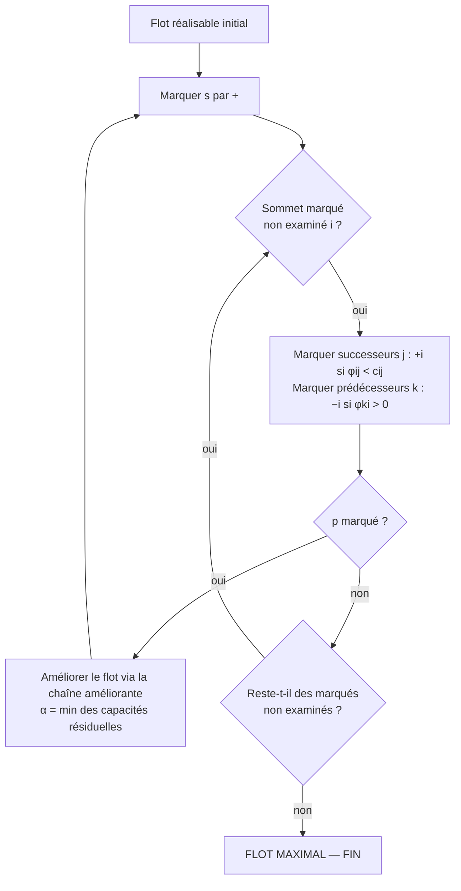

Date: 2026-10-09
Tags: [[Mathematics]], [[Recherche Opérationnelle]], [[Discrete Mathematics]],[[Optimisation Combinatoire]], [[Graphes]], [[Dijkstra]], [[Bellman-Ford]], [[Ford-Fulkerson]], [[Flot Maximal]], [[ENSAM]]

---

# Optimisation Combinatoire — Graphes, Plus Courts Chemins et Flots Maximaux

## 1. Théorie des Graphes

### 1.1 Définitions et Familles

> [!info] Définition : Graphe
> Un graphe est :
> - un **ensemble d'éléments** ;
> - un **ensemble de relations** entre ces éléments.
> 
> **Point de vue mathématique :** une relation binaire. **Point de vue pratique :** représentation abstraite d'un réseau.
> Deux grandes familles : les graphes **non-orientés** et les graphes **orientés**. Utilisés en économie, informatique, industrie, chimie, sociologie…

> [!info] Définition / Théorème : Graphe $G=(S,A)$
> Un graphe $(S,A)$ est la donnée de deux ensembles d'objets :
> - $S$ : l'ensemble des **sommets** ou **nœuds** ;
> - $A$ : un sous-ensemble de $S \times S$ représentant l'ensemble des **arêtes** ou **arcs** :
>   - **arêtes** $\{x,y\}$ : relation **symétrique** ;
>   - **arcs** $(x,y)$ : relation **orientée**.
> 
> **Types :** graphes dirigés (*directed graphs / digraphs*) et graphes symétriques (*undirected graphs*).

![[{C3321756-1F59-4DBF-B0BF-30686C837DE5}.png]]

> [!example] Exemple d'Application : Les sept ponts de Königsberg (Euler, 1735)
> Problème historique fondateur : se promener dans la ville en passant **une et une seule fois** par chaque pont. La modélisation sous forme de graphe (sommets = quartiers $A, B, C, D$ ; arêtes = ponts) transforme l'énigme en question de **degrés de sommets** (voir §1.6).

> ![[{E41F3F1E-7E1B-42AB-A5E0-F920E412EF4B}.png]]

> [!abstract] Modélisation : Domaines d'utilisation des graphes
> - Réseaux de transports routier, d'eau, d'électricité ; réseaux informatiques ;
> - Réseaux sociaux : Facebook = graphe **non orienté**, Twitter = graphe **orienté** ; graphe du web ;
> - Réseaux de transport de données (téléphonie, wifi) ;
> - Représentation d'un algorithme, déroulement d'un jeu, réseaux de régulation génétique ;
> - Organisation logistique, ordonnancement de projet.

### 1.2 Vocabulaire : Ordre, Taille, Voisinages

> [!info] Définition : Graphe symétrique (non-orienté)
> Un graphe non-orienté ou symétrique est une relation binaire $G$ sur un ensemble $A$, notée $G=(S,A)$, où $S$ est l'ensemble des sommets et $A$ l'ensemble des arêtes formé des $\{x,y\} \in A$ qui sont en relation.
> - **Ordre** : nombre de sommets ; **taille** : nombre d'arêtes ;
> - Si $\{x,y\}$ est une arête : $x$ et $y$ sont **voisins**, appelés **extrémités** de l'arête.

> [!info] Définition : Graphe dirigé (orienté)
> Un graphe dirigé ou orienté est une relation binaire $G$ sur un ensemble $A$, notée $G=(S,A)$, où $S$ est l'ensemble des sommets et $A$ l'ensemble des **arcs** formé des couples $(x,y) \in S \times S$ en relation.
> Pour l'arc $(x,y)$ : $x$ et $y$ sont **adjacents** ; $x$ est son **origine**, $y$ son **extrémité** ; $y$ est un **successeur** de $x$ ; $x$ est un **prédécesseur** de $y$.

### 1.3 Degré d'un Sommet

> [!info] Définition / Théorème : Degrés et formules de sommation
> Un **graphe simple** ne contient pas de multi-arêtes/multi-arcs (une seule arête ou un seul arc dans chaque sens entre deux sommets).
> - **Graphe symétrique :** $d(x)$ = nombre d'arêtes **incidentes** à $x$.
> - **Graphe orienté :** $d^{+}(x)$ = nombre d'arcs ayant $x$ comme extrémité **initiale** ; $d^{-}(x)$ = nombre d'arcs ayant $x$ comme extrémité **finale** ; et $d(x) = d^{+}(x) + d^{-}(x)$.
> 
> $$
> \sum_{x \in S} d(x) = 2\,|A| \qquad\qquad \sum_{x \in S} d^{+}(x) = \sum_{x \in S} d^{-}(x) = |A|
> $$

### 1.4 Représentation : Matrice d'Adjacence

> [!info] Définition : Matrice d'adjacence
> Soit $G=(S,A)$ un graphe simple de $n$ sommets numérotés de $1$ à $n$. La **matrice d'adjacence** $A=(a_{ij})$ de $G$ est la matrice carrée d'ordre $n$ où chaque ligne et chaque colonne représentent un sommet :
> $$
> A = \begin{bmatrix} a_{11} & \cdots & a_{1j} & \cdots & a_{1n} \\ a_{21} & \cdots & a_{2j} & \cdots & a_{2n} \\ \vdots & & \vdots & & \vdots \\ a_{n1} & \cdots & a_{nj} & \cdots & a_{nn} \end{bmatrix}
> $$
> Autres représentations possibles : matrice d'incidence, listes d'adjacence.
> 
> **Règles de valuation :**
> - **Non valué, symétrique :** $a_{ij} = 1$ si $\{i,j\} \in A$, $0$ sinon.
> - **Non valué, orienté :** $a_{ij} = 1$ si $(i,j) \in A$, $0$ sinon.
> - **Valué, symétrique :** $a_{ij} = p$ si $\{i,j\} \in A$ ; $0$ si $i=j$ ; $+\infty$ sinon.
> - **Valué, orienté :** $a_{ij} = p$ si $(i,j) \in A$ ; $+\infty$ sinon.

> [!example] Exemple d'Application : Matrices d'adjacence valuées du cours
> **Graphe symétrique valué (5 sommets) :**
> $$
> A = \begin{bmatrix} 0 & 19 & 7 & +\infty & +\infty \\ 19 & 0 & 5 & 14 & 22 \\ 7 & 5 & 0 & 12 & +\infty \\ +\infty & 14 & 12 & 0 & +\infty \\ +\infty & 22 & +\infty & +\infty & 0 \end{bmatrix}
> $$
> **Graphe orienté valué (3 sommets) :**
> $$
> A = \begin{bmatrix} 6 & +\infty & 7 \\ 5 & +\infty & 1 \\ +\infty & 3 & +\infty \end{bmatrix}
> $$
> **Lecture :** la symétrie de la première matrice traduit l'absence d'orientation ; la diagonale nulle traduit l'absence de boucle ; $+\infty$ code l'absence d'arête.

> ![[{19F95F2D-6107-4075-AEBB-840C55EB752E}.png]]

### 1.5 Chaînes, Cycles, Chemins, Circuits

> [!info] Définition : Chaîne dans un graphe symétrique
> Une **chaîne** dans un graphe $G$ est une suite ayant pour éléments alternativement des sommets et des arêtes, commençant et se terminant par un sommet, telle que chaque arête est encadrée par ses extrémités. La chaîne **relie** le premier et le dernier sommet.
> - $l(C)$ : **longueur** de la chaîne $C$ = nombre d'arêtes ;
> - $d(x,y)$ : **distance** entre $x$ et $y$ = longueur de la plus petite chaîne les reliant ;
> - $\delta(G)$ : **diamètre** du graphe = plus grande distance entre deux sommets.

> [!example] Exemple d'Application : Longueur, distance, diamètre
> Dans le graphe $G$ à sommets $v_1,\dots,v_5$ et arêtes $e_1,\dots,e_6$ :
> 
> ![[{F027BBA6-4A27-43C9-8BA5-E9D0E6AC216A}.png]]
> $$
> C = (v_1, e_1, v_2, e_3, v_3, e_6, v_5), \qquad l(C) = 3
> $$
> $$
> d(v_1, v_5) = 2, \qquad \delta(G) = 2
> $$
> **Cas limites :** les graphes de diamètre $0$ sont les graphes **stables** (sans arête) ; le cours illustre également les graphes de diamètre $1$.

![[{01955EAC-187C-4659-99EA-CA2B41806173}.png]]

![[{C14C90D2-3DCD-4AD9-A985-8EE3C9CEA338}.png]]

> [!info] Définition : Qualificatifs des chaînes ; cycles
> - **Chaîne élémentaire** : chaque sommet apparaît **au plus une fois** ;
> - **Chaîne simple** : chaque arête apparaît **au plus une fois** ;
> - **Chaîne fermée** : les deux extrémités sont les mêmes ;
> - **Cycle** : chaîne **simple et fermée**.

> [!info] Définition : Chemins et circuits dans un digraphe
> Un **chemin** de $x$ à $y$ est une suite finie d'arcs consécutifs reliant $x$ à $y$ ; sa **longueur** = nombre d'arcs.
> - **Chemin élémentaire** : ne passe pas deux fois par un même sommet ;
> - **Chemin simple** : ne passe pas deux fois par un même arc ;
> - **Chemin fermé** : origine et extrémité coïncident ;
> - **Circuit** : chemin **simple** dont les deux extrémités sont identiques.

> [!example] Exemple d'Application : Chemin vs circuit
> Dans le digraphe à sommets $x_0,\dots,x_5$ :
> ![[{EB503D01-92C3-4155-BDE5-FB0BA203B963}.png]]
> - $(x_0, x_1, x_2, x_3, x_4)$ est un **chemin** ;
> - $(x_0, x_1, x_2, x_3, x_4, x_2, x_0)$ est un **circuit**.

### 1.6 Graphes Eulériens et Hamiltoniens

> [!info] Définition : Eulérien / semi-eulérien
> - Un graphe symétrique est **eulérien** s'il abrite un **cycle** (chaîne simple fermée) passant **une et une seule fois par toutes les arêtes** ;
> - Il est **semi-eulérien** s'il abrite une **chaîne simple** passant une et une seule fois par toutes les arêtes.
> 
> **Intuition :** dessiner le graphe sans lever le crayon et sans passer deux fois par le même trait.

![[{F71A32E4-2FDE-45EE-ABDD-875FB4700EF6}.png]]

> [!info] Définition : Hamiltonien / semi-hamiltonien
> - Un graphe symétrique est **hamiltonien** s'il abrite un **cycle** (chaîne élémentaire fermée) passant **une et une seule fois par tous les sommets** ;
> - Il est **semi-hamiltonien** s'il abrite une **chaîne élémentaire** passant une et une seule fois par tous les sommets.

![[{5C756479-9EFA-4261-B4CC-622832E7CA6E}.png]]

> [!info] Définition / Théorème : Théorème d'Euler (caractérisation exacte)
> Soit $G=(S,A)$ un graphe symétrique, $d(x)$ le degré de $x$.
> - **(i)** Si $\forall x \in S$, $d(x)$ est **pair**, alors $G$ admet un **cycle eulérien** ;
> - **(ii)** S'il existe **uniquement deux** sommets distincts $x_1, x_2$ de degrés **impairs** et $\forall x \in S \setminus \{x_1,x_2\}$, $d(x)$ pair, alors $G$ abrite une **chaîne eulérienne** d'extrémités $x_1$ et $x_2$ ;
> - **(iii)** Dans tous les autres cas, $G$ n'abrite pas de chaîne eulérienne.

> [!example] Exemple d'Application : Réponse négative au problème de Königsberg
> Euler souhaitait se promener en passant une et une seule fois par chaque pont : le graphe devait être **eulérien**.
> ![[{BC1F1E90-2176-4328-8EF4-00251B14C53D}.png]]
> **Verdict :** impossible, car les degrés des sommets $A, B, C, D$ ne sont **pas tous pairs** (cas (iii) du théorème d'Euler).

> [!info] Définition / Théorème : Conditions suffisantes d'hamiltonicité
> **Théorème de Dirac.** Graphe simple à $n$ sommets ($n \ge 3$). Si chaque sommet a un degré au moins égal à $\frac{n}{2}$, alors le graphe est hamiltonien.
> **Théorème de Ore.** Graphe simple à $n$ sommets ($n \ge 3$). Si la somme des degrés de **toute paire de sommets non adjacents** vaut au moins $n$, alors le graphe est hamiltonien.

> [!warning] Piège / Cas Particulier
> Dirac et Ore donnent des conditions **suffisantes mais non nécessaires** : un graphe peut être hamiltonien sans les satisfaire. À l'inverse, le théorème d'Euler est une caractérisation **exacte** (nécessaire et suffisante). Ne pas confondre les deux statuts logiques à l'examen.


---

## 2. Problèmes de Plus Court Chemin (PCC)
### Introduction
Le problème du plus court chemin (*PCC*) consiste à trouver le meilleur chemin entre deux sommets d’un graphe, en minimisant une distance, un coût ou un temps.
**Applications principales :**
- Trouver le trajet le plus court.
- Trouver la route la plus rapide.
- Déterminer la stratégie optimale.

> [!Example]
> ![[{940FD19A-660F-410B-BEB2-1AE2D9E57770}.png]]
> **Solution:**
> ![[{46CB6DEE-E0AF-48D1-8663-D7DFBA3169DA}.png]]
> 

### 2.1 Contexte Mathématique

> [!info] Définition : Racine, circuit absorbant
> - Une **racine** dans un graphe orienté (resp. non-orienté) est un sommet $r$ tel qu'il existe un chemin (resp. une chaîne) de $r$ à $u$ pour tout sommet $u \ne r$ ;
> - Un circuit (resp. cycle) de longueur **négative** est appelé circuit (resp. cycle) **absorbant**.

> [!info] Définition / Théorème : Existence d'un plus court chemin
> Condition **nécessaire et suffisante** pour trouver un plus court chemin d'un sommet $s$ à tous les sommets du graphe :
> 1. $s$ est **racine** du graphe ;
> 2. le graphe ne contient **pas de circuit/cycle absorbant**.

> [!info] Définition / Théorème : Théorème de sous-optimalité
> Soit $C$ un plus court chemin de $u$ à $v$, et $u', v'$ deux sommets de $C$. Alors le sous-chemin de $C$ de $u'$ à $v'$ est aussi un plus court chemin de $u'$ à $v'$.
> **Preuve.** Soit $C_1$ le sous-chemin de $u'$ à $v'$ contenu dans $C$. Supposons par l'absurde qu'il existe un chemin $C_2$ de $u'$ à $v'$ plus court que $C_1$. Alors le chemin $C'$ de $u$ à $v$ constitué du sous-chemin de $u$ à $u'$, de $C_2$, et du sous-chemin de $v'$ à $v$, serait plus court que $C$ : contradiction. $\blacksquare$

> [!warning] Piège / Cas Particulier : Choix de l'algorithme
> - **Dijkstra** : graphes dont **toutes les pondérations sont positives ou nulles** ;
> - **Bellman-Ford** : **n'importe quel graphe** avec éventuellement des pondérations **négatives**, mais **sans circuit absorbant**.
> Appliquer Dijkstra sur des poids négatifs produit des résultats faux.

### 2.2 Algorithme de Dijkstra

> [!abstract] Modélisation : Principe et notations
> Dijkstra calcule distances et plus courts chemins entre une **racine fixée $s$** et tous les autres sommets, en deux étapes :
> 1. **Initialisation** : chaque successeur de $s$ reçoit la distance $p_{sx}$ ; les autres $+\infty$ ;
> 2. **Itérations** : choisir parmi les sommets non traités celui de distance minimale $x$ ; pour chaque successeur $y$, comparer $L(s,y)$ avec $L(s,x)+p_{xy}$ et mettre à jour si meilleur ; ajouter $x$ aux traités ; recommencer jusqu'à traitement total.
> ![[{2FDDFFB0-45EA-4756-A7B9-C2EFB5E17376}.png]]
> **Tableaux :** $L$ (distances de $s$ aux sommets),
>  $P$ (prédécesseurs dans un plus court chemin d'origine $s$),
>   $M$ (sommets déjà traités ; $S \setminus M$ = à traiter).

**Initialisation :**

```text
  L[s] ← 0
  P[s] ← s                      (s est la racine)
  for (x ≠ s) do
      if (x est un successeur de s) then
          L[x] ← p_sx
          P[x] ← s
      else
          L[x] ← +∞
          P[x] ← ∅
     end if
 end for
 M ← {s}
```

**Traitement :**

```text
  while (M ≠ S) do
      choisir x ∈ S\M tq : ∀ y ∈ S\M, L[x] ≤ L[y]
      for (y ∈ S\M tel que y soit un successeur de x) do
          if (L[x] + p_xy < L[y]) then
              L[y] ← L[x] + p_xy
              P[y] ← x
          end if
      end for
      M ← M ∪ {x}
 end while
```

> [!example] Exemple d'Application : Dijkstra sur graphe orienté valué (racine $A$, sommets $A..F$)
> >![[{758A0F48-B6D9-4994-B208-6C5F19722183}.png]]
>
> | $M$ (traités) | $L(A)$ | $L(B)$ | $L(C)$ | $L(D)$ | $L(E)$ | $L(F)$ | $P(A)$ | $P(B)$ | $P(C)$ | $P(D)$ | $P(E)$ | $P(F)$ |
> | :--- | :---: | :---: | :---: | :---: | :---: | :---: | :---: | :---: | :---: | :---: | :---: | :---: |
> | $A$ | 0 | 7 | 1 | $+\infty$ | $+\infty$ | $+\infty$ | A | A | A | – | – | – |
> | $A,C$ | 0 | 6 | 1 | $+\infty$ | 3 | 8 | A | A | C | – | C | C |
> | $A,C,E$ | 0 | 5 | 1 | 8 | 3 | 8 | A | A | E | E | C | C |
> | $A,C,E,B$ | 0 | 5 | 1 | 8 | 3 | 6 | A | A | E | E | C | B |
> | $A,C,E,B,F$ | 0 | 5 | 1 | 8 | 3 | 6 | A | A | E | E | C | B |
> | $A,C,E,B,F,D$ | 0 | 5 | 1 | 8 | 3 | 6 | A | A | E | E | C | B |
> 
> **Traçage des améliorations :** $C$ traité en premier ($L=1$) : $L(B)=1+5=6$, $L(E)=1+2=3$, $L(F)=1+7=8$. Puis $E$ ($L=3$) : $L(B)=3+2=5$, $L(D)=3+5=8$. Puis $B$ ($L=5$) : $L(F)=5+1=6$. Puis $F$ : $L(D)=6+2=8$ (non améliorant). **Distances finales :** $L(B)=5$, $L(C)=1$, $L(D)=8$, $L(E)=3$, $L(F)=6$.
>![[{2A12A1E5-37B8-4C1F-9862-7C0CC49E0464}.png]]


> [!example] Exemple d'Application : Dijkstra (racine $A$, sommets $A..E$)
> 
>>![[{8F19BC34-2B13-490B-AAD0-BCCEE31124CD}.png]]
>
> | $M$ | $L(A)$ | $L(B)$ | $L(C)$ | $L(D)$ | $L(E)$ | $P(A)$ | $P(B)$ | $P(C)$ | $P(D)$ | $P(E)$ |
> | :--- | :---: | :---: | :---: | :---: | :---: | :---: | :---: | :---: | :---: | :---: |
> | $A$ | 0 | 10 | $+\infty$ | $+\infty$ | 5 | A | A | – | – | A |
> | $A,E$ | 0 | 8 | 14 | 7 | 5 | A | E | E | E | A |
> | $A,E,D$ | 0 | 8 | 13 | 7 | 5 | A | E | D | E | A |
> | $A,E,D,B$ | 0 | 8 | 9 | 7 | 5 | A | E | B | E | A |
> | $A,E,D,B,C$ | 0 | 8 | 9 | 7 | 5 | A | E | B | E | A |
> 
> **Traçage :** $E$ ($L=5$) améliore $B$ ($5+3=8$), $C$ ($5+9=14$), $D$ ($5+2=7$) ; $D$ ($7$) améliore $C$ ($7+6=13$) ; $B$ ($8$) améliore $C$ ($8+1=9$). **Distances finales :** $B=8$, $C=9$, $D=7$, $E=5$.
> 

### 2.3 Algorithme de Bellman-Ford

> [!abstract] Modélisation : Notations
> - $s$ : sommet racine ;
> - $L$ : tableau de dimension $n$ des distances de $s$ aux sommets ; 
> - $P$ : tableau des prédécesseurs dans un plus court chemin d'origine $s$ ;
> - `Continue` : booléen indiquant la fin ou non de l'algorithme.

**Initialisation :**

```text
 L[s] = 0        2: P[s] = s
 for (x ≠ s) do
     L[x] ← +∞   5:     P[x] ← ∅
 end for
 Continue ← Vrai
```

**Traitement :**

```text
  while (Continue) do
      Continue ← Faux
      for (x ∈ S) do
          for (y ∈ S tq y soit un successeur de x) do
              if L[x] + p_xy < L[y] then
                  L[y] = L[x] + p_xy
                  P[y] = x
                  Continue ← Vrai
              end if
         end for
     end for
 end while
```

> [!example] Exemple d'Application : Bellman-Ford (racine $A$, sommets $A..H$) — itérations complètes
> 
> >![[{ACE1A5BF-5211-4E26-8434-F0F813BAA22B}.png]]
> 
> **Initialisation :**
> 
> | | $L(A)$ | $L(B)$ | $L(C)$ | $L(D)$ | $L(E)$ | $L(F)$ | $L(G)$ | $L(H)$ | $P(A)$ | $P(B)$ | $P(C)$ | $P(D)$ | $P(E)$ | $P(F)$ | $P(G)$ | $P(H)$ |
> | :--- | :---: | :---: | :---: | :---: | :---: | :---: | :---: | :---: | :---: | :---: | :---: | :---: | :---: | :---: | :---: | :---: |
> | Init | 0 | $\infty$ | $\infty$ | $\infty$ | $\infty$ | $\infty$ | $\infty$ | $\infty$ | A | – | – | – | – | – | – | – |
> 
> **1ère itération** (traitement de tous les sommets dans l'ordre alphabétique, mises à jour cumulées) :
> 
> | Étape | $L(A)$ | $L(B)$ | $L(C)$ | $L(D)$ | $L(E)$ | $L(F)$ | $L(G)$ | $L(H)$ | $P(A)$ | $P(B)$ | $P(C)$ | $P(D)$ | $P(E)$ | $P(F)$ | $P(G)$ | $P(H)$ |
> | :--- | :---: | :---: | :---: | :---: | :---: | :---: | :---: | :---: | :---: | :---: | :---: | :---: | :---: | :---: | :---: | :---: |
> | $A$ | 0 | 2 | $\infty$ | 4 | $\infty$ | $\infty$ | $\infty$ | $\infty$ | A | A | – | A | – | – | – | – |
> | $B$ | 0 | 2 | $\infty$ | 1 | 6 | 7 | $\infty$ | $\infty$ | A | A | – | B | B | B | – | – |
> | $C$ | 0 | 2 | $\infty$ | 1 | 6 | 7 | $\infty$ | $\infty$ | A | A | – | B | B | B | – | – |
> | $D$ | 0 | 2 | 3 | 1 | 6 | 7 | $\infty$ | $\infty$ | A | A | D | B | B | B | – | – |
> | $E$ | 0 | 2 | 3 | 1 | 6 | 7 | $\infty$ | 8 | A | A | D | B | B | B | – | E |
> | $F$ | 0 | 2 | 3 | 1 | 6 | 7 | 10 | 8 | A | A | D | B | B | B | F | E |
> | $G$ | 0 | 2 | 3 | 1 | 6 | 7 | 10 | 8 | A | A | D | B | B | B | F | E |
> | $H$ | 0 | 2 | 3 | 1 | 6 | 5 | 10 | 8 | A | A | D | B | B | H | F | E |
> 
> **2ème itération :**
> 
> | Étape | $L(A)$ | $L(B)$ | $L(C)$ | $L(D)$ | $L(E)$ | $L(F)$ | $L(G)$ | $L(H)$ | $P(A)$ | $P(B)$ | $P(C)$ | $P(D)$ | $P(E)$ | $P(F)$ | $P(G)$ | $P(H)$ |
> | :--- | :---: | :---: | :---: | :---: | :---: | :---: | :---: | :---: | :---: | :---: | :---: | :---: | :---: | :---: | :---: | :---: |
> | pré | 0 | 2 | 3 | 1 | 6 | 5 | 10 | 8 | A | A | D | B | B | H | F | E |
> | $C$ | 0 | 2 | 3 | 1 | 6 | 5 | 4 | 8 | A | A | D | B | B | H | C | E |
> | $G$ | 0 | 2 | 3 | 1 | 6 | 5 | 4 | 6 | A | A | D | B | B | H | C | G |
> | $H$ | 0 | 2 | 3 | 1 | 6 | 3 | 4 | 6 | A | A | D | B | B | H | C | G |
> 
> **3ème itération :** aucun changement sur aucune ligne.
> **Convergence :** une itération complète sans modification laisse `Continue = Faux` ; l'algorithme s'arrête.
> 
> **Résultat final :**
> 
> | | $L(A)$ | $L(B)$ | $L(C)$ | $L(D)$ | $L(E)$ | $L(F)$ | $L(G)$ | $L(H)$ | $P(A)$ | $P(B)$ | $P(C)$ | $P(D)$ | $P(E)$ | $P(F)$ | $P(G)$ | $P(H)$ |
> | :--- | :---: | :---: | :---: | :---: | :---: | :---: | :---: | :---: | :---: | :---: | :---: | :---: | :---: | :---: | :---: | :---: |
> | Fin | 0 | 2 | 3 | 1 | 6 | 3 | 4 | 6 | A | A | D | B | B | H | C | G |

> ![[{2A29AD6C-9862-4746-B7B7-9233ACD16D98}.png|498]]

---

## 3. Flot Maximal dans un Réseau de Transport

### 3.1 Réseau, Flot Réalisable, Valeur et Saturation

> [!info] Définition : Réseau de transport
> Un **réseau de transport** est un graphe orienté simple antisymétrique $G=(S,A)$ valué positivement sans boucle, ayant : une **racine $s$**, un **puits $p$**. Les valuations des arcs sont appelées **capacités** $c_{ij}$.
> On note $C = \{c_{ij},\ (i,j) \in A\}$ et $G=[S,A,C]$ un réseau de transport avec capacités.
> ![[{605CF179-8704-4B7A-8C89-0EEE1FD5E791}.png]]

> [!info] Définition / Théorème : Flot réalisable
> Un **flot réalisable** sur $G=[S,A,C]$ est une application $\phi : A \longrightarrow \mathbb{R}$ vérifiant :
> 1. **Contraintes de capacité :** $\forall (i,j) \in A,\quad 0 \le \phi_{ij} \le c_{ij}$ ;
> 2. **Contraintes de conservation (Kirchhoff) :** $\forall i \in S \setminus \{s,p\}$,
> $$
> \sum_{k \in A^{-}(i)} \phi_{ki} = \sum_{j \in A^{+}(i)} \phi_{ij}
> \qquad\text{et}\qquad
> \sum_{k \in A^{+}(s)} \phi_{sk} = \sum_{j \in A^{-}(p)} \phi_{jp}
> $$
> 
> ![[{CAF1CC7C-ABEA-475C-9F5B-81FB490F30DE}.png]]

> [!info] Définition : Valeur du flot, capacité résiduelle, arc saturé
> 1. $V(\varphi) = \sum_{k \in A^{+}(s)} \varphi_{sk} = \sum_{j \in A^{-}(p)} \varphi_{jp}$ est la **valeur du flot** (volume total mis en circulation) ;
> 2. $Cr_{ij} = c_{ij} - \varphi_{ij}$ est la **capacité résiduelle** de l'arc $(i,j)$ ;
> 3. Si $\varphi_{ij} = c_{ij}$, l'arc $(i,j)$ est **saturé**.

> [!info] Définition / Théorème : Lemme (généralisation de Kirchhoff)
> Si $B \subseteq S$, alors le **flot sortant de $B$ est égal au flot entrant dans $B$**.
> **Preuve.** Sommer l'égalité de Kirchhoff sur les sommets de $B$ : les flots des arcs ayant leurs deux extrémités dans $B$ apparaissent des deux côtés et se simplifient ; restent d'un côté la somme des flots entrants dans $B$, de l'autre la somme des flots sortants de $B$. $\blacksquare$

> [!example] Exemple d'Application : Vérification numérique de Kirchhoff
> ![[{2366D5DA-FD77-462C-BE4E-B3CC6B3325CB}.png]]
> 
> - **Sommet $B$ :** flot entrant $= 20$ ; flot sortant $= 10 + 5 + 5 = 20$. ✓
> - **Sous-ensemble $X = \{B, C, D, E\}$ :** flot entrant $= 15 + 5 + 20 + 10 = 50$ ; flot sortant $= 25 + 10 + 5 + 10 = 50$. ✓

> [!info] Définition : Flot complet
> Un flot est **complet** si **tout chemin** du réseau allant de $s$ à $p$ contient **au moins un arc saturé**.
> ![[{77875625-32BC-439F-BB7B-05BA6269E379}.png]]

> [!info] Définition / Théorème : Flot maximal
> Le **flot maximal** $\varphi^{*}$ est, parmi l'ensemble des flots réalisables, celui qui maximise $V(\varphi)$ :
> $$
> (\forall \varphi \text{ flot réalisable}) : \quad V(\varphi^{*}) \ge V(\varphi)
> $$
> **Remarques :** un flot maximal n'est **pas nécessairement unique** ; le problème peut être modélisé par **programmation linéaire**, mais ses caractéristiques permettent des algorithmes exacts plus efficaces : **Ford-Fulkerson**.

> ![[{C22D83C1-00DF-4FBD-A18E-404166EB7959}.png]]
> 
> ![[{CFC945F5-DF78-4EB1-90E9-52A691DEBF7E}.png]]

### 3.2 Algorithme de Ford-Fulkerson

> [!abstract] Modélisation : Algorithme de Ford-Fulkerson (marquage)
> Soit $G=[S,A,C]$. Partir d'un flot réalisable initial, puis :
> 1. Marquer l'entrée $s$ par $+$ ;
> 2. Soit $i$ un sommet marqué non examiné.
>    - Étudier tous les **successeurs** $j$ de $i$ : marquer $j$ par $+i$ s'il est non marqué et si $\varphi_{ij} < c_{ij}$ ;
>    - Étudier tous les **prédécesseurs** $k$ de $i$ : marquer $k$ par $-i$ s'il est non marqué et si $\varphi_{ki} > 0$ ;
> 3. Si $p$ est marqué → aller en (4). Sinon : s'il reste des sommets marqués non examinés → aller en (2) ; sinon **le flot est maximal, FIN** ;
> 4. Améliorer le flot à l'aide de la **chaîne améliorante** ayant permis de marquer $p$, effacer les marques sauf celle de $s$, et aller en (1).



> [!example] Exemple d'Application : Ford-Fulkerson complet (convergence en 3 améliorations)
> **Flot initial réalisable :** $V(\varphi) = 6$.
> 
> **Amélioration 1 :** marquage $s \to \dots \to p$ (examen de $s$, $A$, $C$, $B$, $D$). Chaîne améliorante trouvée ; valeur d'amélioration :
> $$
> \alpha = \min\{3-2;\ 4-1;\ 4-3\} = 1 \quad\Rightarrow\quad V(\varphi) = 7
> $$
> **Amélioration 2 :** examen de $s$, $C$, $D$, $B$ ; $p$ marqué :
> $$
> \alpha = \min\{8-4;\ 3-2;\ 9-3\} = 1 \quad\Rightarrow\quad V(\varphi) = 8
> $$
> **Amélioration 3 :** examen de $s$, $C$, $B$, $A$, $D$ ; $p$ marqué (chaîne utilisant un arc à contre-sens, marque $-$, de capacité résiduelle $2$ et $2-1$) :
> $$
> \alpha = \min\{8-5;\ 6-2;\ 2;\ 2-1;\ 9-4\} = 1 \quad\Rightarrow\quad V(\varphi) = 9
> $$
> **Dernière passe :** examen de $s$, $C$, $B$, $A$ : aucun nouveau sommet marquable ; $p$ **non marqué** et plus aucun sommet marqué non examiné.
> $$
> \boxed{V(\varphi^{*}) = 9 \quad \text{(flot maximal)}}
> $$

![[Pasted image 20261009221118.png]]

### 3.3 Coupes et Théorème Flot-Max / Coupe-Min

> [!info] Définition : Coupe et capacité d'une coupe
> Une **coupe** $K$ dans $G=[S,A,C]$ est une partition de $S$ en deux sous-ensembles $U$ et $\bar{U}$ tels que $s \in U$ et $p \in \bar{U}$. Sa **capacité** :
> $$
> c(K) = \sum_{\substack{(i,j) \in A \\ i \in U,\ j \in \bar{U}}} c_{ij}
> $$
> (somme des capacités des arcs **sortants de $U$** allant vers $\bar{U}$).

> [!info] Définition / Théorème : Proposition (valeur d'un flot à travers une coupe)
> Pour toute coupe $K = \{U, \bar{U}\}$, la valeur de tout flot $\varphi$ est le flot circulant de $U$ vers $\bar{U}$ moins le flot de $\bar{U}$ vers $U$ :
> $$
> V(\varphi) = \sum_{i \in U,\, j \in \bar{U}} \varphi_{ij} \;-\; \sum_{j \in \bar{U},\, i \in U} \varphi_{ji}
> $$
> **Preuve.** $V(\varphi) = \sum_{i \in U}\left(\sum_{j} \varphi_{ij} - \sum_{j} \varphi_{ji}\right)$ ; en scindant chaque somme interne sur $U$ et $\bar{U}$, les termes internes à $U$ se simplifient deux à deux ; il reste l'égalité annoncée. $\blacksquare$

> [!info] Définition / Théorème : Proposition (la coupe borne le flot)
> Pour toute coupe $K=\{U,\bar{U}\}$ et tout flot réalisable $\varphi$ : $c(K) \ge V(\varphi)$.
> **Preuve.** $\forall (i,j) \in A,\ 0 \le \varphi_{ij} \le c_{ij}$, d'où :
> $$
> c(K) = \sum_{i \in U,\, j \in \bar{U}} c_{ij} \;\ge\; \sum_{i \in U,\, j \in \bar{U}} \varphi_{ij} \;\ge\; \sum_{i \in U,\, j \in \bar{U}} \varphi_{ij} - \sum_{j \in \bar{U},\, i \in U} \varphi_{ji} \;\ge\; V(\varphi)
> $$
> $\blacksquare$

> [!info] Définition / Théorème : Théorème Coupe minimale – Flot maximal
> Soit $G=[S,A,C]$, $\mathcal{F}$ la famille des flots réalisables, $\mathcal{K}$ la famille des coupes. Posons :
> $$
> V_M = V(\varphi^{*}) = \max_{\varphi \in \mathcal{F}} \{V(\varphi)\}, \qquad c_m = \min_{K \in \mathcal{K}} \{c(K)\}
> $$
> Alors :
> $$
> V_M = c_m
> $$
> **Conséquence :** c'est ce théorème qui garantit que Ford-Fulkerson fournit une solution **exacte** au problème du flot maximal.

> [!example] Exemple d'Application : Coupe certifiant l'optimalité (dernière itération de l'exemple)
> Coupe $K = \{U, \bar{U}\}$ avec :
> $$
> U = \{s, A, B, C\}, \qquad \bar{U} = \{D, p\}
> $$
> - Tout $(i,j) \in A$ avec $i \in U$, $j \in \bar{U}$ est **saturé** ;
> - Tout $(j,i) \in A$ avec $j \in \bar{U}$, $i \in U$ vérifie $\varphi_{ji} = 0$.
> 
> Alors :
> $$
> c(K) = \sum_{i \in U,\, j \in \bar{U}} c_{ij} = \sum_{i \in U,\, j \in \bar{U}} \varphi_{ij} - \sum_{j \in \bar{U},\, i \in U} \varphi_{ji} = V(\varphi^{*})
> $$
> **Interprétation :** $\min = \max$ : la capacité de cette coupe égale la valeur du flot, certifiant $V(\varphi^{*}) = 9$ comme optimal.

![[Pasted image 20261009221209.png]]

---

## 4. Conclusion et Ouvertures

> [!abstract] Le Principe Fondamental : Optimisation Combinatoire
> L'optimisation combinatoire est une branche majeure de la R.O. : elle résout des problèmes réels de **chemins et cycles optimaux** et d'**optimisation de flots dans les réseaux**, avec des gains considérables.
> **Suites du cours (ouvertes) :**
> - **Couverture et affectation** : couverture minimale, problème d'affectation, couplage maximal ;
> - **Partitionnement et découpe** : partitionnement de graphes, problème du sac à dos ;
> - **Tournées et chemins** : problème du voyageur de commerce (TSP), tournées de véhicules (VRP).

---
# ~={red}References=~
*Recherche Opérationnelle — Partie 3 : Optimisation Combinatoire (p. 103–192) — Pr. Abdessamad Kamouss, ENSAM Casablanca*

