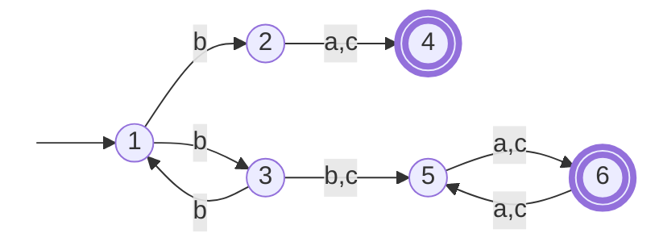
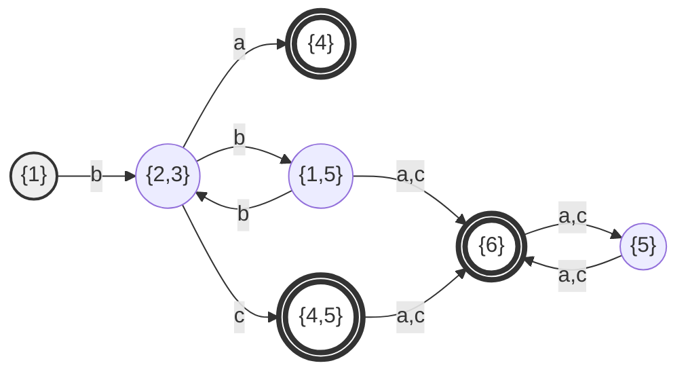
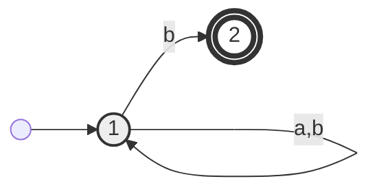
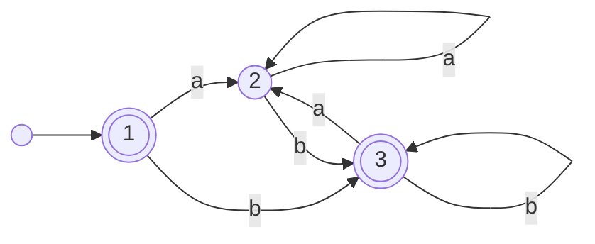
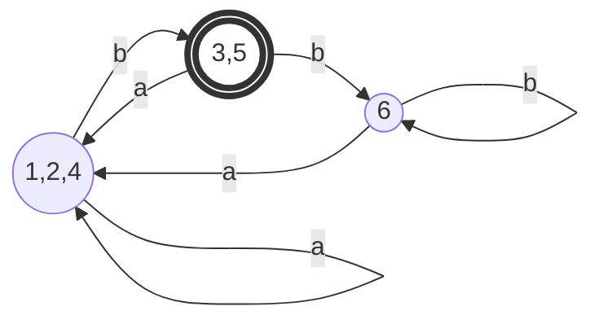
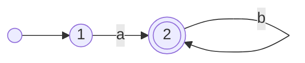
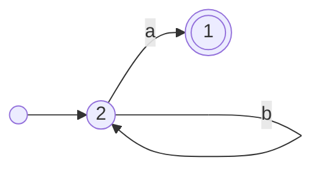

Date: 2026-01-30
Tags: [[Mathematics]], [[Discrete Mathematics]]

# ~={red} Notes=~

## 1. Le Monoïde Libre

### Définitions

> [!abstract] Définition : Mot et Alphabet
> Soit $\mathcal{A}$ un **alphabet** fini. Les éléments de $\mathcal{A}$ sont appelés **lettres**.
> 
> Un **mot** sur l'alphabet $\mathcal{A}$ est une suite finie d'éléments de $\mathcal{A}$.
> On note $\mathcal{A}^*$ l'ensemble de tous les mots sur $\mathcal{A}$.


- **Mot vide** : Le mot qui ne contient aucune lettre est noté $\varepsilon$ (ou $\epsilon$). Il est de longueur 0.
- **Longueur** : On note $|u|$ le nombre de lettres du mot $u$.

### Opération de Concaténation
On munit $\mathcal{A}^*$ d'une loi de composition interne (la concaténation).
Si $u = u_1...u_n$ et $v = v_1...v_m$ sont deux mots, alors le mot $uv$ est :
$$
uv = u_1...u_n v_1...v_m
$$

**Propriétés :**
1.  $|uv| = |u| + |v|$
2.  $\varepsilon$ est l'élément neutre : $u\varepsilon = \varepsilon u = u$
3.  L'opération est associative.

$\Longrightarrow$ $(\mathcal{A}^*, \cdot)$ est un **Monoïde Libre**.

### Notion de Langage

> [!def] Langage
> Un **langage** $L$ sur un alphabet $\mathcal{A}$ est simplement un sous-ensemble de $\mathcal{A}^*$ (une partie de $\mathcal{A}^*$).

**Exemple :**
Si $\mathcal{A}=\{a,b\}$, alors $\mathcal{A}^*=\{\varepsilon, a, b, aa, ab, ba, bb, ...\}$.
$L=\{ab, ba, abb, baa\}$ est un langage fini sur $\mathcal{A}$.

---

## 2. Opérations sur les Langages

Soient $L$ et $L'$ deux langages sur $\mathcal{A}$.

### Opérations Ensemblistes
- **Réunion** : $L \cup L' = \{ u \in \mathcal{A}^* \mid u \in L \text{ ou } u \in L' \}$
- **Intersection** : $L \cap L'$
- **Complémentaire** : $\bar{L} = \mathcal{A}^* \setminus L$

### Opérations Algébriques
1.  **Produit (Concaténation)** :
    $$L \cdot L' = \{ uv \mid u \in L \text{ et } v \in L' \}$$
2.  **Puissance d'un langage** :
    - $L^0 = \{\varepsilon\}$
    - $L^{n+1} = L \cdot L^n$
3.  **L'Étoile de Kleene (Itération)** :
    $$L^* = \bigcup_{n \geq 0} L^n = \{\varepsilon\} \cup L \cup L^2 \cup ...$$
4.  **Plus (Itération positive)** :
    $$L^+ = \bigcup_{n \geq 1} L^n = L \cdot L^*$$

> [!example] Exemple de calcul
> Soit $L=\{ab, ba\}$ et $L'=\{a, aa\}$.
> - **Produit** : $L \cdot L' = \{aba, abaa, baa, baaa\}$
> - **Itération** : $L^* = \{\varepsilon, ab, ba, abab, abba, baab, baba, ...\}$

### Langage Rationnel
Une partie de $\mathcal{A}^*$ est dite **rationnelle** si elle peut être obtenue à partir des parties finies de $\mathcal{A}^*$ en utilisant un nombre fini de fois les opérations : **Réunion $(\cup)$, Produit $(\cdot)$ et Étoile $(*)$**.

---

## 3. Système de transition étiqueté

> [!abstract] Définition Formelle
> Un système de transition est un quadruplet $(S, T, \alpha, \beta, \lambda)$ où :
> * $(S, T, \alpha, \beta)$ est un graphe orienté.
> * $S$ : Ensemble des **États** (sommets).
> * $T$ : Ensemble des **Transitions** (arcs).
> * $\lambda : T \to \mathcal{A}$ est l'étiquetage des transitions.

L'application combinée suivante est **injective** (il n'y a pas deux transitions identiques entre deux mêmes états avec la même étiquette) :
$$
\begin{align}
T &\longrightarrow S \times \mathcal{A} \times S \\
t &\longmapsto (\alpha(t), \lambda(t), \beta(t))
\end{align}
$$
On note une transition : $s \xrightarrow{a} s'$.
![[automate#^frame=automate|center]]

**Exemple :**
![[automate#^frame=automate 4|center]]
$$
\begin{align}
S &= \{1, 2, 3, 4\} \\
T &= \{(1,a,2), (1,b,3), (2,a,2), (2,b,4), (3,a,3), (3,a,4), (4,a,4), (4,b,4)\}
\end{align}
$$

### Chemins et Traces

#### Définition d'un Chemin
Un chemin $c$ est une suite de transitions consécutives $c = t_1 t_2 ... t_n$ telle que l'arrivée d'une transition est le départ de la suivante :
$$\beta(t_i) = \alpha(t_{i+1})$$

![[automate#^frame=cheminnn|center|600]]

- **Origine** : $\alpha(c) = \alpha(t_1)$
- **But** : $\beta(c) = \beta(t_n)$

#### Trace d'un chemin (Label)
La trace d'un chemin, notée $\lambda(c)$, est le mot formé par la concaténation des étiquettes des transitions :
$$\lambda(t_1...t_n) = \lambda(t_1) \cdot \lambda(t_2) \cdot ... \cdot \lambda(t_n)$$

![[automate#^frame=chemin trace|center|600]]

### Langages reconnus par les états
Soit $s, s' \in S$. On note $L_{s,s'}$ l'ensemble des mots qui sont des traces de chemins allant de $s$ à $s'$ :
$$L_{s,s'} = \{ \lambda(c) \mid \alpha(c)=s \text{ et } \beta(c)=s' \}$$

Pour des ensembles d'états $Q, Q' \subseteq S$ :
$$L_{Q,Q'} = \bigcup_{s \in Q, s' \in Q'} L_{s,s'}$$

---

## 4. Propriétés des Automates

### Automate Complet
Un automate est **complet** si depuis chaque état, il existe **au moins** une transition pour chaque lettre de l'alphabet.
$$\forall s \in S, \forall a \in \mathcal{A}, \exists t \in T : \alpha(t)=s \text{ et } \lambda(t)=a$$

### Automate Déterministe
Un automate est **déterministe** si depuis chaque état, il existe **au plus** une transition pour chaque lettre de l'alphabet.
$$\forall s \in S, \forall a \in \mathcal{A}, \text{card}(\{t \in T \mid \alpha(t)=s, \lambda(t)=a\}) \leq 1$$

> [!summary] Résumé : Le Système de Transition
> Un système sur un alphabet $\mathcal{A}$ est défini par $(S, T, \alpha, \beta, \lambda)$.
> Une transition est un triplet $t = (s, a, s')$.
> - $\alpha(t) =s$
> - $\beta(t)=s'$
> - $\lambda(t)=a$
> 
> - **Chemin** $c = t_1...t_n$
> - **Trace** $\lambda(c) = a_1...a_n$ (le mot lu sur le chemin)
> - **Langage reconnu** entre deux états : tous les mots qu'on peut lire en suivant les flèches de l'un à l'autre.

---
## 5. Automate Fini
### Definition
Un **automate fini** sur un alphabet $\mathcal{A}$ est 7-tuplet $(S,T,\alpha,\beta,\lambda,I,F)$
- $(S,T,\alpha,\beta,\lambda)$ un système de transition sur l'alphabet A
- $I$ et $F$ sont deux parties de $S$ 
	- $I$ : états initiale, note "$\rightarrow$"
	- $F$ : états finale, note "$\bigcirc$"
On écrit $\mathcal{A}=(S,T,I,F)$ un automate été représenté par un diagramme (**diagramme de l'automate**)
#### Exemple

![[automate#^frame=automate fini|center|600]]

$$
\begin{align}
&\mathcal{A}=(S,T,I,F) \quad \text{avec} \quad S=(1,2,3,4,5)\\
&T=\{(1,b,1),(1,a,2),(1,a,3),(2,b,3),(2,a,5),(3,a,4),(4,a,4),(4,b,4),(4,a,5),(5,b,4)\} \\
& I=\{1,2\} \quad \text{et} \quad F=\{4\}
\end{align}
$$
### Langage de l'automate
$\mathcal{L(A)}= L_{I,F}$ 
- $L_{I,F}= \{\lambda(c)/\alpha(c) \in I \quad \beta(c) \in F\}$ 

> [!NOTE]
> Un automate est complet si le système de transition $(S,T)$ est **complet**

> [!NOTE]
> Un automate $\mathcal{A}=(S,T,I,F)$ est déterministe s'il possède **un seul** eta initial et si $(S,T)$ est un système de transition déterministe

### Exemple
**Déterminiser et Compléter** l'automate suivant sur l'alphabet $\Sigma = \{a, b, c\}$.

#### 1. Représentation de l'automate (A)



#### 2. Analyse du non-déterminisme

On observe que :
- $(1, b, 2) \in T$
- $(1, b, 3) \in T$

Puisqu'il y a plusieurs transitions possibles pour l'état **1** avec la lettre **b**, **cet automate n'est pas déterministe**.

#### 3. Table de Détermination

Construction de l'automate déterministe par la méthode des sous-ensembles :

| **États (Q′)** | **a**       | **b**       | **c**       |
| -------------- | ----------- | ----------- | ----------- |
| $\to \{1\}$    | $\emptyset$ | $\{2, 3\}$  | $\emptyset$ |
| $\{2, 3\}$     | $\{4\}$     | $\{1, 5\}$  | $\{4, 5\}$  |
| $\{4\}$        | $\emptyset$ | $\emptyset$ | $\emptyset$ |
| $\{1, 5\}$     | $\{6\}$     | $\{2, 3\}$  | $\{6\}$     |
| $\{4, 5\}$     | $\{6\}$     | $\emptyset$ | $\{6\}$     |
| $\{6\}$        | $\{5\}$     | $\emptyset$ | $\{5\}$     |
| $\{5\}$        | $\{6\}$     | $\emptyset$ | $\{6\}$     |

> [!NOTE] Légende
> 
> - **États initiaux** : L'état $\{1\}$ est l'état initial.
>     
> - **États finaux** : Tout ensemble contenant un état final de l'original ($4$ ou $6$) devient un état final (ex: $\{4\}, \{6\}, \{4,5\}$).
>     
> - **Complétion** : Pour compléter cet automate, il faudrait ajouter un état puits $P$ vers lequel pointeraient toutes les cases vides ($\emptyset$).


---
## 6. Langages Reconnaissables et Préfixes
### Langage Reconnaissable

#### Définition
Un langage $L \subseteq \mathcal{A}^*$ est dit **reconnaissable** si et seulement s'il existe un automate fini $\mathcal{A} = (S, T, I, F)$ sur l'alphabet $\mathcal{A}$ tel que le langage reconnu par l'automate soit égal à $L$.
$$
\mathcal{L}(\mathcal{A}) = L
$$

#### Exemple du cours
Voici l'automate dessiné correspondant à l'expression régulière $L = (a+b)^*b$.



> [!example] Analyse de l'exemple
> 
> - **Expression** : $L = (a+b)^*b$
>     
> - Ce langage contient tous les mots qui se terminent par la lettre **b**.
>     
> - L'automate est non-déterministe (car avec la lettre `b` sur l'état 1, on peut soit boucler, soit aller à l'état 2).
>     

### Notion de Préfixe

#### Exemple Introductif
Si on considère le langage fini suivant :

$$ L = {aa, bb} $$

Alors l'ensemble des préfixes de $L$, noté $\text{Pref}(L)$, est :

$$ \text{Pref}(L) = {\varepsilon, a, aa, b, bb} $$

#### Définitions Formelles

**1. Préfixe d'un mot :**
Un mot $u$ est un préfixe de $v$ (noté $u \in \text{Pref}(v)$) s'il existe un mot $w \in \mathcal{A}^*$ tel que $v$ soit la concaténation de $u$ et $w$.

$$u \in \text{Pref}(v) \iff \exists w \in \mathcal{A}^*, v = uw$$

**2. Préfixe d'un langage :**
L'ensemble des préfixes d'un langage $L$ est l'ensemble de tous les préfixes de tous les mots appartenant à ce langage.

$$\text{Pref}(L) = \{ u \in \mathcal{A}^* \mid \exists v \in L, u \in \text{Pref}(v) \}$$

On peut aussi l'écrire comme l'union des préfixes de chaque mot :

$$\text{Pref}(L) = \bigcup_{v \in L} \text{Pref}(v)$$

## Exemples des automates déterministes complets

### 1. Automate Déterministe
#### Intuition 
C'est un système **sans ambiguïté**. Quand on est dans un état et qu'on lit une lettre, on sait exactement où aller (ou alors on ne va nulle part si la transition n'existe pas). Il n'y a jamais de "choix" à faire.
#### Exemple Visuel
> [!failure] Non-Déterministe
> Ici, si je suis en **1** et que je lis **"a"**, je peux aller vers **2** OU vers **3**. C'est ambigu.
> ```mermaid
> graph LR
>    1((1)) -- a --> 2((2))
>    1 -- a --> 3((3))
> ```

> [!success] Déterministe
> Ici, chaque lettre mène à une seule destination précise.
> ```mermaid
> graph LR
>    1((1)) -- a --> 2((2))
>    1 -- b --> 3((3))
> ```

### 2. Automate Complet

#### Intuition
C'est un système **sans blocage**. Quelle que soit la lettre lue, l'automate a toujours une réaction prévue. Si une lettre n'est pas censée être acceptée à un moment donné, on ajoute souvent un **État Puits** (ou état poubelle) pour "capturer" ces erreurs.
#### Exemple Visuel (Alphabet $\Sigma = \{a, b\}$)

> [!failure] Incomplet
> Si je suis en **1** et que je lis **"b"**, l'automate plante car aucune flèche n'est définie.
> ```mermaid
> graph LR
>    1((1)) -- a --> 2((2))
> ```

> [!success] Complet (avec État Puits)
> Ici, la transition manquante **"b"** a été ajoutée vers un état puits (P).
> ```mermaid
> graph LR
>    I(( )) --> 1
>    1((1)) -- a --> 2((2))
>    1 -- b --> P((P))
>    P -- a,b --> P
> ```

### Alphabet $\sum = \{a,b,c\}$

#### 1. L'ensemble des mots de longueur paire 

![[automate#^frame=automateee|center|600]]
#### 2. $u \in \sum^* / |u|_b$ est divisible par 3
$|u|_b$ le nombre d'occurence de la lettre $b$ dans le mot $u$ 

![[Excalidraw/automate.md#^frame=automate completdetermine|center|500]]
#### 3. $u \in \sum^* / |u|_b=1$

![[Excalidraw/automate.md#^frame=automate completdetermine 2|center|500]]

> [!Remarque]
> $u=aabbbccbbaab \in \sum^*$ 
> - $|u|=12$
> - $|u|_a=4$
> - $|u|_b=6$
> - $|u|_c=2$

## 7. Calcul du Langage (Méthodes Algébriques)

### Principe
Soit $\mathcal{A} = (S, T, \{1\}, F)$ un automate dont les états sont numérotés de 1 à $n$, ayant $L$ pour langage.

$$ \mathcal{L} = \mathcal{L}(\mathcal{A}) = L_{1,F} = { u \in \Sigma^* \mid \exists \text{ un chemin } c, \alpha(c)=1, \beta(c) \in F \text{ et } \lambda(c)=u } $$
### 1. Méthode de départ 

À chaque état $K$, on associe le **langage de départ** $D_K$ de l'état $K$.
$D_K = \{ u \in \Sigma^* \mid \exists \text{ un chemin } c \text{ d'origine } K \text{ et de but un état final tel que } \lambda(c)=u \}$

> [!summary] Théorème
> 
> Si $\Sigma = \{a_1, a_2, ..., a_p\}$, alors pour tout $K \in \{1..n\}$ :
> 
> $$ D_K = f_K + a_1 D_{\delta_1(K)} + a_2 D_{\delta_2(K)} + ... + a_p D_{\delta_p(K)} $$
> Avec le terme constant $f_K$ défini par :
> $$f_K = \begin{cases} \varepsilon & \text{si } K \in F \text{ (état final)} \\ \emptyset & \text{si } K \notin F \end{cases}$$
> 
> Le système est formé par ces $n$ équations dont les inconnues sont les langages $D_1, D_2, ..., D_n$.
> 

#### Exemple d'application
On considère l'automate $\mathcal{A}$ suivant sur l'alphabet $\Sigma = \{a, b\}$.




Le système de départ de l'élément 1 est :

$$\begin{cases} D_1 = \varepsilon + a D_2 + b D_3 \\ D_2 = a D_2 + b D_3 \\ D_3 = \varepsilon + a D_2 + b D_3 \end{cases}$$

### 2. Méthode d'Arrivée

Contrairement à la méthode de départ (qui regarde vers le futur), la méthode d'arrivée regarde vers le passé (d'où l'on vient).

#### Définition
À chaque état $K$, on associe le **langage d'arrivée** $A_K$ défini par :
$$A_K = \{ u \in \Sigma^* \mid \delta(I, u) = K \}$$

> [!summary] Théorème
> La relation entre les langages d'arrivée des différents états est donnée par :
> $$A_K = e_K + \sum_{q \xrightarrow{a} K} A_q \cdot a$$
> Avec le terme constant :
> $$
> e_K = \begin{cases} 
> \varepsilon & \text{si } K = I \text{ (état initial)} \\
> \emptyset & \text{sinon}
> \end{cases}
> $$
> 

#### Exemple d'application
Sur le même automate que précédemment :


Le système d'arrivée est :

$$\begin{cases} A_1 = \varepsilon \\ A_2 = A_1 a + A_2 a + A_3 a \\ A_3 = A_1 b + A_2 b + A_3 b \end{cases}$$
### 3. Théorème 3 : Lemme d'Arden

Les deux systèmes (départ et arrivée) se résolvent en utilisant ce lemme fondamental.

> [!important] Lemme d'Arden
> 
> Soient $U$ et $V$ deux langages.
> 
> Si $\varepsilon \notin U$, alors :
> 
> 1. L'équation $X = UX + V$ admet pour **seule solution** $X = U^*V$.
>     
> 2. L'équation $X = XU + V$ admet pour **seule solution** $X = VU^*$.
>     

### 4. Résolution du Système de Départ

On reprend le système de départ établi précédemment et on le résout par substitution et Arden.

**Rappel du système :**

$$\begin{cases} D_1 = \varepsilon + a D_2 + b D_3 & (1) \\ D_2 = a D_2 + b D_3 & (2) \\ D_3 = \varepsilon + a D_2 + b D_3 & (3) \end{cases}$$
#### Étape 1 : Résolution de $D_3$

On observe l'équation (3). On factorise pour isoler le terme en $D_3$ (forme $X = UX + V$) :

$$ D_3 = b D_3 + (a D_2 + \varepsilon) $$
Ici : $U = b$ et $V = (a D_2 + \varepsilon)$.

D'après le Lemme d'Arden ($X = U^*V$) :

$$ D_3 = b^* (a D_2 + \varepsilon) $$
En développant :

$$ D_3 = b^* a D_2 + b^* \quad (*)$$
#### Étape 2 : Injection dans $D_2$

On remplace $D_3$ dans l'équation (2) par l'expression $(*)$ trouvée :

$$ D_2 = a D_2 + b (b^* a D_2 + b^*) $$
On développe :

$$ D_2 = a D_2 + b b^* a D_2 + b b^* $$
On factorise par $aD_2$ (à droite) pour retrouver la forme d'Arden :

$$ D_2 = (\varepsilon + b b^* ) aD_2 + b b^* $$
$$ D_2 = (\varepsilon + b^+)aD_2 + b^+$$
$$ D_2=b^*aD_2 + b^+$$
Ici : $U = b^*a$ et $V = b^+$.

Application du Lemme d'Arden :

$$ \mathbf{D_2 = (b^* a)^* b^+} $$
#### Étape 3 : Résolution Finale ($D_1$)

On remarque d'après les équations (1) et (3) que $D_1 = D_3$ (car $D_1 = \varepsilon + aD_2 + bD_3$ et $D_3 = \varepsilon + aD_2 + bD_3$).

Donc :

$$ D_1 = b^* a D_2 + b^* $$
On remplace $D_2$ par sa valeur finale :

$$ \mathbf{D_1 = b^*a (b^*a)^*b^+  + b^*} $$
$$ \mathbf{D_1 = b^*a (b^*a)^*b^+  + b^+ + \varepsilon} $$
$$ \mathbf{D_1 = (b^*a (b^*a)^*+\varepsilon)b^+ + \varepsilon} $$
$$ \mathbf{D_1 = (b^*a)^*b^+ + \varepsilon} $$

Ceci est l'expression régulière du langage reconnu par l'automate (puisque $L = D_1$).

### 5. Résolution du Système de Départ

On reprend le même automate que pour la méthode de départ :
- **État initial** : 1
- **États finaux** : 1 et 3 (D'après la conclusion $L=A_1+A_3$ dans vos notes)

**Système d'équations (lecture des flèches entrantes) :**
$$
\begin{cases}
A_1 = \varepsilon & (1) \\
A_2 = A_1 a + A_2 a + A_3 a & (2) \\
A_3 = A_1 b + A_2 b + A_3 b & (3)
\end{cases}
$$

##### Étape 1 : Résolution de $A_2$ (équation 2)
On remplace $A_1$ par $\varepsilon$ dans (2) :
$$A_2 = \varepsilon a + A_2 a + A_3 a$$
On factorise pour isoler $A_2$ (forme $X = XU + V$) :
$$A_2 = A_2 a + (\varepsilon + A_3)a$$

Ici : $X = A_2$, $U = a$, $V = (\varepsilon + A_3)a$.
D'après Arden ($X = VU^*$) :
$$A_2 = (\varepsilon + A_3)a a^*$$
Comme $a a^* = a^+$, on a :
$$\mathbf{A_2 = (\varepsilon + A_3)a^+} \quad (*)$$

##### Étape 2 : Résolution de $A_3$ (équation 3)
On reprend (3) : $A_3 = \varepsilon b + A_2 b + A_3 b$.
On remplace $A_2$ par l'expression $(*)$ trouvée :
$$A_3 = b + [(\varepsilon + A_3)a^+]b + A_3 b$$

On développe :
$$A_3 = b + a^+ b + A_3 a^+ b + A_3 b$$

On factorise par $A_3$ (à gauche, car méthode d'arrivée) :
$$A_3 = A_3(a^+ b + b) + (b + a^+ b)$$

On remarque que $(b + a^+ b) = (\varepsilon + a^+)b = a^* b$.
L'équation devient :
$$A_3 = A_3 (a^* b) + a^* b$$

Ici : $X = A_3$, $U = a^* b$, $V = a^* b$.
D'après Arden ($X = VU^*$) :
$$A_3 = (a^* b)(a^* b)^*$$
$$\mathbf{A_3 = (a^* b)^+}$$

##### Étape 3 : Langage Final Accepté
Le langage reconnu par l'automate est la somme des langages d'arrivée des états finaux ($F = \{1, 3\}$).

$$L = \sum_{K \in F} A_K = A_1 + A_3$$

$$L = \varepsilon + (a^* b)^+$$

Or, $\varepsilon \cup (a^* b)^+ = (a^* b)^*$.
Donc :
$$\mathbf{L = (a^* b)^*}$$

> [!success] Conclusion
> L'automate reconnaît l'ensemble des mots formés par des répétitions de séquences de $a$ (autant qu'on veut) terminées par un $b$.


## 8. Notion de Résiduel (Quotient)

### Définitions

> [!def] Résiduel d'un langage
> Soit $L$ un langage sur un alphabet $\Sigma$ et $u \in \Sigma^*$ un mot.
> On appelle **résiduel** (ou quotient) de $L$ par rapport à $u$, noté $u^{-1}L$, le langage :
> $$u^{-1}L = \{ w \in \Sigma^* \mid uw \in L \}$$

**Propriétés fondamentales :**
* $u \in \varepsilon^{-1}L \iff u \in L$ (Le résiduel par le mot vide est le langage lui-même).
* $\varepsilon \in u^{-1}L \iff u \in L$ (Si le mot vide est dans le résiduel, alors $u$ appartient au langage).
* $u^{-1}\emptyset = \emptyset$
* $u^{-1}\Sigma^* = \Sigma^*$
* **Composition** : Le résiduel d'un résiduel est un résiduel.
    $$v^{-1}(u^{-1}L) = (uv)^{-1}L$$

### Théorème : Lien avec les Automates
Soit $\mathcal{A} = (S, T, I, F)$ un automate.
Si $\delta(I, u) = K$ (en partant de l'état initial, on arrive à l'état $K$ en lisant $u$), alors :
$$D_K = u^{-1}L$$
> Le **langage de départ** d'un état accessible $K$ est exactement le **résiduel** du langage $L$ par le mot qui mène à $K$.

---

## 9. Automate Minimal

### États Accessibles
Un état $s$ est dit **accessible** s'il existe un chemin partant de l'état initial allant vers $s$.
$$\exists u \in \Sigma^* \text{ tel que } \delta(I, u) = s$$
Dans le cas contraire, il est dit **inaccessible**.

> **Simplification** : On peut supprimer les états inaccessibles sans changer le langage reconnu par l'automate.

### Théorème de Myhill-Nerode (Version Automates)
1.  Les résiduels d'un langage régulier $L$ sont en nombre fini.
2.  **L'Automate Minimal** de $L$ est l'automate dont les états sont exactement les résiduels distincts de $L$.
    * **États** : L'ensemble des résiduels $\{ u^{-1}L \mid u \in \Sigma^* \}$.
    * **État Initial** : $\varepsilon^{-1}L = L$.
    * **États Finaux** : Les résiduels qui contiennent $\varepsilon$.
    * **Transitions** : D'un état $R$ (qui est un résiduel), la flèche $a$ mène vers le résiduel $a^{-1}R$.

Cet automate est unique (à isomorphisme près) et possède le nombre minimal d'états pour reconnaître $L$.
### Exemple Complet de Minimisation

**Objectif :** Simplifier l'automate suivant et trouver son expression régulière.

![[Excalidraw/automate.md#^frame=simplification d'un automate|center|600]]
#### 1. Automate Initial & Système de Départ

On élimine d'abord l'état **7** qui est inaccessible (aucune flèche ne vient de 1, 2... vers 7).

On écrit le système d'équations des langages de départ ($D_k$) :

$$
\begin{cases}
D_1 = a D_2 + b D_3 & (1) \\
D_2 = a D_4 + b D_5 & (2) \\
D_3 = \varepsilon + a D_4 + b D_6 & (3) \\
D_4 = a D_4 + b D_5 & (4) \\
D_5 = \varepsilon + a D_4 + b D_6 & (5) \\
D_6 = a D_4 + b D_6 & (6)
\end{cases}
$$

#### 2. Identification des États Équivalents
On cherche à réduire le nombre d'états en trouvant les $D_k$ identiques.

1.  **Comparaison (2) et (4)** :
    $D_2$ et $D_4$ ont exactement la même expression ($aD_4 + bD_5$).
    $\Longrightarrow D_2 = D_4$.
2.  **Comparaison (3) et (5)** :
    $D_3$ et $D_5$ ont exactement la même expression ($\varepsilon + aD_4 + bD_6$).
    $\Longrightarrow D_3 = D_5$.
3.  **Retour sur (1)** :
    $D_1 = a D_2 + b D_3$. En remplaçant par les égalités trouvées : $D_1 = a D_4 + b D_5$.
    Or, c'est exactement la définition de $D_4$.
    $\Longrightarrow D_1 = D_4$.

**Conclusion des équivalences :**
Nous avons 3 groupes d'états distincts (3 résiduels) :
* Groupe A : $\{1, 2, 4\}$ (Notez $D_I$)
* Groupe B : $\{3, 5\}$ (Notez $D_{II}$)
* Groupe C : $\{6\}$ (Notez $D_{III}$)

On vérifie que $D_6$ est bien différent des autres (il ne contient pas $\varepsilon$ contrairement à $D_3$, et ses transitions bouclent sur lui-même différemment).

**Nouveau system:**
$$
\begin{cases}
D_1 = a D_1 + b D_3 & (1) \\
D_3 = \varepsilon + a D_1 + b D_6 & (2) \\
D_6 = a D_1 + b D_6 & (3)
\end{cases}
\quad \text{avec} \quad D_1=D_2=D_4 ~;~ D_3=D_5
$$
![[Excalidraw/automate.md#^frame=final|center]]
##### Lemme de Arden
$$
\begin{align}
&(3) \Rightarrow D_6 = bD_6+aD_1\\
&U=b, X=D_6,V=aD_1\\
&D_6=b^*aD_1
\end{align}
$$
$$
\begin{align}
&(2) \Rightarrow D_3 =\varepsilon + aD_1+bD_6\\
& D_3 =\varepsilon + aD_1+b b^* a D_1\\
& D_3 = a(\varepsilon + bb^*)D_1 +\varepsilon\\
& D_3 = ab^*D_1 +\varepsilon
\end{align}
$$
L'equation $(1)$ entraine.

$$
\begin{align}
&(1) \Rightarrow D_1 = aD_1+bD_3\\
& D_1 =aD_1+b(ab^*D_1 +\varepsilon)\\
& D_1 =aD_1+bab^*D_1 +b\\
& D_1 = a(\varepsilon + bb^*)D_1 +b\\
& D_1 = (ab^*)D_1 +b
\end{align}
$$
**D'apres lemme de Arden** 
$U=(ab^*)$, $X=D_1$ et $V=b$ 
Alors:  $$D_1=(ab^*)^*b$$
#### 3. Construction de l'Automate Minimal
On fusionne les états équivalents.



## 10. Automate Miroir (Transposé)

### Définitions

> [!def] Miroir d'un mot et d'un langage
> * Le **miroir d'un mot** $u = a_1 a_2 ... a_n$ est le mot lu à l'envers : $u^R = a_n ... a_2 a_1$.
> * Le **miroir d'un langage** $L$ est l'ensemble des miroirs de ses mots : $L^R = \{ u^R \mid u \in L \}$.

### Construction de l'Automate Miroir $\mathcal{A}^R$
Soit $\mathcal{A} = (S, T, I, F)$ un automate fini.
L'automate miroir $\mathcal{A}^R = (S, T', I', F')$ est construit en inversant le sens de lecture :

1.  **Inversion des flèches** : Si $s \xrightarrow{a} s'$ dans $\mathcal{A}$, alors $s' \xrightarrow{a} s$ dans $\mathcal{A}^R$.
2.  **Échange Entrée/Sortie** :
    * Les états initiaux de $\mathcal{A}$ deviennent les états finaux de $\mathcal{A}^R$.
    * Les états finaux de $\mathcal{A}$ deviennent les états initiaux de $\mathcal{A}^R$.

$$\mathcal{L}(\mathcal{A}^R) = (\mathcal{L}(\mathcal{A}))^R$$

> [!tip] Astuce
> Si l'automate de départ a un seul état initial et un seul état final, son miroir aura aussi une structure simple. Sinon, le miroir devient souvent non-déterministe (plusieurs états initiaux).

### Exemple Visuel

**1. Automate Original ($\mathcal{A}$)**
*Langage :* $ab^*$ (un 'a' suivi de n'importe quel nombre de 'b').



**2. Automate Miroir ($\mathcal{A}^R$)**

- L'état 2 devient initial.
- L'état 1 devient final.
- Les flèches sont renversées.
- _Langage reconnu :_ $(b^*)^R a^R = b^* a$ (des 'b' suivis d'un 'a').



### Application : Algorithme de Brzozowski

L'opération miroir est au cœur d'une méthode élégante pour minimiser un automate :

$$ \text{Minimal}(\mathcal{A}) = \text{Det}(\text{Miroir}(\text{Det}(\text{Miroir}(\mathcal{A})))) $$

_Où "Det" signifie déterminiser l'automate._

# ~={red}References=~
