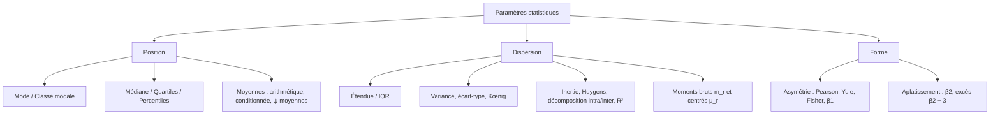

Tags: [[Statistics]], [[Descriptive Statistics]], [[Paramètres de Position]], [[Dispersion]], [[Histogramme]], [[Moments]], [[ENSAM]]

---
# Statistique Descriptive

## Chapitre 0 : Généralités

> [!info] Définition : Statistique descriptive vs inférentielle
> - **Statistique descriptive** : l'étude de la **totalité** de la population.
> - **Statistique inférentielle** : l'étude d'une **partie** de la population (échantillon), puis **généralisation** des résultats à la population entière.

**Avantages de l'approche par échantillonnage :**
- Optimiser le coût et les ressources (humains, matériels) ;
- Réviser les conclusions dans le cas où la totalité de la population est absente / inaccessible ;
- Nécessité de l'échantillonnage pour vérifier la qualité des éléments (contrôle destructif par exemple).

> [!info] Définition / Théorème : Vocabulaire fondamental
> - **Population** : les éléments à étudier ; une cible finie notée $\Omega$ ;
> - **Unité statistique** : les éléments de $\Omega$, notés $\omega$ ;
> - **Caractère statistique** : $C$, $X$ ou $Y$ — un trait présent chez les éléments de $\Omega$ de manière :
>     - **Exhaustive** : le caractère doit être présent chez **tous** les éléments de la population ;
>     - **Exclusive** : un élément doit avoir une **valeur modale unique** ;
> - **Modalités** : les différentes valeurs de $C$ ;
> - **Observation** : les modalités **avec répétition**.

> [!info] Définition / Théorème : Le caractère comme application
> Un caractère statistique est une application
> $$X : \Omega \longrightarrow E, \quad \omega \mapsto X(\omega)$$
> où $E$ est l'ensemble des modalités (ex. l'ensemble des poids). Le caractère est **bien défini** si et seulement si il est **exhaustif** (défini partout) et **exclusif** (valeur unique par unité).

> [!example] Exemple d'Application : Étude des poids des étudiants d'une classe
> - **Population** : les étudiants de la classe modélisée ;
> - **Caractère** : le poids ;
> - **Modalité** : valeur possible du caractère (ex. $50$ kg, $80$ kg…).
> 
> L'application $X : \Omega \to \mathbb{R}_{+}$ qui à chaque étudiant associe son poids est exhaustive et exclusive : c'est un caractère bien défini.

> [!info] Définition : Effectifs et fréquences
> - **Effectif** $n_i$ : nombre d'observations prenant la modalité $i$ ; effectif total $N = \sum_i n_i$ ;
> - **Fréquence** $f_i = \dfrac{n_i}{N}$, avec $\sum_i f_i = 1$ ;
> - **Effectifs cumulés** $N_i$ et **fréquences cumulées** $F_i = \sum_{k \le i} f_k$ (représentations « intégrales »).

### Typologie des Variables Statistiques

| Type de Variable | Nature des Modalités                         | Exemples                      |
| ---------------- | -------------------------------------------- | ----------------------------- |
| **Qualitative**  | Non mesurables, catégories                   | Sexe, Couleur des yeux, CSP   |
| ↳ _Nominale_     | Pas d'ordre naturel                          | Groupe sanguin (A, B, O)      |
| ↳ _Ordinale_     | Ordre naturel, pas de distance               | Niveau d'étude, Mention       |
| **Quantitative** | Mesurables, valeurs numériques               | Poids, Salaire, Température   |
| ↳ _Discrète_     | Valeurs isolées (dénombrables)               | Nombre d'enfants, Note sur 20 |
| ↳ _Continue_     | Valeurs dans un intervalle réel $\mathbb{R}$ | Taille, Temps de trajet, PIB  |

---

## 1. Représentations Graphiques

### 1.1 Caractère Qualitatif

On utilise principalement 3 types de présentation graphique : le **diagramme en bâtons**, les **tuyaux d'orgue** et le diagramme par **secteurs**. Lorsque le caractère étudié est la **répartition géographique** d'une population, la représentation graphique est un **cartogramme**.

**Diagramme en bâtons :**
- On porte en abscisse les modalités, de façon arbitraire ;
- On porte en ordonnée des segments dont la longueur est proportionnelle aux **effectifs** (ou aux **fréquences**) de chaque modalité ;
- On appelle **polygone statistique** (ou diagramme polygonal) la ligne obtenue en joignant les sommets des bâtons.

> ![[Pasted image 20261009011437.png|549]]
> *(Description précise de l'illustration : bâtons(Barres) verticaux dont la hauteur est proportionnelle à l'effectif de chaque modalité, avec le polygone statistique joignant les sommets)*

**Tuyaux d'orgue :**
- On porte en abscisses les modalités, de façon arbitraire ;
- On porte en ordonnées des **rectangles** dont la longueur est proportionnelle aux effectifs ou aux fréquences.

> ![[Pasted image 20261009011603.png]]
> *(Description précise de l'illustration : rectangles jointifs de hauteurs proportionnelles aux effectifs des modalités)*

**Secteurs :** ces diagrammes conviennent très bien pour des données politiques ou des sous-mesures (parts d'un tout).

> ![[Pasted image 20261009011732.png]]
> *(Description précise de l'illustration : diagramme circulaire en secteurs proportionnels aux fréquences, et cartogramme pour une répartition géographique)*

### 1.2 Caractère Quantitatif

Il existe deux types de représentation graphique :
- **Effectifs / fréquences** (représentation « différentielle ») : effectifs ou fréquences ;
- **Intégrale** (cumulée) : effectifs cumulés ou fréquences cumulées.

#### Variable statistique discrète :
- **Diagramme en bâtons** : la différence avec le cas qualitatif est que les abscisses sont ici les **valeurs** de la variable statistique ;
- **Courbe en escaliers** des effectifs cumulés ou des fréquences cumulées.

> ![[Pasted image 20261009011905.png]]
> *(Description précise de l'illustration : fonction en escaliers croissante des effectifs cumulés $N_i$ en fonction des valeurs $x_i$)*

#### Variable statistique continue :
Les observations sont regroupées en **classes** (intervalles $[x_i, x_{i+1}[$). L'amplitude de la classe est $a_i = x_{i+1} - x_i$.

> [!warning] Piège / Concept Crucial : La Densité
> Lorsque les classes ont des **amplitudes différentes**, on ne peut pas tracer la hauteur du rectangle proportionnellement à l'effectif. Il faut utiliser la **densité**.
> $$d_i = \frac{n_i}{a_i} \quad \text{(Densité d'effectif)} \qquad \text{ou} \qquad d_i = \frac{f_i}{a_i} \quad \text{(Densité de fréquence)}$$
> Dans un **histogramme**, c'est l'**aire** du rectangle (et non la hauteur) qui est proportionnelle à l'effectif de la classe.
>- **Courbe cumulative** des effectifs ou des fréquences cumulés.

> ![[Pasted image 20261009011959.png]]
> *(Description précise de l'illustration : histogramme à rectangles de hauteurs égales aux densités corrigées $n_i/a_i$, avec la courbe cumulative superposée)*

> [!warning] Piège / Cas Particulier : Amplitudes inégales
> Lorsque les classes ont des amplitudes **différentes**, tracer les effectifs bruts fausse la lecture visuelle : il faut impérativement utiliser les **densités corrigées** $n_i / a_i$, car c'est l'**aire** du rectangle qui doit représenter l'effectif.

---

## 2. Paramètres de Position

> [!info] Définition : Paramètres de position
> Ces paramètres permettent de savoir **autour de quelles valeurs** se situent les valeurs d'une variable statistique (centre, extrêmes).

![[Pasted image 20261009012227.png]]
### 2.1 Le mode et la classe modale

> [!info] Définition / Théorème : Mode
> Le **mode** est la modalité qui possède le **plus grand effectif** (ou la plus grande fréquence).
>- **Distribution unimodale** : Un seul pic, population homogène.
>- **Distribution multimodale** : Plusieurs pics, population hétérogène (mélange de sous-populations).

> [!info] Définition / Théorème : Classe modale (variable quantitative continue)
> Soit $[x_i, x_{i+1}[$ la classe modale, $\Delta_1 = n_i - n_{i-1}$ et $\Delta_2 = n_i - n_{i+1}$ les écarts d'effectifs avec les classes adjacentes. Le mode corrigé $M_0$ est défini par :
> $$
> \frac{M_0 - x_i}{\Delta_1} = \frac{x_{i+1} - M_0}{\Delta_2}
> \quad\Longrightarrow\quad
> M_0 = x_i + \frac{\Delta_1}{\Delta_1 + \Delta_2}\,(x_{i+1} - x_i)
> $$

> ![[Pasted image 20261009012031.png|538]]

### 2.2 La Médiane ($M_e$)

> [!info] Définition / Théorème : Médiane
> La **médiane** $M_e$ est la modalité qui divise la population en **deux parties de même taille** ($p = 1/2$) :
> - $1^{\text{ère}}$ partie : modalités $<$ médiane ;
> - $2^{\text{ème}}$ partie : modalités $>$ médiane.
> 
> Elle est définie si la description est **quantitative** (une relation d'ordre existe $\Rightarrow$ quantitative ordinale).

**Cas discret (données ordonnées $x_{(1)} \le \dots \le x_{(N)}$) :**
- Si $N$ est **impair** :
$$
M_e = x_{\left(\frac{N+1}{2}\right)}
$$
- Si $N$ est **pair** (complément) :
$$
M_e = \frac{1}{2}\left( x_{\left(\frac{N}{2}\right)} + x_{\left(\frac{N}{2}+1\right)} \right)
$$

**Cas continu (complément) :** interpolation linéaire sur la classe médiane $[x_i, x_{i+1}[$ :
$$
M_e = x_i + \frac{\frac{N}{2} - N_{i-1}}{n_i}\,(x_{i+1} - x_i)
\quad=\quad
x_i + \frac{0{,}5 - F_{i-1}}{f_i}\,(x_{i+1} - x_i)
$$

### 2.3 La Moyenne Arithmétique ($\overline{X}$)

> [!info] Définition / Théorème : Moyenne arithmétique
> Définie quand la distribution est **quantitative** :
> $$
> \overline{X} = \frac{1}{N} \sum_{\omega \in \Omega} X(\omega) = \frac{1}{N} \sum_i n_i x_i = \sum_i f_i x_i
> $$

> [!abstract] Propriétés Fondamentales de la Moyenne
> 1. **Linéarité (Somme)** : $\overline{X + Y} = \overline{X} + \overline{Y}$
> 2. **Homogénéité (Scalaire)** : $\overline{\lambda X} = \lambda \overline{X}$
> 3. **Écart moyen nul** : La moyenne des écarts à la moyenne est toujours nulle. $\overline{(X - \overline{X})} = 0$
> 4. **Propriété de Huygens (Minimum)** : La somme des carrés des écarts est minimale lorsqu'elle est calculée par rapport à la moyenne. $\forall a \in \mathbb{R}, \sum n_i(x_i - \overline{X})^2 \le \sum n_i(x_i - a)^2$

**Moyenne conditionnée :** si on divise la population en sous-populations triées par une condition (région, niveau…), la moyenne de chaque sous-population est une **moyenne conditionnée**, et la moyenne générale est la moyenne des moyennes conditionnées **pondérée par la taille des parties** :
$$
\overline{X^j} = \frac{1}{n_j} \sum_{i=1}^{n_j} x_i
\qquad\Longrightarrow\qquad
\overline{X} = \frac{1}{N} \sum_{j} n_j\, \overline{X^j}
$$

**Moyenne d'une variable continue :**
$$
\overline{X} = \frac{1}{N} \sum_{i} n_i\, \overline{X^i}
\quad \text{avec } \overline{X^i} \text{ la moyenne à l'intérieur de } [x_i, x_{i+1}[
$$
- **Hypothèse 1** : dans chaque classe, toutes les observations sont concentrées au **centre** de la classe : $\overline{X^i} = \dfrac{x_i + x_{i+1}}{2}$ ;
- **Hypothèse 2** : la répartition des observations est **uniforme** dans la classe (ce qui redonne aussi $\overline{X^i} = \dfrac{x_i + x_{i+1}}{2}$, mais avec une variance intra-classe non nulle, cf. §3).

> [!example] Exemple d'Application : Moyenne avec centres de classes
> | $x_i$ (centre) | $n_i$ |
> | :--- | :--- |
> | 7 | 30 |
> | 10 | 10 |
> 
> Sous l'hypothèse 1 (concentration au centre), avec $N = 30 + 10 = 40$ :
> $$
> \overline{X} = \frac{1}{40}\left( 30 \times 7 + 10 \times 10 \right) = \frac{210 + 100}{40} = \frac{310}{40} = 7{,}75
> $$

### 2.4 Généralisation : la $\psi$-moyenne

> [!info] Définition / Théorème : $\psi$-moyenne
> Soit $X$ une variable statistique réelle et $\psi : \mathbb{R} \to \mathbb{R}$ une application localement intégrable et inversible. Alors $\psi \circ X : \Omega \to \mathbb{R}$ est une distribution statistique réelle, et on définit la **$\psi$-moyenne** de $X$ par :
> $$
> \overline{\psi}(x) = \frac{1}{N} \sum_i n_i\, \psi(x_i)
> \qquad\Longrightarrow\qquad
> \overline{X}^{\psi} = \psi^{-1}\!\left( \overline{\psi \circ X} \right)
> $$

> [!example] Exemple d'Application : Les quatre moyennes classiques
> 1. **Arithmétique** : $\psi_1 : x \mapsto x$ (identité) :
> $$
> \overline{X}^{\psi} = \text{Id}^{-1}\!\left( \frac{1}{N} \sum_i n_i\, \text{Id}(x_i) \right) = \overline{X}
> $$
> 2. **Quadratique** : $\psi_2 : x \mapsto x^2$ :
> $$
> \overline{X}_q = \sqrt{ \frac{1}{N} \sum_i n_i x_i^2 }
> $$
> 3. **Harmonique** : $\psi : x \mapsto 1/x$ :
> $$
> \overline{X}_h = \left( \frac{1}{N} \sum_i \frac{n_i}{x_i} \right)^{-1}
> $$
> 4. **Géométrique** : $\psi : x \mapsto \ln(x)$ :
> $$
> \overline{X}_g = \exp\!\left( \frac{1}{N} \sum_i n_i \ln(x_i) \right) = \sqrt[N]{ \prod_{i=1}^{k} x_i^{n_i} }
> $$

**Propriétés de la $\psi$-moyenne (inégalité des moyennes) :**
$$
\overline{X}_h \le \overline{X}_g \le \overline{X} \le \overline{X}_q
$$
- Il y a **égalité** si toutes les valeurs de $x$ sont égales ;
- $\overline{X}_g$ est bien adaptée à l'étude des **phénomènes de croissance** (taux multiplicatifs) ;
- $\overline{X}_h$ est utilisée pour les **calculs d'indices économiques** (vitesses, ratios).

---

## 3. Paramètres de Dispersion

Les paramètres de position ne suffisent pas : une moyenne de 10/20 peut cacher une classe homogène (tous à 10) ou hétérogène (moitié à 0, moitié à 20).

> [!info] Définition : Étendue
> $$w = x_{\max} - x_{\min}$$
> Très sensible aux valeurs aberrantes (outliers).

### 3.1 Quartiles, déciles, percentiles

![[Pasted image 20261009012424.png|633]]

> [!info] Définition / Théorème : Quartiles
> On appelle **quartiles** les nombres $Q_1, Q_2, Q_3$ (notés $\phi_1, \phi_2, \phi_3$ dans le cours) pour lesquels les **fréquences cumulées** de $X$ sont respectivement $0{,}25$ ; $0{,}50$ ; $0{,}75$.
> - Les quartiles partagent l'étendue en **4 parties de même effectif** ;
> - $Q_2$ est égal à la **médiane** ;
> - L'**intervalle interquartile** $Q_3 - Q_1$ contient **50 %** des valeurs de $X$.

> ![[Pasted image 20261009012523.png]]
> *(Description précise de l'illustration : courbe des fréquences cumulées $F(x)$ avec les lectures horizontales à 0,25 / 0,50 / 0,75 donnant $Q_1, Q_2, Q_3$)*

> ![[Pasted image 20261009012619.png]]
> *(Description précise de l'illustration : boîte à moustaches — boîte de $Q_1$ à $Q_3$, trait médian, moustaches vers les extrêmes)*

- **Écart Interquartile ($IQR$)** : $IQR = Q_3 - Q_1$. Contient 50% des effectifs centraux. Robuste aux outliers.
- **Variable discrète** : les quartiles sont déterminés par **interpolation linéaire** entre deux valeurs ;
- Les **Percentiles ($P_1 \dots P_{99}$)** divisent l'étendue en **100** parties de même effectif ;
- Les **Déciles ($D_1 \dots D_9$)** partagent l'étendue en **10** parties de même effectif.

### 3.2 Écart absolu moyen, variance, écart-type

**Écart absolu moyen** (difficile à manipuler algébriquement) :
$$
e = \frac{1}{N} \sum_i n_i\, |x_i - \overline{x}|
$$

> [!info] Définition / Théorème : Variance et écart-type
> La **variance** mesure la dispersion autour de $\overline{x}$ :
> $$
> V(x) = \delta^2(x) = \frac{1}{N} \sum_i n_i (x_i - \overline{x})^2
> $$
> L'**écart-type** :
> $$
> \delta(x) = \sigma(x) = \sqrt{ \frac{1}{N} \sum_i n_i (x_i - \overline{x})^2 }
> $$
> **Formule de Kœnig (variance = moyenne des carrés − carré de la moyenne) :**
> $$
> V(x) = \overline{x^2} - (\overline{x})^2
> $$

> [!abstract] Propriétés de la Variance
> 1. **Positivité** : $V(X) \ge 0$.
> 2. **Nullité** : $V(X) = 0 \iff X$ est constante.
> 3. **Invariance par translation** : $V(X + b) = V(X)$ (ajouter une constante ne change pas la dispersion).
> 4. **Homogénéité quadratique** : $V(aX) = a^2 V(X)$.

### 3.3 Inertie (généralisation de la variance)

> [!info] Définition / Théorème : Inertie et théorème de Huygens
> L'**inertie** par rapport à une référence $a$ est la moyenne des carrés des écarts à $a$ :
> $$
> I_a(x) = \frac{1}{N} \sum_i n_i (x_i - a)^2
> $$
> **Théorème de Huygens :**
> $$
> I_a(x) = \delta^2(x) + (a - \overline{x})^2
> $$
> (cas particulier $a = \overline{x}$ : l'inertie est minimale en $\overline{x}$ et vaut la variance).

### 3.4 Variance conditionnée et décomposition

Soit une partition de la population $\Omega = \bigsqcup_{j=1}^{g} \Omega_j$. Chaque partie a une **moyenne conditionnée** $\overline{X^j}$ et une **variance conditionnée** $\sigma_j^2(X)$.

> [!info] Théorème de Décomposition (ANOVA à 1 facteur)
> Si la population est partitionnée en $g$ sous-groupes, la variance totale se décompose exactement en deux termes :
> $$V_{totale}(X) = V_{intra}(X) + V_{inter}(X)$$
> $$\underbrace{\sigma^2(X)}_{\text{Variance Totale}} = \underbrace{\frac{1}{N} \sum_{j=1}^{g} n_j \sigma_j^2(X)}_{\text{Variance Intra-classes (Moyenne des variances)}} + \underbrace{\frac{1}{N} \sum_{j=1}^{g} n_j (\overline{X}_j - \overline{X})^2}_{\text{Variance Inter-classes (Variance des moyennes)}}$$

> ![[Pasted image 20261009012947.png]]
> *(Description précise de l'illustration : population $\Omega$ partitionnée en sous-groupes $\Omega_j$, chacun avec sa moyenne conditionnée)*

> ![[Pasted image 20261009013053.png]]
> *(Description précise de l'illustration : schéma de la décomposition $\sigma^2 = \sigma_w^2 + \sigma_b^2$)*

> [!warning] Interprétation et Rapport de Corrélation ($\eta^2$)
> Le **rapport de corrélation** mesure la part de la variance totale expliquée par la partition (le regroupement en classes) :
> $$\eta^2_{X|Y} = \frac{V_{inter}}{V_{totale}} = 1 - \frac{V_{intra}}{V_{totale}} \in [0, 1]$$
> - Si $\eta^2 = 0$ : $V_{inter} = 0$, toutes les sous-populations ont la même moyenne. **Aucune liaison** entre $X$ et la partition $Y$.
> - Si $\eta^2 = 1$ : $V_{intra} = 0$, il n'y a aucune dispersion à l'intérieur des classes. **Liaison fonctionnelle parfaite** (connaître la classe donne exactement la valeur de $X$).

> [!example] Exemple d'Application : Dépendance parfaite vs nulle
> - **$\eta^2 = 1$** : toute la population d'une classe a **18** en note → variance intra-classe nulle → la note dépend entièrement de la classe ;
> - **$\eta^2 = 0$** : toutes les classes ont une moyenne $= 18$ → la variance inter-classes est nulle → $X$ ne dépend pas de la classe.

> [!warning] Piège / Cas Particulier : Asymétrie de la dépendance
> - $X$ dépend de $Y$ **n'implique pas** que $Y$ dépend de $X$ ;
> - **Classification** : quand $X$ dépend de $Y$ mais $X$ n'est pas numérique ;
> - **Corrélation** : lorsque une variable statistique **numérique** dépend d'une autre.

> ![[Pasted image 20261009013439.png]]
> *(Description précise de l'illustration : deux nuages de points illustrant $\eta^2_{Y|X} \ne \eta^2_{X|Y}$ : dépendance dans un seul sens)*

**Variance intra-classe sous hypothèse uniforme (complément) :** si les observations sont uniformément réparties dans $[x_i, x_{i+1}[$ :
$$
\sigma_i^2(X) = \frac{(x_{i+1} - x_i)^2}{12}
$$

> [!warning] Correction des notes originales
> La formule $\sigma_i^2(x) = \dfrac{x_{i+1}^2 - x_i^2}{x_i^2}$ présente dans le brouillon LaTeX est **erronée** (elle n'est pas homogène à une variance). La variance d'une loi uniforme sur $[x_i, x_{i+1}[$ est bien $\dfrac{(x_{i+1}-x_i)^2}{12}$ ; de même, sous hypothèse uniforme, la moyenne des carrés intra-classe vaut $\dfrac{x_i^2 + x_i x_{i+1} + x_{i+1}^2}{3}$ (et non $\frac{x_i^2 + x_{i+1}^2}{2}$, qui correspond à une masse placée aux deux extrémités).

### 3.5 Moments

> [!info] Définition / Théorème : Moments bruts et centrés
> **Moment d'ordre $r$** (moyenne de $X^r$) :
> $$
> m_r = \frac{1}{N} \sum_\omega [X(\omega)]^r = \frac{1}{N} \sum_i n_i x_i^r
> $$
> 1. $r = 0$ : $m_0 = 1$ ;
> 2. $r = 1$ : $m_1 = \overline{X}$ ; 
> 3. $r = 2$ : $m_2 = \overline{X^2}$.
> 
> **Moment centré d'ordre $r$** :
> $$
> \mu_r = \frac{1}{N} \sum_i n_i (x_i - \overline{X})^r
> $$
> 1. $r = 0$ : $\mu_0 = 1$ ; 
> 2. $r = 1$ : $\mu_1 = 0$ ; 
> 3. $r = 2$ : $\mu_2 = \sigma^2(X) = m_2 - m_1^2$ (la variance).

### 3.6 Distributions centrée et centrée-réduite

> [!info] Définition / Théorème : Centrage et réduction
> - **Distribution centrée** : $X - \overline{X}$, qui vérifie $\overline{X - \overline{X}} = 0$ ;
> - **Distribution centrée-réduite** :
> $$
> Z = \frac{X - \overline{X}}{\sigma(X)}
> \quad\text{avec}\quad \overline{Z} = 0 \ \text{ et } \ \sigma(Z) = 1
> $$
> (conséquence de $V(aX+b) = a^2 V(X)$).
> 
> **Utilité absolue** : Permet de comparer des variables de natures et d'unités différentes (ex: comparer un poids en kg avec un salaire en MAD) ou de se ramener à la **Loi Normale Centrée Réduite $\mathcal{N}(0,1)$**.

> [!example] Exemple d'Application : Centrage des poids
> Soit $\overline{P} = 80$ kg la moyenne des poids. La distribution centrée $P - \overline{P}$ donne :

| $P$ (kg) | $P - \overline{P}$ |
| :------- | :----------------- |
| 50       | $-30$              |
| 48       | $-32$              |
| 52       | $-28$              |
| 80       | $0$                |

> ![[Pasted image 20261009013620.png]]
> *(Description précise de l'illustration : courbe en cloche de la loi normale centrée-réduite servant de référence de comparaison)*

---

## 4. Paramètres de Forme

### 4.1 Coefficient d'asymétrie

> [!info] Définition / Théorème : Mesures d'asymétrie
> 1. **Pearson** (utilise le mode) :
> $$
> P = \frac{\overline{X} - M_0}{\sigma(X)}
> $$
> 2. **Yule** (utilise la médiane et les quartiles — Yule-Bowley) :
> $$
> Y = \frac{Q_1 + Q_3 - 2M_e}{Q_3 - Q_1}
> $$
> 3. **Fisher** (utilise les moments centrés) :
> $$
> \gamma_1 = \frac{\mu_3}{\mu_2^{3/2}} = \frac{\mu_3}{\sigma^3(X)}
> $$
> Mesure carrée associée : $\beta_1 = \dfrac{\mu_3^2}{\mu_2^3} \ge 0$ : plus $\beta_1$ est grand, plus l'asymétrie est marquée.

> [!warning] Lecture de l'Asymétrie
> - **$\gamma_1 = 0$** : Distribution symétrique (ex: Loi Normale).
> - **$\gamma_1 > 0$** : Asymétrie positive (queue étirée vers la **droite**). Moyenne > Médiane > Mode.
> - **$\gamma_1 < 0$** : Asymétrie négative (queue étirée vers la **gauche**). Moyenne < Médiane < Mode.

> ![[Pasted image 20261009013724.png]]

### 4.2 Coefficient d'aplatissement (kurtosis)

> [!info] Définition / Théorème : Kurtosis
> 1. **Kurtosis** : $\beta_2 = \dfrac{\mu_4}{\mu_2^2}$ ;
> 2. **Excès de kurtosis** (Yule / Fisher) : $F_2 =\gamma_2= \dfrac{\mu_4}{\mu_2^2} - 3$.
> 
> **Interprétation (complément) :** pour la loi normale $\beta_2 = 3$ (excès $=0$) ; $\beta_2 > 3$ : distribution **leptokurtique** (pointue) ; $\beta_2 < 3$ : **platykurtique** (aplatie).

| Valeur de $\gamma_2$ | Type | Description |
| :--- | :--- | :--- |
| $\gamma_2 = 0$ | **Mésocurtique** | Aplatissement identique à la Loi Normale. |
| $\gamma_2 > 0$ | **Leptocurtique** | Distribution pointue, queues épaisses (risque d'outliers élevé). |
| $\gamma_2 < 0$ | **Platycurtique** | Distribution aplatie, queues fines (données très concentrées). |

---

## Synthèse du Chapitre

> [!abstract] Ce que ce chapitre établit
> - **Vocabulaire** : population $\Omega$, unité $\omega$, caractère exhaustif/exclusif, modalités, effectifs $n_i$, fréquences $f_i = n_i/N$ ;
> - **Graphiques** : bâtons / tuyaux d'orgue / secteurs / cartogramme (qualitatif) ; bâtons et escaliers (discret) ; histogramme des **densités** et courbes cumulées (continu) ;
> - **Position** : mode, classe modale corrigée, médiane (impair/pair/interpolation), moyenne et ses propriétés, moyennes conditionnées pondérées, $\psi$-moyennes et inégalité $\overline{X}_h \le \overline{X}_g \le \overline{X} \le \overline{X}_q$ ;
> - **Dispersion** : étendue, quartiles/IQR, variance et formule de Kœnig, inertie et Huygens, **décomposition intra + inter** et rapport de dépendance $R^2 \in [0,1]$, moments, centrage-réduction ;
> - **Forme** : asymétrie (Pearson, Yule, Fisher) et aplatissement ($\beta_2$, excès).

---
# ~={red}References=~
*Statistique Descriptive — Notes de cours personnelles (LaTeX) — Pr. Tahir, ENSAM Casablanca (IAGI)*