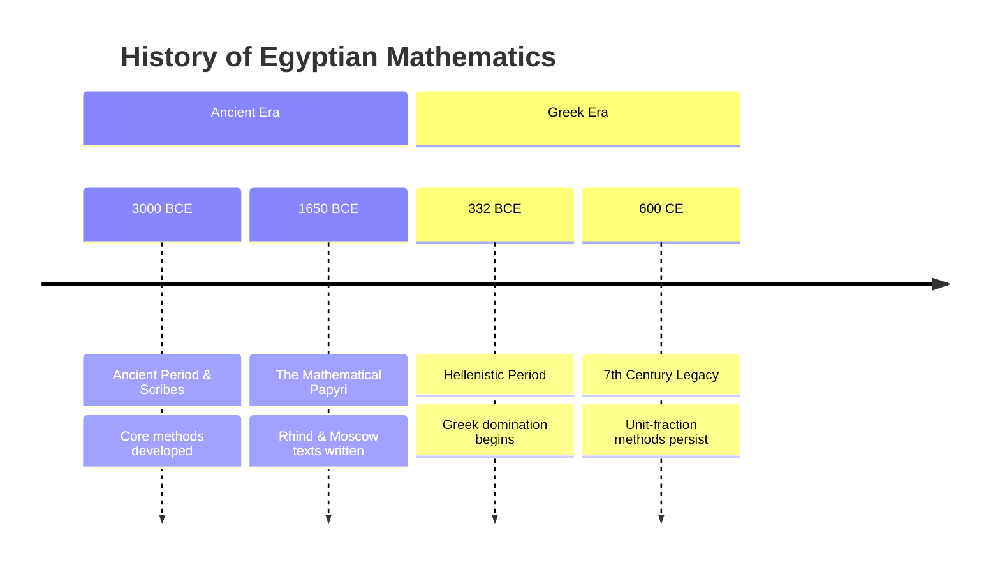

Date: 2026-01-30
Tags: [[Mathematics]], [[History]], [[Ancient Egypt]], [[Algebra]]

# ~={red} Notes=~

# Context & Sources

**The Scribe & Civil Service (c. 3000 BCE)** Mathematics was a trade skill for **[[Scribes & Knowledge Transmission]]**, serving as the foundation for civil administration. It was purely practical, used for:
- **Record keeping & Taxation**
- **Public Works:** Managing building projects (e.g., calculating bricks for ramps).
- **Military:** Logistics, supplies, and payrolls.

![[Pasted image 20260204205833.png|center|500]]

**Key Mathematical Texts** Knowledge comes primarily from two papyri used as school textbooks:

1. **Rhind Papyrus** (c. 17th C. BCE): Contains a table of fractional parts for division and **84 problems** (arithmetic/geometry).
	![[Pasted image 20260204205949.png|center|450]]
2. **Golenishchev (Moscow) Papyrus** (c. 19th C. BCE): Contains **25 problems** regarding wage distribution (beer/bread), field area measurement, and volumes (pyramids).
    ![[Pasted image 20260204210038.png|center|400]]

> **Note:** Scribes often used "satiric letters" (e.g., _Hori to Amen-em-opet_, 13th C. BCE) to mock rivals for failing to solve practical geometry problems, highlighting the social prestige of mathematical competence.

---
# The Numeral System & Arithmetic Operations in Ancient Egypt

> [!INFO] Metadata
> 
> **Period:** c. 3000 BCE – 1600 BCE

## 1. The Numeral System

The Egyptian system was **decimal** (base-10) but **non-positional**. Unlike modern systems where a digit's place determines its value (e.g., the '1' in 10 vs 100), Egyptians used distinct symbols for each power of 10.

### Writing Scripts

There were two distinct scripts for writing mathematics:

| **Script Type**      | **Context**                      | **Characteristics**                                                                                                                                 |
| -------------------- | -------------------------------- | --------------------------------------------------------------------------------------------------------------------------------------------------- |
| **[[Hieroglyphic]]** | Stone inscriptions, formal texts | **Cumbersome.** Signs were repeated to represent value (e.g., writing the symbol for '1' twenty-four times for the number 24, or grouping symbols). |
| **Hieratic**         | Papyrus, daily administration    | **Abbreviated/Cursive.** Used specific signs for groups of numbers to speed up writing (e.g., a single symbol representing "24").                   |
![[Pasted image 20260204211320.png|center|550]]

![[Pasted image 20260204211553.png|center|550]]

> **Note:** Writing direction was customarily **Right-to-Left**.

---
## 2. Arithmetic Operations

### Addition & Subtraction
Because the system was non-positional, these operations were intuitive:
- **Method:** Count the occurrences of each symbol type in both numbers.
- **Result:** Rewrite the total count of each symbol.

### Multiplication: "Successive Doubling"
The scribes did not memorize times tables. Instead, they used a method of **binary decomposition** (doubling).

**Example:** Multiply $28 \times 11$

1. List powers of 2 (1, 2, 4, 8...) in one column.
2. Doubling the multiplicand (28) in the second column.
3. Select numbers in the first column that sum to the multiplier ($8 + 2 + 1 = 11$).
4. Sum the corresponding values in the second column.

| **Power of 2 (Multiplier components)** | **Multiples of 28** | **Action** |
| -------------------------------------- | ------------------- | ---------- |
| **1**                                  | **28**              | ✅ (Keep)   |
| **2**                                  | **56**              | ✅ (Keep)   |
| 4                                      | 112                 | (Ignore)   |
| **8**                                  | **224**             | ✅ (Keep)   |
| **Sum: 11**                            | **Total: 308**      |            |

$$224 + 56 + 28 = 308$$

> **Pro Tip for Large Numbers:** Scribes would optimize this by introducing multiples of 10, 20, or 100 rather than just doubling.
> 
> _Example ($28 \times 27$):_ Use multiples by 1, 2, 4, and **20**.

### Division
Division was simply **multiplication in reverse**.

**Example:** $308 \div 28$

1. Construct the same doubling table as above.
2. Find the largest entry less than the dividend (308). _Here, it is 224 (corresponds to 8)._
3. Subtract $308 - 224 = 84$.
4. Find the next largest entry less than the remainder (84). _Here, it is 56 (corresponds to 2)._
5. Subtract $84 - 56 = 28$.
6. Find the entry for 28. _It is 28 (corresponds to 1)._
7. Sum the multipliers: $8 + 2 + 1 = 11$.

---

## 3. Fractions & Unit Parts

Egyptian fractions were almost exclusively **Unit Fractions** (numerator is always 1, e.g., $\frac{1}{n}$).

- **Notation:** Written as $1/n$ (modern notation).
- **The Exception:** They had a specific symbol for $\frac{2}{3}$.
- **Decomposition:** A non-unit fraction like $\frac{4}{7}$ had to be written as a sum of unit fractions:
$$\frac{4}{7} = \frac{1}{2} + \frac{1}{14}$$

> [!WARNING] Complexity
> 
> There was no standard way to decompose fractions.
> 
> _Example:_ $\frac{2}{29}$ could be written as:
> 
> - $\frac{1}{24} + \frac{1}{58} + \frac{1}{174} + \frac{1}{232}$ (Rhind Papyrus version)
>     
> - $\frac{1}{15} + \frac{1}{435}$ (Alternative)
>     
> 
> Scribes relied heavily on reference tables to manage these complex expansions.

---

## 4. Algebra: The Method of "[[Algebra|False Position]]"

Used for solving linear equations, often phrased as _"Aha"_ problems (finding a quantity _aha_).

**Problem (Rhind Papyrus #24):**
_"A quantity and its 7th together make 19. What is the quantity?"_

$$x + \frac{1}{7}x = 19$$

**Solution Strategy:**

1. **Make a False Assumption:** Assume $x = 7$ (to make the math easy).
2. **Test:** $7 + \frac{1}{7}(7) = 8$.
    
3. **Compare:** The result (8) is not the target (19).
4. **Adjust:** Multiply the assumption by the ratio of _Target/Result_ ($\frac{19}{8}$).
$$Answer = 7 \times \frac{19}{8} = 16 + \frac{1}{2} + \frac{1}{8}$$
---
# Geometry & Spatial Measurement

> [!INFO] Metadata
> 
> **Key Texts:** Rhind Papyrus (c. 1650 BCE), Golenishchev (Moscow) Papyrus (c. 1850 BCE)

## 1. Planar Geometry & Algebraic Logic

Egyptian geometry was primarily practical, seeking measurements for figures like rectangles and triangles. However, some solutions suggest an understanding of underlying algebraic principles.

### The "Algebraic" Rectangle (Golenishchev #6)

This problem solves for dimensions without using variables, yet follows the logic of a quadratic equation.

- **The Problem:** Find a rectangle where:
    1. $Area = 12$
    2. $Height = (1/2 + 1/4) \times Base$ (i.e., $H = \frac{3}{4}W$)
    
- **The Egyptian Method:**    
    1. Invert the ratio: $\frac{4}{3}$.
    2. Multiply by Area: $12 \times \frac{4}{3} = 16$.
    3. Square root result: $\sqrt{16} = 4$ (This is the **Base**).
    4. Calculate Height: $\frac{3}{4} \times 4 = 3$.
        
- **Modern Equivalent:**
$$x \cdot \frac{3}{4}x = 12 \implies x^2 = 16 \implies x = 4$$

---

## 2. The Circle & The Approximation of Pi

The Egyptians used a unique procedure to calculate the area of a circle (Rhind #50), relying on an approximation of $\pi$ that was remarkably accurate for the time.

![[Pasted image 20260204215412.png|center]]

> **The Rule:** "Discard 1/9 of the diameter and square the result."

$$Area \approx \left( d - \frac{1}{9}d \right)^2 = \left( \frac{8}{9}d \right)^2$$
### Accuracy Comparison

By expanding this formula ($\frac{64}{81}r^2 \times 4$), we can derive their implied value of $\pi$:

|**Standard**|**Value**|**Accuracy**|
|---|---|---|
|**Egyptian $\pi$**|$\frac{256}{81} \approx 3.1605$|**~0.6% too large**|
|**Archimedes $\pi$**|$3 \frac{1}{7} \approx 3.1428$|**~0.04% too large**|
|**True $\pi$**|$3.14159...$|-|

![[Pasted image 20260204215540.png|center|500]]

> [!NOTE]
> 
> There is no evidence scribes knew this was an approximation; they likely treated it as an exact rule.

---

## 3. Solid Geometry: The Truncated Pyramid

Perhaps the most impressive result in Egyptian mathematics is the correct formula for the volume of a **truncated pyramid** (frustum), found in [^1]Golenishchev Problem 14.

![[Pasted image 20260204220459.png|center|450]]

**The Formula:**
For a pyramid with height $h$, base side $a$, and top side $b$:

$$V = \frac{h}{3}(a^2 + ab + b^2)$$

**The Example Problem:**

- **Given:** Height $h=6$, Base $a=4$, Top $b=2$.
- **Calculation:**
$$\frac{6}{3} (4^2 + 4 \cdot 2 + 2^2) = 2(16 + 8 + 4) = 56$$
This implies the scribes also understood the volume of a standard pyramid ($V = \frac{1}{3}Ah$), a concept debated by historians regarding derivation but confirmed by their computational success.

---

## 4. The _Seked_ (Slope & Surveying)

The Egyptians did not use "degrees" for angles. Instead, they defined slope as the **Seked**.

- **Definition:** The ratio of the **Run** to the **Rise** (Reciprocal of modern slope).
    
- **Units:** Measured as horizontal _Palms_ per vertical _Cubit_. 
    - _(Note: 1 Cubit = 7 Palms)_

![[Pasted image 20260204220620.png|center|550]]

> [!EXAMPLE] Rhind Papyrus #57
> 
> - **Given:** Base = 140 cubits, Seked = $5 \frac{1}{4}$ palms (per cubit rise).
>     
> - **Resulting Height:** $93 \frac{1}{3}$ cubits.
>     
> - **Method:** Relies on the principle of **similar triangles**.
>     

### Historical Context: Thales vs. The Scribes

Greek history credits **[[Thales of Miletus]]** (6th C. BCE) with measuring pyramids using shadows (similar triangles). However, the _Seked_ computations prove Egyptians utilized these advanced surveying principles **1,000 years before Thales**, demonstrating a sophisticated mastery of practical trigonometry.

---
# Assessment of Egyptian Mathematics

## Overview
Egyptian mathematics represents a practical mathematical tradition closely tied to the accounting and surveying activities of ancient scribes, documented primarily through papyri that have survived to the present day.
## Primary Sources

### The Papyri
The mathematical papyri serve as our main window into Egyptian mathematical practices, revealing:
- Strong connection to **practical applications**
- Focus on accounting and surveying
- Methods used by scribes in their official duties

![[Pasted image 20260204224005.png|center|500]]
#### Notable Example: Rhind Papyrus Problem 79
A classic example of mathematical progression:

- **7 houses**
- **7 cats** per house
- **7 mice** per cat
- **7 ears of wheat** per mouse
- **7 [^2]hekat of grain** per ear
- **Result**: 19,607

> [!note] 
> Mathematical Interest Beyond Practicality This problem demonstrates the scribes' interest in progressions, suggesting they possessed rules for calculating such sequences that went beyond mere practical necessity.

---

## Characteristics of Egyptian Mathematics

### Strengths
1. **Competence** - Solid understanding of necessary mathematical operations
2. **Continuity** - Remarkable consistency over time

### Scope and Limitations
- Primarily **practical in nature**
- Limited theoretical development
- Focused on basic arithmetic and geometry needed for civil administration
- Achievement viewed as **modest** despite its effectiveness

---

## Historical Continuity

### Timeline of Persistence
Egyptian mathematical methods showed extraordinary longevity:

> [!important]
>  Remarkable Stability Even after Greek domination, traditional Egyptian mathematical methods continued in use, documented in both demotic (Egyptian) and Greek language papyri as late as the 7th century CE.

## Unit-Fraction Methods

### Definition
A distinctive feature of Egyptian mathematics involving the expression of fractions as sums of unit fractions (fractions with 1 as the numerator).

### Longevity
- Remained prominent teaching method for over **1,300 years** after Greek conquest
- Found in school papyri written in:
    - Demotic (Egyptian) language
    - Greek language

---

## Legacy and Influence

### Impact on Greek Mathematics

![[Pasted image 20260204224239.png|center|500]]

#### Historical Context
**Period of Influence**: 6th-4th centuries BCE

> [!warning] 
> Limited Documentation Due to scarce documentation from this period, the manner and significance of Egyptian influence can only be **conjectured**.

#### Evidence of Transmission

**Literary Evidence:**
- **Thales**: Reported to have measured pyramid heights using Egyptian knowledge
- **Herodotus**: Described Egyptian mathematical practices with approval
- **Plato**: Praised Egyptian teaching and application of mathematics

**Historical Support:**
- Continuous Greek trade with Egypt from 7th century BCE onward
- Greek military operations in Egypt
- Regular cultural exchange and contact

#### Probable Greek Borrowings

Plausible Egyptian contributions to early Greek mathematics:

|Mathematical Concept|Egyptian Precedent|
|---|---|
|**Fractional parts**|Unit-fraction methods|
|**Area measurement**|Surveying techniques|
|**Volume calculation**|Practical geometry|
|**Ratios and proportions**|Use in similar figures|

---
## Key Takeaways

1. Egyptian mathematics was fundamentally **practical** rather than theoretical
2. The tradition showed remarkable **continuity** spanning at least 1-2 millennia
3. Methods persisted even **after Greek domination** (3rd century BCE - 7th century CE)
4. Egyptian mathematics likely **influenced early Greek mathematics** through:
    - Direct cultural contact
    - Trade and military presence
    - Transmission of practical techniques
5. Despite modest scope, Egyptian mathematics was **competent and effective** for its intended purposes

---

## Related Topics

- [[Greek Mathematics]]
- [[Thales of Miletus]]
- [[Hellenistic Period]]

---
# ~={red}References & Further Reading=~
https://www.britannica.com/science/mathematics/Mathematics-in-ancient-Egypt
[[pyramid problem.pdf]]
- Rhind Mathematical Papyrus
- Egyptian school papyri (demotic and Greek, up to 7th century CE)
- Herodotus on Egyptian mathematics
- Plato on Egyptian mathematical education

---
[^1]: [[pyramid problem.pdf]]

[^2]: The hekat or heqat (transcribed HqA. t) was **an ancient Egyptian volume unit used to measure grain, bread, and beer**
