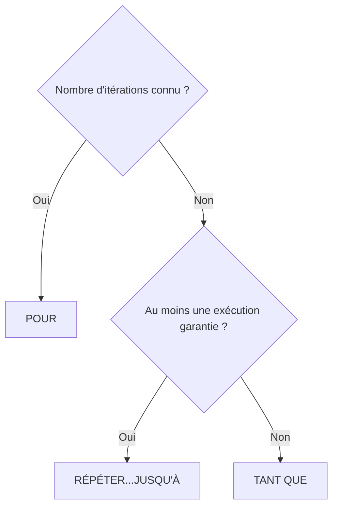
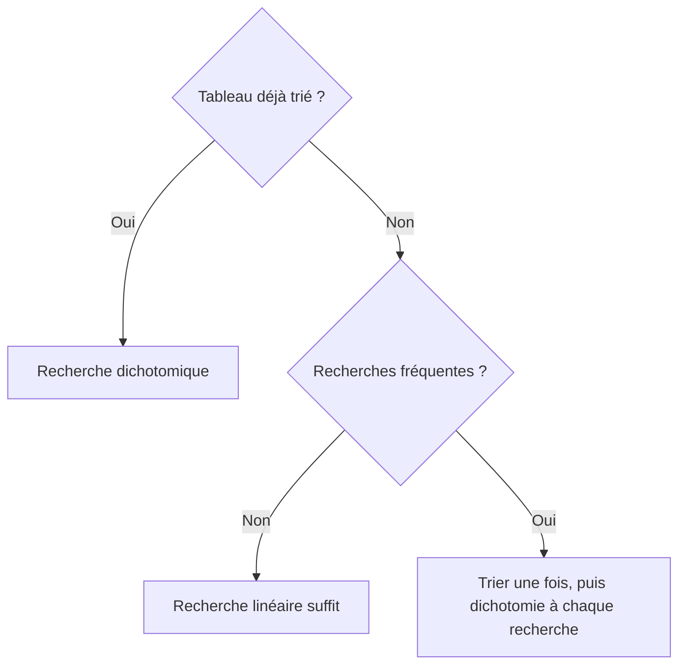

Date: 2026-11-02
Tags: [[Algorithmique]], [[Structures de Contrôle]], [[Boucles]], [[Tableaux]], [[Tri]], [[Recherche]], [[Pseudo-code]], [[ENSAM]]

## 0. Conventions du Cours

> [!info] Définition : Conventions de pseudo-code
> | Convention | Signification |
> | :--- | :--- |
> | `T[1..N]` | Indices de **1 à N** inclus (`T[1]` premier, `T[N]` dernier) |
> | `POUR i DE a À b` | $i$ prend $a, a+1, \dots, b$ ; si $a > b$, le corps ne s'exécute pas |
> | `DIV` | Division entière : $7 \text{ DIV } 2 = 3$ |
> | `RETOURNER` | Interrompt immédiatement la fonction |
> | `RETOURNER -1` | Convention « valeur non trouvée » dans les recherches |
> 
> **Transition Python :** indices de $0$ à $N-1$ ; comparaison chaînée `5 < x < 10` valide.

---

## 1. A3 — Structures de Contrôle et Évaluation

### 1.1 Choisir : SI / SINON / SINON SI

> [!info] Définition : Structure conditionnelle
> ```
> SI condition ALORS
>     instructions_si_vrai
> SINON
>     instructions_si_faux
> FSINON
> ```
> La condition est évaluée en premier ; **une seule branche** s'exécute ; le bloc `SINON` est optionnel. Avec `SINON SI`, les conditions sont testées **dans l'ordre** et la première VRAIE sort de la structure.

> [!warning] Piège / Cas Particulier : `>` vs `>=` (la borne)
> Pour $T = 30$ et $seuil = 30$ : `T > seuil` → FAUX (pas d'alerte) ; `T >= seuil` → VRAI (alerte). **L'inclusion de la borne est une décision métier, pas une règle mathématique** : toujours tester avec la valeur limite exacte.
> 
> | Condition | $T = 30$ | $T = 31$ |
> | :--- | :---: | :---: |
> | `T > 30` | FAUX | VRAI |
> | `T >= 30` | VRAI | VRAI |

> [!example] Exemple d'Application : Classification de température (trace)
> Algorithme : `SI T<15 → "Gel" ; SINON SI T<10... ` (chaîne `T<15 / T<10 / T<20 / T<30 / SINON`).
> 
> | $T$ | Conditions testées (dans l'ordre) | Affichage |
> | :---: | :--- | :--- |
> | $-5$ | $T<0$ → VRAI (1er test) | "Gel" |
> | $10$ | $T<0$ F, $T<10$ **F** ($10 \nless 10$), $T<20$ V | "Frais" |
> | $29.9$ | $T<0$ F, $T<10$ F, $T<20$ F, $T<30$ V | "Agreable" |
> | $30$ | les 4 conditions FAUSSES → `SINON` (5 tests) | "Canicule" |

### 1.2 Opérateurs logiques ET / OU / NON

| $A$ | $B$ | $A$ ET $B$ | $A$ OU $B$ | NON $A$ |
| :---: | :---: | :---: | :---: | :---: |
| VRAI | VRAI | VRAI | VRAI | FAUX |
| VRAI | FAUX | FAUX | VRAI | FAUX |
| FAUX | VRAI | FAUX | VRAI | VRAI |
| FAUX | FAUX | FAUX | FAUX | VRAI |

> [!example] Exemple d'Application : Contrôle qualité (condition combinée)
> Pièce acceptée si longueur $L \in [9.8, 10.2]$ (bornes incluses), masse $M < 50$, et non défectueuse :
> ```
> SI (L >= 9.8 ET L <= 10.2) ET M < 50 ET NON defaut ALORS
>     afficher("Acceptee")
> SINON
>     afficher("Rejetee")
> FSINON
> ```
> | Cas | $L \in [9.8, 10.2]$ | $M < 50$ | NON defaut | Résultat |
> | :--- | :---: | :---: | :---: | :--- |
> | $L=10.0, M=48$, def=FAUX | VRAI | VRAI | VRAI | ✅ Acceptée |
> | $L=10.2, M=51$, def=FAUX | VRAI | FAUX | VRAI | ❌ Rejetée |
> | $L=9.7, M=45$, def=FAUX | FAUX | VRAI | VRAI | ❌ Rejetée |
> 
> **Avec ET, un seul FAUX suffit à rejeter.**

### 1.3 Les trois boucles

> [!abstract] Modélisation : Comparaison des boucles
> | Critère | `POUR` | `TANT QUE` | `RÉPÉTER...JUSQU'À` |
> | :--- | :--- | :--- | :--- |
> | Test de la condition | Compteur borné | **Avant** le corps | **Après** le corps |
> | Exécutions minimales | $0$ si $debut > fin$ | $0$ | $1$ (toujours) |
> | Arrêt | $i > fin$ | Condition FAUSSE | Condition **VRAIE** |
> | Usage typique | $N$ connu à l'avance | $N$ inconnu, test préalable | Saisie / validation |



> [!example] Exemple d'Application : Trace d'une boucle POUR (accumulateur)
> $T = [21, 23, 19, 25, 22]$, `somme ← 0 ; POUR i DE 1 À 5 : somme ← somme + T[i]`
> 
> | Tour | $i$ | $T[i]$ | somme avant | somme après |
> | :---: | :---: | :---: | :---: | :---: |
> | 1er | 1 | 21 | 0 | 21 |
> | 2e | 2 | 23 | 21 | 44 |
> | 3e | 3 | 19 | 44 | 63 |
> | 4e | 4 | 25 | 63 | 88 |
> | 5e | 5 | 22 | 88 | 110 |
> 
> Moyenne calculée **après** la boucle : $110 / 5 = 22.0$.

> [!warning] Piège / Cas Particulier : Boucle infinie et accès hors bornes
> - **Infinie :** `i ← 1 ; TANT QUE i > 0` ne s'arrête jamais : la condition doit devenir FAUSSE.
> - **Hors bornes :** `TANT QUE T[i] <= 24` accède à $T[N+1]$ si aucun élément ne dépasse 24. Version correcte : `TANT QUE i <= N ET T[i] <= 24` — le test $i \le N$ est évalué **en premier** (court-circuit) : toujours vérifier l'indice **avant** d'accéder à la case.

> [!example] Exemple d'Application : RÉPÉTER...JUSQU'À (saisie valide)
> ```
> RÉPÉTER
>     note ← lire_note()
>     SI note < 0 OU note > 20 ALORS afficher("Note invalide")
> JUSQU'À (note >= 0 ET note <= 20)
> ```
> Trace : saisie $-3$ → recommencer ; $25$ → recommencer ; $14$ → condition VRAIE → sortie. Le corps s'exécute **au moins une fois**.

> [!info] Définition : Boucles imbriquées
> La boucle interne s'exécute **entièrement** pour chaque itération de l'externe : total $= N \times M$ opérations, complexité $O(N^2)$. Exemple fil-rouge : comparer toutes les paires de relevés avec `j DE i+1 À N` → 10 paires uniques (contre 25 passages avec doublons si `j DE 1 À N`).
> **Piège :** ne jamais modifier le compteur de la boucle externe depuis la boucle interne.

> [!example] Exemple d'Application : Choix de la boucle (correction)
> | Situation | Boucle | Justification |
> | :--- | :--- | :--- |
> | Somme de 10 relevés | `POUR` | $N$ connu = 10 |
> | Lire jusqu'à $T > 30$ | `TANT QUE` | Condition testée avant la 1ère exécution |
> | Mot de passe jusqu'à correct | `RÉPÉTER...JUSQU'À` | Au moins une saisie garantie |
> | Afficher 7 jours | `POUR` | $N$ connu = 7 |
> | 1er relevé négatif, taille inconnue | `TANT QUE` | Arrêt anticipé possible dès le 1er élément |
> | Au moins une note, continuer si souhaité | `RÉPÉTER...JUSQU'À` | 1 exécution garantie avant test |

### 1.4 Évaluer : trace, terminaison, invariant

> [!abstract] Processus : Méthode de la table de trace (4 étapes)
> 1. **Colonnes** = chaque variable + condition de boucle + sortie (une colonne par variable, pas plus) ;
> 2. Choisir un exemple **petit mais non trivial**, incluant un cas limite (tableau vide, $N=1$, valeur absente) ;
> 3. Ligne par ligne : mettre à jour **uniquement** les variables qui changent ;
> 4. Vérifier le résultat final contre l'attendu : si ça ne correspond pas, le bug est dans la trace.
> 
> Une table bien construite révèle ~90 % des bugs **avant** d'écrire une ligne de code. Erreurs fréquentes : tout mettre à jour à chaque ligne ; oublier la colonne « condition » ; exemple trop simple.

> [!info] Définition / Théorème : Terminaison et variant
> - `POUR` termine toujours : $(fin - debut + 1)$ itérations bornées.
> - `TANT QUE` : identifier un **variant** — expression entière positive qui (1) décroît strictement à chaque itération et (2) est bornée inférieurement ($\ge 0$). Variant atteint 0 → sortie garantie.
> - Exemple : recherche linéaire, variant $= N - i$ ; quand $i = N+1$, variant $= -1 < 0$ → sortie.

> [!warning] Piège / Cas Particulier : Variant présent mais condition jamais satisfaite
> `i ← 1 ; TANT QUE i ≠ 10 ; i ← i + 2` : $i$ prend $1, 3, 5, 7, 9, 11, \dots$ et **saute par-dessus 10** → boucle infinie. Correction : `i < 10` ou `i <= 9`.

> [!info] Définition : Invariant de boucle
> Propriété qui reste **VRAIE à chaque début d'itération**. Exemple (somme) : « après le tour $i$, $somme = T[1] + \dots + T[i]$ ».
> - Avant ($i=0$) : $somme = 0$ = somme de zéro élément ✓ ;
> - Chaque tour : invariant maintenu ✓ ;
> - Après ($i=N$) : $somme = T[1]+\dots+T[N]$ = conclusion ✓.
> Formuler l'invariant **avant** d'écrire la boucle, c'est s'assurer qu'on sait ce qu'on calcule.

---

## 2. A4 — Tableaux, Recherche et Tri

### 2.1 Définition, indexation, opérations de base

> [!info] Définition : Tableau
> Collection ordonnée de données du **même type**, stockées en mémoire de façon **contiguë**, accessibles par indice. Déclaration : `T[1..N]` (taille fixée). Accès direct : `valeur ← T[3]` ; écriture : `T[3] ← 42`.

> [!example] Exemple d'Application : Manipulation ($T = [12, 7, 15, 9, 20]$, $N=5$)
> - $T[3] = 15$ ;
> - $T[2] \leftarrow 14 \Rightarrow T = [12, 14, 15, 9, 20]$ ;
> - `POUR i DE 2 À 4` parcourt $T[2], T[3], T[4]$ → valeurs $7, 15, 9$ ;
> - $T[N] = T[5] = 20$.

**Opérations de base** (toutes = un parcours complet) : Remplir (`LIRE T[i]`), Afficher (`ÉCRIRE T[i]`), Copier (`B[i] ← T[i]`), Inverser (`T[i] ↔ T[N-i+1]` pour $i$ DE 1 À $N$ DIV 2).

### 2.2 Les trois patterns fondamentaux

> [!abstract] Modélisation : Patterns de parcours
> | Pattern | Squelette | Initialisation |
> | :--- | :--- | :--- |
> | **Accumulation** | `somme ← 0 ; POUR i : somme ← somme + T[i]` | à $0$ |
> | **Min/Max** | `min ← T[1] ; POUR i DE 2 À N : SI T[i] < min → min ← T[i]` | avec $T[1]$, **pas 0** |
> | **Comptage** | `nb ← 0 ; POUR i : SI condition → nb ← nb + 1` | à $0$ |
> 
> Règle commune : **initialiser avant la boucle, mettre à jour dans la boucle**. Un seul parcours peut combiner les trois :
> ```
> somme ← 0 ; max ← T[1] ; nbValides ← 0
> POUR i DE 1 À N :
>     somme ← somme + T[i]
>     SI T[i] > max ALORS max ← T[i]
>     SI T[i] >= 10 ALORS nbValides ← nbValides + 1
> FPOUR
> moy ← somme / N
> ```
> Vérification numérique sur $T=[14, 8, 17, 6, 12]$ : $moy = 57/5 = 11.4$ ; $max = 17$ ; $nbValides = 3$.

### 2.3 Recherche linéaire

> [!example] Exemple d'Application : Algorithme avec arrêt anticipé
> ```
> POUR i DE 1 À N :
>     SI T[i] = x ALORS RETOURNER i   ← arrêt anticipé
> FPOUR
> RETOURNER -1                        ← non trouvé
> ```
> - **Universel** (tableau trié ou non) ; meilleur cas 1 comparaison, pire cas $N$ (absent ou en $T[N]$).
> - Échauffement : $T=[17,4,9,12,6]$, chercher 12 → **4 comparaisons** ; chercher 99 → **5** (= $N$).
> - Trace fil-rouge : $T=[21.3, 22.1, 19.8, 23.5, 18.2, 24.0, 20.5, 22.7]$, $x=18.2$ → trouvé en $i=5$ (5 visites sur 8 ; cases 6–8 non examinées).

### 2.4 L'échange (swap)

> [!warning] Piège / Cas Particulier : Écrasement sans temporaire
> `T[i] ← T[j] ; T[j] ← T[i]` **perd** la valeur de $T[i]$. Solution (analogie des trois verres) :
> ```
> temp ← T[i] ; T[i] ← T[j] ; T[j] ← temp
> ```
> Trace ($T=[21,18]$, échanger $T[1], T[2]$) : après `temp←T[1]` : temp=21 ; après `T[1]←T[2]` : [18,18] ; après `T[2]←temp` : [18,21] ✓.

### 2.5 Les trois tris simples

> [!info] Définition : Tri à bulles
> Parcourir, comparer chaque paire adjacente $(T[i], T[i+1])$, échanger si désordonnée ; répéter jusqu'à aucun échange. Chaque passe place le plus grand élément restant à sa position définitive (zone triée qui grandit **par la droite**). **Optimisation :** passe sans échange → tableau trié → arrêt (avantage sur la sélection).
> Passe unique sur $[5,2,8,1]$ : $(5,2)$ échange → $[2,5,8,1]$ ; $(5,8)$ ok ; $(8,1)$ échange → $[2,5,1,8]$ ; **8 placé**.

```
Algorithme TriABulles(T : tableau d'entiers, n : entier)
Début
    Pour i de 1 à n - 1 faire
        Pour j de 1 à n - i faire
            Si T[j] > T[j + 1] alors
                temp ← T[j]
                T[j] ← T[j + 1]
                T[j + 1] ← temp
            FinSi
        FinPour
    FinPour
Fin
```


> [!info] Définition : Tri par sélection
> À chaque étape $i$ : trouver le minimum dans $T[i..N]$, l'échanger avec $T[i]$. **Avantage :** au plus $N-1$ échanges (idéal si échanges coûteux). **Inconvénient :** coût fixe $\approx N^2/2$ comparaisons, ne profite pas d'un tableau presque trié.

```
Algorithme TriSelection(T : tableau d'entiers, n : entier)
Début
    Pour i de 1 à n - 1 faire
        indiceMin ← i

        Pour j de i + 1 à n faire
            Si T[j] < T[indiceMin] alors
                indiceMin ← j
            FinSi
        FinPour

        Si indiceMin ≠ i alors
            temp ← T[i]
            T[i] ← T[indiceMin]
            T[indiceMin] ← temp
        FinSi
    FinPour
Fin
```

> [!info] Définition : Tri par insertion
> Comme trier des cartes en main : prendre $cle \leftarrow T[i]$, décaler vers la droite les éléments triés $> cle$, insérer à sa place. **Avantage :** très efficace si presque trié (peu de décalages) ; **inconvénient :** beaucoup de décalages en ordre inverse.
> ```
> POUR i DE 2 À N :
>     cle ← T[i] ; j ← i - 1
>     TANT QUE j >= 1 ET T[j] > cle : T[j+1] ← T[j] ; j ← j - 1
>     T[j+1] ← cle
> FPOUR
> ```

> [!example] Exemple d'Application : Traces complètes sur le fil-rouge $T=[21, 23, 19, 25, 18]$
> 
> **Bulles** (4 passes, 10 comparaisons) :
> 
> | Passe | État | Échanges |
> | :---: | :--- | :--- |
> | 1 | [21, 19, 23, 18, **25**] | (23,19), (25,18) |
> | 2 | [19, 21, 18, 23, **25**] | (21,19), (23,18) |
> | 3 | [19, 18, 21, **23, 25**] | (21,18) |
> | 4 | [**18, 19, 21, 23, 25**] ✓ | (19,18) |
> 
> **Sélection** (4 échanges, ≈10 comparaisons) :
> 
> | Étape | Min trouvé | Échange | État |
> | :---: | :--- | :--- | :--- |
> | 1 | 18 (pos 5) | $T[1] \leftrightarrow T[5]$ | [18, 23, 19, 25, 21] |
> | 2 | 19 (pos 3) | $T[2] \leftrightarrow T[3]$ | [18, 19, 23, 25, 21] |
> | 3 | 21 (pos 5) | $T[3] \leftrightarrow T[5]$ | [18, 19, 21, 25, 23] |
> | 4 | 23 (pos 5) | $T[4] \leftrightarrow T[5]$ | [18, 19, 21, 23, 25] ✓ |
> 
> **Insertion** :
> 
> | $i$ | Clé | Décalages | État |
> | :---: | :---: | :--- | :--- |
> | 2 | 23 | aucun | [21, 23, 19, 25, 18] |
> | 3 | 19 | 23, 21 | [19, 21, 23, 25, 18] |
> | 4 | 25 | aucun | [19, 21, 23, 25, 18] |
> | 5 | 18 | 25, 23, 21, 19 | [18, 19, 21, 23, 25] ✓ |

> [!example] Exemple d'Application : Comparaison des tris et activité manuelle ($T=[15, 8, 22, 3, 19]$)
> | Critère | Bulles | Sélection | Insertion |
> | :--- | :--- | :--- | :--- |
> | Idée clé | Remonter les grands par échanges voisins | Sélectionner le min et le placer | Insérer chaque élément dans la zone triée |
> | Meilleur cas | $N-1$ (déjà trié) ✅ | $\approx N^2/2$ toujours ⚠ | $N-1$ (déjà trié) ✅ |
> | Pire cas | $\approx N^2$ | $\approx N^2$ | $\approx N^2$ |
> | Échanges | Nombreux ⚠ | Minimum $N-1$ ✅ | Décalages |
> | Quand ? | Pédagogie, détection tableau trié | Échanges coûteux (mémoire flash) | Données presque triées, petits $N$ |
> 
> **Correction du tri à la main :** Bulles → passes [8,15,3,19,22] (3 éch.), [8,3,15,19,22] (1), [3,8,15,19,22] (1), passe 4 sans échange (arrêt) : **5 échanges**. Sélection → [3,8,22,15,19], inchangé (8 en place), [3,8,15,22,19], [3,8,15,19,22] : **3 échanges**. Insertion → décalages 1, 0, 3, 1 : **5 décalages** (pic à $i=4$ pour la valeur 3). **Bonus :** la sélection fait le moins d'échanges sur ces données ; l'insertion dominerait sur un tableau presque trié.

### 2.6 Recherche dichotomique

> [!info] Définition / Théorème : Dichotomie (diviser pour régner)
> **Prérequis absolu : tableau trié.** Comparer $x$ au milieu : égal → trouvé ; $x < T[m]$ → moitié gauche ; $x > T[m]$ → moitié droite. À chaque étape on élimine **la moitié** des restants → $\log_2 N$ étapes suffisent.
> ```
> g ← 1 ; d ← N
> TANT QUE g <= d :
>     m ← (g + d) DIV 2
>     SI T[m] = x        → RETOURNER m
>     SINON SI T[m] < x  → g ← m + 1
>     SINON              → d ← m - 1
> RETOURNER -1
> ```
> **Terminaison :** variant $d - g + 1$ (taille de l'intervalle) décroît strictement à chaque itération.

> [!example] Exemple d'Application : Traces de dichotomie
> - $T=[2,5,8,11,16,20,25,31]$, $x=20$ : étape 1 $g=1,d=8,m=4,T[4]=11 < 20 \Rightarrow g=5$ ; étape 2 $g=5,d=8,m=6,T[6]=20$ → **trouvé indice 6** (2 comparaisons).
> - $x=15$ (absent) : $m=4$ (11) → $g=5$ ; $m=6$ (20) → $d=5$ ; $m=5$ (16) → $d=4$ ; $g=5 > d=4$ → sortie → $-1$ (3 étapes $= \log_2 8$).
> - Fil-rouge trié $=[18.2, 19.8, 20.5, 21.3, 22.1, 22.7, 23.5, 24.0]$, $x=22.7$ : étape 1 $m=4$ (21.3) → $g=5$ ; étape 2 $m=6$ → trouvé pos 6. **2 comparaisons** contre 6 en linéaire.


### 2.7 Coût, comparaison et choix d'algorithme

> [!abstract] Modélisation : Ordres de grandeur
> | $N$ | Linéaire $O(N)$ | Tri $O(N^2)$ | Dichotomie $O(\log_2 N)$ |
> | :---: | :---: | :---: | :---: |
> | 8 | 8 | 64 | 3 |
> | 100 | 100 | 10 000 | 7 |
> | 1 000 | 1 000 | 1 000 000 | 10 |
> | 1 000 000 | 1 000 000 | $10^{12}$ | 20 |
> 
> Si on double $N$ : le linéaire double, le $N^2$ **quadruple**, le $\log_2$ ajoute 1. **L'algorithme compte plus que la machine** : un $O(N^2)$ sur superordinateur peut être battu par un $O(\log N)$ sur un PC de bureau.



> [!example] Exemple d'Application : Raisonnement de choix (correction)
> - **A.** 20 valeurs non triées, une seule recherche → **linéaire** (trier pour une recherche ne vaut pas le coût).
> - **B.** $10^6$ valeurs déjà triées, nombreuses recherches → **dichotomie** directe ($\log_2 10^6 \approx 20$ comparaisons).
> - **C.** 50 valeurs presque triées → **tri par insertion** (peu de décalages).
> 
> Il n'existe pas d'algorithme universellement meilleur : le choix dépend de (1) la taille $N$, (2) l'état initial, (3) la fréquence d'utilisation, (4) le coût des opérations.

---

## 3. Synthèse du Fil Rouge et Transition Python

> [!abstract] Modélisation : Le pipeline complet sur le carnet de relevés
> | Sous-problème | Outil |
> | :--- | :--- |
> | Moyenne des $N$ températures | Accumulation ($somme/N$) |
> | Température min / max | Pattern Min/Max |
> | Compter les relevés $> 30°C$ | Comptage conditionnel |
> | Vérifier l'existence d'une valeur | Recherche linéaire $O(N)$ |
> | Trier par ordre croissant | Sélection / insertion $O(N^2)$ |
> | Rechercher efficacement après tri | Dichotomie $O(\log N)$ |
> 
> **Leçon centrale :** un problème complexe se décompose en sous-problèmes connus ; identifier le bon outil pour chacun est la compétence de l'ingénieur.
> 
> **Transition Python :** `SI`→`if`, `POUR`→`for`, `TANT QUE`→`while`, Tableau→`list`, Fonction→`def`. *L'algorithme est la solution ; Python n'est que le moyen de l'exprimer.*

---
# ~={red}References=~
*Algorithmique — Partie 2 : Évaluer, Rechercher, Trier (A3 & A4) — Pr. Yassir MATRANE, Département génie Informatique, ENSAM Casablanca (2025-2026)*