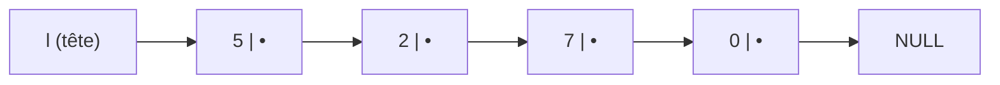

Date: 2026-10-30
Tags: [[Structures de Données]], [[Listes Chaînées]], [[C]], [[Pointeurs]], [[malloc]], [[ENSAM]]

# Listes Simplement Chaînées (Synthèse)

## 1. Rappel : Limites des Tableaux

> [!warning] Piège / Cas Particulier : Les quatre limites du tableau
> Un tableau stocke ses éléments de façon **contiguë** (`t[0]` @1000, `t[1]` @1004, `t[2]` @1008...) avec accès direct $O(1)$, mais :
> 1. **Taille fixe** : connue à l'avance ; `realloc` copie tout le tableau → lent ;
> 2. **Insertion coûteuse** : insérer au milieu = décaler $n-i$ éléments → $O(n)$ ;
> 3. **Suppression coûteuse** : un « trou » à combler en décalant tout ce qui suit ;
> 4. **Mémoire gaspillée** : allouer 1000 cases pour 10 utilisées.
> 
> **Intuition du train :** chaque wagon (nœud) contient des passagers (valeur) et un crochet (pointeur) vers le wagon suivant. On ne saute pas directement au wagon C (pas d'accès direct), mais ajouter un wagon en tête est immédiat.
> 
> $\Rightarrow$ **Solution :** une structure où chaque élément pointe vers le suivant, allouée indépendamment avec `malloc` (mémoire éparpillée, pas de gros bloc contigu).

> ![[Pasted image 20261024002732.png]]

---

## 2. Le Nœud et la Structure de Base

> [!info] Définition : Nœud (maillon)
> Chaque élément d'une liste chaînée est un **nœud** composé de deux parties :
> 1. **La valeur** : la donnée stockée (`int`, `float`, `char`, `struct`...) ;
> 2. **Le pointeur `suivant`** : l'adresse du prochain nœud ; si c'est le dernier → `NULL`.
> 
> `NULL` signifie « fin de la chaîne ». **Déréférencer `NULL` (`NULL->valeur`) provoque une Segmentation Fault.**

```c
typedef struct element {
    int valeur;
    struct element *suivant;
} element;

typedef element *liste;      /* une liste = pointeur vers le premier nœud */

liste l = NULL;              /* liste vide */
```

> [!info] Définition : La tête (`head`)
> Une liste est **un pointeur vers le premier nœud** (la tête). C'est le point d'entrée unique : si la liste est vide, ce pointeur vaut `NULL`.
> **Danger :** perdre la tête = perdre l'accès à tous les nœuds = fuite mémoire.

> [!abstract] Règle d'or mémoire
> Chaque `malloc` doit avoir son `free`. Oublier `free` = fuite mémoire ; utiliser après `free` = Segfault.
> ```c
> element *nouveau = (element *) malloc(sizeof(element));
> if (nouveau == NULL) { printf("Erreur mémoire!\n"); exit(1); }
> nouveau->valeur = 42;
> nouveau->suivant = NULL;
> free(nouveau);   /* quand on n'en a plus besoin */
> ```



> [!example] Exemple d'Application : Accès séquentiel
> Pour la liste $l = [5, 2, 7, 0]$ :
> ```c
> l->valeur == 5;                    /* 1er élément */
> l->suivant->valeur == 2;           /* 2ème élément */
> l->suivant->suivant->valeur == 7;  /* 3ème élément */
> ```
> Pour atteindre 7, il faut traverser $5 \to 2 \to 7$ : **pas d'accès direct**.

---

## 3. Opérations d'Insertion

### 3.1 Ajouter en tête — $O(1)$

> [!example] Exemple d'Application : `AjouterTete`
> Toujours 3 opérations fixes : `malloc`, affecter la valeur, lier. Indépendant de la taille.
> ```c
> element *AjouterTete(element *l, int x) {
>     element *nouveau = (element *) malloc(sizeof(element));
>     if (nouveau == NULL) return l;
>     nouveau->valeur = x;
>     nouveau->suivant = l;      /* le nouveau pointe vers l'ancienne tête */
>     return nouveau;            /* nouvelle tête */
> }
> /* l = NULL; l = AjouterTete(l,5); // [5]
>    l = AjouterTete(l,2);           // [2,5]
>    l = AjouterTete(l,9);           // [9,2,5] */
> ```

### 3.2 Ajouter après un élément donné — $O(n)$

> [!warning] Piège / Cas Particulier : Ordre critique du chaînage
> Étape ③ (`nouveau->suivant = tmp->suivant`) **AVANT** étape ④ (`tmp->suivant = nouveau`). Inverser = perdre le lien vers la suite de la liste.

```c
element *AjouterApres(element *l, int val, int x) {
    element *tmp = l;
    while (tmp != NULL) {
        if (tmp->valeur == val) {
            element *nouveau = (element *) malloc(sizeof(element));
            nouveau->valeur = x;
            nouveau->suivant = tmp->suivant;   /* ③ */
            tmp->suivant = nouveau;            /* ④ */
            return l;
        }
        tmp = tmp->suivant;
    }
    printf("Valeur %d non trouvee\n", val);
    return l;
}
```
*Parcours $O(n)$ pour trouver `val` ; l'insertion elle-même est $O(1)$. Ex : `AjouterApres(l, 7, 99)` sur $[5,2,7,0] \to [5,2,7,99,0]$.*

### 3.3 Ajouter avant un élément donné — $O(n)$

> [!info] Définition : Différence clé avec `AjouterApres`
> `AjouterAvant` cherche le **PRÉCÉDENT** de `val` (test `tmp->suivant->valeur == val`), car un nœud singly linked ne connaît pas son prédécesseur. **Cas spécial :** si `val` est le premier élément → pas de précédent → `AjouterTete(l, x)`.

```c
element *AjouterAvant(element *l, int val, int x) {
    if (l != NULL && l->valeur == val)
        return AjouterTete(l, x);              /* cas spécial tête */
    element *tmp = l;
    while (tmp != NULL && tmp->suivant != NULL) {
        if (tmp->suivant->valeur == val) {
            element *nouveau = (element *) malloc(sizeof(element));
            nouveau->valeur = x;
            nouveau->suivant = tmp->suivant;   /* nouveau -> val */
            tmp->suivant = nouveau;            /* précédent -> nouveau */
            return l;
        }
        tmp = tmp->suivant;
    }
    printf("Valeur %d non trouvee\n", val);
    return l;
}
```

### 3.4 Ajouter en fin — $O(n)$

> [!example] Exemple d'Application : `AjouterFin`
> Il faut parcourir **toute** la liste jusqu'au dernier nœud (`tmp->suivant == NULL`). **Cas spécial :** liste vide → le nouveau nœud devient la tête (`return nouveau`). On retourne `l` (inchangé), contrairement à `AjouterTete`.
> ```c
> element *AjouterFin(element *l, int x) {
>     element *nouveau = (element *) malloc(sizeof(element));
>     nouveau->valeur = x;
>     nouveau->suivant = NULL;
>     if (l == NULL) return nouveau;           /* liste vide */
>     element *tmp = l;
>     while (tmp->suivant != NULL)
>         tmp = tmp->suivant;
>     tmp->suivant = nouveau;
>     return l;
> }
> ```

> ![[Pasted image 20261024002913.png]]

---

## 4. Parcours, Recherche et Accès

```c
void AfficherListe(element *l) {
    if (l == NULL) { printf("Liste vide (NULL)\n"); return; }
    element *tmp = l;                 /* ne JAMAIS parcourir avec l directement */
    while (tmp != NULL) {
        printf("%d -> ", tmp->valeur);
        tmp = tmp->suivant;
    }
    printf("NULL\n");
}

element *RechercherElement(element *l, int x) {
    element *tmp = l;
    while (tmp != NULL) {
        if (tmp->valeur == x) return tmp;   /* trouvé */
        tmp = tmp->suivant;
    }
    return NULL;                            /* non trouvé */
}

int NombreOccurrences(element *l, int x) {
    int compteur = 0;
    element *tmp = l;
    while (tmp != NULL) {
        if (tmp->valeur == x) compteur++;
        tmp = tmp->suivant;
    }
    return compteur;
}

int NombreElements(element *l) {            /* récursif */
    if (l == NULL) return 0;                /* cas de base */
    return 1 + NombreElements(l->suivant);  /* cas récursif */
}

element *element_i(element *l, int indice) {
    int i;
    for (i = 0; i < indice && l != NULL; i++)
        l = l->suivant;
    return l;                               /* NULL si indice trop grand */
}
```

> [!info] Définition / Théorème : Complexités de recherche
> - `RechercherElement` : meilleur cas $O(1)$ (premier élément), pire cas $O(n)$ (absent ou dernier). **Pas de recherche dichotomique possible** sur une liste chaînée.
> - `NombreOccurrences` : $O(n)$ toujours (parcours complet).
> - `element_i` : $O(i)$ — c'est **LE désavantage majeur** face au tableau ($t[i]$ en $O(1)$ par calcul d'adresse direct).

---

## 5. Opérations de Suppression

### 5.1 Supprimer en tête — $O(1)$

> [!warning] Piège / Cas Particulier : Ordre critique
> Il faut **sauvegarder `l->suivant` AVANT `free(l)`**. Après `free`, `l` est invalide : accéder à `l->suivant` = comportement indéfini.

```c
element *SupprimerTete(element *l) {
    if (l != NULL) {
        element *tmp = l->suivant;   /* 1. sauver le 2ème nœud */
        free(l);                     /* 2. libérer le 1er */
        return tmp;                  /* 3. nouvelle tête */
    }
    return NULL;
}
```

### 5.2 Supprimer la 1ère occurrence — $O(n)$

> [!example] Exemple d'Application : `SupprimerPremier` avec bypass
> Deux cas : (1) $x$ en tête → sauver, `free`, retourner le suivant ; (2) $x$ au milieu/fin → chercher le **précédent** (`prec->suivant->valeur == x`), **bypass** (`prec->suivant = aSuppr->suivant`), `free(aSuppr)`, `return l`. On s'arrête dès la 1ère occurrence supprimée.
> ```c
> element *SupprimerPremier(element *l, int x) {
>     if (l == NULL) return NULL;
>     if (l->valeur == x) {
>         element *tmp = l->suivant;
>         free(l);
>         return tmp;
>     }
>     element *prec = l;
>     while (prec->suivant != NULL) {
>         if (prec->suivant->valeur == x) {
>             element *aSuppr = prec->suivant;
>             prec->suivant = aSuppr->suivant;   /* bypass */
>             free(aSuppr);
>             return l;
>         }
>         prec = prec->suivant;
>     }
>     return l;   /* x non trouvé */
> }
> /* Trace : SupprimerPremier([3,7,3,5], 3) → tête == 3 → cas 1 → [7,3,5] */
> ```

### 5.3 Supprimer TOUTES les occurrences — $O(n)$

> [!warning] Piège / Cas Particulier : Ne pas avancer après suppression
> Après le bypass, `prec->suivant` pointe **déjà** vers le nœud d'après : avancer `prec` sauterait un élément sans le tester. D'où le `else`. En tête, utiliser un `while` (plusieurs $x$ consécutifs possibles, ex : $[3,3,3,5]$).

```c
element *SupprimerTous(element *l, int x) {
    while (l != NULL && l->valeur == x) {    /* phase tête (while, pas if) */
        element *tmp = l->suivant;
        free(l);
        l = tmp;
    }
    if (l == NULL) return NULL;
    element *prec = l;
    while (prec->suivant != NULL) {
        if (prec->suivant->valeur == x) {
            element *aSuppr = prec->suivant;
            prec->suivant = aSuppr->suivant;
            free(aSuppr);                    /* ne PAS avancer prec */
        } else {
            prec = prec->suivant;
        }
    }
    return l;
}
/* Trace : SupprimerTous([3,7,3,5,3], 3) → tête: [7,3,5,3] → prec=7: [7,5,3] → prec=5: [7,5] */
```

### 5.4 Supprimer en fin — $O(n)$

> [!example] Exemple d'Application : `SupprimerFin` avec deux pointeurs
> Trois cas : ① liste vide → `NULL` ; ② un seul élément → `free` + `NULL` ; ③ 2+ éléments → parcourir avec `tmp` (courant) et `ptmp` (précédent) jusqu'au dernier, puis `ptmp->suivant = NULL` et `free(tmp)`.
> ```c
> element *SupprimerFin(element *l) {
>     if (l == NULL) return NULL;
>     if (l->suivant == NULL) { free(l); return NULL; }
>     element *tmp = l;
>     element *ptmp = NULL;
>     while (tmp->suivant != NULL) {
>         ptmp = tmp;
>         tmp = tmp->suivant;
>     }
>     ptmp->suivant = NULL;
>     free(tmp);
>     return l;
> }
> ```

---

## 6. Complexité et Arbitrage Tableau vs Liste

> [!abstract] Modélisation : Table de complexité complète
> | Opération | Complexité | Explication |
> | :--- | :---: | :--- |
> | Ajouter en tête | $O(1)$ | 3 opérations fixes |
> | Ajouter en fin | $O(n)$ | Parcours jusqu'au dernier |
> | Ajouter après / avant un élément | $O(n)$ | Parcours pour trouver (+ insertion $O(1)$) |
> | Supprimer en tête | $O(1)$ | Sauver, libérer, retourner |
> | Supprimer en fin | $O(n)$ | Trouver l'avant-dernier |
> | Supprimer un élément | $O(n)$ | Parcours + bypass |
> | Rechercher | $O(n)$ | Parcours séquentiel |
> | Accès au $i$-ème | $O(i)$ | Pas d'accès direct |
> | Compter / Afficher | $O(n)$ | Parcours complet |

> [!info] Définition : Tableau vs Liste chaînée
> | Critère | Tableau | Liste chaînée |
> | :--- | :--- | :--- |
> | Taille | Fixe (ou `realloc`) | Dynamique |
> | Mémoire | Bloc contigu | Éparpillée |
> | Accès à $t[i]$ | $O(1)$ | $O(i)$ |
> | Insertion tête | $O(n)$ | $O(1)$ |
> | Insertion fin | $O(1)$ amorti | $O(n)$ |
> | Insertion après/avant | $O(n)$ décalage | $O(n)$ parcours + $O(1)$ insertion |
> | Suppression | $O(n)$ décalage | $O(1)$ si pointeur connu |
> | Recherche dichotomique | Possible | Impossible |
> | Mémoire / élément | `sizeof(type)` | `sizeof(type)` + `sizeof(ptr)` |
> 
> **Choix :** tableau si accès fréquent par indice et taille connue ; liste si insertions/suppressions fréquentes et taille variable.

---

## 7. Erreurs Courantes et Bonnes Pratiques

> [!warning] Piège / Cas Particulier : Catalogue des erreurs fatales
> | Erreur | Conséquence | Solution |
> | :--- | :--- | :--- |
> | Oublier de vérifier `NULL` (`if (l->valeur == x)`) | Crash (Segfault) | Toujours tester `l != NULL` d'abord |
> | Perdre la tête (`l = l->suivant`) | Fuite mémoire | Utiliser un pointeur `tmp` pour parcourir |
> | Oublier `free` | Fuite mémoire | Libérer chaque nœud supprimé |
> | Utiliser après `free` | Crash | Sauver ce qu'il faut **AVANT** le `free` |
> | Mauvais ordre de pointeurs | Chaîne brisée | Sauvegarder `suivant` avant de modifier |
> | Boucle infinie | Programme bloqué | Vérifier l'avancée `tmp = tmp->suivant` |
> 
> **Règle d'or de test :** toujours tester votre code avec une liste **vide**, une liste à **un seul élément**, et une liste à **plusieurs éléments**.

---
# ~={red}References=~
*Structures de Données — Listes Simplement Chaînées — Pr. Yassir MATRANE, Département génie Informatique, ENSAM (2025-2026)*