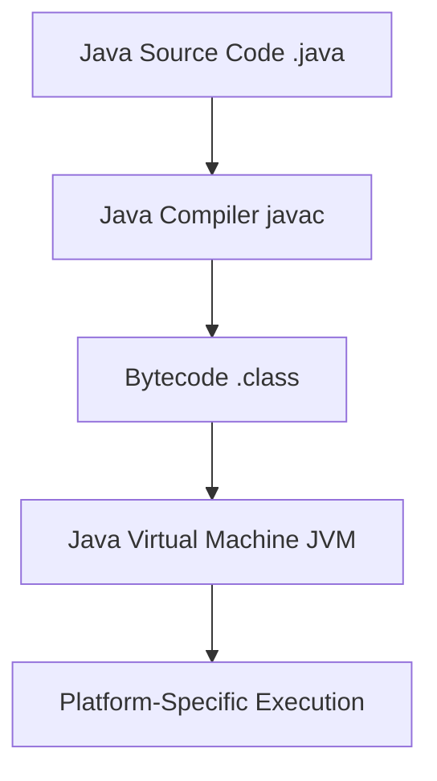
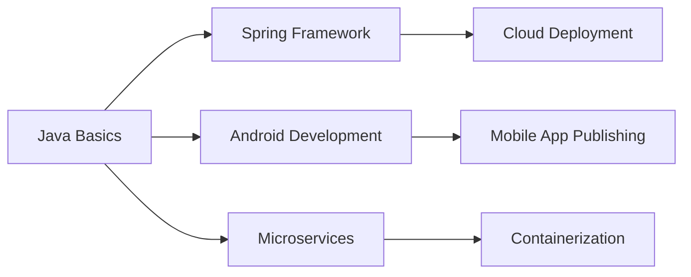

Date: 2025-10-30
Tags: [[Programming language]], [[Object Oriented]]


---
# Java Overview

> [!NOTE] Quick Facts
> - **First released**: 1995
> - **Creator**: James Gosling (Sun Microsystems, now Oracle)
> - **Paradigm**: Object-oriented, imperative, structured
> - **Typing**: Static, strong, safe, nominative
> - **Memory management**: Automatic (Garbage Collection)
> - **Key principle**: "Write Once, Run Anywhere" (WORA)

![[Pasted image 20251113183302.png|center]]
## Introduction

Java is a **high-level, class-based, object-oriented** programming language designed to have as few implementation dependencies as possible. It is:
- **Platform-independent** (via Java Virtual Machine)
- **Memory-safe** (automatic garbage collection)
- **Multi-threaded** (built-in concurrency support)
- **Secure** (sandboxed execution environment)

![[Pasted image 20251113182109.png|center]]

### Current Status
- **Rank**: Consistently top 3-5 in popularity indices (TIOBE, GitHub, Stack Overflow)
- **Active version**: Java 23 (as of 2025)
- **Primary maintainer**: Oracle Corporation (with community via OpenJDK)

### The Java Mascot: Duke
![[Pasted image 20251113182755.png|center|200]]
*Duke, Java's official mascot, was created by Joe Palrang*

---

## Core Java Architecture



### Three Pillars of Java Platform

1. **JDK (Java Development Kit)**
    - Tools for developing Java applications
    - Includes compiler, debugger, documentation tools
    - Contains JRE + development tools
    
2. **JRE (Java Runtime Environment)**
    - Libraries and JVM to run Java applications
    - End-user focused (no development tools)
    
3. **JVM (Java Virtual Machine)**
    - Executes Java bytecode
    - Provides platform independence
    - Manages memory (garbage collection)
    

---

## First Java Program


```java
// A Java program to print Hello World!
public class HelloWorld {          // Class declaration
    public static void main(String[] args) {  // Main method - entry point
        System.out.println("Hello World!");   // Output statement
    }
}
```
**Output:**

```text
Hello World!
```
### Key Syntax Elements

|Element|Purpose|Required?|
|---|---|---|
|`public class`|Class declaration (must match filename)|Yes|
|`main()`|Application entry point|Yes for executable apps|
|`System.out.println()`|Output to console|No (but commonly used)|
|Semicolons `;`|Statement terminator|Yes (except blocks)|

![[Pasted image 20251113182505.png|center]]

---

## Java Syntax Fundamentals

### Comments

```java

// Single-line comment

/*
 * Multi-line comment
 * (Good practice: use javadoc style for documentation)
 */

/**
 * Javadoc comment
 * @param args command-line arguments
 * @return void
 */
```
### Basic Structure

```java

// File: MyProgram.java
package com.example.myapp;  // Optional package declaration

import java.util.Scanner;   // Import statements

// Class declaration (public class name must match filename)
public class MyProgram {
    
    // Main method - program entry point
    public static void main(String[] args) {
        // Program logic here
    }
    
    // Other methods
    public void myMethod() {
        // Method implementation
    }
}
```

---

## Why Java? Key Features

### 1. Platform Independence

- **"Write Once, Run Anywhere" (WORA)**
- Bytecode runs on any JVM implementation
- No need to recompile for different platforms

### 2. Object-Oriented

- Encapsulation, Inheritance, Polymorphism, Abstraction
- Everything (except primitives) is an object

### 3. Automatic Memory Management

- Garbage Collector automatically reclaims unused memory
- Reduces memory leaks and segmentation faults

### 4. Rich Standard Library

- Collections Framework
- I/O, Networking, Concurrency utilities
- Security, Database connectivity (JDBC)

### 5. Strong Community & Ecosystem

- Mature frameworks (Spring, Jakarta EE, etc.)
- Extensive tooling (Maven, Gradle, IDEs)
- Large talent pool and learning resources

---

## Java Applications & Use Cases

### Enterprise Systems

- **Banking & Finance**: Transaction processing, trading platforms
- **E-commerce**: Backend systems, payment processing
- **Healthcare**: EHR systems, medical record management

### Web Development

| Framework          | Purpose                  | Popularity |
| ------------------ | ------------------------ | ---------- |
| **Spring Boot**    | Microservices, REST APIs | ⭐⭐⭐⭐⭐      |
| **Jakarta EE**     | Enterprise applications  | ⭐⭐⭐⭐       |
| **Struts**         | MVC web applications     | ⭐⭐         |
| **Play Framework** | Reactive web apps        | ⭐⭐⭐        |

### Mobile Development

- **Android Apps** (primary language for native Android development)
- Cross-platform frameworks (Kotlin interoperable)

### Game Development

- **Minecraft** (most famous Java game)
- LibGDX, jMonkeyEngine frameworks
- Android mobile games

### Cloud & Big Data

- **Hadoop** (big data processing)
- **Apache Kafka** (stream processing)
- **Apache Spark** (data analytics)
- Major cloud providers (AWS, Azure, GCP) have extensive Java SDKs

### Desktop Applications

- **JavaFX** (modern UI framework)
- **Swing** (legacy but still used)
- **IntelliJ IDEA** (IDE built with Java)

### Scientific Computing

- Data analysis tools
- Mathematical modeling
- Research applications

---

## Major Companies Using Java

|Company|Use Case|
|---|---|
|**Google**|Android OS, backend services|
|**Amazon**|E-commerce platform, AWS services|
|**Netflix**|Content delivery, recommendation engine|
|**Spotify**|Music streaming backend|
|**Uber**|Ride-hailing backend, surge pricing|
|**LinkedIn**|Professional networking platform|
|**Twitter**|Backend services (migrating but still uses Java)|
|**NASA**|World Wind project, data analysis|

---

## Learning Path & Prerequisites

### Before Learning Java

- Basic programming concepts (variables, loops, conditionals)
- Understanding of object-oriented principles (helpful but not required)
- No specific language prerequisite (Java can be a first language)

### Core Concepts to Master

1. **Basics**: Variables, Data Types, Operators
2. **Control Flow**: Conditionals, Loops
3. **OOP**: Classes, Objects, Inheritance, Polymorphism
4. **Advanced**: Exception Handling, Collections, Multithreading
5. **Tools**: Build tools (Maven/Gradle), Testing (JUnit)

### Next Steps After Java Basics




---

## Common Criticisms & Alternatives

### Criticisms

- **Verbose syntax** (compared to Kotlin, Python)
- **Memory consumption** (JVM overhead)
- **Slower startup time** (improved with AOT compilation)
- **Less flexible** than dynamically-typed languages

### Modern Alternatives

|Language|Best For|Java Comparison|
|---|---|---|
|**Kotlin**|Android, modern JVM apps|More concise, interoperable|
|**Python**|Data science, scripting|Dynamic typing, faster development|
|**Go**|Cloud services, CLI tools|Better performance, simpler concurrency|
|**C#**|Windows apps, game dev|Similar syntax, Microsoft ecosystem|

---

## Quick Reference

### Compile & Run

```bash

# Compile
javac HelloWorld.java

# Run
java HelloWorld

# Create JAR file
jar cf myapp.jar *.class
```
### Popular IDEs

1. **IntelliJ IDEA** (most popular for Java)
2. **Eclipse** (free, extensive plugins)
3. **VS Code** (lightweight with Java extensions)
4. **NetBeans** (official Oracle IDE)

### Useful Links

- [Oracle Java Documentation](https://docs.oracle.com/javase/)
- [OpenJDK](https://openjdk.org/)
- [Java on GitHub](https://github.com/openjdk)
- [Stack Overflow Java Tag](https://stackoverflow.com/questions/tagged/java)

---

> [!TIP] Learning Strategy
> 
> 1. Master core Java concepts thoroughly
>     
> 2. Build small projects (calculator, to-do app)
>     
> 3. Learn Spring Framework for enterprise development
>     
> 4. Contribute to open-source Java projects
>     
> 5. Stay updated with new Java versions (6-month release cycle)
>     

> [!QUOTE]  
> "Java is to JavaScript what car is to carpet." — Chris Heilmann