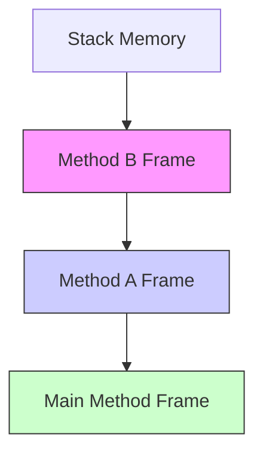

Date: 2025-12-11
Tags: [[JAVA]], [[Programming language]], [[Methods]], [[Clean Code]]

# ~={red}Terms=~

| Term             | Definition                                                                                          |
| :--------------- | :-------------------------------------------------------------------------------------------------- |
| **Method**       | A named block of code that performs a specific task and can be called repeatedly.                   |
| **Parameter**    | Variables defined in the method declaration (the input *slots*).                                    |
| **Argument**     | The actual values passed to the method when calling it (the input *data*).                          |
| **Return Value** | Data that the method sends back to the caller (output).                                             |
| **Void**         | A return type indicating the method does **not** return any value.                                  |
| **Signature**    | Method Name + Parameter Types. It defines the method's unique identity.                             |
| **Call Stack**   | The "Stack" memory structure that tracks active method calls.                                       |
| **Scope**        | The region of code where a variable is visible. Variables inside a method die when the method ends. |

---

# ~={red}Notes=~

### ~={blue}1. Core Concepts=~

Methods are the building blocks of Java programs. They allow us to follow the **DRY Principle** (Don't Repeat Yourself).

#### **Anatomy of a Method**

![[Pasted image 20260208004426.png|center|500]]

```java
//    (1)      (2)   (3)      (4)              (5)
public static int addNumbers(int a, int b) {
    // (6) Body
    int sum = a + b;
    return sum; // (7) Return statement
}
```

1. **Modifiers:** `public static` (Accessible from everywhere, belongs to the class).
    
2. **Return Type:** `int` (The result type). Use `void` if nothing is returned.
    
3. **Method Name:** `addNumbers` (camelCase).
    
4. **Parameters:** `(int a, int b)` (Inputs).
    
5. **Signature:** `addNumbers(int, int)`.
    
6. **Body:** The code block `{ ... }`.
    
7. **Return:** Stops execution and sends data back.
    

---

### ~={blue}2. Return Values & Void=~

> [!NOTE] The Rule of Return 
> If a method has a return type (e.g., `int`), it **MUST** return a value on **every** possible path of execution.


```java
// ❌ BAD: Compilation Error
public static int check(int n) {
    if (n > 10) {
        return 1;
    }
    // Error: What happens if n <= 10? No return value!
}

// ✅ GOOD:
public static int check(int n) {
    if (n > 10) {
        return 1;
    }
    return 0; // Fallback return
}
```

---

### ~={blue}3. Parameter Mechanics (Pass-by-Value)=~

This is the most important concept for exams. **Java is always "Pass-by-Value".** When you pass a variable to a method, Java passes a **COPY** of that variable. The method cannot change the original variable in the caller.

```java
public class Main {
    public static void main(String[] args) {
        int x = 10;
        changeValue(x);
        System.out.println(x); // OUTPUT: 10 (Not 20!)
    }

    public static void changeValue(int number) {
        number = 20; // This only changes the local COPY
    }
}
```

---

### ~={blue}4. The Call Stack (Memory)=~

Methods execute in a **LIFO** (Last-In, First-Out) structure called the Stack.

1. `main()` is pushed onto the stack.
    
2. `main()` calls `methodA()`, which is pushed on top.
    
3. `methodA()` finishes and is **popped** (destroyed).
    
4. Control returns to `main()`.
    



---
#### **Complete Examples**

```java
// 1. Void method without parameters
public static void greet() {
    System.out.println("Hello!");
}

// 2. Void method with parameters
public static void printSum(int a, int b) {
    System.out.println("Sum: " + (a + b));
}

// 3. Value-returning method
public static int calculateSum(int a, int b) {
    return a + b;
}

// 4. Using return value
public static void main(String[] args) {
    greet();                            // Calls method
    printSum(5, 3);                     // Passes arguments
    int result = calculateSum(10, 20);  // Stores return value
    System.out.println(calculateSum(2, 3)); // Direct usage
}

// 5. Multiple methods working together
public static double average(int a, int b, int c) {
    int total = sum(a, b, c);           // Calls another method
    return total / 3.0;
}

public static int sum(int x, int y, int z) {
    return x + y + z;
}

```

---

### ~={blue}5. Method Overloading=~

You can have multiple methods with the **Same Name** if they have **Different Parameters** (different type or number). This is called _Overloading_.

```java
public static int sum(int a, int b) {
    return a + b;
}

public static int sum(int a, int b, int c) {
    return a + b + c;
}

public static double sum(double a, double b) {
    return a + b;
}

// Usage
sum(5, 10);       // Calls the first method
sum(5, 10, 20);   // Calls the second method
sum(5.5, 2.1);    // Calls the third method
```

---

### ~={cyan}Common Patterns=~

#### **The "Helper" Method**

Breaking a big problem into small helpers.

```java
public static void main(String[] args) {
    printTriangle(5);
}

public static void printTriangle(int size) {
    for (int i = 1; i <= size; i++) {
        printRow(i); // Calling a helper
        System.out.println();
    }
}

// Helper method doing one specific job
public static void printRow(int stars) {
    for (int i = 0; i < stars; i++) {
        System.out.print("*");
    }
}
```

### Debugging & Understanding Execution

#### **Tracing Method Calls**

```java
public static void main(String[] args) {
    System.out.println("Start");
    methodA();
    System.out.println("End");
}

public static void methodA() {
    System.out.println("A start");
    methodB();
    System.out.println("A end");
}

public static void methodB() {
    System.out.println("B start");
    System.out.println("B end");
}

// Output:
// Start
// A start
// B start
// B end
// A end
// End
```

---

### ~={orange}Common Pitfalls=~

1. **Missing Return:** Forgetting `return` in a non-void method.
    
2. **Unreachable Code:** Writing code _after_ the `return` statement (Compiler Error).
    
3. **Type Mismatch:** Trying to return a `String` when the return type is `int`.
    
4. **Shadowing:** Confusing a class variable with a parameter because they have the same name.


# ~={red}References=~

[Java Methods - MOOC.fi](https://java-programming.mooc.fi/part-2/4-methods) [W3Schools Methods](https://www.w3schools.com/java/java_methods.asp)