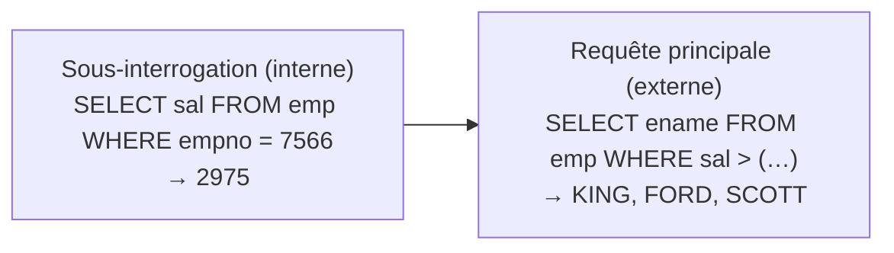

Date: 2026-11-05
Tags: [[SQL]], [[Database]], [[Oracle]], [[Sous-Interrogations]], [[Subqueries]], [[ENSAM]]

# Sous-Interrogations (Subqueries)

## 1. Principe et Syntaxe

> [!info] Définition : Sous-interrogation
> Une sous-interrogation (requête interne) répond à une question dont le résultat est nécessaire à une autre requête (la requête principale / externe).
> - La sous-interrogation est exécutée **une fois, avant** la requête principale ;
> - Son **résultat** est injecté et utilisé par la requête principale (dans sa clause `WHERE`) ;
> - Problème type : *« Qui a un salaire supérieur à celui de Jones ? »* → sous-interrogation : *« Quel est le salaire de Jones ? »*



> ![[Pasted image 20261024005517.png]]

> [!example] Exemple d'Application : Salaire supérieur à celui de Jones
> ```sql
> SQL> SELECT ename
>   2  FROM emp
>   3  WHERE sal >
>   4       (SELECT sal
>   5        FROM emp
>   6        WHERE empno = 7566);
> ENAME
> ----------
> KING
> FORD
> SCOTT
> ```
> *(La sous-interrogation renvoie `2975` ; la requête principale conserve les employés tels que `sal > 2975`.)*

**Syntaxe générale :**
```sql
SELECT select_list
FROM   table
WHERE  expr operator (SELECT select_list
                      FROM   table);
```

> [!abstract] Conventions d'utilisation
> 1. Placer les sous-interrogations **entre parenthèses** ;
> 2. Les placer **à droite** de l'opérateur de comparaison ;
> 3. **Ne jamais** ajouter de clause `ORDER BY` à une sous-interrogation ;
> 4. Opérateurs **mono-ligne** avec sous-interrogations **mono-ligne** ;
> 5. Opérateurs **multi-ligne** avec sous-interrogations **multi-ligne**.

---

## 2. Sous-Interrogations Mono-ligne

> [!info] Définition : Sous-interrogation mono-ligne
> Ne ramène **qu'une seule ligne**. Utilise les opérateurs de comparaison mono-ligne : `=`, `>`, `>=`, `<`, `<=`, `<>`.

> [!example] Exemple d'Application : Deux sous-interrogations combinées (job et salaire)
> ```sql
> SQL> SELECT ename, job
>   2  FROM emp
>   3  WHERE job =
>   4       (SELECT job FROM emp WHERE empno = 7369)   -- job de SMITH = CLERK
>   5    AND sal >
>   6       (SELECT sal FROM emp WHERE empno = 7876);  -- sal de ADAMS = 1100
> ENAME      JOB
> -------------------
> MILLER     CLERK
> ```

> [!example] Exemple d'Application : Fonction de groupe dans une sous-interrogation
> ```sql
> SQL> SELECT ename, job, sal
>   2  FROM emp
>   3  WHERE sal =
>   4       (SELECT MIN(sal) FROM emp);                -- 800
> ENAME      JOB        SAL
> ----------------------------
> SMITH      CLERK      800
> ```

> [!example] Exemple d'Application : Clause HAVING avec sous-interrogation
> Le serveur Oracle exécute **d'abord** la sous-interrogation, puis ramène son résultat dans le `HAVING` de la requête principale.
> ```sql
> SQL> SELECT deptno, MIN(sal)
>   2  FROM emp
>   3  GROUP BY deptno
>   4  HAVING MIN(sal) >
>   5       (SELECT MIN(sal) FROM emp WHERE deptno = 20);   -- 800
> ```
> **Lecture :** on conserve les départements dont le salaire minimum dépasse 800 (départements 10 et 30 ; le département 20 est exclu car son MIN vaut exactement 800).

> [!warning] Piège / Cas Particulier : ORA-01427 (mono-ligne qui renvoie plusieurs lignes)
> ```sql
> SQL> SELECT empno, ename
>   2  FROM emp
>   3  WHERE sal =
>   4       (SELECT MIN(sal)
>   5        FROM emp
>   6        GROUP BY deptno);
> ERROR:
> ORA-01427: single-row sub-query returns more than one row
> no rows selected
> ```
> **Cause :** le `GROUP BY deptno` fait renvoyer **une ligne par département** à la sous-interrogation, alors que l'opérateur `=` attend **exactement une** ligne. Correction : utiliser un opérateur multi-ligne (`IN`, `ANY`, `ALL`) ou supprimer le regroupement.

---

## 3. Sous-Interrogations Multi-lignes

> [!info] Définition : Sous-interrogation multi-ligne
> Ramène **plusieurs lignes**. Exige les opérateurs de comparaison multi-ligne :
> 
> | Opérateur | Signification |
> | :---: | :--- |
> | `IN` | Égal à **un élément quelconque** de la liste ramenée |
> | `ANY` (`SOME`) | Compare la valeur à **chaque valeur** ramenée (une seule suffit selon le sens) |
> | `ALL` | Compare la valeur à **toutes les valeurs** ramenées |

> [!example] Exemple d'Application : Opérateur `< ANY`
> ```sql
> SQL> SELECT empno, ename, job
>   2  FROM emp
>   3  WHERE sal < ANY
>   4       (SELECT sal FROM emp WHERE job = 'CLERK')   -- 950, 800, 1100, 1300
>   5    AND job <> 'CLERK';
> EMPNO  ENAME   JOB
> -------------------------
> 7654   MARTIN  SALESMAN
> 7521   WARD    SALESMAN
> ```
> **Règles de lecture :**
> - `< ANY` = inférieur à **au moins une** valeur → donc inférieur au **maximum** ;
> - `> ANY` = supérieur à **au moins une** valeur → donc supérieur au **minimum** ;
> - `= ANY` équivaut à `IN`.

> [!example] Exemple d'Application : Opérateur `> ALL`
> ```sql
> SQL> SELECT empno, ename, job
>   2  FROM emp
>   3  WHERE sal > ALL
>   4       (SELECT avg(sal) FROM emp GROUP BY deptno);  -- 2916.67, 2175, 1566.67
> EMPNO  ENAME   JOB
> -------------------------
> 7839   KING    PRESIDENT
> 7566   JONES   MANAGER
> 7902   FORD    ANALYST
> 7788   SCOTT   ANALYST
> ```
> **Règles de lecture :**
> - `> ALL` = supérieur au **maximum** ;
> - `< ALL` = inférieur au **minimum**.

---

## 4. Synthèse

> [!abstract] Modélisation : Récapitulatif mono-ligne vs multi-ligne
> | Critère | Mono-ligne | Multi-ligne |
> | :--- | :--- | :--- |
> | Lignes ramenées | $\le 1$ | plusieurs |
> | Opérateurs | `=`, `>`, `>=`, `<`, `<=`, `<>` | `IN`, `ANY`, `ALL` |
> | Erreur typique | `ORA-01427` si la sous-requête renvoie $>1$ ligne | utiliser `=` avec une liste |
> 
> **Bornes équivalentes (mémo) :**
> 
> | Comparaison | `ANY` | `ALL` |
> | :---: | :--- | :--- |
> | `>` | $>$ minimum | $>$ maximum |
> | `<` | $<$ maximum | $<$ minimum |
> | `=` | $\equiv$ `IN` | égal à toutes (valeur unique identique) |

---
# ~={red}References=~
*Sous-Interrogations — sous_requêtes IAGI_27.pdf, Pr H.Moutachaouik — ENSAM Casablanca (IAGI)*