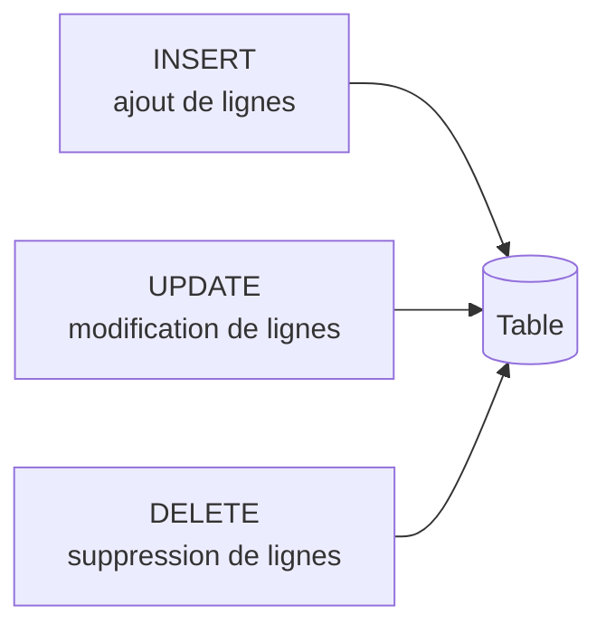

Date: 2026-11-06
Tags: [[SQL]], [[Database]], [[Oracle]], [[LMD]], [[INSERT]], [[UPDATE]], [[DELETE]], [[ENSAM]]

---
# Manipulation des Données (LMD)

> [!abstract] Objectifs du chapitre
> - Décrire chaque ordre du **LMD** (Langage de Manipulation de Données) ;
> - Insérer des lignes dans une table ;
> - Mettre à jour des lignes d'une table ;
> - Supprimer des lignes d'une table ;
> - Contrôler les transactions.

## 1. Le Langage de Manipulation de Données

> [!info] Définition : Ordres du LMD
> Un ordre du LMD est exécuté lorsque :
> - Vous **ajoutez** des lignes à une table ;
> - Vous **modifiez** des lignes existantes dans une table ;
> - Vous **supprimez** des lignes d'une table.



---

## 2. L'Ordre `INSERT`

> [!info] Définition : Syntaxe de `INSERT`
> ```sql
> INSERT INTO table [(column [, column...])]
> VALUES (value [, value...]);
> ```
> - Cette syntaxe n'insère qu'**une seule ligne à la fois** ;
> - Insérez une nouvelle ligne en précisant une valeur pour chaque colonne ;
> - Éventuellement, énumérez les colonnes dans la clause `INSERT` ;
> - Indiquez les valeurs dans l'**ordre par défaut** des colonnes de la table ;
> - Placez les valeurs de type **caractère** et **date** entre **simples quotes**.

> [!example] Exemple d'Application : Insertion dans `DEPT`
> ```sql
> SQL> INSERT INTO dept(deptno, dname, loc)
>   2  VALUES (50, 'DEVELOPMENT', 'DETROIT');
> 1 row created.
> ```

### 2.1 Insertion de valeurs NULL

> [!example] Exemple d'Application : NULL implicite vs explicite
> - **Méthode implicite :** ne spécifiez pas la colonne dans la liste :
> ```sql
> SQL> INSERT INTO dept(deptno, dname)
>   2  VALUES (60, 'MIS');
> 1 row created.
> ```
> - **Méthode explicite :** spécifiez le mot-clé `NULL` :
> ```sql
> SQL> INSERT INTO dept
>   2  VALUES (70, 'FINANCE', NULL);
> 1 row created.
> ```

### 2.2 Insertion de valeurs spéciales (`SYSDATE`)

> [!info] Définition : `SYSDATE`
> La fonction `SYSDATE` renvoie la **date et l'heure courantes**.

> [!example] Exemple d'Application : Insertion avec `SYSDATE`
> ```sql
> SQL> INSERT INTO emp(empno, ename, job,
>   2  mgr, hiredate, sal, comm,
>   3  deptno)
>   4  VALUES (7196, 'GREEN', 'SALESMAN',
>   5  7782, SYSDATE, 2000, NULL,
>   6  10);
> 1 row created.
> ```

### 2.3 Copie de lignes d'une autre table

> [!info] Définition : `INSERT` avec sous-interrogation
> - Écrivez votre ordre `INSERT` en spécifiant une **sous-interrogation** ;
> - **N'utilisez pas** la clause `VALUES` ;
> - Le nombre de colonnes de la clause `INSERT` doit **correspondre** à celui de la sous-interrogation.

> [!example] Exemple d'Application : Copie des managers
> ```sql
> SQL> INSERT INTO managers(id, name, salary, hiredate)
>   2  SELECT empno, ename, sal, hiredate
>   3  FROM emp
>   4  WHERE job = 'MANAGER';
> 3 rows created.
> ```

---

## 3. L'Ordre `UPDATE`

> [!info] Définition : Syntaxe de `UPDATE`
> ```sql
> UPDATE table
> SET column = value [, column = value]
> [WHERE condition];
> ```
> Utilisez `UPDATE` pour modifier des lignes existantes ; si nécessaire, vous pouvez modifier **plusieurs lignes à la fois**.

> [!warning] Piège / Cas Particulier : La clause `WHERE`
> - La clause `WHERE` permet de modifier **une ou plusieurs lignes spécifiques** ;
> - Si vous **omettez** la clause `WHERE`, **toutes les lignes** sont modifiées.

> [!example] Exemple d'Application : Modification ciblée vs globale
> ```sql
> SQL> UPDATE emp
>   2  SET deptno = 20
>   3  WHERE empno = 7782;
> 1 row updated.
>
> SQL> UPDATE employee
>   2  SET deptno = 20;
> 14 rows updated.
> ```

### 3.1 Modification en fonction d'une autre table

> [!example] Exemple d'Application : Sous-interrogations dans `UPDATE`
> Utilisez des sous-interrogations dans l'ordre `UPDATE` pour modifier des lignes d'une table à l'aide de valeurs d'une autre table :
> ```sql
> SQL> UPDATE employee
>   2  SET deptno = (SELECT deptno
>   3                FROM emp
>   4                WHERE empno = 7788)
>   5  WHERE job = (SELECT job
>   6               FROM emp
>   7               WHERE empno = 7788);
> 2 rows updated.
> ```

---

## 4. L'Ordre `DELETE`

> [!info] Définition : Syntaxe de `DELETE`
> ```sql
> DELETE [FROM] table
> [WHERE condition];
> ```
> - La clause `WHERE` permet de supprimer **une ou plusieurs lignes spécifiques** ;
> - Si vous **omettez** la clause `WHERE`, **toutes les lignes** sont supprimées.

> [!example] Exemple d'Application : Suppression ciblée vs globale
> ```sql
> SQL> DELETE FROM department
>   2  WHERE dname = 'DEVELOPMENT';
> 1 row deleted.
>
> SQL> DELETE FROM department;
> 4 rows deleted.
> ```

### 4.1 Suppression en faisant référence à une autre table

> [!example] Exemple d'Application : Sous-interrogation dans `DELETE`
> ```sql
> SQL> DELETE FROM employee
>   2  WHERE deptno =
>   3       (SELECT deptno
>   4        FROM dept
>   5        WHERE dname = 'SALES');
> 6 rows deleted.
> ```

### 4.2 Erreur de contrainte d'intégrité

> [!warning] Piège / Cas Particulier : ORA-02292 (child record found)
> ```sql
> SQL> DELETE FROM dept
>   2  WHERE deptno = 10;
> DELETE FROM dept
> *
> ERROR at line 1:
> ORA-02292: integrity constraint (USR.EMP_DEPTNO_FK) violated - child record found
> ```
> **Cause :** des lignes de la table fille (`EMP`) référencent encore le département 10 via la clé étrangère `EMP_DEPTNO_FK`. Oracle refuse la suppression pour préserver l'intégrité référentielle : supprimez (ou réaffectez) d'abord les employés du département.

---

## 5. Synthèse des Ordres du LMD

> [!abstract] Modélisation : Récapitulatif
> | Ordre | Description |
> | :---: | :--- |
> | `INSERT` | Ajoute une nouvelle ligne dans une table |
> | `UPDATE` | Modifie des lignes dans une table |
> | `DELETE` | Supprime des lignes d'une table |
> 
> **Règle transversale :** sans clause `WHERE`, `UPDATE` et `DELETE` agissent sur **toutes** les lignes de la table ; `INSERT` avec sous-interrogation copie **toutes** les lignes satisfaisant la condition. Toujours vérifier la cible avant d'exécuter.

---
# ~={red}References=~
*07 Manipulation des Données_sqlplus_formation.pdf, Pr H.Moutachaouik — ENSAM Casablanca (IAGI)*