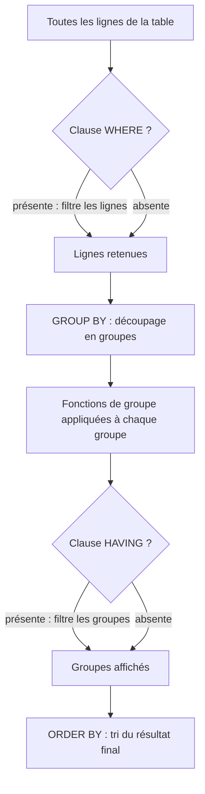

Date: 2026-10-13
Tags: [[SQL]], [[Database]], [[Oracle]], [[Fonctions de Groupe]], [[GROUP BY]], [[HAVING]], [[Agrégation]]

---

## 1. Fonctions de Groupe : Principe et Types

> [!info] Définition : Fonction de groupe
> Les fonctions de groupe **agissent sur des groupes de lignes** et donnent **un résultat par groupe** — par opposition aux fonctions mono-ligne (leçon 3) qui donnent un résultat par ligne.

> [!example] Exemple d'Application : « salaire maximum de la table EMP »
> Les 14 lignes de `EMP` (colonnes `DEPTNO`, `SAL`) se réduisent à **une seule valeur** :
> ```sql
> SQL> SELECT MAX(sal) FROM emp;
> MAX(SAL)
> --------
>     5000
> ```

| Fonction | Rôle | Types acceptés |
| :---: | :--- | :--- |
| `AVG()` | Moyenne | Numérique uniquement |
| `SUM()` | Somme | Numérique uniquement |
| `MIN()` | Minimum | **Tous** types (y compris dates, caractères) |
| `MAX()` | Maximum | **Tous** types |
| `COUNT()` | Comptage | **Tous** types |

---

## 2. Fonctions de Groupe Élémentaires

### 2.1 `AVG` et `SUM` (données numériques)

> [!example] Exemple d'Application : Statistiques des vendeurs
> ```sql
> SQL> SELECT AVG(sal), MAX(sal),
>   2  MIN(sal), SUM(sal)
>   3  FROM emp
>   4  WHERE job LIKE 'SALES%';
>   
> AVG(SAL)  MAX(SAL)  MIN(SAL)  SUM(SAL)
> --------------------------------------
>     1400      1600      1250      5600
> ```

### 2.2 `MIN` et `MAX` (tous types de données)

> [!example] Exemple d'Application : Bornes temporelles des embauches
> ```sql
> SQL> SELECT MIN(hiredate), MAX(hiredate)
>   2  FROM emp;
>   
> MIN(HIRED   MAX(HIRED
> ----------------------
> 17-DEC-80   12-JAN-83
> ```

### 2.3 `COUNT(*)` vs `COUNT(expr)`

> [!info] Définition : Les deux formes de COUNT
> - `COUNT(*)` ramène le **nombre de lignes** d'une table (y compris doublons et NULL) ;
> - `COUNT(expr)` ramène le nombre de lignes **non NULL** pour l'expression donnée.

> [!example] Exemple d'Application : Comptage avec et sans NULL
> ```sql
> SQL> SELECT COUNT(*)
>   2  FROM emp
>   3  WHERE deptno = 30;
> COUNT(*)
> --------
>        6
>
> SQL> SELECT COUNT(comm)
>   2  FROM emp
>   3  WHERE deptno = 30;
> COUNT(COMM)
> -----------
>           4
> ```
> **Lecture :** 6 employés au département 30, mais seulement 4 commissions non NULL (les commissions existent pour les vendeurs uniquement).

### 2.4 Fonctions de Groupe et Valeurs NULL

> [!warning] Piège / Cas Particulier : Les NULL sont ignorés
> Les fonctions de groupe **ignorent les valeurs NULL** des colonnes. Pour forcer leur prise en compte, encapsuler la colonne dans `NVL`.
> ```sql
> SQL> SELECT AVG(comm)
>   2  FROM emp;
> AVG(COMM)
> ---------
>       550
>
> SQL> SELECT AVG(NVL(comm,0))
>   2  FROM emp;
> AVG(NVL(COMM,0))
> ----------------
>      157.14286
> ```
> **Vérification du calcul :** les 4 commissions non NULL valent $1400 + 300 + 0 + 500 = 2200$.
> - `AVG(comm)` divise par le nombre de **non-NULL** : $2200 / 4 = 550$ ;
> - `AVG(NVL(comm,0))` divise par **toutes les lignes** : $2200 / 14 = 157.14286$.

---

## 3. Création de Groupes : la Clause `GROUP BY`

> [!info] Définition : GROUP BY
> La clause `GROUP BY` **divise une table en groupes de lignes** sur lesquels chaque fonction de groupe produit un résultat distinct.

> [!example] Exemple d'Application : « salaire moyen pour chaque département de la table EMP »
> | DEPTNO | AVG(SAL) |
> | :---: | :---: |
> | 10 | 2916.6667 |
> | 20 | 2175 |
> | 30 | 1566.6667 |

> [!abstract] Modélisation Mathématique : Syntaxe avec GROUP BY
> ```sql
> SELECT column, group_function
> FROM table
> [WHERE condition]
> [GROUP BY group_by_expression]
> [ORDER BY column];
> ```

> [!warning] Piège / Cas Particulier : Règles de cohérence du GROUP BY
> - La clause `GROUP BY` doit inclure **toutes les colonnes de la liste SELECT qui ne figurent pas dans des fonctions de groupe** ;
> - Inversement, la colonne citée en `GROUP BY` **ne doit pas nécessairement figurer** dans la liste SELECT.

> [!example] Exemple d'Application : Groupe sur une colonne
> ```sql
> SQL> SELECT deptno, AVG(sal)
>   2  FROM emp
>   3  GROUP BY deptno;
>   
> DEPTNO  AVG(SAL)
> ------------------
>     10  2916.6667
>     20  2175
>     30  1566.6667
> ```

> [!example] Exemple d'Application : Colonne de groupement absente du SELECT
> ```sql
> SQL> SELECT AVG(sal)
>   2  FROM emp
>   3  GROUP BY deptno;
> AVG(SAL)
> ---------
> 2916.6667
> 2175
> 1566.6667
> ```

### 3.1 Regroupement sur Plusieurs Colonnes

> [!example] Exemple d'Application : « somme des salaires pour chaque poste, regroupés par département »
> ```sql
> SQL> SELECT deptno, job, sum(sal)
>   2  FROM emp
>   3  GROUP BY deptno, job;
>   
> DEPTNO  JOB        SUM(SAL)
> ---------------------------
>     10  CLERK          1300
>     10  MANAGER        2450
>     10  PRESIDENT      5000
>     20  ANALYST        6000
>     20  CLERK          1900
>     20  MANAGER        2975
>     30  CLERK           950
>     30  MANAGER        2850
>     30  SALESMAN       5600
> ...
> 9 rows selected.
> ```
> **Lecture :** les groupes sont **imbriqués** — premier niveau par `deptno`, second niveau par `job` à l'intérieur de chaque département (ex : `CLERK` 1900 = 800 + 1100 au dept 20).

![[{4DC530D1-A425-44F9-98E8-170E48EE97D5}.png]]

---

## 4. Exclusion de Groupes : la Clause `HAVING`

> [!warning] Piège / Cas Particulier : WHERE ne peut pas filtrer les groupes
> ```sql
> SQL> SELECT deptno, AVG(sal)
>   2  FROM emp
>   3  WHERE AVG(sal) > 2000
>   4  GROUP BY deptno;
> WHERE AVG(sal) > 2000
>       *
> ERROR at line 3:
> ORA-00934: group function is not allowed here
> ```
> La clause `WHERE` s'applique **aux lignes avant regroupement** : une fonction de groupe n'existe pas encore à ce stade. Le filtrage de groupes se fait **exclusivement avec `HAVING`**.

> [!info] Définition : Ordre de traitement de HAVING
> 1. Les lignes sont **regroupées** (`GROUP BY`) ;
> 2. La **fonction de groupe est appliquée** à chaque groupe ;
> 3. Seuls les groupes qui **correspondent à la clause HAVING** sont affichés.

> [!abstract] Modélisation Mathématique : Syntaxe avec HAVING
> ```sql
> SELECT column, group_function
> FROM table
> [WHERE condition]
> [GROUP BY group_by_expression]
> [HAVING group_condition]
> [ORDER BY column];
> ```

| Critère | `WHERE` | `HAVING` |
| :--- | :--- | :--- |
| **Cible** | Lignes individuelles | Groupes de lignes |
| **Moment** | Avant le regroupement | Après application des fonctions de groupe |
| **Fonctions de groupe autorisées ?** | Non (ORA-00934) | Oui |

> [!example] Exemple d'Application : « salaire maximum supérieur à 2900 dans chaque département »
> ```sql
> SQL> SELECT deptno, max(sal)
>   2  FROM emp
>   3  GROUP BY deptno
>   4  HAVING max(sal) > 2900;
> DEPTNO  MAX(SAL)
> ------------------
>     10      5000
>     20      3000
> ```
> **Lecture :** le département 30 (max = 2850) est **exclu** par `HAVING`.

> [!example] Exemple d'Application : Combinaison WHERE + GROUP BY + HAVING + ORDER BY
> ```sql
> SQL> SELECT job, SUM(sal) PAYROLL
>   2  FROM emp
>   3  WHERE job NOT LIKE 'SALES%'
>   4  GROUP BY job
>   5  HAVING SUM(sal) > 5000
>   6  ORDER BY SUM(sal);
> JOB       PAYROLL
> ------------------
> ANALYST      6000
> MANAGER      8275
> ```
> **Vérification :** masse des managers $2450 + 2850 + 2975 = 8275$ ; les `CLERK` (masse $4150$) sont éliminés par `HAVING`, les `SALESMAN` par `WHERE`.

> *![[PLACEHOLDER_HAVING_Filtrage_Des_Groupes.png]]*
> *(Description précise de l'illustration : pipeline lignes → WHERE → groupes GROUP BY → agrégats → HAVING → résultat affiché)*

---

## 5. Imbrication des Fonctions de Groupe

> [!info] Définition : Fonctions de groupe imbriquées
> Les fonctions de groupe peuvent être imbriquées (ex : `MAX(AVG(...))`) ; le résultat final est alors **une seule ligne**.

> [!example] Exemple d'Application : « Afficher le salaire moyen maximum »
> ```sql
> SQL> SELECT max(avg(sal))
>   2  FROM emp
>   3  GROUP BY deptno;
> MAX(AVG(SAL))
> -------------
>   2916.6667
> ```
> **Lecture :** `AVG(sal)` est d'abord calculé par département (2916.6667 / 2175 / 1566.6667), puis `MAX` sélectionne la plus grande de ces moyennes.

---

## 6. Résumé : Syntaxe Complète et Ordre d'Évaluation



> [!abstract] Modélisation Mathématique : Ordre SELECT complet (leçon 5)
> ```sql
> SELECT column, group_function
> FROM table
> [WHERE condition]
> [GROUP BY group_by_expression]
> [HAVING group_condition]
> [ORDER BY column];
> ```
> **Règle mnémotechnique de l'ordre d'exution :** `FROM` → `WHERE` (lignes) → `GROUP BY` (groupes) → agrégats → `HAVING` (groupes) → `SELECT` → `ORDER BY`.

---
# ~={red}References=~
*05 Regrouper les Données avec les Fonctions de Groupe_sqlplus_formation.pdf, Pr H.Moutachaouik* (p. 5-1 to 5-23)

