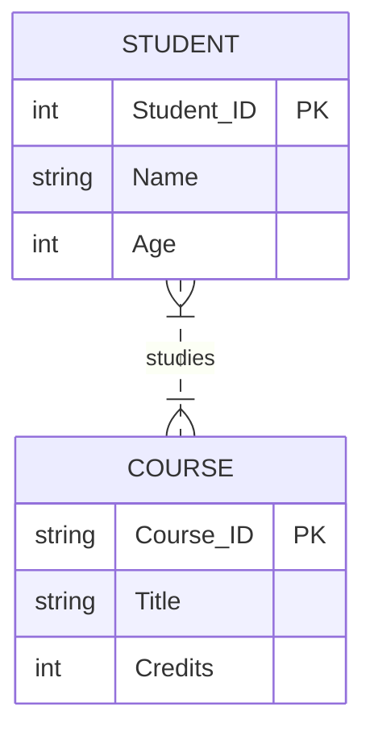

Date: 2025-10-29
Tags: [[SQL]], [[Programming language]], [[Database]], [[Theory]]

---

# SQL & Database Fundamentals

## What is SQL?
**SQL** (Structured Query Language) is the standard language for communicating with relational databases. It allows users to query, manipulate, define, and control data.

* **Primary Goal**: To allow technical and non-technical users to access data simply.
* **Origin**: Initially developed by IBM.
* **Scalability**: Powers everything from small mobile apps to massive data systems.

> [!INFO] Definition
> **Query**: A request for data or information from a database table or combination of tables.

> [!TIP] Did you know?
> Popular SQL databases include **SQLite**, **MySQL**, **PostgreSQL**, **Oracle**, and **Microsoft SQL Server**. While they all support the standard SQL syntax, they often have their own proprietary extensions.

### Key Features
1.  **Universal Access**: Can access any data within the relational database.
2.  **Performance**: highly optimized for retrieving large amounts of data quickly.
3.  **Standardization**: Works across major systems (Oracle, IBM, Microsoft).

---

## Relational Databases
A **Relational Database** stores data in a structured format using rows and columns. It is a collection of related two-dimensional tables.

![[Pasted image 20260208022614.png|center|500]]

* **Table**: Similar to an Excel sheet.
* **Column (Attribute)**: A specific piece of information (e.g., "Color", "Model").
* **Row (Record)**: A single entry of data.

### Example: DMV Vehicle Database
Imagine a database for the Department of Motor Vehicles:

| ID | Make/Model | # Wheels | # Doors | Type |
| :--- | :--- | :--- | :--- | :--- |
| 1 | Ford Focus | 4 | 4 | Sedan |
| 2 | Tesla Roadster | 4 | 2 | Sports |
| 3 | Kawasaki Ninja | 2 | 0 | Motorcycle |
| 4 | McLaren F1 | 4 | 0 | Race |
| 5 | Tesla Model S | 4 | 4 | Sedan |

---

## ER Diagrams (Entity Relationship Diagrams)

### What is an ER Diagram?
An **ER Diagram** is a structural flowchart that illustrates how "entities" (people, objects, or concepts) relate to each other within a system. It is the blueprint of your database.

![[Pasted image 20251210182614.png|center]]
### Why use ER Diagrams?
* **Conceptualization**: Helps identify which fields belong to which entity.
* **Communication**: Bridges the gap between technical developers and non-technical stakeholders.
* **Efficiency**: Reduces complexity and saves time during the actual coding phase.

### Core Components
An ER diagram is built on three main pillars:

![[Pasted image 20251210183134.png|center|600]]
#### 1. Entities (Rectangles)
An object or concept about which you want to store information.
* **Strong Entity**: Exists independently (e.g., *Student*, *Course*).
	![[Pasted image 20260208022949.png|center|500]]
* **Weak Entity**: Depends on another entity for existence (e.g., *Classroom* inside a School). Represented by a double rectangle.
	![[Pasted image 20260208022910.png|center|500]]

#### 2. Attributes (Ovals)
Properties or characteristics of an entity.

| Attribute Type | Symbol | Description | Example |
| :--- | :--- | :--- | :--- |
| **Key** | Underlined Text | Unique identifier. | `Student_ID` |
| **Composite** | Branching Ovals | Composed of smaller parts. | `Name` (First, Last) |
| **Multivalued** | Double Oval | Can have multiple values. | `Phone_Numbers`, `Skills` |
| **Derived** | Dashed Oval | Calculated from other attributes. | `Age` (from DOB) |
![[Pasted image 20260208023016.png|center|500]]
#### 3. Relationships (Diamonds)
How two entities interact with each other.
* **Example**: A Student *Studies* a Course.

![[Pasted image 20251210184500.png|center|600]]
### Interactive ER Diagram Example (Mermaid)
*This diagram is rendered live. You can edit the code below to change it.*

---

## Relationship Cardinality

Cardinality defines the numerical attributes of the relationship between two entities or entity sets.

### 1. One-to-One (1:1)

A single record in Table A relates to a single record in Table B.

- **Example**: Person ↔ Passport.
- _Visual_: `A --- B`
    

### 2. One-to-Many (1:N)

A single record in Table A relates to multiple records in Table B.

- **Example**: Customer ↔ Orders. (One customer places many orders).
    
- _Visual_: `A ---< B`
    

### 3. Many-to-One (N:1)

Multiple records in Table A relate to a single record in Table B.

- **Example**: Employees ↔ Department. (Many employees work in one department).
    
- _Visual_: `A >--- B`
    

### 4. Many-to-Many (M:N)

Multiple records in Table A relate to multiple records in Table B.

- **Note**: In SQL, this requires a **Junction Table** (or linking table) to connect them.
    
- **Example**: Students ↔ Courses. (A student takes many courses; a course has many students).
    
- _Visual_: `A >--< B`
    

---
### Drawing An ERD
![[Pasted image 20251210191231.png|center]]

---
# References

- [SQLBolt - Interactive SQL Lessons](https://sqlbolt.com/)