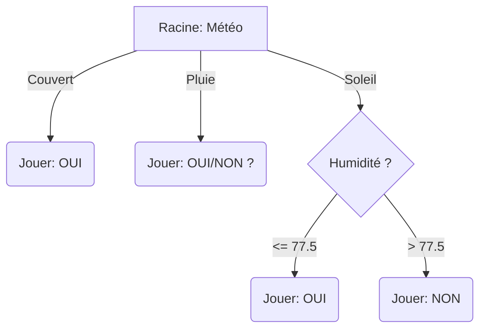

Date: 2026-01-12
Tags: [[Mathematics]], [[Data Science]], [[Machine Learning]], [[Decision Tree]],[[Python]], [[Supervised Learning]], [[R]]

# ~={red} Notes=~

> Source: Cours PDF - Méthode CHAID

## 1. Introduction Rapide

La technique de l'arbre de décision relie une variable cible **Y** (continue, nominale, ordinale) à des variables explicatives $X_1, \dots, X_p$. L'objectif est de découper la population en groupes (feuilles) les plus homogènes possible vis-à-vis de Y.

- **Classification :** Prédire une classe (arbre de classification).
    
- **Régression :** Prédire une valeur (arbre de régression).
    
- **Caractéristiques :** Hiérarchiques, descendantes, supervisées; tolèrent données hétérogènes et valeurs manquantes.
    

## 2. Panorama d'algorithmes

- **AID** (Morgan & Sonquist, 1963)
    
- **THAID** (Morgan & Messenger, 1973)
    
- **ID3 / C4.5 / C5.0** (Quinlan)
    
- **CHAID** (Kass, 1980)
    
- **CART** (Breiman et al., 1984)
    

> **Spécificité de CHAID :** Conçu pour des cibles catégorielles, il repose sur des tests du $\chi^2$ (Chi-deux) et intègre la fusion itérative des modalités d'un prédicteur.

## 3. Principe général de CHAID (à un nœud)

Pour chaque nœud à segmenter :

1. Pour chaque prédicteur candidat (qualitatif ou continu), construire un tableau de contingence avec la variable cible.
    
2. Calculer une statistique d'association (test du $\chi^2$).
    
3. Normaliser la statistique (ex. **T de Tschuprow**) pour comparer des prédicteurs de tailles différentes.
    
4. Choisir le prédicteur qui maximise la dépendance.
    
5. **Spécificité :** Fusionner des modalités similaires (test d'équivalence) avant de diviser.
    
6. Arrêter selon règles de pré-élagage (p-value, effectif min).
    

### Formules Clés

> [!MATH] Test du Chi-deux d'indépendance
> 
> $$\chi^2 = \sum_{i=1}^K \sum_{j=1}^L \frac{(n_{ij} - e_{ij})^2}{e_{ij}}$$
> 
> Où l'effectif attendu $e_{ij}$ est :
> 
> $$e_{ij} = \frac{n_{i\cdot} \times n_{\cdot j}}{n}$$
> 
> - $n_{ij}$ : effectif observé
>     
> - $n$ : taille totale
>     

> [!MATH] T de Tschuprow (Normalisation)
> 
> Permet de limiter l'influence de la taille de l'échantillon. $t \in [0,1]$.
> 
> $$t =\sqrt{\frac{\chi^2}{n \sqrt{(K-1)(L-1)}}}$$
> 
> 
> - $t=0$ : Indépendance
>     
> - $t=1$ : Dépendance parfaite
>     

## 4. Exemple Didactique : Jeu "Weather"

**Données (14 observations)** : Ensoleillement, Température, Humidité, Vent, **Jouer** (Cible).

|**ID**|**Ensoleillement**|**Temp**|**Hum**|**Vent**|**Jouer**|
|---|---|---|---|---|---|
|1|soleil|75|70|oui|oui|
|2|soleil|80|90|oui|non|
|3|soleil|85|85|non|non|
|4|soleil|72|95|non|non|
|5|soleil|69|70|non|oui|
|...|...|...|...|...|...|
|14|pluie|70|96|non|oui|

### 4.1 Premier choix — Ensoleillement vs Jouer

**Tableau de contingence observé :**

| **Ensoleillement** | **Oui** | **Non** | **Total** |
| ------------------ | ------- | ------- | --------- |
| **Soleil**         | 2       | 3       | 5         |
| **Couvert**        | 4       | 0       | 4         |
| **Pluie**          | 3       | 2       | 5         |
| **Total**          | **9**   | **5**   | **14**    |

Calcul des effectifs attendus ($E$) :

$$E \approx \begin{pmatrix} 3.2143 & 1.7857 \\ 2.5714 & 1.4286 \\ 3.2143 & 1.7857 \end{pmatrix}$$

**Résultats du test :**

- $\chi^2 \approx 3.5467$
    $$t = \sqrt{\frac{3.5467^2}{14 \sqrt{(2-1)(3-1)}}}$$
- $t_{\text{Ensoleillement}} \approx 0.423$

### 4.2 Comparaison avec le Vent

- $\chi^2 \approx 0.934$
    $$t =\sqrt \frac{0.934^2}{14 \sqrt{(2-1)(2-1)}}$$
- $t_{\text{Vent}} \approx 0.258$
    
- **Conclusion :** $0.423 > 0.258$, donc **Ensoleillement** est meilleur que Vent.
    

### 4.3 Variables Quantitatives (Humidité)

CHAID cherche le meilleur point de coupure (binning).

Pour le sous-ensemble "Soleil" (5 obs.) :

1. Valeurs triées : 70, 85, 90, 95.
    
2. Candidats coupure : 77.5, 87.5, 92.5.
    
3. **Test Seuil 77.5 :**
    
    - Humidité $\le$ 77.5 : 2 Oui, 0 Non.
        
    - Humidité > 77.5 : 0 Oui, 3 Non.
        
    - Séparation parfaite ($t=1.0$).
        
### Pre-elagage: Stopping Rules (Pre-Pruning)

CHAID is "Conservative." It stops growing _during_ construction (unlike CART which grows fully then prunes).

- Stops if the P-value > $\alpha$ (Threshold, usually 0.05).
    
- Stops if the node size is too small.

## 5. Fusion de modalités (Spécificité CHAID)

![[Pasted image 20260115142425.png|center|550]]

1. Fusionner d'abord les deux sommets les plus proches (p-value la plus élevée au test d'équivalence).
    
2. Réitérer jusqu'à ce que la p-value < seuil.
    
    Avantage : Lutte contre la fragmentation et améliore la lisibilité.
    
![[Pasted image 20260112193956.png|center]]

## 6. Règles de prédiction

- **Si feuille pure :** Affecter la modalité présente.
    
- **Si feuille impure :** Règle de la majorité (mode).

## 7. Comparaison Rapide

| **Algorithme** | **Critère de division**       | **Type de variable**  | **Spécificité**                          |
| -------------- | ----------------------------- | --------------------- | ---------------------------------------- |
| **CHAID**      | Chi-2 ($\chi^2$)              | Catégorielle (binned) | Fusion de modalités, pas de post-élagage |
| **CART**       | Indice de Gini                | Mixte                 | Arbres binaires, post-élagage            |
| **C4.5**       | Gain d'information (Entropie) | Mixte                 | Gère bien les valeurs manquantes         |

## 8. Visualisation de l'arbre (Règles)

Extrait de code



---

## 9. Implémentation Code

### Python (Didactique)

Calcul "from scratch" des statistiques.

```Python
import numpy as np
from scipy.stats import chi2_contingency

# Données brutes
rows = [
    ("soleil",75,70,"oui","oui"), ("soleil",80,90,"oui","non"),
    ("soleil",85,85,"non","non"), ("soleil",72,95,"non","non"),
    ("soleil",69,70,"non","oui"), ("couvert",72,90,"oui","oui"),
    ("couvert",83,78,"non","oui"), ("couvert",64,65,"oui","oui"),
    ("couvert",81,75,"non","oui"), ("pluie",71,80,"oui","non"),
    ("pluie",65,70,"oui","non"), ("pluie",75,80,"non","oui"),
    ("pluie",68,80,"non","oui"), ("pluie",70,96,"non","oui"),
]

def tschuprow_from_table(obs_table):
    chi2, p, dof, exp = chi2_contingency(obs_table, correction=False)
    K, L = obs_table.shape
    # Formule simplifiée selon notes de cours
    denom = (np.sum(obs_table) * (K-1) * (L-1))
    t = chi2 / denom if denom != 0 else 0
    return chi2, p, t

# Création du tableau de contingence Ensoleillement vs Jouer
cats = ["soleil", "couvert", "pluie"]
classes = ["oui", "non"]
obs = np.zeros((len(cats), len(classes)), dtype=int)

for i, c in enumerate(cats):
    for r in rows:
        if r[0] == c:
            obs[i, 0 if r[4] == "oui" else 1] += 1

chi2, p, t = tschuprow_from_table(obs)
print(f"Ensoleillement vs Jouer: Chi2={chi2:.4f}, t={t:.4f}")
```

### R (Package CHAID)

Utilisation de la librairie standard.

```R
if (!require("CHAID")) install.packages("CHAID", repos="http://R-Forge.R-project.org")
library("CHAID")

weather <- data.frame(
  Ensoleillement = factor(c('soleil','soleil','soleil','soleil','soleil',
                            'couvert','couvert','couvert','couvert',
                            'pluie','pluie','pluie','pluie','pluie')),
  Temperature = c(75,80,85,72,69,72,83,64,81,71,65,75,68,70),
  Humidite = c(70,90,85,95,70,90,78,65,75,80,70,80,80,96),
  Vent = factor(c('oui','oui','non','non','non','oui','non','oui','non',
                  'oui','oui','non','non','non')),
  Jouer = factor(c('oui','non','non','non','oui','oui','oui','oui','oui',
                   'non','non','oui','oui','oui'))
)

# ctrl: contrôles pour éviter erreurs sur petit dataset
ctrl <- chaid_control(minbucket = 1, minsplit = 2, alpha2 = 0.05)
fit <- chaid(Jouer ~ Ensoleillement + Temperature + Humidite + Vent, 
             data = weather, control = ctrl)

print(fit)
plot(fit)
```
# ~={red}References=~
[[cours_Arbre_CHAID_2025_AZOUAGH.pdf]]