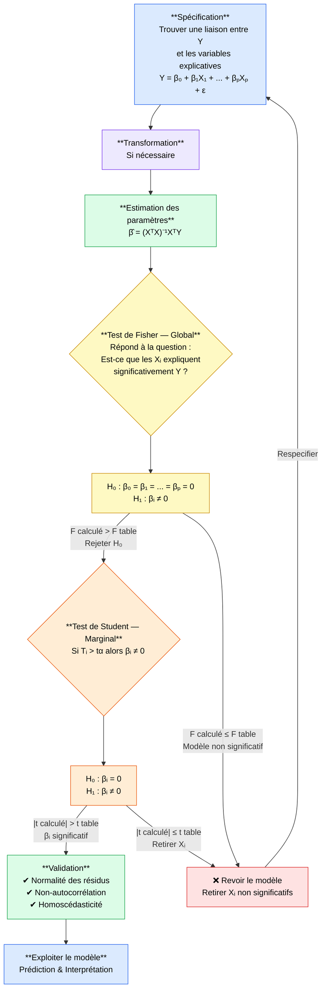

Date: 2026-04-21
Tags: [[Mathematics]], [[Data Science]], [[Machine Learning]], [[Supervised Learning]]

---

## 1) Présentation Générale

> Établir une relation **linéaire** entre une variable $Y$ (à expliquer ou dépendante) et une ou plusieurs variables explicatives $X_1, \ldots, X_p$ (quantitatives) pour faire de la **prédiction**.

- Si $p = 1$ : **régression simple**
- Si $p > 1$ : **régression multiple**

> ⚠️ $Y$ et $X_1, \ldots, X_p$ doivent être des **variables quantitatives**

---

## 2) Traitement Général d'un Problème de Régression

### Étapes détaillées

| Étape                   | Description                                                             |
| ----------------------- | ----------------------------------------------------------------------- |
| **1. Spécification**    | Forme générale du modèle qui explique le phénomène                      |
| **2. Transformation**   | Si nécessaire, transformer en modèle linéaire                           |
| **3. Estimation**       | Estimer les paramètres $\beta_0, \beta_1, \ldots, \beta_p$              |
| **4. Analyse variance** | Décomposer la variance totale de $Y$ en variance expliquée + résiduelle |
| **5. Tests**            | Test global (Fisher) et marginal (Student)                              |
| **6. Validation**       | Vérification des hypothèses fondamentales                               |

### Validation — Hypothèses à vérifier
- ✅ Normalité des résidus
- ✅ Non-autocorrélation des résidus
- ✅ Qualité du modèle

---

## 3) Spécification du Modèle

### Modèle général

$$Y = f(X_1, X_2, \ldots, X_p) + \varepsilon$$

$$\boxed{Y = \beta_0 + \beta_1 X_1 + \beta_2 X_2 + \cdots + \beta_p X_p + \varepsilon}$$

$$\varepsilon = \underbrace{Y}_{\text{réel}} - \underbrace{(\beta_0 + \beta_1 X_1 + \cdots + \beta_p X_p)}_{\text{estimation}}$$

### Tableau des types de modèles

| Type              | Forme                           | Variation                                         | Caractéristique                                                                          |
| ----------------- | ------------------------------- | ------------------------------------------------- | ---------------------------------------------------------------------------------------- |
| **Linéaire**      | $Y = \beta_0 + \beta_1 X$       | $\Delta Y = \beta_1 \Delta X$                     | Proportion marginale constante $\frac{\Delta Y}{\Delta X} = \beta_1$                     |
| **Log-linéaire**  | $Y = \beta_0 \cdot X^{\beta_1}$ | $\frac{\Delta Y}{Y} = \beta_1 \frac{\Delta X}{X}$ | Élasticité constante $\beta_1 = \frac{\Delta Y/Y}{\Delta X/X}$                           |
| **Exponentielle** | $Y = e^{\beta_0 + \beta_1 X}$   | $\frac{\Delta Y}{Y} = \beta_1 \Delta X$           | Taux de croissance de $Y$, $\beta_1$ proportionnel à la variation de $X$                 |
| **Logarithmique** | $Y = \beta_0 + \beta_1 \log(X)$ | $\Delta Y = \beta_1$                              | $\beta_1$ proportionnel à la variation de $Y$ et $\beta_1$ par taux de croissance de $X$ |

---

## 4) Régression Linéaire Simple

$$Y = \beta_0 + \beta_1 X + \varepsilon$$

### Forme matricielle

$$\begin{pmatrix} y_1 \\ y_2 \\ \vdots \\ y_n \end{pmatrix} = \beta_0 \begin{pmatrix} 1 \\ 1 \\ \vdots \\ 1 \end{pmatrix} + \beta_1 \begin{pmatrix} x_1 \\ x_2 \\ \vdots \\ x_n \end{pmatrix} + \begin{pmatrix} \varepsilon_1 \\ \varepsilon_2 \\ \vdots \\ \varepsilon_n \end{pmatrix}$$

$$\boxed{Y = X\beta + \varepsilon}$$

$$\begin{pmatrix} y_1 \\ y_2 \\ \vdots \\ y_n \end{pmatrix} = \begin{pmatrix} 1 & x_1 \\ 1 & x_2 \\ \vdots & \vdots \\ 1 & x_n \end{pmatrix} \begin{pmatrix} \beta_0 \\ \beta_1 \end{pmatrix} + \begin{pmatrix} \varepsilon_1 \\ \varepsilon_2 \\ \vdots \\ \varepsilon_n \end{pmatrix}$$

---

## 5) Régression Linéaire Multiple

$$Y = \beta_0 + \beta_1 X_1 + \beta_2 X_2 + \cdots + \beta_p X_p + \varepsilon$$

$$\boxed{Y = X\beta + \varepsilon}$$

$$\begin{pmatrix} y_1 \\ y_2 \\ \vdots \\ y_n \end{pmatrix} = \begin{pmatrix} 1 & x_{11} & x_{12} & \cdots & x_{1p} \\ 1 & x_{21} & x_{22} & \cdots & x_{2p} \\ \vdots & \vdots & \vdots & \ddots & \vdots \\ 1 & x_{n1} & x_{n2} & \cdots & x_{np} \end{pmatrix} \begin{pmatrix} \beta_0 \\ \beta_1 \\ \vdots \\ \beta_p \end{pmatrix} + \begin{pmatrix} \varepsilon_1 \\ \varepsilon_2 \\ \vdots \\ \varepsilon_n \end{pmatrix}$$

---

## 6) Hypothèses de la Régression Linéaire

| N° | Hypothèse |
|---|---|
| **H1** | Bonne spécification du modèle |
| **H2** | $E(\varepsilon_i) = 0,\quad i \in \{1,\ldots,n\}$ |
| **H3** | Homoscédasticité : $V(\varepsilon_i) = \sigma^2 = \text{cte},\quad i \in \{1,\ldots,n\}$ |
| **H4** | Non-autocorrélation des résidus : $\text{Cov}(\varepsilon_i, \varepsilon_j) = 0$ |
| **H5** | $\varepsilon_i \sim \mathcal{N}(0, \sigma^2),\quad i \in \{1,\ldots,n\}$ |
| **H6** | Les variables $X_1, \ldots, X_p$ sont **linéairement indépendantes** |

---

## 7) Estimation des Paramètres — Moindres Carrés

> **Principe :** On cherche $\hat{\beta}_0, \hat{\beta}_1$ qui **minimisent** la somme des carrés des résidus $S = \sum_{i=1}^{n} \varepsilon_i^2$

---

### Cas Régression Linéaire Simple

#### Étape 1 — Définir la fonction à minimiser

$$S(\beta_0, \beta_1) = \sum_{i=1}^{n} \varepsilon_i^2 = \sum_{i=1}^{n} \left(y_i - (\beta_0 + \beta_1 x_i)\right)^2$$

#### Étape 2 — Conditions du premier ordre (dérivées partielles = 0)

**Dérivée par rapport à $\beta_0$ :**

$$\frac{\partial S}{\partial \beta_0} = \frac{\partial}{\partial \beta_0} \sum_{i=1}^{n}\left(y_i - \beta_0 - \beta_1 x_i\right)^2 = -2\sum_{i=1}^{n}(y_i - \beta_0 - \beta_1 x_i) = 0$$

$$\Rightarrow \sum_{i=1}^{n} y_i - n\beta_0 - \beta_1\sum_{i=1}^{n} x_i = 0 \quad \cdots (1)$$

**Dérivée par rapport à $\beta_1$ :**

$$\frac{\partial S}{\partial \beta_1} = \frac{\partial}{\partial \beta_1} \sum_{i=1}^{n}\left(y_i - \beta_0 - \beta_1 x_i\right)^2 = -2\sum_{i=1}^{n} x_i(y_i - \beta_0 - \beta_1 x_i) = 0$$

$$\Rightarrow \sum_{i=1}^{n} x_i y_i - \beta_0\sum_{i=1}^{n} x_i - \beta_1\sum_{i=1}^{n} x_i^2 = 0 \quad \cdots (2)$$

#### Étape 3 — Système des équations normales

$$\begin{cases} \displaystyle\sum_{i=1}^{n} y_i - n\beta_0 - \beta_1\sum_{i=1}^{n} x_i = 0 \\[8pt] \displaystyle\sum_{i=1}^{n} x_i y_i - \beta_0\sum_{i=1}^{n} x_i - \beta_1\sum_{i=1}^{n} x_i^2 = 0 \end{cases}$$

On réarrange :

$$\begin{cases} \beta_1\displaystyle\sum_{i=1}^{n} x_i = \sum_{i=1}^{n} y_i - n\beta_0 \\[8pt] \beta_0\displaystyle\sum_{i=1}^{n} x_i = \sum_{i=1}^{n} x_i y_i - \beta_1\sum_{i=1}^{n} x_i^2 \end{cases}$$

#### Étape 4 — Résolution par la Règle de Cramer

On écrit le système sous forme matricielle :

$$\begin{pmatrix} n & \displaystyle\sum x_i \\[4pt] \displaystyle\sum x_i & \displaystyle\sum x_i^2 \end{pmatrix} \begin{pmatrix} \beta_0 \\ \beta_1 \end{pmatrix} = \begin{pmatrix} \displaystyle\sum y_i \\[4pt] \displaystyle\sum x_i y_i \end{pmatrix}$$

Le déterminant du système :

$$\Delta = \begin{vmatrix} n & \displaystyle\sum x_i \\[4pt] \displaystyle\sum x_i & \displaystyle\sum x_i^2 \end{vmatrix} = n\sum x_i^2 - \left(\sum x_i\right)^2$$

**Pour $\hat{\beta}_0$ — on remplace la 1ère colonne :**

$$\hat{\beta}_0 = \frac{\begin{vmatrix} \displaystyle\sum y_i & \displaystyle\sum x_i \\[4pt] \displaystyle\sum x_i y_i & \displaystyle\sum x_i^2 \end{vmatrix}}{\Delta} = \frac{\displaystyle\sum y_i \cdot \sum x_i^2 - \sum x_i \cdot \sum x_i y_i}{n\displaystyle\sum x_i^2 - \left(\sum x_i\right)^2}$$

**Pour $\hat{\beta}_1$ — on remplace la 2ème colonne :**

$$\hat{\beta}_1 = \frac{\begin{vmatrix} n & \displaystyle\sum y_i \\[4pt] \displaystyle\sum x_i & \displaystyle\sum x_i y_i \end{vmatrix}}{\Delta} = \frac{n\displaystyle\sum x_i y_i - \sum x_i \cdot \sum y_i}{n\displaystyle\sum x_i^2 - \left(\sum x_i\right)^2}$$

#### Étape 5 — Simplification en divisant par $n$

$$\boxed{\hat{\beta}_1 = \frac{\displaystyle\sum_{i=1}^{n} x_i y_i - \frac{\left(\displaystyle\sum_{i=1}^{n} x_i\right)\left(\displaystyle\sum_{i=1}^{n} y_i\right)}{n}}{\displaystyle\sum_{i=1}^{n} x_i^2 - \frac{\left(\displaystyle\sum_{i=1}^{n} x_i\right)^2}{n}} = \frac{\text{Cov}(X,Y)}{V(X)}}$$

#### Étape 6 — Déduire $\hat{\beta}_0$

De l'équation $(1)$ : $\sum y_i = n\beta_0 + \beta_1 \sum x_i$

En divisant par $n$ :

$$\bar{Y} = \beta_0 + \beta_1 \bar{X}$$

$$\boxed{\hat{\beta}_0 = \bar{Y} - \hat{\beta}_1\bar{X}}$$

> **Interprétation géométrique :** La droite de régression passe **toujours par le point $(\bar{X}, \bar{Y})$**

---

### Cas Régression Multiple — Estimateur OLS

#### Étape 1 — Rappel des propositions matricielles

> Ces propositions sont **indispensables** pour dériver la fonction de coût matricielle.

**Proposition 1 :** Soit $V \in \mathbb{R}^k$ et $a \in \mathbb{R}^k$ :

$$\frac{\partial V^T a}{\partial V} = \frac{\partial a^T V}{\partial V} = a$$

*Intuition : c'est l'équivalent matriciel de $\frac{\partial (ax)}{\partial x} = a$*

**Proposition 2 :** Soit $V \in \mathbb{R}^k$ et $M \in \mathbb{R}^{k\times k}$ :

$$\frac{\partial V^T M V}{\partial V} = (M + M^T)V$$

En particulier, si $M$ est **symétrique** ($M^T = M$) :

$$\frac{\partial V^T M V}{\partial V} = 2MV$$

*Intuition : c'est l'équivalent matriciel de $\frac{\partial (ax^2)}{\partial x} = 2ax$*

---

#### Étape 2 — Définir la fonction à minimiser

$$S(\beta) = \varepsilon^T\varepsilon = \sum_{i=1}^{n} \varepsilon_i^2$$

avec $\varepsilon = Y - X\beta$, donc :

$$\varepsilon^T = (Y - X\beta)^T = Y^T - \beta^T X^T$$

#### Étape 3 — Développer $\varepsilon^T\varepsilon$

$$\varepsilon^T\varepsilon = (Y - X\beta)^T(Y - X\beta)$$

$$= (Y^T - \beta^T X^T)(Y - X\beta)$$

$$= Y^T Y - Y^T X\beta - \beta^T X^T Y + \beta^T X^T X\beta$$

> **Remarque :** $Y^T X\beta$ est un scalaire, donc $Y^T X\beta = (Y^T X\beta)^T = \beta^T X^T Y$

$$\boxed{\varepsilon^T\varepsilon = Y^TY - 2\beta^T X^T Y + \beta^T X^T X\beta}$$

où l'on identifie :
- $Y^TY$ : scalaire constant (ne dépend pas de $\beta$)
- $-2\beta^T X^T Y$ : terme linéaire en $\beta$ (forme $V^T a$ avec $a = X^TY$)
- $\beta^T X^T X\beta$ : terme quadratique en $\beta$ (forme $V^T M V$ avec $M = X^TX$)

#### Étape 4 — Dériver par rapport à $\beta$

En appliquant les **Propositions 1 et 2** :

$$\frac{\partial \varepsilon^T\varepsilon}{\partial \beta} = \frac{\partial}{\partial\beta}\left[Y^TY\right] - \frac{\partial}{\partial\beta}\left[2\beta^T X^T Y\right] + \frac{\partial}{\partial\beta}\left[\beta^T X^T X\beta\right]$$

$$= 0 - 2X^TY + 2(X^TX)\beta$$

> **Note :** $X^TX$ est **symétrique** car $(X^TX)^T = X^TX$, donc on applique la Prop. 2 avec $M = X^TX$ :
> $\frac{\partial \beta^T(X^TX)\beta}{\partial \beta} = 2(X^TX)\beta$

#### Étape 5 — Égaliser à zéro et résoudre

$$\frac{\partial \varepsilon^T\varepsilon}{\partial \beta} = -2X^TY + 2(X^TX)\beta = 0$$

$$\Rightarrow 2(X^TX)\beta = 2X^TY$$

$$\Rightarrow (X^TX)\beta = X^TY \quad \text{(équations normales)}$$

Si $\det(X^TX) \neq 0$ (colonnes de $X$ linéairement indépendantes — **Hypothèse H6**), on peut inverser :

$$\boxed{\hat{\beta} = (X^TX)^{-1}X^TY}$$

#### Résumé visuel de la dérivation

$$S(\beta) = \varepsilon^T\varepsilon$$
$$\downarrow \text{ développer}$$
$$Y^TY - 2\beta^TX^TY + \beta^TX^TX\beta$$
$$\downarrow \frac{\partial}{\partial\beta} = 0$$
$$-2X^TY + 2(X^TX)\beta = 0$$
$$\downarrow \text{ résoudre}$$
$$\hat{\beta} = (X^TX)^{-1}X^TY$$
---

## 8) Exemple de Transformation (Log-linéaire)

**Modèle :** $Y = \beta_0 \cdot X_1^{\beta_1}$

$$\ln Y = \ln(\beta_0) + \beta_1 \ln(X_1)$$

On pose $Y' = \ln(Y)$, $\beta_0' = \ln(\beta_0)$, $X_1' = \ln(X_1)$

$$\Rightarrow Y' = \beta_0' + \beta_1 X_1'$$

> ⚠️ Condition : $Y > 0$, $\beta_0 > 0$, $X_1 > 0$

---

## 9. Analyse de la Variance (ANOVA)

$$\boxed{SCT = SCReg + SCRes}$$

|Terme|Désignation|Formule|
|---|---|---|
|$SCT$|Somme des Carrés Totale|$\displaystyle\sum_{i=1}^{n}(y_i - \bar{y})^2$|
|$SCReg$|Somme des Carrés de Régression|$\displaystyle\sum_{i=1}^{n}(\hat{y}_i - \bar{y})^2$|
|$SCRes$|Somme des Carrés Résiduelle|$\displaystyle\sum_{i=1}^{n}(y_i - \hat{y}_i)^2$|

> [!note]
>  Interprétation fondamentale La variance totale de $Y$ est la somme d'une **variance expliquée** par le modèle ($SCReg$) et d'une **variance inexpliquée** ou résiduelle ($SCRes$).

---

### Coefficient de Détermination $R^2$

$$R^2 = \frac{SCReg}{SCT} = 1 - \frac{SCRes}{SCT} \qquad R^2 \in [0,,1]$$

Plus $R^2$ est proche de $1$, meilleur est l'ajustement du modèle aux données.

### $R^2$ Ajusté

$$R^2_{adj} = 1 - \frac{n-1}{n-p-1}\quad,\quad(1 - R^2) = 1 - \frac{SCRes,/,(n-p-1)}{SCT,/,(n-1)}$$

> [!important] 
> Utilité du $R^2$ ajusté En régression multiple, le $R^2$ ordinaire augmente mécaniquement à chaque ajout de variable, même non significative. Le $R^2$ ajusté corrige ce biais en pénalisant la complexité du modèle (nombre de variables $p$). Il est donc préférable pour comparer des modèles de tailles différentes.

---

### Tableau des Risques de Décision

| |$H_0$ vraie|$H_1$ vraie|
|---|---|---|
|**$H_0$ acceptée**|Bonne décision — probabilité $1-\alpha$|Erreur de 2ème espèce — $\beta = P(\text{Rej};H_1 \mid H_0;\text{vraie})$|
|**$H_1$ acceptée**|Erreur de 1ère espèce — $\alpha$|Bonne décision (puissance) — $1-\beta$|

---

## 10. Tests Statistiques

### Test Global de Fisher

Ce test détermine s'il existe une **liaison significative globale** entre $Y$ et l'ensemble des régresseurs $(X_1, \ldots, X_p)$.

$$H_0 : \beta_1 = \beta_2 = \cdots = \beta_p = 0 \qquad \text{vs} \qquad H_1 : \exists, i \in {1,\ldots,p},; \beta_i \neq 0$$

$$F_{\text{cal}} = \frac{SCReg / p}{SCRes / (n-p-1)} \qquad F_{theo} = F_{p,(n-p-1),(1-\alpha)}$$

**Règle de décision :** $$F_{\text{cal}} > F_{theo} \implies \text{rejet de } H_0 \implies \text{le modèle est globalement significatif}$$

> [!note] Si on ne rejette pas $H_0$, cela ne signifie pas que tous les $\beta_i$ sont nuls, mais qu'on ne peut pas le prouver au seuil $\alpha$.

---

### Test Marginal de Student

Ce test évalue la **significativité individuelle** de chaque coefficient $\beta_i$.

$$H_0 : \beta_i = 0 \qquad \text{vs} \qquad H_1 : \beta_i \neq 0$$

$$t_{\text{cal}} = \frac{\hat{\beta}_i}{\hat{\sigma}_{\hat{\beta}_i}} \qquad t_{\text{théo}} = t_{n-p-1;1-\alpha/2}$$

**Règle de décision :** $$|t_{\text{cal}}| > t_{\text{théo}} \implies \text{rejet de } H_0 \implies \beta_i \text{ est individuellement significatif}$$

---

### Écarts-Types des Estimateurs

**Régression simple :**

$$\hat{\sigma}_{\hat{\beta}_0} = \sqrt{\frac{SCRes}{n-2}} \cdot \sqrt{\frac{1}{n} + \frac{\bar{x}^2}{\displaystyle\sum_{i=1}^n (x_i-\bar{x})^2}} \qquad \hat{\sigma}_{\hat{\beta}_1} = \frac{\sqrt{SCRes/(n-2)}}{\sqrt{\displaystyle\sum_{i=1}^n (x_i-\bar{x})^2}}$$

**Régression multiple :**

$$\hat{\Omega}_{\hat{\beta}} = \hat{\sigma}^2_\varepsilon \cdot (X'X)^{-1} \qquad \text{avec} \quad \hat{\sigma}^2_\varepsilon = \frac{\displaystyle\sum_{i=1}^n (y_i - \hat{y}_i)^2}{n-p-1}$$

La matrice $\hat{\Omega}_{\hat{\beta}}$ est la **matrice de variance-covariance** des estimateurs :

$$\hat{\Omega}_{\hat{\beta}} = \begin{pmatrix} \mathrm{Var}(\hat{\beta}_0) & \mathrm{Cov}(\hat{\beta}_0,\hat{\beta}_1) & \cdots & \mathrm{Cov}(\hat{\beta}_0,\hat{\beta}_p) \\ & \mathrm{Var}(\hat{\beta}_1) & \cdots & \vdots \\ & & \ddots & \vdots \\ & & & \mathrm{Var}(\hat{\beta}_p) \end{pmatrix}$$

Les écarts-types $\hat{\sigma}_{\hat{\beta}_i}$ sont les racines carrées des éléments diagonaux.

---

## 11. Diagnostic des Hypothèses du Modèle

### (1) Hypothèse de Spécification (Linéarité)

**Diagnostic graphique :** Le nuage de points $(\hat{y}_i,; \hat{\varepsilon}_i)$ doit avoir une forme **ronde, symétrique et horizontale**. Toute structure systématique (courbe, entonnoir, pattern) indique une mauvaise spécification.

![[Pasted image 20260422012711.png]]

**Remèdes :**

- Si $R^2 \approx 0$ : problème de spécification avéré
- Transformer les variables (logarithme, différences, puissances)
- Ajouter des variables explicatives manquantes
- Reconsidérer la forme fonctionnelle du modèle

---

### (2) Hypothèse d'Homoscédasticité

L'hypothèse stipule que $\mathrm{Var}(\varepsilon_i) = \sigma^2$ (constante pour tout $i$). Sa violation entraîne de l'**hétéroscédasticité**.

**Diagnostic graphique :** Le nuage $(\hat{y}_i,; \hat{\varepsilon}_i)$ présente une dispersion variable (évasée ou rétrécie), non uniforme.

![[Pasted image 20260422012806.png]]

**Tests formels :**

|Test|Principe|
|---|---|
|Goldfeld-Quandt|Comparaison des variances sur deux sous-échantillons|
|Breusch-Pagan|Régression auxiliaire des résidus au carré|
|White|Version plus générale de Breusch-Pagan, sans hypothèse sur la forme|
|ARCH-LM|Détection d'hétéroscédasticité conditionnelle (séries temporelles)|

**Remède :** Estimer un modèle de type **ARCH** (Autorégressif Conditionnel Hétéroscédastique) qui modélise explicitement la variance conditionnelle.

---

### (3) Hypothèse de Non-Autocorrélation

L'hypothèse stipule que $\mathbb{E}(\varepsilon_i \varepsilon_j) = 0$ pour $i \neq j$.

**Diagnostic graphique :** Le tracé chronologique des résidus $(i,;\hat{\varepsilon}_i)$ ne doit présenter aucune structure systématique — il doit ressembler à un **bruit blanc** (aléatoire, centré, sans tendance).

**Test formel : Durbin-Watson**

$$dw = \frac{\displaystyle\sum_{i=2}^n (\hat{\varepsilon}_i - \hat{\varepsilon}_{i-1})^2}{\displaystyle\sum_{i=1}^n \hat{\varepsilon}_i^2}$$

Avec $d_L$ = borne inférieure et $d_U$ = borne supérieure (issues des tables de Durbin-Watson) :

|Intervalle de $dw$|Décision|
|---|---|
|$[0,; d_L)$|Autocorrélation positive — $\mathbb{E}(\varepsilon_i \varepsilon_{i-1}) > 0$|
|$[d_L,; d_U)$|Zone de doute|
|$[d_U,; 4-d_U]$|Pas d'autocorrélation|
|$(4-d_U,; 4-d_L]$|Zone de doute|
|$(4-d_L,; 4]$|Autocorrélation négative — $\mathbb{E}(\varepsilon_i \varepsilon_{i-1}) < 0$|

**Remède :** Enrichir le modèle pour capturer l'information restée dans les résidus : ajouter des variables retardées, intégrer un terme autorégressif, ou transformer la variable dépendante.

---

### (4) Hypothèse de Normalité des Résidus

L'hypothèse stipule que $\varepsilon_i \sim \mathcal{N}(0, \sigma^2)$.

**Diagnostic graphique :**

|Outil|Interprétation|
|---|---|
|Histogramme des résidus|Doit approcher la forme d'une cloche symétrique|
|QQ-plot des résidus|Les points doivent s'aligner sur la droite diagonale|

**Tests statistiques — Skewness et Kurtosis :**

Pour une loi normale, les valeurs de référence sont :

|Statistique|Valeur de référence|Interprétation si écart|
|---|---|---|
|Skewness (asymétrie)|$0$|Distribution asymétrique|
|Kurtosis (aplatissement)|$3$|Distribution trop plate ou trop pointue|

![[Pasted image 20260422012909.png]]

> [!important] Conséquence sur les tests La normalité des résidus est indispensable pour que les tests $F$ et $t$ soient valides en **petit échantillon**. En grand échantillon, le théorème central limite garantit la validité asymptotique même sans normalité stricte.

---

> [!summary] Récapitulatif des Hypothèses à Vérifier
> 
> |Hypothèse|Outil graphique|Test(s) formel(s)|Remède principal|
> |---|---|---|---|
> |Spécification|Nuage $(\hat{y}_i, \hat{\varepsilon}_i)$|$R^2 \approx 0$|Transformation, changement de modèle|
> |Homoscédasticité|Nuage $(\hat{y}_i, \hat{\varepsilon}_i)$|White, Breusch-Pagan, ARCH-LM, GQ|Modèle ARCH, MCG|
> |Non-autocorrélation|Tracé chronologique des résidus|Durbin-Watson|Variables retardées, modèle AR|
> |Normalité|Histogramme, QQ-plot|Skewness $= 0$, Kurtosis $= 3$|Grand échantillon, transformation|

---

## 11) Exercice Complet — Modèle Log-linéaire

**Modèle :** $M = \alpha \cdot PIB^{\beta}$

$$\log(M) = \log(\alpha) + \beta\log(PIB)$$

On pose : $Y = \log(M)$, $\beta_0 = \log(\alpha)$, $\beta_1 = \beta$, $X = \log(PIB)$

### Estimation

$$\hat{\beta}_1 = \frac{\sum x_i y_i - \frac{(\sum x_i)(\sum y_i)}{n}}{\sum x_i^2 - \frac{(\sum x_i)^2}{n}} = 1{,}168$$

$$\hat{\beta}_0 = \bar{Y} - \hat{\beta}_1 \bar{X} = -3{,}584$$

### Test de Fisher

$$F_{\text{calculé}} = \frac{SCReg/1}{SCRes/(n-2)} = \frac{59{,}39}{5{,}987} \approx 59{,}39 \quad > \quad F_{\alpha=5\%} = 5{,}99$$

> ✅ On **rejette** $H_0$ → le modèle est **significatif au seuil 5%**

### Test de Student

$$|t_{\text{calculé}}| > t_{n-2;\,1-\alpha/2} = t_{6;\,0{,}975} = 2{,}447$$

**Pour $\hat{\beta}_0$ :** $|-2{,}503| > 2{,}447$ → ❌ On ne rejette pas $H_0$ → $\beta_0$ **n'est pas significatif**

### Test de Durbin-Watson

$$d_L = 0{,}763 \qquad d_U = 1{,}332$$

### Interprétation économique

$$\frac{\Delta M}{M} = \hat{\beta}_1 \frac{\Delta PIB}{PIB}$$

> Si le PIB augmente de **1%**, alors le taux de variation des importations sera $\hat{\beta}_1 \times 1\% = 1{,}168\%$

### Prévision

$$\frac{M_{2013} - M_{2012}}{M_{2012}} = \hat{\beta}_1 \frac{\Delta PIB}{PIB}$$

$$\frac{M_{2013} - 8028}{8028} = 1{,}168 \times 4{,}5\%$$

$$M_{2013} = 8028(1{,}168 \times 4{,}5\%) + 8028$$

---

## Résumé — Formules Clés

| Concept | Formule |
|---|---|
| Modèle général | $Y = X\beta + \varepsilon$ |
| Estimateur OLS | $\hat{\beta} = (X^TX)^{-1}X^TY$ |
| $\hat{\beta}_1$ simple | $\dfrac{\text{Cov}(X,Y)}{V(X)}$ |
| $\hat{\beta}_0$ simple | $\bar{Y} - \hat{\beta}_1\bar{X}$ |
| Décomposition variance | $SCT = SCReg + SCRes$ |
| Test Fisher | $F = \dfrac{SCReg/p}{SCRes/(n-p-1)}$ |
| Test Student | $\|t\| > t_{n-p-1;\,1-\alpha/2}$ |

> ⚠️ **Rappel clé :** $\det(X^TX) \neq 0$ est nécessaire pour que $\hat{\beta} = (X^TX)^{-1}X^TY$ existe — cela implique que les colonnes de $X$ sont **linéairement indépendantes** (H6).