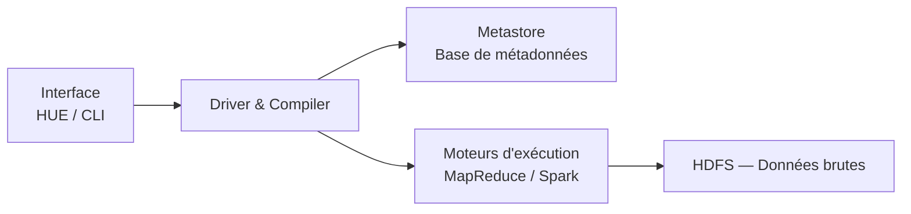
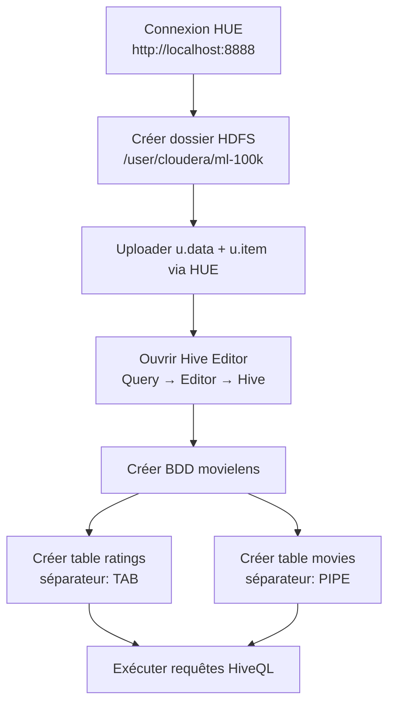
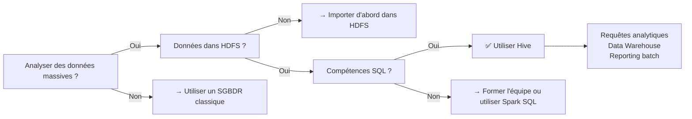

Date: 2026-05-12
Tags: 

---
# 📦 Big Data — Notes de Révision Complètes

> **Objectif :** Maîtriser les concepts fondamentaux du Big Data, de l'écosystème Hadoop, MapReduce et Apache Hive pour l'examen.

---

# Chapitre 1 : L'Essentiel du Big Data

> [!abstract] Définition Clé 
> Le **Big Data** est la capacité d'**extraire des informations pertinentes** de données **massives, rapides et diversifiées**, ingérables par des outils classiques (Excel, SQL standard).

---

## 1. Small Data vs Big Data

|**Critère**|**Small Data**|**Big Data**|
|---|---|---|
|**Volume**|Limité (Mo / Go)|Massif (Pétaoctets → Zettaoctets)|
|**Structure**|Structuré (Lignes/Colonnes)|Structuré, semi-structuré, non structuré|
|**Mise à jour**|Lente ou périodique|Continue & en temps réel|
|**Traitement**|Outils classiques (Excel, SQL)|Outils spécialisés (Hadoop, Spark, NoSQL)|
|**Stockage**|Serveur interne (SGBDR)|Cloud, clusters de serveurs (HDFS)|

---

## 2. Les Types de Données

> [!important] Répartition à retenir
> 
> - **20% Structurées :** Lignes/Colonnes, SQL — ex : Ventes Excel, bases de données relationnelles.
> - **10% Semi-structurées :** Balises présentes mais pas de schéma rigide — ex : JSON, XML, Emails.
> - **70% Non structurées :** Aucun schéma prédéfini — ex : Vidéos, Audio, Images, posts réseaux sociaux.

![[Pasted image 20260512190825.png]]

---

## 3. Les 5V du Big Data ⭐

> [!tip] Les 5V — Le cœur du chapitre
> Les 5V définissent ce qui rend la donnée "Big". Chaque V adresse un défi spécifique.

| **V**          | **Signification**                             | **Défi associé**        | **Exemple**                              |
| -------------- | --------------------------------------------- | ----------------------- | ---------------------------------------- |
| **Volume**     | Quantité massive (Pétaoctets → Zettaoctets)   | Stockage et traitement  | Logs de transactions bancaires mondiales |
| **Vélocité**   | Vitesse de génération et de traitement        | Temps réel vs batch     | Tweets générés à 6000/seconde            |
| **Variété**    | Diversité des formats et sources              | Intégration hétérogène  | CSV + JSON + vidéo + capteurs IoT        |
| **Véracité**   | Qualité, précision, fiabilité des données     | Nettoyage et validation | Capteurs défectueux produisant du bruit  |
| **==Valeur==** | Transformer la donnée en décision stratégique | **L'objectif final**    | Recommandation produit → vente concrète  |
![[Pasted image 20260512190911.png]]

> [!warning] Piège d'examen 
> La **Valeur** est le V le plus important — c'est la **finalité** de toute démarche Big Data. Les 4 autres V ne sont que des obstacles à surmonter pour atteindre la Valeur.

---

## 4. Cycle de Vie de la Donnée

```
Collecte → Stockage → Traitement → Analyse → Visualisation → Décision
```

![[Pasted image 20260512191115.png]]

|**Étape**|**Description**|**Outils typiques**|
|---|---|---|
|**Collecte**|Récupérer depuis diverses sources|IoT, web scraping, APIs|
|**Stockage**|Systèmes distribués et scalables|HDFS, NoSQL, S3|
|**Traitement**|Nettoyage, transformation, modélisation|Spark, MapReduce|
|**Analyse**|Extraction de patterns et prédictions|ML, Deep Learning, Data Mining|
|**Visualisation**|Représentation graphique des résultats|Power BI, Tableau|
|**Décision**|Action stratégique basée sur les résultats|—|

---

## 5. Scalabilité — Scale Up vs Scale Out

> [!important] Concept fondamental (revient dans Hadoop)

![[Pasted image 20260512195644.png]]

|**Type**|**Méthode**|**Avantages**|**Limites**|
|---|---|---|---|
|**Verticale (Scale Up)**|Ajouter RAM/CPU à **une seule machine**|Simple à gérer|Coûteux, limité physiquement, **SPOF**|
|**Horizontale (Scale Out)**|Ajouter des **machines au cluster**|Élastique, tolérant aux pannes|Plus complexe à orchestrer|

> [!note] SPOF = Single Point of Failure
>  Un SPOF est un composant dont la défaillance entraîne l'arrêt total du système. La scalabilité horizontale **élimine ce risque** en distribuant la charge.

---

## 6. Parallélisme

![[Pasted image 20260512191435.png]]

- **Parallélisme trivial :** Tâches **100% indépendantes**, aucune communication entre nœuds nécessaire.
    
    - _Exemple :_ Redimensionner 10 millions d'images — chaque image est traitée indépendamment.
    
- **Parallélisme non trivial :** Les nœuds doivent **s'échanger des données** pour produire un résultat global.
    
    - _Exemple :_ Trier un dataset de 2 To par ordre alphabétique — les nœuds doivent se comparer pour garantir un ordre global.


---

## 7. L'Écosystème Technologique Big Data (6 Piliers)

|**Catégorie**|**Outils Principaux**|**Rôle**|
|---|---|---|
|**1. Technologies**|Hadoop (HDFS/MapReduce), Spark|Stockage distribué et traitement in-memory|
|**2. Visualisation**|Tableau, SAS|Dashboards interactifs|
|**3. BI**|Power BI, IBM Cognos|Reporting et prise de décision métier|
|**4. Cloud**|AWS, GCP, Azure|Infrastructure scalable à la demande|
|**5. NoSQL**|MongoDB, Cassandra, Redis|BDD flexibles (Document, Clé-valeur, Colonnes)|
|**6. Programmation**|Python, R, SQL, Scala|Analyse, ML/DL et requêtage|

---


- **IoT (Internet of Things) :** Génère la donnée via des capteurs → Le Big Data l'exploite via des algorithmes.

![[Pasted image 20260512191610.png]]

- **Cas concrets :**
    - **Recommandations :** Netflix, Spotify (analyse comportementale)
    - **Assistants vocaux :** Siri, Google Assistant (NLP + Deep Learning)
    - **Maintenance prédictive :** Détecter une panne machine avant qu'elle survienne

---

---

# Chapitre 2 : L'Écosystème Hadoop

> [!abstract] Définition Clé 
> **Hadoop** est une ~={red}Plateforme logicielle=~ ~={purple}open source=~ pour le ~={pink}stockage distribué=~ et le ~={blue}traitement parallèle=~ sur du matériel standard (commodity hardware — pas de serveurs coûteux).

> [!note] Historique (peut tomber à l'examen)
>  Hadoop est né des publications de Google en **2003-2004** sur le _Google File System (GFS)_ et _MapReduce_. Créé en **2005** par **Doug Cutting** et **Mike Cafarella**, il est devenu un projet Apache indépendant en **2006**.

---

## 1. Pourquoi Hadoop ? — Les 3 Problèmes Résolus

| **Problème**               | **Explication**                                        | **Solution Hadoop**                     |
| -------------------------- | ------------------------------------------------------ | --------------------------------------- |
| **Saturation du stockage** | Un seul disque ne suffit plus pour les volumes actuels | Stockage distribué sur cluster (HDFS)   |
| **Latence d'accès**        | Chercher dans des disques massifs devient ingérable    | Localité des données (calcul → donnée)  |
| **SPOF**                   | Un serveur centralisé en panne = perte totale          | Réplication des données (x3 par défaut) |

![[Pasted image 20260512200931.png]]

---

## 2. Paradigmes de Traitement : Batch vs Streaming

|**Mode**|**Technologie**|**Latence**|**Cas d'usage**|
|---|---|---|---|
|**Batch (Par lots)**|MapReduce (natif Hadoop)|Minutes / Heures|Rapports périodiques, ETL|
|**Streaming (Flux continu)**|Spark Streaming, Apache Storm|Sub-seconde|IoT, détection de fraude, alertes|

> [!example] Exemple concret Maroc
> 
> - **Batch :** Génération du **rapport mensuel des ventes** chez Marjane. Les données sont déjà stockées, une exécution planifiée suffit.
> - **Stream :** **Détection de fraude en temps réel** chez Attijariwafa Bank. Chaque transaction doit être analysée instantanément (ex : 2 achats depuis pays différents en 5 min → blocage automatique).

---

## 3. Le Noyau Hadoop : HDFS + YARN + MapReduce

### HDFS — Hadoop Distributed File System

> [!important] Rôle : **La couche de stockage** de Hadoop

![[Pasted image 20260512205448.png]]

**Principe fondamental :**

- Les fichiers sont découpés en **blocs de 128 Mo** (Hadoop 2.x+)
- Chaque bloc est **répliqué 3 fois** sur des nœuds différents
- Principe de **localité** : déplacer le **calcul vers la donnée**, pas l'inverse

**Architecture Maître-Esclave :**

![[Pasted image 20260512205604.png]]

|**Nœud**|**Rôle**|**Stocke les données ?**|
|---|---|---|
|**NameNode (Maître)**|Cerveau du système — gère les **métadonnées** et sait où sont les blocs|❌ Non|
|**DataNodes (Esclaves)**|Stockent **physiquement** les blocs, envoient des _heartbeats_ au NameNode|✅ Oui|

> [!warning] Point critique 
> Le **NameNode** est le seul point de défaillance potentiel de HDFS. C'est pourquoi les configurations production utilisent un **NameNode secondaire** ou de la haute disponibilité (HA).

**Mécanisme de lecture :**

```
Client → Demande au NameNode → Obtient l'emplacement des blocs → Lit directement depuis les DataNodes
```

**Mécanisme d'écriture :**

```
Client → Demande au NameNode (allocation) → Écrit sur DataNode 1 
       → Pipeline vers DataNode 2 puis DataNode 3 → ACK envoyé au NameNode
```

**Commandes HDFS essentielles :**

| **Commande**                   | **Action**                               |
| ------------------------------ | ---------------------------------------- |
| `hdfs dfs -ls <chemin>`        | Lister le contenu d'un répertoire        |
| `hdfs dfs -mkdir <chemin>`     | Créer un répertoire                      |
| `hdfs dfs -put <local> <hdfs>` | Copier un fichier local **vers** HDFS    |
| `hdfs dfs -get <hdfs> <local>` | Copier un fichier HDFS **vers** le local |
| `hdfs dfs -cat <chemin>`       | Afficher le contenu d'un fichier         |
| `hdfs dfs -mv <src> <dest>`    | Déplacer / renommer                      |
| `hdfs dfs -cp <src> <dest>`    | Copier en interne dans HDFS              |
| `hdfs dfs -rm <chemin>`        | Supprimer un fichier                     |
| `hdfs dfs -rm -r <chemin>`     | Supprimer un dossier entier (récursif)   |

**Limites de HDFS :**

> [!danger] Limites à connaître pour l'examen
> 
> - **Latence élevée :** Optimisé pour le débit (_throughput_), **pas** pour le temps réel.
> - **Petits fichiers :** Chaque fichier consomme de la RAM sur le NameNode → des millions de petits fichiers saturent sa mémoire.
> - **Non cloud-native :** Couplage fort calcul/stockage comparé à AWS S3 ou Google Cloud Storage.
> - **Maintenance complexe :** Infrastructure lourde à administrer.

---

### YARN — Yet Another Resource Negotiator

> [!important] Rôle : **Le gestionnaire de ressources** du cluster

- Attribue les tâches aux nœuds selon la disponibilité (CPU/RAM disponibles)
- Coordonne l'exécution des jobs soumis au cluster
- Découplé de MapReduce → permet à **d'autres moteurs** (Spark, Storm) d'utiliser le cluster

---

### MapReduce (Natif)

> [!important] Rôle : **Le modèle de programmation** par défaut _(détaillé en Chapitre 3)_

- **Phase MAP :** Transforme les données en paires `(Clé, Valeur)`
- **Phase REDUCE :** Regroupe et agrège les résultats par clé

> [!example] Exemple : Compter les mots dans un corpus
> 
> - **Map :** Chaque nœud lit un fragment de texte → produit des paires `(mot, 1)`
> - **Shuffle :** Regroupement automatique par mot → `mot → [1, 1, 1, ...]`
> - **Reduce :** Somme des 1 pour chaque mot → `(mot, total)`

---

## 4. L'Écosystème Complet Hadoop

![[Pasted image 20260512202513.png]]

|**Catégorie**|**Outils**|**Rôle Principal**|
|---|---|---|
|**Noyau**|HDFS, YARN, MapReduce|Stockage distribué, gestion ressources, traitement par lots|
|**Langages Data**|Pig, Hive|Pig = Scripts (Pig Latin) ; Hive = Requêtes SQL (HiveQL) sur HDFS|
|**Base NoSQL**|HBase|Base orientée colonnes, accès temps réel sur HDFS|
|**Calcul Rapide**|Spark, Spark MLlib|Traitement _in-memory_ (100x plus rapide que MapReduce), ML|
|**Temps Réel**|Storm|Traitement événement par événement, latence ultra-faible|
|**Orchestration**|Oozie, Zookeeper|Oozie = Planificateur de workflows ; Zookeeper = Coordination du cluster|
|**Ingestion**|Sqoop, Flume, Kafka|Sqoop (depuis SQL), Flume (logs web), Kafka (flux temps réel)|
|**Interface UI**|HUE|Portail web graphique pour explorer et gérer le cluster|

> [!tip] Moyen mnémotechnique pour l'ingestion **S**qoop → **S**QL (bases relationnelles) **F**lume → **F**lux de logs (web servers) **K**afka → **K**inetic (messagerie temps réel)

---

---

# Chapitre 3 : L'Essentiel de MapReduce

> [!abstract] Définition Clé 
> MapReduce est un **modèle de programmation** pour diviser, traiter et agréger des données massives **en parallèle**. Le développeur écrit uniquement la **logique métier** (fonctions Map et Reduce) — Hadoop gère la distribution, la parallélisation et la tolérance aux pannes.

---

## 1. Les 4 Principes Fondamentaux

|**Principe**|**Explication**|
|---|---|
|**Division & Parallélisme**|Les données sont partitionnées en fragments traités simultanément sur différents nœuds|
|**Localité des données**|Le traitement est envoyé **là où résident les données** pour éviter les transferts réseau coûteux|
|**Tolérance aux pannes**|Si un nœud échoue, Hadoop relance automatiquement la tâche sur un nœud possédant une réplique|
|**Abstraction**|Le framework gère tout — le développeur se concentre uniquement sur Map et Reduce|

---

## 2. Le Pipeline MapReduce — Les 3 Phases ⭐

![[Pasted image 20260514011242.png]]

```
Données brutes → [MAP] → Paires (Clé, Valeur) 
→ [SHUFFLE & SORT] → Clé: [V1,V2,V3] 
→ [REDUCE] → Résultat final
```

### Phase 1 — MAP (Transformation)

- Lit les données **ligne par ligne**
- Émet des paires `(Clé, Valeur)`
- La **Clé** = critère de regroupement
- La **Valeur** = donnée à analyser

### Phase 2 — SHUFFLE & SORT (Tri & Redistribution)

- **100% automatique** — géré entièrement par Hadoop
- Regroupe toutes les valeurs d'une même clé : `Clé → [V1, V2, V3, ...]`
- _Exemple :_ `(Ali, 15), (Ali, 10)` → `Ali: [15, 10]`

### Phase 3 — REDUCE (Agrégation)

- Reçoit la clé et **sa liste complète** de valeurs
- Applique une fonction d'agrégation : **Somme, Moyenne, Max, Min, Count**
- Génère le résultat final

---

## 3. Modèles de Logique — Fichier de Notes

> [!tip] Comment choisir la Clé et la Valeur ?
> 
> - La **Clé** détermine le **niveau de regroupement** (par quoi regrouper ?)
> - La **Valeur** est ce qu'on veut **agréger** (quoi calculer ?)

|**Objectif Visé**|**Clé (MAP)**|**Valeur (MAP)**|**Action (REDUCE)**|
|---|---|---|---|
|**Moyenne par Étudiant**|Étudiant|Note|`Somme / Nombre`|
|**Moyenne par Matière**|Matière|Note|`Somme / Nombre`|
|**Meilleure Note par Matière**|Matière|Note|Garder le **Maximum**|
|**Nombre de notes par Étudiant**|Étudiant|1 (pour compter)|`Somme des 1 = COUNT`|

---

## 4. Hadoop Streaming — MapReduce en Python

> [!important] Définition
>  **Hadoop Streaming** est une API qui permet d'écrire les fonctions Map et Reduce dans **n'importe quel langage** (Python, Ruby, etc.) via les flux standards `stdin` / `stdout` — sans avoir à coder en Java.

![[Pasted image 20260514011421.png]]

### Structure du Mapper (`mapper.py`)

- Lit depuis `sys.stdin` ligne par ligne
- Découpe la ligne avec `split()`
- Émet le résultat avec `print("%s\t%s" % (cle, valeur))`
- Le **séparateur obligatoire** entre clé et valeur est la **tabulation** `\t`

### Structure du Reducer (`reducer.py`)

- Lit depuis `sys.stdin` (les données arrivent **déjà triées** par clé — Shuffle est automatique)
- Accumule les valeurs tant que la clé est identique
- Émet le résultat avec `print` lors du **changement de clé**

---

## 5. Commandes d'Exécution — Workflow Complet

### Étape 1 — Préparer l'environnement

```bash
# Rendre les scripts exécutables
hdfs dfs -chmod 777 mapper.py reducer.py

# Charger les données sources dans HDFS
hdfs dfs -put donnees.csv /input
```

### Étape 2 — Lancer le Job MapReduce

```bash
hadoop jar /usr/lib/hadoop-mapreduce/hadoop-streaming.jar \
  -files mapper.py,reducer.py \
  -input /input/donnees.csv \
  -output /input/ventes \
  -mapper "python mapper.py" \
  -reducer "python reducer.py"
```

> [!warning] Règle importante 
> Le dossier de **sortie** (`-output`) **ne doit pas exister** avant l'exécution. Hadoop refuse d'écraser un dossier existant — pensez à le supprimer avec `hdfs dfs -rm -r /input/ventes` avant de relancer.

### Étape 3 — Exploiter les Résultats

Les résultats sont stockés dans le fichier `part-00000` du dossier de sortie.

| **Besoin**                        | **Commande**                                                                            |
| --------------------------------- | --------------------------------------------------------------------------------------- |
| **Afficher tout le résultat**     | `hdfs dfs -cat /input/ventes/part-00000`                                                |
| **Filtrer une valeur spécifique** | `hdfs dfs -cat /input/ventes/part-00000 \| grep "mot_cherché"`                          |
| **Filtres multiples**             | `hdfs dfs -cat /input/ventes/part-00000 \| grep "A" \| grep "B"`                        |
| **Trier par valeur numérique**    | `hdfs dfs -cat /input/ventes/part-00000 \| sort -k2 -n`, Ajouter `-r` pour décroissant. |
| **Récupérer en local**            | `hdfs dfs -get /input/ventes/part-00000 Resultats.txt`                                  |

---

---

# Chapitre 4 : Apache Hive

> [!abstract] Définition Clé 
> Apache Hive est un **entrepôt de données distribué** construit **au-dessus de Hadoop**, permettant d'interroger de très grands volumes de données dans HDFS via **HiveQL** (langage proche de SQL), sans avoir à écrire de code MapReduce complexe.

---

## 1. Philosophie Hive : Schema-on-Read

> [!important] Différence fondamentale à maîtriser

|                 | **SGBDR (MySQL, PostgreSQL)**                                    | **Hive**                                                     |
| --------------- | ---------------------------------------------------------------- | ------------------------------------------------------------ |
| **Approche**    | **Schema-on-Write** — Le schéma est imposé **avant** l'insertion | **Schema-on-Read** — Le schéma est appliqué **à la lecture** |
| **Conséquence** | Erreurs détectées à l'insertion                                  | Erreurs de format détectées **à l'exécution**                |
| **Flexibilité** | Données doivent être propres avant stockage                      | Stockage immédiat de fichiers bruts (CSV, JSON, logs)        |

---

## 2. Comparaison Complète : Hive vs MapReduce vs SGBDR

### Hive vs MapReduce

|**Critère**|**MapReduce (Python)**|**Hive (HiveQL)**|
|---|---|---|
|**Langage**|`mapper.py` + `reducer.py` (~100+ lignes)|1 requête HiveQL (quelques lignes)|
|**Prérequis**|Élevé (Python + API Hadoop + MapReduce)|Faible (SQL suffit)|
|**Public cible**|Développeurs expérimentés|Analystes, Data Scientists|
|**Jointures/Agrégations**|Complexes à coder manuellement dans le Reducer|Simples : `JOIN...ON...`, `SUM`, `AVG`, `GROUP BY`|
|**Usage**|Traitement sur mesure et complexe|Analytics, Data Warehouse, Reporting|

> [!info] Relation Hive ↔ MapReduce 
> Hive **n'est pas un remplacement** de MapReduce — c'est une **couche d'abstraction** au-dessus. Chaque requête HiveQL est convertie automatiquement en job MapReduce (ou Spark) exécuté sur le cluster.

### Hive vs SGBDR Classique

| **Critère**         | **SGBDR (MySQL, PostgreSQL)**         | **Hive**                                     |
| ------------------- | ------------------------------------- | -------------------------------------------- |
| **Langage**         | SQL                                   | HiveQL (proche de SQL, quelques différences) |
| **Schéma**          | Schema-on-Write                       | Schema-on-Read                               |
| **Type de données** | Structurées                           | Semi-structurées (CSV, JSON, logs)           |
| **Stockage**        | Disque local / SAN                    | HDFS                                         |
| **Usage principal** | OLTP — Applications transactionnelles | OLAP — Analytics et Data Warehouse           |
| **Temps réel**      | ✅ Oui                                 | ❌ Non (optimisé pour le batch)               |

---

## 3. Architecture Hive — Les 4 Composants Clés



|**Composant**|**Rôle Détaillé**|
|---|---|
|**Interface (HUE / CLI)**|Point d'entrée — soumettre les requêtes HiveQL via interface web (HUE) ou ligne de commande|
|**Driver & Compiler**|Parse la requête HiveQL, vérifie la syntaxe, consulte le Metastore, génère le plan d'exécution|
|**Metastore (BD)**|Stocke les **métadonnées** : schémas des tables, types de colonnes, chemins HDFS des données|
|**Moteurs d'exécution**|Exécute le plan : **MapReduce** (défaut) ou **Spark** pour traitement distribué sur le cluster|

### Processus d'exécution étape par étape

```
1. SOUMISSION  → Utilisateur écrit la requête HiveQL dans HUE ou CLI
2. COMPILATION → Driver parse, valide la syntaxe, consulte le Metastore pour les schémas
3. PLANIFICATION → Génération du plan d'exécution logique → puis physique
4. EXÉCUTION   → Plan converti en jobs MapReduce → soumis à YARN sur le cluster
5. RÉSULTAT    → Données collectées depuis HDFS → renvoyées à l'utilisateur
```

---

## 4. HiveQL — Syntaxe Complète & Commandes

### DDL — Data Definition Language (Structure)

```sql
-- Gestion des bases de données
CREATE DATABASE movielens;
USE movielens;
DROP DATABASE IF EXISTS movielens CASCADE;  -- CASCADE = supprime même si non vide

-- Création de table avec schéma explicite
CREATE TABLE ratings (
    id_user    BIGINT,
    id_film    BIGINT,
    rating     BIGINT,
    rating_time BIGINT
)
ROW FORMAT DELIMITED
FIELDS TERMINATED BY '\t'    -- Séparateur tabulation
STORED AS TEXTFILE;
```

> [!warning] ROW FORMAT DELIMITED — Séparateurs à retenir
> 
> |**Séparateur**|**Syntaxe HiveQL**|
> |---|---|
> |Tabulation|`FIELDS TERMINATED BY '\t'`|
> |Pipe|`FIELDS TERMINATED BY '\|'`|
> |Virgule (CSV)|`FIELDS TERMINATED BY ','`|

### DML — Data Manipulation Language (Données)

```sql
-- Chargement des données
LOAD DATA LOCAL INPATH '/home/user/u.data' INTO TABLE ratings;    -- Depuis le système local
LOAD DATA INPATH '/user/cloudera/ml-100k/u.data' INTO TABLE ratings;  -- Depuis HDFS

-- Commandes utilitaires
SHOW DATABASES;                             -- Lister toutes les bases
SHOW TABLES;                                -- Lister les tables de la BDD active
DESCRIBE ratings;                           -- Afficher le schéma (colonnes et types)
DESCRIBE FORMATTED ratings;                 -- Métadonnées complètes (chemin HDFS, format, etc.)
DROP TABLE IF EXISTS ratings;               -- Supprimer une table
ALTER TABLE ratings RENAME TO user_ratings; -- Renommer une table
```

### Requêtes d'Analyse (SELECT)

```sql
-- Sélection simple avec limite
SELECT * FROM ratings LIMIT 10;

-- Filtrage avec condition
SELECT * FROM ratings WHERE rating >= 4;

-- Tri décroissant
SELECT id_user, rating FROM ratings
ORDER BY rating DESC LIMIT 5;

-- Agrégation par groupe
SELECT id_user,
       COUNT(*)     AS nb_ratings,
       AVG(rating)  AS moyenne
FROM ratings
GROUP BY id_user;

-- Filtrage APRÈS agrégation (HAVING ≠ WHERE)
SELECT id_user, COUNT(*) AS nb_ratings
FROM ratings
GROUP BY id_user
HAVING nb_ratings > 100;

-- Jointure entre deux tables
SELECT m.film_title,
       COUNT(r.rating)  AS nb_notes,
       AVG(r.rating)    AS note_moyenne
FROM ratings r
JOIN movies m ON r.id_film = m.id_film
GROUP BY m.film_title, m.id_film
ORDER BY nb_notes DESC
LIMIT 10;
```

> [!tip] HAVING vs WHERE — Différence clé
> 
> - `WHERE` : Filtre les lignes **avant** l'agrégation (GROUP BY)
> - `HAVING` : Filtre les groupes **après** l'agrégation → s'utilise toujours **avec** GROUP BY

---

## 5. Cas Pratique — Dataset MovieLens 100K

> [!note] Source du dataset Disponible sur : https://grouplens.org/datasets/movielens/

|**Fichier**|**Séparateur**|**Colonnes**|**Description**|
|---|---|---|---|
|`u.data`|Tabulation (`\t`)|`id_user, id_film, rating, rating_time`|~100K évaluations (notes 1 à 5)|
|`u.item`|Pipe (`\|`)|`id_film, film_title`|Métadonnées de 1682 films|

### Workflow complet dans HUE



---

## 6. Cheatsheet HiveQL — Référence Rapide ⭐

|**Objectif**|**Commande HiveQL**|
|---|---|
|Créer une BDD|`CREATE DATABASE nom_bdd;`|
|Utiliser une BDD|`USE nom_bdd;`|
|Créer une table CSV|`CREATE TABLE t (c1 STRING, c2 INT) ROW FORMAT DELIMITED FIELDS TERMINATED BY ',' STORED AS TEXTFILE;`|
|Charger depuis local|`LOAD DATA LOCAL INPATH '/chemin' INTO TABLE t;`|
|Charger depuis HDFS|`LOAD DATA INPATH '/hdfs/chemin' INTO TABLE t;`|
|Sélection filtrée|`SELECT c1 FROM t WHERE c2 > 10 LIMIT 100;`|
|Agrégation|`SELECT c1, COUNT(*), AVG(c2) FROM t GROUP BY c1;`|
|Jointure simple|`SELECT a.*, b.titre FROM table_a a JOIN table_b b ON a.id = b.id;`|
|Voir métadonnées|`DESCRIBE FORMATTED nom_table;`|
|Supprimer table|`DROP TABLE IF EXISTS nom_table;`|

---

## 7. Limites de Hive

> [!danger] Limites à connaître pour l'examen
> 
> - **Latence élevée :** Optimisé pour le batch — **pas adapté au temps réel** (< 1 minute)
> - **Pas de transactions ACID complètes** (sauf configurations avancées)
> - **Schema-on-Read :** Erreurs de format détectées **uniquement à l'exécution**, pas à l'insertion
> - **Dépendance Hadoop :** Nécessite un cluster HDFS/YARN fonctionnel

---

## 8. Quand utiliser Hive ?



> [!success] Takeaway Final 
> **Hive = SQL sur Hadoop** → Permet aux analystes d'exploiter le Big Data **sans devenir développeurs MapReduce**. Idéal pour l'exploration, l'agrégation et le reporting sur des pétaoctets de données semi-structurées.

---

---

# 🎯 Synthèse Globale — Vision d'Ensemble

## La Pile Technologique : Qui fait quoi ?

```
┌─────────────────────────────────────────────────┐
│           COUCHE INTERFACE & ANALYSE            │
│    Hive (SQL)   │   Pig (Scripts)   │   HUE     │
├─────────────────────────────────────────────────┤
│           COUCHE TRAITEMENT                     │
│   MapReduce (Batch)  │  Spark (Rapide/Stream)   │
├─────────────────────────────────────────────────┤
│           COUCHE RESSOURCES                     │
│                   YARN                          │
├─────────────────────────────────────────────────┤
│           COUCHE STOCKAGE                       │
│                   HDFS                          │
└─────────────────────────────────────────────────┘
```

## Tableau de Décision : Quel outil choisir ?

|**Situation**|**Outil recommandé**|**Pourquoi ?**|
|---|---|---|
|Stocker des fichiers massifs distribués|**HDFS**|Stockage distribué avec réplication|
|Traitement batch de données historiques|**MapReduce**|Modèle natif, tolérant aux pannes|
|Requêtes analytiques type SQL|**Hive**|Abstraction SQL sur Hadoop|
|Traitement rapide in-memory|**Spark**|100x plus rapide que MapReduce|
|Données en temps réel (flux)|**Storm / Kafka**|Latence sub-seconde|
|Ingestion depuis bases SQL|**Sqoop**|Import/export SQL ↔ HDFS|
|Ingestion de logs web|**Flume**|Collecte de flux de logs|
|Coordination de workflows|**Oozie**|Planification et orchestration|

## Les Comparaisons Clés à Maîtriser

|**Comparaison**|**Critère décisif**|
|---|---|
|**Batch vs Stream**|Batch = données passées, planifié ; Stream = temps réel, immédiat|
|**Scale Up vs Scale Out**|Scale Out = idéal Big Data (élastique, sans SPOF)|
|**SGBDR vs Hive**|Schema-on-Write vs Schema-on-Read ; OLTP vs OLAP|
|**MapReduce vs Hive**|Code complexe vs SQL simple ; développeur vs analyste|
|**NameNode vs DataNode**|Métadonnées (cerveau) vs données physiques (stockage)|
|**Parallélisme trivial vs non-trivial**|Indépendant vs communication inter-nœuds requise|

---
![[Chap3 Hadoop MapReduce.pdf]]
![[Chap 1 Introduction Big Data.pdf]]
![[Chap 2 Ecosysteme Hadoop.pdf]]
![[Chap 4 Hadoop Hive_260512_173524.pdf]]