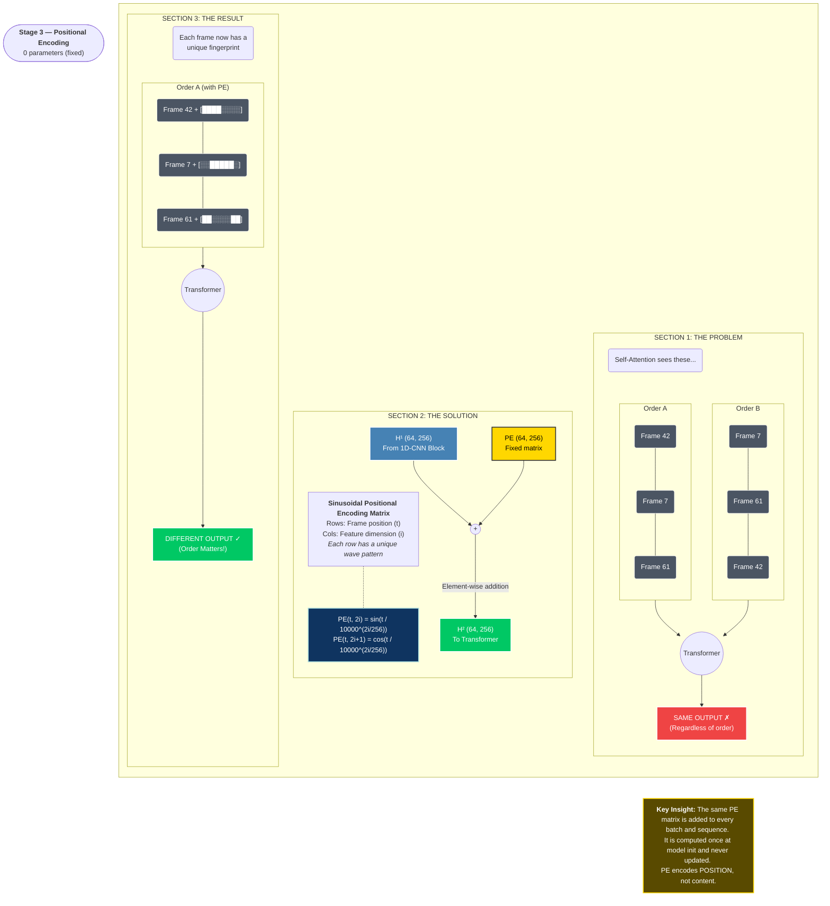

Date: 2026-04-12
Tags: [[Data Science]]

## What Is A Landmark?

A landmark is a specific **point on the human body** that MediaPipe tracks in 3D space every single video frame.

Think of it like placing tiny GPS trackers on specific body parts. MediaPipe looks at a camera frame and calculates the exact 3D position of 543 specific points simultaneously.

![[Pasted image 20260412121022.png]]

![[Pasted image 20260412121054.png]]

Each landmark is represented by three numbers:

| Coordinate | Meaning | Range |
|---|---|---|
| `x` | Horizontal position | 0 (left) → 1 (right) |
| `y` | Vertical position | 0 (top) → 1 (bottom) |
| `z` | Depth from camera | Negative (closer) → Positive (further) |

---

## Why 543 Landmarks?

MediaPipe Holistic tracks **four body regions** simultaneously:

### Region 1: Face Mesh — 468 landmarks
Maps a detailed 3D mesh of the entire face.

> Why so many? Because **facial expressions are part of ASL grammar**.
> - Raised eyebrows = yes/no question marker
> - Furrowed brows = wh-question (who, what, where)
> - Puffed cheeks = signs like "fat" or "full"
> - Mouth shape = distinguishes similar-looking signs

![[Pasted image 20260412121148.png]]

### Region 2: Pose — 33 landmarks
Tracks the body skeleton (shoulders, elbows, wrists, hips, knees).

> Why do we need this for sign language?
> Because the **location of the hand relative to the body carries meaning**.
> - Hand at forehead = THINK / SMART / REMEMBER
> - Hand at chest = FEEL / LOVE / SORRY
> - Hand at chin = MOTHER / CUTE / GIRL
> Without pose, the model cannot tell WHERE the hand is on the body.

![[Pasted image 20260412121212.png]]

### Region 3: Left Hand — 21 landmarks
Every joint of every finger on the left hand (wrist + 4 fingers × 4 joints + thumb × 4 joints).

### Region 4: Right Hand — 21 landmarks
Identical structure to the left hand.

> Why all 21 points per hand?
> Because **handshape is the primary carrier of meaning in ASL**.
> - All fingers extended = HELLO
> - Index only = POINT
> - Fist = part of MOTHER
> Without finger joint positions, these are indistinguishable.

![[Pasted image 20260412121244.png]]

### Total Breakdown

```
Face:        468 landmarks
Pose:         33 landmarks  
Left Hand:    21 landmarks
Right Hand:   21 landmarks
─────────────────────────
TOTAL:       543 landmarks

Per frame: 543 × 3 coordinates = 1,629 numbers
```

---

## What The Raw Data Looks Like

The dataset contains **94,477 parquet files** — one file per sign video sample.

Each file is in **long format** (one row per landmark per frame):

```
frame | type       | landmark_index | x     | y     | z
──────────────────────────────────────────────────────────
  20  | face       |       0        | 0.494 | 0.380 | -0.030
  20  | face       |       1        | 0.496 | 0.350 | -0.057
  20  | left_hand  |       0        | 0.621 | 0.441 | -0.010
  20  | right_hand |       0        | 0.712 | 0.380 | -0.005
  20  | pose       |      11        | 0.400 | 0.600 |  0.000
  21  | face       |       0        | 0.491 | 0.382 | -0.031
  ...
```

> One row = one landmark at one moment in time
> 12,489 rows in one file = ~23 frames × 543 landmarks per frame

### Dataset Statistics

| Property                | Value                 |
| ----------------------- | --------------------- |
| Total samples           | 94,477                |
| Unique signs            | 250                   |
| Samples per sign (min)  | 299                   |
| Samples per sign (max)  | 415                   |
| Samples per sign (mean) | 378                   |
| Format                  | Parquet (long format) |
| Total size on disk      | ~56 GB                |

> The dataset is **very well balanced** — every sign has roughly the same number of samples. This means no class imbalance problem during training.

---

## The ETL Problem

### Why We Cannot Train Directly On The Raw Files

```
Problem 1: FORMAT
  The model needs a fixed-size tensor as input.
  Raw parquet files have variable numbers of rows.
  (A short sign = 10 frames, a long sign = 150 frames)
  
Problem 2: SPEED
  Opening 94,477 separate files during training = disaster.
  The CPU spends more time on file I/O than the GPU 
  spends on computation. GPU utilization drops to ~10%.

Problem 3: REDUNDANCY  
  468 face landmarks is massive overkill.
  We only need ~40 key face points.
  We are carrying 428 useless landmarks through every operation.
```

### The ETL Solution — Run Once, Train Forever

ETL stands for **Extract, Transform, Load**. We run this script exactly once to convert the raw data into training-ready format.

```
EXTRACT:   Read all 94,477 parquet files
TRANSFORM: Filter landmarks + normalize + pad/truncate
LOAD:      Save as two numpy arrays
```

#### Step 1: Filter 543 → 115 Landmarks

```
Keep:
  Key face points:   40   (eyebrows, eyes, lips, nose)
  Pose:              33   (all — location matters)
  Left hand:         21   (all — every joint matters)
  Right hand:        21   (all — every joint matters)
  ─────────────────────
  Total:            115 landmarks
  Per frame:        115 × 3 = 345 numbers

Drop:
  428 redundant face mesh points
  (the interior of the face with no linguistic meaning)
```

#### Step 2: Convert Long → Wide Format

```
BEFORE (long format, one row per landmark):
  12,489 rows × 7 columns for ONE sign

AFTER (wide format, one row per frame):
  23 rows × 345 columns for the SAME sign
  (115 landmarks × 3 coordinates, all in one row)
```

#### Step 3: Pad or Truncate to Fixed Length

```
Every sign must become exactly 64 frames.

Short sign (23 frames → 64 frames):
  [F1, F2, ..., F23, 0, 0, 0, ..., 0]
                     ↑ pad with zeros ↑

Long sign (150 frames → 64 frames):
  Sample uniformly: pick 64 evenly spaced frames
  [F1, F4, F7, F10, ..., F147, F150]
  (keeps the full motion arc, not just the first 64)
```

#### Step 4: Normalize Coordinates

```
Problem: Raw (x, y, z) values depend on where the 
         signer stands in the camera frame.
         
         Two people signing the same word look 
         completely different in raw coordinates.

Solution: Make coordinates RELATIVE to the body.

  Step A — Translation (centering):
    Find the midpoint between left and right shoulders.
    Subtract this point from ALL landmarks.
    Now (0, 0, 0) is always the center of the chest.

  Step B — Scaling:
    Divide all coordinates by the shoulder width.
    Now "1 unit" means "1 shoulder-width" for everyone.

Result: The model learns the SHAPE of the sign,
        not WHERE the signer happened to be standing.
```

#### Step 5: Handle Missing Values (NaN)

```
MediaPipe outputs NaN when it cannot detect a body part.
(Example: one hand is hidden behind the body)

Strategy:
  Forward fill  → copy last known value forward
  Backward fill → copy next known value backward  
  Zero fill     → if still NaN, replace with 0.0
```

### ETL Output

```
BEFORE:   94,477 parquet files   ~56 GB on disk
AFTER:    2 numpy files          ~8.3 GB total

X_train.npy   shape: (94477, 64, 345)   ← all sequences
y_train.npy   shape: (94477,)           ← integer labels 0-249

Loading during training:
  np.load('X_train.npy', mmap_mode='r')
  → Instant. No file I/O during training.
  → GPU stays at ~99% utilization.
```

---

## The Full Picture — What We Are Building

```
Phase 1 (NOW): ETL Pipeline
  94,477 parquet files → X_train.npy + y_train.npy
  Run once. Takes ~30-60 minutes on Ryzen 7 7700.

Phase 2: Transformer Model
  Input:  (batch, 64, 345)   ← batch of sequences
  Output: (batch, 250)       ← probability per sign
  
  Architecture:
    Linear Projection  (345 → 256)   "What shapes?"
    1D CNN             (local motion) "What movements?"  
    Positional Encoding               "When in sequence?"
    Transformer × 4    (global)       "How do parts relate?"
    Global Avg Pool    (64 → 1)      "Summarize everything"
    Linear Classifier  (256 → 250)   "Which word?"

Phase 3: Gloss-to-English
  "HOW YOU DO" → FLAN-T5 → "How are you doing?"

Phase 4: Real-Time
  Webcam → Sliding Window → Same Model → Live Text → TTS
```

---

## Current Status

| Task | Status |
|---|---|
| WSL2 + ROCm + PyTorch setup | ✅ Done |
| Dataset download (40GB) | ✅ Done |
| Dataset extraction | ✅ Done |
| Project structure created | ✅ Done |
| Data exploration notebook | 🔄 In Progress |
| ETL script | ⏳ Next |
| Model implementation | ⏳ Pending |
| Training | ⏳ Pending |
| Real-time pipeline | ⏳ Pending |

> **Current step:** Exploring one parquet file to understand the exact schema before writing the ETL script. We never preprocess data we haven't fully understood.


```bash
rayan@DESKTOP-TK9I2J1:~$ cd ~/projects/signlang
rayan@DESKTOP-TK9I2J1:~/projects/signlang$ source ~/projects/signlang/venv/bin/activate
(venv) rayan@DESKTOP-TK9I2J1:~/projects/signlang$ code .


```

---
# whats next 

## Complete Next Steps — Everything Remaining

Let me state them clearly in priority order.

---

### IMMEDIATE — This Week

**1. Experiment 6b — Merge Confused Pairs**
Retrain v5 but merge confirmed confused pairs into single classes.
`pen/pencil`, `awake/wake`, `sleep/sleepy`, `cat/kitty`, `hear/listen`, `duck/goose`.
No ETL re-run needed — just remap labels in the existing arrays.
Expected result: cleaner accuracy on remaining classes.

**2. Retrain on 67 Conversational Signs Only**
Take the v5 architecture, retrain with only 67 output classes.
Faster training (~15 min), higher accuracy on subset, cleaner deployment.
This becomes your **demo model**.
Save as `best_model_demo.pt`.

**3. Fix the Lion Problem — Tune the State Machine**
Lower the confidence threshold slightly or increase `MIN_STABLE_FRAMES`.
The model should not emit `lion` when you are just sitting there.
We tune this after seeing the debug output.

**4. Statistical Validation**
Run v4 and v5 each 3 times with different random seeds.
Report mean ± std of Top-1 and Top-5.
Addresses the critique about statistical rigour.
Can implement McNemar's test instead if time is short.

---

### APP AND DEMO — Next Week

**5. Improve the Flask App**
Currently working but basic. Needs:
- Better video quality/framerate
- Proper landmark visibility fix
- Reset button working cleanly
- Conversation history persisting properly
- TTS output (hearing person hears the translation)

**6. LM Studio Integration**
Currently falling back to simple word join.
Install a model in LM Studio (Mistral or Llama 3.2).
Test the gloss → English translation properly.
Verify the prompt template produces natural sentences.

**7. Practice 10 Signs**
Learn these specifically from YouTube ASL tutorials:
```
hello, thankyou, yes, no, water,
drink, hungry, sick, happy, please
```
These are all above 60% accuracy in the subset.
Test the live system with practiced signs.
Record a short demo video.

**8. Hearing Person TTS**
When the deaf person's sentence appears, optionally read it aloud.
Simple `pyttsx3` or `gTTS` implementation.
One thread, one function.

---

### REPORT — Ongoing

**9. Fix Report Issues from Critique**

Critical:
- Add explicit statement that Phase 1 recognises isolated signs
- Rewrite Experiment 3 RAM explanation (broadcast buffers, not array size)
- Rewrite Chapter 8 (gloss-to-word dictionary + FLAN-T5 for future)
- Change "conversational interaction" → "conversational signing pace"

Minor:
- Add ROCm officially supports RX 7900 XT
- Verify all figures compile in PDF

**10. Add Experiment 6a and 6b to Report**
Document the subset evaluation results.
Document the merged classes experiment.
Update the complete experiment comparison table.

**11. Add App/Demo Section to Report**
Document the Flask inference pipeline.
Add screenshot of the working interface.
Describe the two-thread architecture.
Latency measurements.

---

### OBSIDIAN ARCHITECTURE NOTES — When You Have Time

**12. Complete Concepts 11-20**
```
11. Self-Attention          ← most important, do first
12. Multi-Head Attention
13. The Feed-Forward Block
14. Global Average Pooling
15. CrossEntropyLoss
16. Label Smoothing
17. AdamW
18. Cosine Annealing
19. Gradient Clipping
20. The Full Forward Pass
```

**13. Complete Excalidraw Diagrams**
```

Drawing 6: Self-Attention mechanism
Drawing 7: Full model end-to-end
```

---

### FUTURE — After Demo

**14. How2Sign Finetuning**
Primary path to better accuracy.
Increases signer diversity directly.
Expands vocabulary beyond 67/250 signs.

**15. PySide6 Desktop App**
Replace Flask with a proper desktop application.
Professional UI for the final product.
Native window, no browser dependency.

**16. Phase 2 — Text to Sign**
After Phase 1 is fully operational.
Video retrieval or skeletal animation.
Not started yet.

---

## Priority Summary

```
This week:
  1. Experiment 6b (merge classes)
  2. Retrain on 67 signs
  3. Tune state machine (lion problem)
  4. Statistical validation

Next week:
  5. Improve Flask app
  6. LM Studio integration
  7. Practice 10 signs + record demo
  8. Fix report critique issues

Ongoing:
  9. Obsidian concepts 11-20
  10. Report updates

Future:
  11. How2Sign finetuning
  12. PySide6 app
  13. Phase 2
```

---


