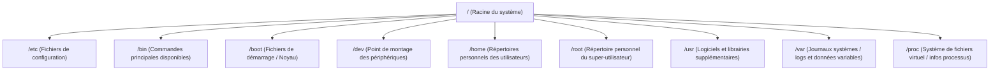
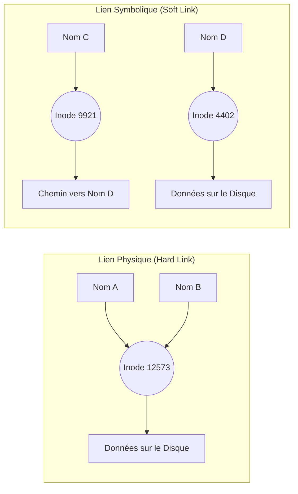

Date: 2026-10-09
Tags: [[Systèmes d'Exploitation]], [[Linux]], [[Shell]], [[Système de Fichiers]], [[Commandes Unix]], [[ENSAM]]

---
# Systèmes d'Exploitation & Linux — Partie 2 : Système de Fichiers et Commandes

## 1. Le Système de Fichiers

> [!info] Définition : Système de fichiers
> Un système de fichiers est l'agencement logique et structuré des données sur un média (disque dur, clé USB, DVD...). Il définit l'organisation des informations, tant au niveau des fichiers stockés que des métadonnées associées.
> - **Fichier** : Ensemble de données numériques réunies sous un même nom, constitué d'une séquence d'octets.
> - **Répertoire** : Structure logique (équivalent à un dossier/classeur) permettant de ranger et organiser les fichiers.

> [!info] Définition : L'arborescence
> L'organisation logique des fichiers sur un système Linux est une structure de données hiérarchique de type **arbre**.
> - Les **nœuds** sont les répertoires.
> - Les **feuilles** sont les fichiers ordinaires.
> - Contrairement à Windows, l'arborescence Linux **ne dépend pas des disques durs ou de leurs partitions** (tout est unifié sous une seule racine).

---

## 2. L'Arborescence Standard de Linux

> [!info] Définition : La Racine (`/`)
> L'ensemble des fichiers est architecturé autour d'une unique arborescence dont la base, appelée **racine**, est notée `/`.



> ![[{BD2E5A6F-6964-4CE2-9984-52F495027977}.png]]


---

## 3. Navigation et Chemins d'Accès

### 3.1 Symboles Spéciaux

| Symbole | Signification |
| :---: | :--- |
| `.` | Répertoire **courant** |
| `..` | Répertoire **parent** |
| `~` | Répertoire **personnel** de l'utilisateur courant (alias de `/home/user`) |
| `/` | Répertoire **racine** de l'arbre (ou séparateur de chemin) |

### 3.2 Types de Chemins

> [!info] Définition : Chemin Absolu vs Relatif
> - **Chemin absolu** : Commence toujours de la racine `/` ou par le raccourci `~`. Il est indépendant de la position actuelle.
>   - *Exemple :* `cd ~/tmp` ou `cd /var/log`
> - **Chemin relatif** : Part de l'endroit où vous êtes (le répertoire courant).
>   - *Exemple :* `cd ../Documents`

![[{CF9A4413-2555-4BE2-8818-7B8353DA7C72}.png]]

---

## 4. Commandes de Navigation et d'Affichage

### 4.1 `pwd` (Print Working Directory)
Indique la position actuelle (le chemin absolu) au sein du système de fichiers.
```bash
ubuntu@pc:~$ pwd
/home/ubuntu
```

### 4.2 `ls` (List)
Permet d'obtenir la liste et les caractéristiques des fichiers contenus dans un répertoire.

> [!abstract] Options de la commande `ls`
> | Option | Description |
> | :---: | :--- |
> | `-l` | Liste les attributs détaillés des fichiers (permissions, propriétaire, taille, date). |
> | `-a` | Liste **tous** les fichiers, y compris les fichiers cachés (commençant par `.`). |
> | `-m` | Affiche les fichiers séparés par une virgule. |
> | `-d` | Affiche les répertoires eux-mêmes, et non leur contenu. |
> | `-R` | Affiche le contenu de manière récursive (toute l'arborescence). |
> | `-t` | Trie par date de modification (du plus récent au plus ancien). |
> | `-r` | Inverse l'ordre de tri (ex: alphabétique inverse). |
> | `-tr` | Trie par date en commençant par les plus anciens. |
> | `-F` | Trie et indique par type (ajoute `/` aux dossiers, `*` aux exécutables). |
> | `-X` | Trie par extension alphabétique. |
> | `-i` | Affiche l'**inode** (identifiant unique) des fichiers listés. |

### 4.3 `cd` (Change Directory)
Permet de se déplacer au sein du système de fichiers.
```bash
cd /var/log       # Chemin absolu
cd ../Documents   # Chemin relatif
cd ~              # Retour au répertoire personnel
cd                # (Sans argument) Retourne au répertoire personnel
```

---

## 5. Manipulation des Fichiers et Répertoires

### 5.1 Création et Suppression de Répertoires

> [!example] Exemple d'Application : `mkdir` et `rmdir`
> ```bash
> # Création simple
> mkdir rep1 rep2 rep3
> 
> # Création récursive (arborescence complète)
> mkdir -p rep1/rep2/rep3
> 
> # Suppression de répertoires VIDES
> rmdir rep1 rep2 rep3
> rmdir -p rep1/rep2/rep3
> ```

### 5.2 Création et Suppression de Fichiers

> [!example] Exemple d'Application : `touch` et `rm`
> ```bash
> # Créer un fichier vide (ou mettre à jour son timestamp)
> touch fich.txt
> 
> # Supprimer un fichier
> rm fich.txt
> 
> # Supprimer de manière interactive (demande confirmation)
> rm -i fich.txt
> ```

> [!warning] Piège / Cas Particulier : La commande `rm -rf`
> Par défaut, `rm` ne supprime pas les répertoires. L'option `-r` permet la suppression récursive.
> **`rm -rf`** supprime toute une arborescence de force, **sans aucune confirmation**. C'est une commande extrêmement dangereuse si elle est mal ciblée (ex: `rm -rf /`).

### 5.3 Copie et Déplacement

| Commande | Rôle | Exemple |
| :--- | :--- | :--- |
| **`cp`** | Copier une source vers une destination. | `cp fich1 fich2`<br>`cp fich1 fich2 rep_fich/` |
| **`mv`** | Déplacer ou **renommer** un fichier/répertoire. | `mv ancien_nom.txt nouveau_nom.txt`<br>`mv fich.txt /home/user/docs/` |

---

## 6. Recherche de Fichiers

### 6.1 La commande `find`
Recherche des fichiers en temps réel en parcourant l'arborescence à partir d'un répertoire donné.

> [!abstract] Options fréquentes de `find`
> | Option | Description |
> | :--- | :--- |
> | `-name` | Recherche par nom exact (sensible à la casse). |
> | `-iname` | Recherche par nom (insensible à la casse). |
> | `-type` | Recherche par type (`f` pour fichier, `d` pour répertoire). |
> | `-atime` | Recherche par date de dernier accès (en jours). |
> | `-mtime` | Recherche par date de dernière modification (en jours). |
> | `-user` | Fichiers appartenant à un utilisateur spécifique. |
> | `-group` | Fichiers appartenant à un groupe spécifique. |

> [!example] Exemple d'Application : Requêtes `find`
> ```bash
> # Chercher "monfichier" dans /home/ et ses sous-dossiers
> find /home/ -name monfichier
> 
> # Chercher tous les fichiers .c dans le répertoire courant
> find . -name "*.c"
> 
> # Fichiers modifiés il y a moins de 5 jours
> find . -mtime -5
> 
> # Fichiers n'appartenant pas à root
> find . ! -user root
> ```

### 6.2 La commande `locate`
Recherche un fichier par son nom dans une **base de données pré-indexée** (beaucoup plus rapide que `find`, mais pas en temps réel).
```bash
locate nom_du_fichier
```
> [!info] Définition : Mise à jour de la base `locate`
> La base de données est générée par la commande `sudo updatedb`. 
> **Note :** `locate` affiche les résultats même si l'utilisateur n'a pas les droits de lecture. Pour vérifier les droits d'accès avant l'affichage, on utilise **`slocate`** (secure locate).

---

## 7. Lecture et Traitement de Texte

### 7.1 Édition et Affichage Global
- **`gedit`** : Éditeur graphique par défaut (GNOME). `gedit fich.txt`
- **`cat`** : Affiche le contenu d'un fichier en entier.
  - `cat -n fich.txt` (énumère les lignes).

### 7.2 Extraction et Découpage (`cut`)
Permet d'afficher des zones spécifiques (colonnes ou champs) d'un fichier.

| Option | Description |
| :---: | :--- |
| `-c` | Sélectionne par numéro de caractère (colonne). |
| `-b` | Sélectionne par numéro d'octet. |
| `-d` | Spécifie un séparateur de champs. |
| `-f` | Indique le numéro du champ à extraire. |
| `-s` | (Avec `-f`) Supprime les lignes ne contenant pas le séparateur. |

> [!example] Exemple d'Application : Extraction avec `cut`
> ```bash
> # Afficher le 1er caractère de chaque ligne de /etc/passwd
> cut -c1 /etc/passwd
> 
> # Afficher le 6ème champ (répertoire home) de /etc/passwd (séparateur ":")
> cut -d: -f6 /etc/passwd
> ```

### 7.3 Lecture Partielle (`head` et `tail`)

| Commande | Comportement | Exemple |
| :--- | :--- | :--- |
| **`head`** | Affiche le **début** du fichier. | `head -n 10 fich.txt` (10 premières lignes)<br>`head -n +10 fich.txt` (Tout sauf les 10 dernières)<br>`head -c 10 fich.txt` (10 premiers caractères) |
| **`tail`** | Affiche la **fin** du fichier. | `tail -n 10 fich.txt` (10 dernières lignes)<br>`tail -n +10 fich.txt` (À partir de la 10ème ligne)<br>`tail -c -10 fich.txt` (10 derniers caractères) |

### 7.4 Tri de Lignes (`sort`)
```bash
sort [options] nom_fichier
```

| Option | Signification                                                      |
| :----: | :----------------------------------------------------------------- |
|  `-o`  | Écrit le résultat dans un fichier de sortie.                       |
|  `-u`  | Élimine les lignes identiques (unique).                            |
|  `-r`  | Trie en ordre inverse.                                             |
|  `-R`  | Trie de manière aléatoire.                                         |
|  `-n`  | Trie des nombres (évalue la valeur numérique plutôt que lexicale). |

---

## 8. Les Liens entre Fichiers (`ln`)

> [!info] Définition : Le stockage et l'Inode
> Sur le disque dur, un fichier est séparé en deux parties : son **nom** et son **contenu**.
> L'**inode** (affiché avec `ls -i`) est un numéro qui identifie les métadonnées du fichier sur le système de fichiers. Plusieurs noms peuvent pointer vers le même inode.

### 8.1 Liens Physiques (Hard Links)
Permet d'avoir deux noms de fichiers qui partagent **exactement le même contenu (inode)**.
```bash
ln fich.txt Documents/L_fich.txt
```
> [!warning] Piège / Cas Particulier : Règles des liens physiques
> 1. Ils partagent la même zone disque : modifier l'un modifie l'autre.
> 2. Le fichier ne disparaît du disque que lorsque **tous** les liens physiques pointant vers son inode sont supprimés.
> 3. **Impossible** de créer un lien physique vers un répertoire.
> 4. **Impossible** de créer un lien physique sur une **partition différente** de celle du fichier original.

### 8.2 Liens Symboliques (Soft Links)
Permet de créer un raccourci (un fichier spécial) qui pointe vers le **chemin** d'un autre fichier ou répertoire.
```bash
ln -s fich.txt TP/Lfich.txt
```

> [!warning] Piège / Cas Particulier : Règles des liens symboliques
> 1. La taille du lien symbolique correspond à la longueur de la chaîne de caractères du chemin cible.
> 2. `rm` supprime le lien symbolique lui-même, sans affecter le fichier cible.
> 3. **Si le fichier cible est supprimé**, le lien symbolique existe toujours mais pointe vers un fichier inexistant (on parle de lien "cassé" ou *dangling link*).
> 4. Contrairement aux liens physiques, les liens symboliques **peuvent** pointer vers des répertoires et traverser les partitions.



> ![[{F942A0B3-CEB4-4DE2-AA0A-7FD59B8697EC}.png]]
> *(Schéma comparatif montrant deux noms pointant vers le même inode pour le lien physique, et un fichier indépendant contenant un chemin texte pointant vers un autre inode pour le lien symbolique)*

---
# ~={red}References=~
*Systèmes d'Exploitation Linux — IAGI-1, Partie 2 : Système de fichiers et Commandes — Pr. Soukaina BOUHSISSIN, ENSAM Casablanca (2026-2027)*
