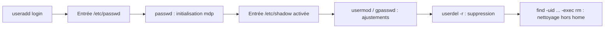

Date: 2026-10-26
Tags:  [[Operating Systems]], [[Linux]], [[Utilisateurs]], [[Groupes]], [[Permissions]], [[chmod]], [[umask]], [[ENSAM]]

---

# Gestion des Utilisateurs et des Groupes sous Linux

## 1. Introduction et Types de Comptes

> [!info] Définition : Système multiutilisateur
> Linux est un système **multiutilisateur** : pour préserver la sécurité et la confidentialité des données, Linux assure un système d'identification et de gestion des utilisateurs.
> Un **utilisateur** est celui qui s'est logué en donnant un nom de **login**. Ce login permet de définir l'utilisateur et de **tracer l'activité** menée en son nom.

### 1.1 Les trois types de comptes

> [!info] Définition : Typologie des comptes
> Les comptes utilisateur ne sont pas tous égaux sur Linux. On distingue trois types :
> 
> | Type | Rôle | UID |
> | :--- | :--- | :--- |
> | **Super-utilisateur (root)** | Le plus important du point de vue de l'administration. **N'est pas concerné par les droits d'accès aux fichiers**. A à sa charge les tâches d'administration du système. | $0$ |
> | **Comptes systèmes** | Comptes non affectés à des personnes (`bin`, `daemon`, `sync`, `apache`...). Servent à faciliter la gestion des droits d'accès de certaines applications et démons. | $1$ à $999$ |
> | **Comptes ordinaires** | Associés à des personnes ; vocation de permettre aux utilisateurs standard de se connecter. | $\ge 1000$ |

> [!warning] Piège / Cas Particulier : Ne jamais exposer un service sous root
> - En lançant le serveur Web sous l'identité du compte `apache`, on pourra aisément **limiter ses droits d'accès** à certains fichiers.
> - D'une façon générale, on ne lance **jamais** un service exposé aux attaques réseau (serveur Web Apache) sous l'identité de `root` : quelqu'un de mal intentionné qui réussirait à exploiter une faille de sécurité du logiciel obtiendrait **automatiquement les droits d'administration**.
> - Toujours pour des raisons de sécurité, on fera en sorte que **personne ne puisse se connecter** à la machine à partir d'un compte système.

---

## 2. Administration du Système : `sudo` et terminal root

> [!info] Définition : La commande `sudo`
> Créer des comptes, les affecter à des groupes et définir les droits sur les fichiers est un **travail d'administration** : un utilisateur ordinaire ne peut pas y accéder. La commande `sudo` permet à un utilisateur d'exécuter des commandes réservées au super-utilisateur :
> ```bash
> $ sudo commande
> ```
> Le mot de passe de votre compte est alors demandé afin que le système vérifie votre identité.

> [!abstract] Processus : Pourquoi `sudo` plutôt qu'une session root
> On pourrait être tenté d'utiliser le super-utilisateur (`root`) comme une session afin de ne pas avoir à changer d'utilisateur lors des reconfigurations. Mais avec le super-utilisateur, **une mauvaise manipulation peut causer la perte irrémédiable de tout ou partie des données ou rendre la machine inutilisable**.
> La substitution d'utilisateur par `sudo` est une manière de vous dire et de vous rappeler : *« Est-ce que vous êtes sûr que vous voulez faire ceci ?! »*

> [!warning] Piège / Cas Particulier : Le terminal root est déconseillé
> Utiliser `sudo` pour une seule commande ne cause pas de réel désagrément, mais il peut être désagréable de l'utiliser pour une longue procédure nécessitant plusieurs interventions en mode super-utilisateur. L'ouverture d'un terminal root évite d'appeler `sudo` à chaque étape, **mais aucune trace des actions posées n'est inscrite dans le journal de `sudo`** (sinon l'ouverture du terminal root lui-même). **Il est déconseillé d'ouvrir un terminal root.**

> [!example] Exemple d'Application : Procédure du terminal root (si nécessaire)
> 1. Ouvrez une fenêtre de terminal ;
> 2. Saisissez la commande : `sudo -i`
> 3. Saisissez votre mot de passe ;
> 4. Exécutez votre série de commandes d'administration ;
> 5. Fermez la session root : `exit` ou `Ctrl+D`

---

## 3. Création et Gestion des Comptes Utilisateurs

### 3.1 Création simple : `useradd`

> [!info] Définition : `useradd`
> La commande `useradd` permet d'ajouter un nouvel utilisateur **sans spécifier aucune information** sur ce compte (UID, mot de passe...).
> ```bash
> useradd [options] login
> ```
> Le `login` définit le nom du compte à créer.

### 3.2 Le fichier de gestion : `/etc/passwd`

> [!info] Définition : Format de `/etc/passwd`
> Le fichier `/etc/passwd` contient les informations relatives aux comptes (login, interpréteur de commande...). Champs de texte séparés par `:` respectant le format :
> $$\text{nom\_compte} : \text{mot\_de\_passe} : \text{UID} : \text{GID} : \text{commentaire} : \text{répertoire} : \text{programme\_de\_demarrage}$$
> ```text
> root:x:0:0:root:/root:/bin/bash
> ...
> info:x:1000:1000:linux2020,,,:/home/smi:/bin/bash
> Ensamiste:x:1001:1001::/home/Ensamiste:/bin/sh
> ```

| Champ | Signification |
| :--- | :--- |
| **nom du compte** | Identifiant de l'utilisateur |
| **mot de passe** | Mot de passe de l'utilisateur. Celui-ci est **codé**, il est inutile de l'éditer |
| **numéro utilisateur** | Le **UID**. Identifiant unique. Les valeurs $> 1000$ sont pour les comptes utilisateurs |
| **numéro de groupe** | Entier identifiant le groupe de l'utilisateur : le **GID** (Group Identifier) |
| **commentaire** | Informations sur l'utilisateur |
| **répertoire** | Répertoire dans lequel se retrouve l'utilisateur après connexion (son *homedir*) |
| **commande** | Le shell par défaut associé à ce compte |

### 3.3 Création configurée : options de `useradd`

> [!example] Exemple d'Application : Création d'un compte entièrement configuré
> ```bash
> sudo useradd -u 2040 -g sigma -G UH2M -c "compte configurer" \
>     -e 2026-12-01 -s /bin/bash -d /home/Ensamiste2 Ensamiste2
> ```
> 
> | Option | Rôle |
> | :---: | :--- |
> | `-u` | Spécifier manuellement le **UID** du compte |
> | `-g` | Spécifier le **groupe par défaut** |
> | `-G` | Spécifier les **groupes secondaires** |
> | `-c` | Affecter un **commentaire** (nom exact, adresse email...) |
> | `-e` | Spécifier une **date d'expiration** du compte (à partir de laquelle le compte ne sera plus accessible) |
> | `-s` | Indiquer le **shell par défaut** |
> | `-d` | Spécifier le **répertoire personnel** |
> | `-m` | Faire en sorte que le **dossier personnel soit créé** |

### 3.4 Modification : `usermod`

> [!example] Exemple d'Application : Modifier les propriétés d'un compte
> ```bash
> sudo usermod -c "c'est le compte de Ensamiste" -s /bin/bash Ensamiste
> ```
> Vérification dans `/etc/passwd` : la définition du compte a changé :
> ```text
> Ensamiste:x:1001:1001:c'est le compte de Ensamiste:/home/Ensamiste:/bin/bash
> ```

### 3.5 Options par défaut : `useradd -D`

> [!info] Définition : Modification des valeurs par défaut
> On peut changer les options par défaut de `useradd` en modifiant directement le fichier `/etc/default/useradd` ou en utilisant `useradd` avec l'option `-D`.
> ```bash
> useradd -D                # afficher les options par défaut
> useradd -D -b /home_2     # changer le répertoire home
> useradd -D -g dev         # changer le groupe par défaut
> useradd -D -s /bin/csh    # changer le shell par défaut
> ```

### 3.6 Le fichier sensible : `/etc/shadow`

> [!info] Définition : `/etc/shadow`
> Le 3ème fichier concernant l'administration des utilisateurs Unix : `/etc/shadow`. C'est un fichier **sensible** (`sudo`) qui contient les mots de passe et d'autres informations sur les comptes utilisateurs.
> ```text
> root:!:16719:0:99999:7:::
> daemon:*:15630:0:99999:7:::
> ...
> info:$1$Pv$Omhf8yD/Pg3sViEtYQtHj/:16719:0:99999:7:::
> Ensamiste:!:18546:0:99999:7:::
> ```
> Fichier séparé par `:` en **9 champs** :
> 1. **Nom d'utilisateur** : doit être présent dans `/etc/passwd` ;
> 2. **Mot de passe crypté** de 13 caractères :
>    - entrée nulle (`::`) : aucun mot de passe n'est demandé pour entrer dans le système ;
>    - entrée (`:!:`) : le mot de passe n'a **jamais été initialisé**, le compte n'est pas encore activé ;
>    - entrée (`:*:`) : le compte n'aura **pas de mot de passe** et il n'y aura pas la possibilité d'y accéder ;
> 3. Nombre de jours depuis le **1er Janvier 1970** jusqu'au jour du dernier changement du mot de passe ;
> 4. Nombre de jours avant que le mot de passe ne puisse être changé ($0$ = changeable à n'importe quel moment) ;
> 5. Nombre de jours après lesquels le mot de passe **doit** être changé ($99999$ = l'utilisateur peut le garder inchangé pendant beaucoup, beaucoup d'années) ;
> 6. Nombre de jours pour **avertir** l'utilisateur que le mot de passe ne va plus être valable ($7$ = une semaine entière) ;
> 7. Nombre de jours avant de **désactiver le compte** après expiration du mot de passe ;
> 8. Nombre de jours depuis le 1er Janvier 1970 pendant lesquels un compte a été désactivé ;
> 9. Champ **réservé** pour une utilisation future possible.

### 3.7 Changement de mot de passe : `passwd`

> [!info] Définition : `passwd`
> La commande `passwd` permet de changer le mot de passe d'un utilisateur. **L'utilisateur peut changer son mot de passe personnel** ; **seul l'administrateur peut changer le mot de passe d'un autre**. La modification se répercute dans `/etc/shadow`.

### 3.8 Suppression : `userdel` et nettoyage

> [!example] Exemple d'Application : Suppression complète d'un utilisateur
> ```bash
> userdel Ensamiste          # supprime le compte
> userdel -r Ensamiste       # supprime le compte ET son répertoire personnel
> ```
> **Problème résiduel :** les fichiers appartenant à `Ensamiste` situés **en dehors** du répertoire personnel ne sont pas supprimés. On les trouve et les supprime à partir de l'UID (ici $1001$) :
> ```bash
> find / -type f -uid 1001 -print -exec rm {} \;
> ```



---

## 4. Les Groupes

> [!info] Définition : Groupe
> Un **groupe** est un ensemble de personnes ou de groupes.
> - Les groupes sont utilisés pour **contrôler les accès** au sein du système ;
> - Le changement de groupe est (éventuellement) contrôlé par un mot de passe ;
> - Il est géré par un administrateur spécifique au groupe (ou par défaut le super-utilisateur) ;
> - Il est identifié par un numéro unique : le **GID** (Group IDentification number).

> [!info] Définition : Groupe principal et groupes secondaires
> - **Groupe principal** : groupe assigné par le système d'exploitation aux fichiers créés par l'utilisateur. Chaque utilisateur **doit** appartenir à un groupe principal (par défaut, le nom de l'utilisateur est aussi le nom de son groupe principal lors de sa création).
> - **Groupes secondaires** : groupes auxquels un utilisateur peut appartenir. Maximum de **15 groupes secondaires**.

### 4.1 Le fichier `/etc/group`

> [!info] Définition : `/etc/group`
> Le 4ème fichier à examiner gère les groupes : `/etc/group`. En visualisant son contenu, on distingue le nom et le GID des groupes présents :
> ```text
> sudo:x:27:info
> info:x:1000:
> Ensamiste:x:1001:
> ```

### 4.2 Fichiers d'administration (synthèse)

| Fichier | Description |
| :--- | :--- |
| `/etc/passwd` | Information sur les comptes utilisateurs |
| `/etc/shadow` | Information cachée sur les comptes utilisateurs |
| `/etc/group` | Définit les groupes auxquels les utilisateurs appartiennent |
| `/etc/gshadow` | Information cachée sur les groupes |
| `/etc/sudoers` | Liste de qui peut lancer quoi avec `sudo` |

### 4.3 Commandes de gestion des groupes

> [!example] Exemple d'Application : Manipulation des groupes
> ```bash
> groups nom_utilisateur            # connaître les groupes d'un utilisateur
> id nom_utilisateur                # alternative : identité + groupes
> groupadd nom_groupe               # créer un nouveau groupe
> gpasswd -a nom_utilisateur nom_groupe   # ajouter un utilisateur à un groupe
> usermod -aG grp1,grp2 nom_utilisateur   # ajouter plusieurs groupes à un utilisateur
> groupdel nom_groupe               # effacer un groupe
> ```

---

## 5. Changement du Propriétaire et du Groupe

> [!info] Définition : `chown` vs `chgrp`
> - **`chown`** : change le **propriétaire** d'un fichier. **Seul l'administrateur** peut modifier le propriétaire d'un fichier ou d'un répertoire.
> - **`chgrp`** : change le **groupe**, à condition que l'utilisateur fasse partie du nouveau groupe **et** soit propriétaire de ces fichiers ou répertoires.

### 5.1 La commande `chgrp`

> [!info] Définition : `chgrp`
> Utilisée pour changer le groupe du fichier ou du répertoire. Le changement peut être effectué par :
> - le **root** ;
> - le **propriétaire** du fichier, si ce dernier est parmi les membres du groupe en question.
> ```bash
> chgrp [options] nouveau_groupe fichier/répertoire
> ```
> | Option | Rôle |
> | :---: | :--- |
> | `-R` | Changer l'autorisation sur les fichiers contenus dans les sous-répertoires du répertoire en question |
> | `-c` | Changer l'autorisation pour chaque fichier |
> | `-f` | Forcer et ne pas reporter les erreurs |

### 5.2 La commande `chown`

> [!info] Définition : `chown`
> Utilisée pour changer le propriétaire **et/ou** le groupe propriétaire du fichier ou du répertoire. Utilisation permise **uniquement pour le root**.
> ```bash
> chown [-option] [utilisateur][:groupe] fichier [fichier1 fichier2..]
> ```
> Elle peut être utilisée pour changer :
> - le propriétaire **et** le groupe ;
> - seulement le **propriétaire** ;
> - seulement le **groupe** (devient alors similaire à `chgrp`).
> 
> | Option | Rôle |
> | :---: | :--- |
> | `-R` | Modifie tous ses sous-répertoires et ses sous-fichiers d'une manière récursive |
> | `-h` | Modifie uniquement les **liens symboliques** et pas leur cible |

---

## 6. Les Droits d'Accès

> [!info] Définition : Modèle des droits
> Sous Linux, chaque fichier (ou répertoire) possède un ensemble d'attributs définissant les droits d'accès à ce fichier pour tous les utilisateurs du système. Un droit d'accès est un modèle qui décrit, pour chaque fichier ou répertoire, qui a le droit de **lire**, d'**exécuter** ou de **modifier**.

| Droit | Sur les répertoires | Sur les fichiers |
| :--- | :--- | :--- |
| **Lire** (`r`) | Autorisation de voir le contenu d'un répertoire ou les sous-répertoires | Autorisation de voir le contenu du fichier |
| **Écrire** (`w`) | Autorisation de créer, modifier, supprimer les fichiers ou sous-répertoires | Autorisation d'ajouter, modifier, supprimer le contenu d'un fichier |
| **Exécuter** (`x`) | Autorisation d'accéder au répertoire | Permettre d'exécuter le fichier |
| **`-`** | Pas d'autorisation | Pas d'autorisation |

### 6.1 `chmod` en mode symbolique

> [!info] Définition : Mode symbolique
> Permet une description absolue ou relative des droits d'accès, au format familier `rwx`, plus facile à comprendre pour la plupart des nouveaux utilisateurs.
> ```bash
> chmod [qui] op [permission] fich/rep
> ```
> - **qui** : combinaison de lettres `u` (user), `g` (groupe), `o` (other=autre) ou `a` (all=tous) pour `ugo` ;
> - **op** : `+` ajouter un droit, `-` supprimer un droit, `=` affecter un droit de manière absolue ;
> - **permission** : `r` (read), `w` (write), `x` (exécution).
>   
>   ![[Pasted image 20261023205947.png]]

> [!example] Exemple d'Application : Manipulations symboliques
> ```bash
> $ chmod u-w file            # supprime le droit d'écriture au propriétaire
> $ chmod g+r file            # ajoute le droit de lecture pour le groupe
> $ chmod ug=x file           # accès uniquement en exécution pour propriétaire et groupe ;
>                             # pas de modification pour les autres
> $ chmod ugo+x monRep        # ajoute l'exécution (ouverture) de monRep à tous
> $ chmod go-wx monRep        # supprime écriture et exécution de monRep au groupe et aux autres
> $ chmod u=rw,go=r MonFichier # lecture+écriture au propriétaire ; lecture au groupe et aux autres
> ```

### 6.2 `chmod` en mode absolu (octal)

> [!info] Définition : Mode absolu
> Les droits sont représentés par un **nombre octal (base 8)**, de $1$ à $7$. La représentation **binaire (base 2)** donne le détail des droits. Ce mode permet de modifier tous les droits en même temps : à utiliser avec précaution, très efficace pour s'assurer que tous les fichiers ont les mêmes droits, et utilisé pour sécuriser les accès des utilisateurs aux fichiers.

> [!example] Exemple d'Application : Conversion binaire → octal
> $$110 \quad 101 \quad 100 \;\Longrightarrow\; rw\text{-} \quad r\text{-}x \quad r\text{--} \;\Longrightarrow\; 6 \quad 5 \quad 4$$
> 
> **Cas complets du cours :**
> ```bash
> $ chmod 567 Fich     # r-x rw- rwx : lecture+exécution au propriétaire,
>                      # lecture+écriture au groupe, accès sans restriction aux autres (cas très rare)
> $ ls -l Fich
> $ chmod 644 MonFichier  # lecture+écriture au propriétaire ; lecture au groupe et aux autres
> $ chmod 640 MonFichier  # lecture+écriture au propriétaire ; lecture au groupe seulement ;
>                         # tout accès interdit aux autres
> ```

> ![[Pasted image 20261023205849.png]]
> *(Description précise de l'illustration : Correspondance triplets binaires → caractères rwx → chiffres octaux, ex. 110→rw-→6, 101→r-x→5, 100→r--→4)*

### 6.3 Droits par défaut et `umask`

> [!info] Définition : Droits par défaut et `umask`
> Quand vous créez un fichier (ex. avec `touch`), ce fichier possède par défaut certains droits : **666** pour un fichier (`-rw-rw-rw-`) et **777** pour un répertoire (`drwxrwxrwx`) — ce sont les **droits maximums**.
> La commande `umask` définit les permissions par défaut d'un répertoire ou d'un fichier créé :
> ```bash
> umask x    # x : nombre exprimé en octal qui déterminera les permissions
> ```

> [!example] Exemple d'Application : Calculs `umask` (soustraction octale des droits maximums)
> **Pour un fichier** (base $666$) :
> - `umask 022` : $666 - 022 = 644$ → par défaut les fichiers auront (`rw-r--r--`) ;
> - `umask 244` : $666 - 244 = 422$ → par défaut les fichiers auront (`r---w--w-`).
> 
> **Pour un répertoire** (base $777$) :
> - `umask 022` : $777 - 022 = 755$ → par défaut (`drwxr-xr-x`) ;
> - `umask 244` : $777 - 244 = 533$ → par défaut (`drwx-wx-wx`).


---

## 7. Synthèse du Cycle de Vie d'un Compte

> [!abstract] Modélisation : Chaîne de commande complète
> 1. **Créer** : `useradd` (simple) ou `useradd -u -g -G -c -e -s -d -m` (configuré) ;
> 2. **Activer** : `passwd` (renseigne `/etc/shadow`) ;
> 3. **Ajuster** : `usermod`, `gpasswd -a`, `usermod -aG` ;
> 4. **Protéger** : `chmod` (symbolique ou octal), `chown`, `chgrp`, `umask` ;
> 5. **Supprimer** : `userdel -r` puis `find / -type f -uid <UID> -print -exec rm {} \;`.

---
# ~={red}References=~
*Systèmes d'Exploitation Linux — IAGI-1, Partie 4 : Gestion des utilisateurs et des groupes — Pr. Soukaina BOUHSISSIN, ENSAM Casablanca (2026-2027)*