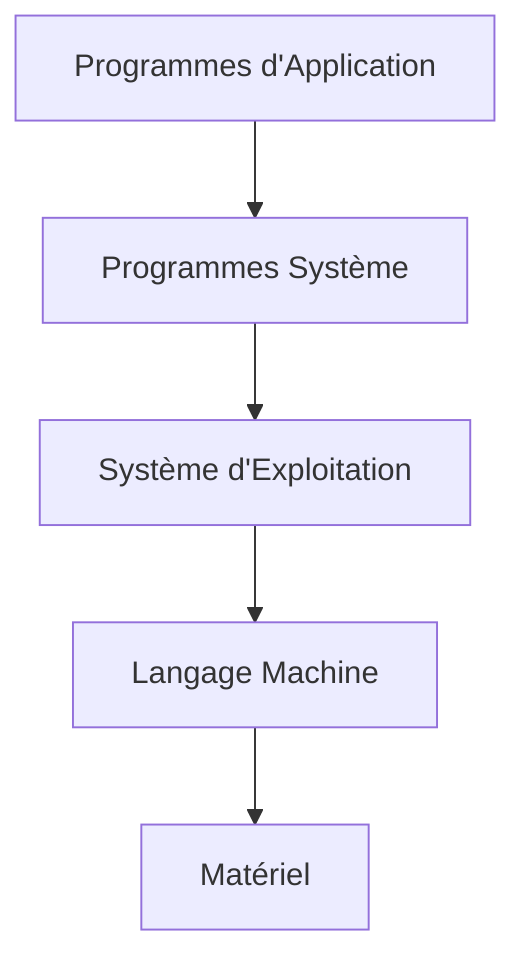
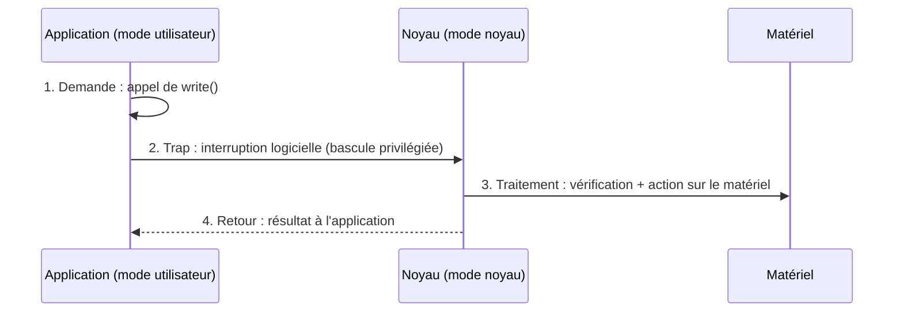
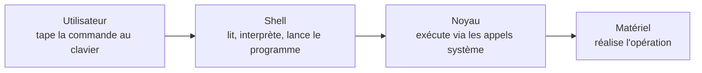

Date: 2026-10-08
Tags: [[Systèmes d'Exploitation]], [[Linux]], [[Unix]], [[Shell]], [[Noyau]], [[Appels Système]], [[ENSAM]]

---

# Systèmes d'Exploitation & Linux — Partie 1

## Partie I : Introduction aux Systèmes d'Exploitation

### 1. Le Système Informatique et le Problème du Matériel à Nu

> [!info] Définition : Système informatique
> Un système informatique est l'ensemble des moyens **logiciels** et **matériels** nécessaires pour satisfaire les besoins informatiques des utilisateurs.
> - **HARDWARE** : partie matérielle ;
> - **SOFTWARE** : partie logicielle.
> 
> Sans hardware il n'y a pas d'ordinateur ; sans software, l'ordinateur n'est qu'un assemblage de ferraille et de plastique stérile.

> [!warning] Piège / Cas Particulier : Programmer le matériel à nu
> Piloter directement un ordinateur se fait en **langage machine** : primitif et très lourd, surtout pour les entrées-sorties. Si chaque programmeur devait connaître le fonctionnement exact de chaque disque dur et toutes les erreurs possibles lors de la lecture d'un bloc, bien peu de programmes verraient le jour.
> - **Sans SE :** pour écouter un morceau, il faudrait commander soi-même le disque, la carte son et les signaux électriques.
> - **Avec SE :** on ouvre Spotify ; le système se charge de parler à la carte son, à la mémoire et au disque.

> [!info] Définition : Solution — la machine virtuelle étendue
> Enrober le matériel avec une **couche de logiciel** qui gère l'ensemble du système : présenter au programmeur une **interface de programmation d'application (API)**, ce qui correspond à une **machine virtuelle** plus facile à comprendre et à programmer.

> ![[Pasted image 20261008210906.png]]

> [!info] Définition : Composants d'un système informatique
> 1. **Matériel** : fournit les ressources informatiques de base (CPU, mémoire, périphériques E/S, communication) ;
> 2. **Système d'exploitation** : contrôle et coordonne l'utilisation du matériel parmi divers programmes d'application pour différents utilisateurs ;
> 3. **Programmes système et application** : utilisation des ressources système pour résoudre les problèmes informatiques des utilisateurs (traitements de texte, compilateurs, navigateurs Web, systèmes de base de données, jeux vidéo) ;
> 4. **Utilisateurs** : personnes, machines, autres ordinateurs.

Un ordinateur moderne comprend : un ou plusieurs processeurs, une mémoire principale, des disques, et divers dispositifs d'entrée/sortie (imprimantes…). La gestion de tous ces composants variés nécessite une couche logicielle appelée **Système d'Exploitation (SE)**.

---

### 2. Définition et Objectifs du SE

> [!info] Définition / Théorème : Système d'Exploitation
> Un système d'exploitation est un **programme** qui sert comme **intermédiaire / interface** entre un utilisateur d'un ordinateur et le matériel informatique. C'est un logiciel fondamental qui assure la **gestion et la coordination** des ressources matérielles et logicielles, offrant une plateforme stable et efficace pour l'exécution des applications.
> 
> **Objectifs :**
> 1. Contrôler / exécuter des programmes / applications utilisateur ;
> 2. Rendre le système informatique facile à utiliser ;
> 3. Utiliser le matériel informatique de manière efficace.

### 3. Services Offerts par le SE

> [!abstract] Processus : Les quatre familles de services
> 1. **Facilité de la création de programme** : éditeurs, compilateurs, débogueurs…
> 2. **Exécution du programme** : chargement en mémoire, gestion des E/S et initialisation de fichiers ;
> 3. **Accès aux E/S et aux fichiers** : traitement des spécificités des E/S et des formats de fichiers ;
> 4. **Accès au système** : résolution des conflits de ressources ; protection de l'accès aux ressources et aux données.

---

### 4. Composants d'un SE

> [!info] Définition : Composition typique d'un SE
> - **Bibliothèques dynamiques** (librairies, compilateurs) ;
> - **Un ensemble d'outils système** (interprétateurs de commandes — shell) ;
> - **Programmes applicatifs de base** (éditeurs) (API) ;
> - **Un noyau (Kernel)** : la partie qui se charge en mémoire lors du démarrage ; elle comporte les fonctions principales du système.
> 
> Chaque couche s'appuie sur celle du dessous et offre ses services à celle du dessus. **Seuls le noyau et les pilotes parlent directement au matériel.**

> ![[Pasted image 20261008211055.png|569]]

### 5. Modèle en Couches, Modes d'Exécution et Appels Système

> [!info] Définition : Modèle en couches
> Le SE est utilisé comme une **bibliothèque prédéfinie** pour l'interaction matérielle et logicielle : la programmation des applications s'applique au niveau du SE installé, puisqu'il s'avère difficile et confus d'atteindre le matériel directement.




> [!warning] Piège / Cas Particulier : Mode utilisateur vs Mode noyau
> Le SE lui-même est un programme, mais il a une **priorité** que les programmes d'application n'ont pas :
> - Le SE utilise le **mode noyau** du microprocesseur ;
> - Les autres programmes d'application utilisent le **mode utilisateur** ;
> - **Différence :** toutes les instructions du matériel sont valables en mode noyau, mais **certaines de ces instructions ne peuvent pas être utilisées en mode utilisateur**.

> [!abstract] Processus : L'appel système en 4 étapes
> Interface entre le SE et les programmes d'application s'exécutant en mode non privilégié (mode utilisateur). Les appels système sont réalisés au moyen d'instructions (« **traps** » ou **interruptions logicielles**) permettant le passage en mode privilégié (mode noyau).
> 1. **Demande** (utilisateur) : l'application appelle une fonction comme `write()` ;
> 2. **Trap** (transition) : interruption logicielle, bascule en mode privilégié ;
> 3. **Traitement** (noyau) : le noyau vérifie la demande et agit sur le matériel ;
> 4. **Retour** (utilisateur) : le résultat revient à l'application.



> ![[Pasted image 20261008211149.png]]
> *(Description précise de l'illustration : schéma séquentiel des quatre étapes demande → trap → traitement → retour avec les changements de mode utilisateur/noyau)*

---

### 6. Fonctionnalités d'un SE (Le Noyau)

> [!info] Définition : Les six gestions du noyau
> ![[Pasted image 20261008211300.png]]

| Gestion | Rôle détaillé |
| :--- | :--- |
| **Processus** | Un **processus** est un programme en cours d'exécution. Pour l'exécuter, l'OS doit disposer des ressources nécessaires (mémoire, processeur…). *Activité : gestionnaire des tâches.* |
| **Mémoire** | Suivre les parties de la mémoire utilisées / non utilisées ; allouer / libérer l'espace mémoire aux processus ; contrôler le **swapping** entre mémoire principale et disque. |
| **Périphériques** | Être branchés à l'ordinateur (installation matérielle) ; avoir les **drivers** installés (installation logicielle). *Activité : gestionnaire de périphériques.* |
| **Droits d'accès** | OS multiutilisateurs : créer plusieurs sessions (comptes utilisateur) ; authentifier les utilisateurs ; donner ou non des autorisations d'accès aux ressources du PC. *Activité : comptes utilisateurs.* |
| **Fichiers** | Le **système de gestion de fichiers (SGF)** gère le stockage et la manipulation de fichiers sur une unité de stockage (partition, disque, CD…). *Activité : explorateur de fichiers.* |
| **Communications réseaux** | Protocoles réseaux, sécurité réseau… |

---

### 7. Les Générations des SE

> [!info] Définition / Théorème : Cinq générations
> Le développement des systèmes d'exploitation est passé par 5 générations : par lots (batch), multi programmés, en temps partagé, temps réel, distribués. **Chacun des principes mis en œuvre dans une génération se retrouve dans les générations suivantes.**

| Génération | Époque | Principe |
| :--- | :--- | :--- |
| **G1 : Traitement par lots** | Années 1950 | Programmes = piles de cartes perforées avec indicateurs de début/fin de lot ; l'opérateur place la pile dans le lecteur et lance la lecture séquentielle ; le processeur central est **au repos** durant les manipulations de l'opérateur. |
| **G2 : Multiprogrammation** | Années 60 | Utilisation du processeur partagée par **planification (scheduling)** : à chaque utilisation d'un périphérique, le SE choisit quel programme exécuter, sur la base de **priorités** ; mécanisme de **protection** empêchant un programme de lire/écrire la mémoire d'un autre ; exécution en **mode non privilégié**. |
| **G3 : Temps partagé** | 1970 | Techniques sophistiquées de multiprogrammation pour l'**utilisation interactive** de l'ordinateur par plusieurs usagers et plusieurs programmes simultanément ; résulte d'une forte demande et de la baisse du prix du matériel. |
| **G4 : Temps réel** | Milieu des années 70 (Hewlett-Packard) | Destinés aux dispositifs devant donner des résultats **corrects dans un délai déterminé** ; ordinateurs reliés à un appareil externe (pilotes automatiques, robots industriels, applications vidéo/audio) où un retard de réponse entraîne l'**échec de l'appareil**. |
| **G5 : Systèmes distribués** | Années 90 | Systèmes composés de plusieurs ordinateurs (plusieurs processeurs, plusieurs mémoires, nombreux périphériques) ; **partage des ressources** entre ordinateurs : un utilisateur d'un ordinateur bon marché peut se servir de ressources coûteuses existant sur un autre ordinateur. |

> ![[Pasted image 20261008211508.png]]
> 


### 8. Terminologies

| Terme | Définition |
| :--- | :--- |
| **Mono utilisateur** | Une seule personne utilise l'ordinateur. |
| **Multi-utilisateur** | Plusieurs personnes peuvent utiliser le système en même temps ; le système s'assure qu'un utilisateur n'interfère pas avec un autre. |
| **Mono-tâche** | Un seul processus tourne à un instant. |
| **Multi-tâche** | Plusieurs processus donnent l'impression de tourner en même temps. |
| **Multi-tâche préemptif** | L'OS détermine quand un processus a eu assez de temps CPU. |
| **Multi-tâche non préemptif** | Le processus détermine lui-même quand il a eu assez de temps CPU. |

### 9. Exemples de SE

| Famille | Exemples |
| :--- | :--- |
| **Microsoft Windows** | Dernière version : Windows 11 ; préinstallés sur plus de 91 % des ordinateurs personnels. |
| **Dérivés d'Unix** (BSD, System V…) | macOS et iOS (ex-iPhone OS) : préinstallés sur la majorité des ordinateurs et appareils mobiles Apple. |
| **GNU/Linux** | Objet de la suite du cours. |
| **Unix « propriétaires »** | A/UX (Apple, SystemV), HP-UX (Hewlett-Packard, SystemV), Sinix (Siemens), Solaris (Sun, SystemV), SunOS (Sun, BSD). |

---

## Partie II : Introduction aux Systèmes d'Exploitation Linux

### 1. UNIX : Origine

> [!info] Définition / Théorème : Naissance d'Unix
> Unix a été créé il y a plus de 40 ans par un groupe de chercheurs du laboratoire **AT&T Bell**. Après que Bell se soit retiré d'une longue collaboration avec **General Electric (G.E.)** et le **MIT** pour la création d'un système d'exploitation pour l'infrastructure G.E. appelé **MULTICS** (*Multiplexed Operating and Computing System*), les chercheurs de Bell Labs créent en **1969** la première version d'Unix (alors appelée **UNICS**), qui évolue vers **UNIX**.
> **Parents d'Unix :** Ken Thompson et Dennis M. Ritchie.
> Omniprésent : des plus gros serveurs au plus petit des appareils embarqués.

### 2. Les Familles d'UNIX

> [!info] Définition : Deux versions de base et tentatives d'unification
> Du point de vue de l'**utilisateur**, les divers UNIX se ressemblent beaucoup ; du point de vue de l'**administration**, chacun a des spécificités (commandes liées au hardware, extensions propres à chaque constructeur).
> **Deux versions de base :** AT&T **System V** et **Berkeley Software Distribution (BSD)** — la grande majorité des variantes est construite sur l'une des deux (différences principales : utilitaires disponibles et structure d'implémentation des fichiers).
> 
> **Tentatives d'unification :**
> - **SVID** (System V Interface Definition) de AT&T : SVID, SVID2, SVID3 en 1989 ;
> - **IEEE POSIX** : POSIX1003.1 en 1990 ;
> - **X/OPEN Portability Guide** : XPG4 en 1993, du consortium X/OPEN (créé en 1984).

> ![[Pasted image 20261008211634.png]]

### 3. Linux et le Mouvement GNU

> [!info] Définition / Théorème : Linux (1991)
> En **1991**, **Linus Torvalds**, étudiant finlandais, commence à travailler sur un système Unix-like appelé **Linux**.
> - **Linux n'est que le noyau** ; les outils, le shell et le système de fichiers que la plupart des gens reconnaissent sont les **créations du GNU** ;
> - La force de Linux réside dans son **homologation progressive** : logiciels librement distribuables sans condition ;
> - Seule exigence : toutes les modifications apportées au logiciel de base doivent être **rendues disponibles** pour la Communauté → évolution à un rythme incroyablement rapide ;
> - Licence : **GNU Public License (GPL)**.

> [!info] Définition / Théorème : GNU/Linux
> Le projet GNU arrive en 1991 avec de très nombreux outils libres, mais il lui manque l'élément central : **le noyau** (celui qui gère la mémoire, le microprocesseur, les périphériques : clavier, souris, disques durs). Linus Torvalds développe ce noyau, demande des contributions, et se laisse persuader de le placer sous **GPL**.
> $$\text{Système d'exploitation} = \text{outils GNU} + \text{noyau Linux} \Rightarrow \text{GNU/Linux}$$
> Système complètement **Libre**, performant, hautement configurable, ne dépendant d'aucune multinationale. Dès **1993**, premières solutions complètes intégrant noyau Linux + système GNU + applicatifs.

> [!warning] Piège / Cas Particulier : Linux ≠ système complet
> Dire « Linux » désigne strictement le **noyau**. Le système complet que l'utilisateur manipule est un **GNU/Linux** (ou une distribution). Confondre les deux est l'erreur classique de vocabulaire en examen.

> [!info] Définition : Les quatre libertés (points forts de Linux)
> 0. **Exécuter** : utiliser le programme pour n'importe quel usage ;
> 1. **Étudier** : accéder au code source et comprendre comment il fonctionne ;
> 2. **Redistribuer** : partager des copies avec d'autres ;
> 3. **Améliorer** : modifier le programme et publier ses améliorations.

> [!info] Définition : Distributions de Linux
> Seul, Linux n'est qu'un noyau. Une **distribution** est un système complet : le noyau, plus tout ce qu'il faut pour le rendre utilisable. Des communautés ou des entreprises (**Red Hat, SUSE, Canonical…**) l'assemblent, le testent et, pour les offres payantes, assurent le support.

### 4. Organisation du Système Unix et Architecture de Linux

> [!info] Définition : Organisation en couches du système Unix
> - **Noyau** : assure la communication avec le matériel ; s'occupe de la gestion de la mémoire, la gestion des tâches, l'accès aux périphériques (disque dur, lecteur CD-ROM, clavier, souris…), la gestion des fichiers ;
> - **Shell** : interprète les ordres de l'utilisateur et les fait exécuter par le noyau ; ordres passés au clavier ou via des outils graphiques de plus haut niveau ;
> - **Applications** : interagissent avec l'utilisateur ou avec d'autres applications, et communiquent avec le shell ou le noyau.

> [!info] Définition : Architecture de Linux — trois couches distinctes
> 1. **Couche physique** : périphériques et BIOS ;
> 2. **Couche système** : gérée par le noyau ;
> 3. **Couche interface** : le Shell et/ou le système X-Window.


> ![[Pasted image 20261008211858.png]]
> *(Description précise de l'illustration : schéma en trois bandes — interface (X-Window, Shell), système (Noyau/Kernel), physique (BIOS, Périphériques) — avec les flèches de dépendance)*

### 5. Les Shells

> [!info] Définition : Shell
> Le shell est le **programme de gestion de la ligne de commande** : il interprète les commandes saisies et les transmet au système.




**Les deux formes du shell :**
- **CLI** (*Command Line Interface*) : instructions en mode texte — **c'est l'objet du cours** ;
- **GUI** : shell graphique fournissant une interface graphique.

| Pourquoi le CLI ? | Justification |
| :--- | :--- |
| **Natif** | C'est l'outil d'origine pour piloter un système Linux. |
| **Puissant** | Certaines manipulations sont impossibles avec l'interface graphique. |
| **Léger** | Pas besoin de carte graphique performante ni de beaucoup de mémoire. |
| **Automatisable** | Les commandes s'enchaînent dans des scripts. |
| **À distance** | On administre un serveur via `ssh`, sans écran. |
| **Reproductible** | Une commande s'écrit, se partage et s'interprète de façon unique. |

**Les principaux shells :**

| Shell | Nom |
| :--- | :--- |
| `sh` | Bourne Shell (shell standard) |
| `ksh` | Korn Shell |
| `csh` | C Shell |
| `bash` | GNU (Bourne Again Shell) |

Commandes utiles : `echo $SHELL` → `/bin/bash` (shell courant) ; liste des shells autorisés : `/etc/shells`.

> [!example] Exemple d'Application : Anatomie d'une invite de commande (prompt)
> ```shell
> root@ubuntu:~# pwd
> /home/ubuntu
> root@ubuntu:~#
> ```
> - **Contexte** : `root@ubuntu:~#` (utilisateur, machine, répertoire courant) ;
> - **Commande à exécuter** : `pwd` ;
> - **Résultat de la commande** : `/home/ubuntu`.
> 
> Après le login, le shell affiche un **prompt** et attend les commandes de l'utilisateur.

> [!example] Exemple d'Application : Identité et groupes
> Pour Linux, l'identité d'un utilisateur est celle sous laquelle il se logge.
> ```shell
> % whoami
> root
> % id
> uid=5230(ubuntu)  gid=64(profs)  groups=64(profs)
> ```
> - `whoami` : donne votre identité ;
> - `id` : donne votre identité et votre groupe — `uid` = n° de l'utilisateur, `gid` = n° du groupe utilisateur, `groups` = groupes d'appartenance.

> [!info] Définition : Structure d'une commande
> $$\texttt{\$ commande -options arguments}$$
> Une commande est l'exécution d'un programme dans l'interprète (shell). Elle prend en entrée des **options** et/ou des **paramètres** ; elle peut renvoyer de l'information à l'écran ou dans un fichier, modifier un fichier, ou produire un message d'erreur.
> - Composition : un **code mnémonique**, suivi parfois d'options ou de paramètres ;
> - Les options (souvent très nombreuses) modifient le comportement de la commande ; en général précédées du signe `-` (ex : `ls -l`) ;
> - Pour obtenir **toutes** les options d'une commande : appeler l'option `--help`.

### 6. Se Connecter (Login)

> [!abstract] Processus : Procédure de connexion
> Linux possède un mécanisme d'identification connu sous le nom de **login**. Pour utiliser un système Linux sur une machine, il faut avoir un **compte** sur cette machine et rentrer au clavier :
> - son nom d'utilisateur : **login** ;
> - son mot de passe : **password**.
> 
> Le système vérifie la correspondance entre login et mot de passe :
> - **si échec** : il refuse l'accès ;
> - **si correct** : il lance la procédure de login (analyse différents fichiers de configuration et met en place l'environnement de l'utilisateur).
> 
> L'utilisateur est alors placé dans son **répertoire d'accueil** : `/home/user1`.

> [!example] Exemple d'Application : Changement de mot de passe
> Commandes : `passwd` ou `yppasswd`.
> ```text
> % passwd
> Changing NIS password for USER on MACHINE
> Old password:          -- entrez votre mot de passe courant
> New password:          -- entrez votre nouveau mot de passe
> Retype new password:   -- rentrez votre mot de passe
> NIS entry has changed on filemon
> ```

---

## Synthèse de la Partie 1

> [!abstract] Ce que cette partie établit
> - **Pourquoi un SE** : abstraction du matériel (machine virtuelle étendue), coordination des ressources, protection ;
> - **Structure** : noyau chargé au démarrage, pilotes, services système, interface utilisateur ; modèle en couches ; mode utilisateur vs mode noyau ; appels système par traps en 4 étapes ;
> - **Fonctions du noyau** : processus, mémoire (swapping), périphériques, droits d'accès, fichiers (SGF), réseaux ;
> - **Histoire** : 5 générations (batch → multiprogrammation → temps partagé → temps réel → distribués), chaque principe survivant aux générations suivantes ;
> - **Unix → Linux** : Bell Labs / MULTICS / 1969 UNICS ; familles System V et BSD ; standards SVID, POSIX, XPG4 ; Linux = noyau de Torvalds (1991) sous GPL ; GNU/Linux = outils GNU + noyau Linux ; distributions (Red Hat, SUSE, Canonical) ;
> - **Pratique** : architecture Linux en 3 couches, rôle du shell (CLI), login et répertoire d'accueil, anatomie du prompt, identité (`whoami`, `id`), structure d'une commande (`$ commande -options arguments`, `--help`).

---
# ~={red}References=~
*Systèmes d'Exploitation Linux — IAGI-1, Partie 1 — Pr. Soukaina BOUHSISSIN, ENSAM Casablanca (2026-2027)*

