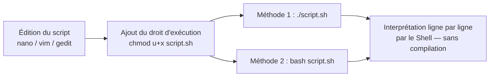

Date: 2026-10-27
Tags:  [[Operating Systems]], [[Linux]], [[Shell]], [[Bash]], [[Scripting]], [[Variables Shell]], [[ENSAM]]

---

# Programmation en Shell — Partie 1 : Introduction et Variables

> [!abstract] Processus : Plan du module
> 1. Introduction ;
> 2. Les variables – système ;
> 3. Les instructions de lecture et d'écriture ;
> 4. Opérations et opérateurs numériques ;
> 5. Les structures de contrôle.
> 
> *Cette partie 5-1 couvre les points 1 et 2.*

---

## 1. Le Shell : Plus qu'un Interpréteur de Commandes

> [!info] Définition : Script et Shell
> - Le **Shell** est plus qu'un interpréteur de commandes : c'est également un **puissant langage de programmation**. Cela n'est pas propre à Linux ; tout système d'exploitation offre la possibilité d'enregistrer dans des fichiers des suites de commandes que l'on peut invoquer par la suite. Mais aucun système d'exploitation n'offre autant de **souplesse et de puissance** que le Shell Linux dans ce type de programmation.
> - L'existence de plusieurs Shells conduit à **plusieurs langages**. Sous Linux, un fichier contenant des commandes est appelé **script** ; ce terme sera exclusivement employé dans la suite. De même, le terme **Shell** désigne à la fois l'interpréteur de commandes et le langage correspondant.

> [!info] Définition : Caractéristiques du langage Shell
> - Le shell dispose d'un véritable langage de programmation : **gestion des variables, tests et boucles, opérations sur variables, fonctions**...
> - Le Shell est un **langage interprété** : les commandes sont exécutées **ligne par ligne, sans compilation**.
> - Lors de l'écriture d'un script Shell, **pas besoin de compiler** comme en C ou en Java : à chaque exécution, le Shell lit et exécute les lignes directement.
> - Un script écrit en **Bash** peut être exécuté avec **sh** ou **zsh** : les commandes simples sont compatibles avec la plupart des shells.
> - Un script Shell est exactement comme un fichier `.txt`, sauf qu'il contient des **commandes Linux** que l'interpréteur va exécuter.
> - **Shell du cours :** Bash. **Éditeur au choix :** le plus facile = éditeur graphique ; le plus intéressant et instructif = **Vim, emacs** en mode CLI ; ceux qui marchent à tous les coups = **nano, gedit**.



---

## 2. Premiers Scripts et Méthodes d'Exécution

> [!example] Exemple d'Application : Premier script (`scr1.sh`)
> ```bash
> #!/bin/bash
> echo Bonjour
> # Un commentaire
> # Un autre commentaire
> ```
> - Éditez ce script puis enregistrez-le sous le nom `scr1.sh`.
> - Pour rendre le fichier exécutable, il faut ajouter le droit d'exécution : `chmod u+x scr1.sh` (**par défaut, un fichier créé n'est pas exécutable**).
> - Exécuter le script :
>   - **Méthode 1 :** exécuter le fichier directement : `./scr1.sh`
>   - **Méthode 2 :** appeler bash pour lire le fichier : `bash scr1.sh`

> [!example] Exemple d'Application : Script d'information système
> ```bash
> #!/bin/bash
> clear
> echo -n Vous utilisez le système $(uname)
> echo
> echo -n La version de votre noyau est $(uname -r)
> ```
> | Commande | Rôle |
> | :--- | :--- |
> | `echo -n` | Affiche du texte **sans retour à la ligne** |
> | `echo` | Affiche une **ligne vide** pour séparer les deux parties du résultat |
> | `uname` | Affiche le **nom** du système d'exploitation |
> | `uname -r` | Affiche la **version** du noyau Linux |

> [!warning] Piège / Cas Particulier : Shebang et bit d'exécution
> La première ligne `#!/bin/bash` (shebang) indique l'interpréteur à employer. Sans `chmod u+x`, l'exécution directe `./scr1.sh` échoue ; la méthode 2 (`bash scr1.sh`) fonctionne sans le bit d'exécution puisque l'interpréteur est invoqué explicitement.

---

## 3. Les Variables

> [!info] Définition : Trois types de variables
> On en distingue trois types : **utilisateur**, **système** et **spécial**.

### 3.1 Les variables système

> [!info] Définition : Variables système
> - Le bash et le système Linux d'une manière générale utilisent **leurs propres variables** pour fonctionner. Elles comportent des **informations sur l'environnement du système** (visualisables en tapant la commande `env`).
> - Les variables système sont nommées en **MAJUSCULES** pour éviter d'entrer en conflit avec les variables que vous pourriez créer.
> - Exemples : `HOME`, `LOGNAME`, `USER`, `SHELL`, `PATH`, `PWD`, `LANG`, `MAIL`...

### 3.2 Les variables utilisateur

> [!info] Définition : Affectation sans déclaration
> - Le principe est de pouvoir **affecter un contenu à un nom de variable**, généralement une chaîne de caractères ou des valeurs numériques.
> - Il n'y a **pas besoin de déclarer** les variables comme en langage C : on peut directement affecter une valeur :
> ```bash
> a=100
> nom=khalid
> ```
> - Pour utiliser le **contenu** des variables affectées, on utilise le signe `$` :
> ```bash
> echo $nom
> ```

> [!info] Définition : Règles de nommage d'une variable
> - Le nom peut être composé de **lettres minuscules, majuscules, de chiffres, de caractères de soulignement** (`_`) ;
> - Le **premier caractère ne peut pas être un chiffre** ;
> - La **taille d'un nom est en principe illimitée** (il ne faut pas abuser non plus) ;
> - **Convention :** les variables utilisateur sont en **minuscules** pour les différencier des variables système. Au choix de l'utilisateur.

### 3.3 Les variables spéciales

> [!info] Définition : Variables spéciales
> Le Shell **prédéfinit** des variables facilitant la programmation en fournissant des **informations spéciales** au moment de l'exécution du script :
> 
> | Variable | Contenu |
> | :---: | :--- |
> | `$0` | Contient le **nom sous lequel le script est invoqué** |
> | `$#` | Contient le **nombre de paramètres** passés en argument |
> | `$*` | Contient la **liste des paramètres** passés en argument |
> | `$?` | Contient le **code de retour** de la dernière commande exécutée |
> | `$$` | Contient le **numéro de processus (PID)** du Shell (décimal) |

### 3.4 Passage des paramètres et commande `shift`

> [!info] Définition : Paramètres positionnels
> On peut rendre un script plus **interactif** en lui transmettant des **arguments** lors de l'invocation. Pour ce faire, les variables `$1, $2, ..., $9` permettent de désigner respectivement le **premier, deuxième, ..., neuvième** paramètre associés à l'invocation du script.

> [!warning] Piège / Cas Particulier : Au-delà de 9 paramètres — `shift`
> Le nombre de paramètres passés en argument à un script **n'est pas limité à 9**. Toutefois, seules les neuf variables `$1, ..., $9` permettent de désigner ces paramètres : **il n'existe pas de `$10`, `$11`, etc.**
> La commande **`shift`** permet de contourner ce problème : après `shift`, le $i$-ème paramètre est désigné par `$i-1` (décalage d'un rang vers la gauche) :
> - Après **1** `shift` → le **2ᵉ** paramètre devient le **1ᵉ** ;
> - Après **2** `shift` → le **3ᵉ** paramètre devient le **1ᵉ** ;
> - Après **3** `shift` → le **4ᵉ** paramètre devient le **1ᵉ** ; etc.

> [!example] Exemple d'Application : Mécanisme du décalage `shift`
> Soit l'invocation `./script.sh p1 p2 p3 p4` :
> 
> | État | `$1` | `$2` | `$3` | `$4` | `$#` |
> | :--- | :---: | :---: | :---: | :---: | :---: |
> | Invocation initiale | p1 | p2 | p3 | p4 | 4 |
> | Après 1 `shift` | p2 | p3 | p4 | — | 3 |
> | Après 2 `shift` | p3 | p4 | — | — | 2 |
> | Après 3 `shift` | p4 | — | — | — | 1 |


---
# ~={red}References=~
*Systèmes d'Exploitation Linux — IAGI-1, Partie 5 : Programmation en Shell (1) — Pr. Soukaina BOUHSISSIN, ENSAM Casablanca (2026-2027)*