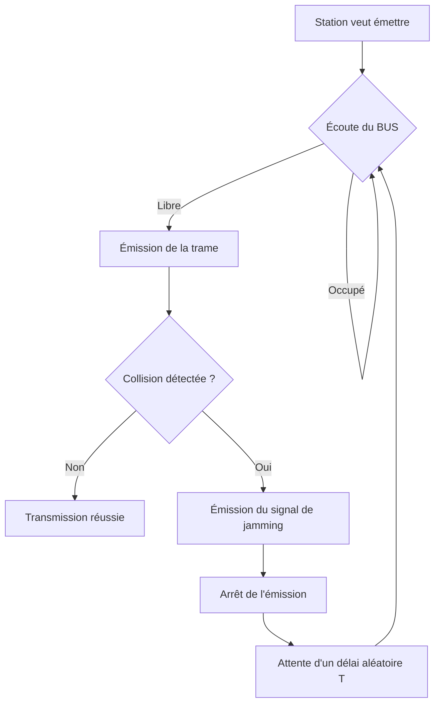
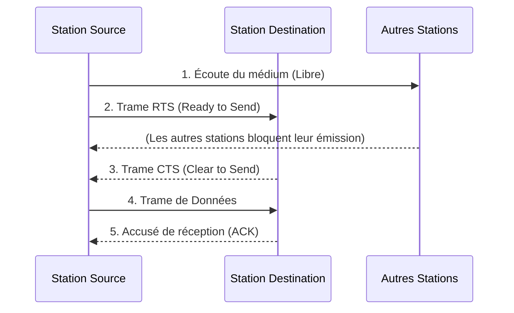

Date: 2026-10-09
Tags: [[Réseaux]], [[Protocoles]], [[MAC]], [[CSMA]], [[TCP/IP]], [[Adressage IP]], [[Sous-réseaux]], [[ENSAM]]

---
# Réseaux et Protocoles — Session 3 : Sous-couche MAC, TCP/IP et Adressage

## 1. La Sous-couche MAC et les Méthodes d'Accès

> [!info] Définition : Problématique de la sous-couche MAC
> Être réunis en réseau implique de permettre l'accès à une même source d'informations. Il faut réglementer le flux d'informations afin d'éviter les **collisions** et faire parvenir rapidement les données.
> Les méthodes principales d'accès au réseau appartiennent à la sous-couche **MAC** (*Medium Access Control*) :
> - **802.3** : accès CSMA/CD (Ethernet) ;
> - **802.4** : accès Jeton sur bus (*Token Bus*) ;
> - **802.5** : accès Jeton sur anneau (*Token Ring*).

### 1.1 Le Protocole 802.3 : CSMA/CD

> [!info] Définition : CSMA/CD
> **CSMA** (*Carrier Sense Multiple Access*) : détection de porteuse, accès multiple. Le principe est d'écouter avant de transmettre.
> **CD** (*Collision Detection*) : détecte les collisions physiquement sur le câble.
> - Le transceiver vérifie l'absence de trame sur la ligne et émet la sienne.
> - Si superposition de trames (collision), le transceiver émet un signal d'alerte, arrête d'émettre, et tente une nouvelle émission après un **temps aléatoire**.
> - **Propriété fondamentale :** Le réseau Ethernet (CSMA/CD) n'est **pas déterministe** (on ne peut pas garantir un temps maximal d'accès au médium).

### 1.2 Le Protocole CSMA/CA

> [!info] Définition : CSMA/CA
> **CA** (*Collision Avoidance*) : évite les collisions par une procédure **logicielle** (et non physique comme CSMA/CD).
> Utilise un mécanisme de réservation du canal par échange de trames de contrôle avant l'envoi des données.

**Mécanisme RTS/CTS :**
1. **Écoute** physique du signal sur le BUS.
2. **RTS** (*Ready To Send*) : Le nœud émet une trame RTS contenant l'adresse du destinataire. Cela bloque les autres stations et demande un accusé de réception.
3. **CTS** (*Clear To Send*) : Si le destinataire est prêt, il répond par une trame CTS dans un temps imparti.
4. **Données** : Le nœud émet sa trame de données.

> [!warning] Piège / Cas Particulier : Collision logicielle
> Si deux nœuds émettent un RTS simultanément, il y a collision. Aucune trame CTS n'est reçue dans le temps imparti. La collision est détectée de façon **logicielle** par le non-acquittement, déclenchant une procédure de réémission identique à CSMA/CD.

### 1.3 Le Protocole 802.5 : Jeton sur Anneau (*Token Ring*)

> [!info] Définition : Jeton sur anneau
> Une trame spéciale (le **Jeton**) tourne en permanence sur l'anneau.
> - La station qui veut émettre capture le jeton, modifie sa valeur (le marque comme "occupé"), et y place ses données.
> - La trame fait un tour complet, puis le jeton est repositionné à sa valeur "vide".
> - **Propriété fondamentale :** Méthode d'accès **déterministe** (le temps maximal d'attente est calculable en fonction du nombre de stations).

> [!abstract] Processus : Système de priorité (802.5)
> Pour éviter qu'un nœud ne monopolise l'anneau, un système de priorité est implémenté :
> - Une valeur de priorité est affectée à chaque nœud.
> - La valeur de priorité décroît à chaque tour de l'anneau.
> - Un nœud possédant une priorité supérieure peut s'approprier le jeton pour émettre.

### 1.4 Le Protocole 802.4 : Jeton sur BUS (*Token Bus*)

> [!info] Définition : Jeton sur BUS
> Le principe est identique au jeton sur anneau, mais appliqué à une topologie physique en **BUS**.
> - Le signal est diffusé à toutes les stations.
> - Un système d'adressage des trames permet de former un **anneau logique**.
> - Chaque station modifie l'adresse destination de la trame de jeton pour qu'il soit transmis successivement à toutes les stations selon l'ordre logique défini.

> ![[Pasted image 20261009165521.png]]

---

## 2. Le Modèle TCP/IP

> [!info] Définition : Architecture TCP/IP
> TCP/IP désigne une architecture réseau en **4 couches**, reposant sur deux protocoles étroitement liés : **TCP** (*Transmission Control Protocol*, couche Transport) et **IP** (*Internet Protocol*, couche Internet).

| Couche TCP/IP | Équivalent OSI | Rôle principal |
| :--- | :--- | :--- |
| **Application** | Application, Présentation, Session | Protocoles applicatifs (HTTP, FTP, SMTP...) |
| **Transport** | Transport | Communication de bout en bout, fiabilité (TCP) ou rapidité (UDP) |
| **Internet** | Réseau | Adressage logique et routage des datagrammes (IP) |
| **Hôte-Réseau** | Liaison, Physique | Accès au médium physique (ex: Ethernet, Wi-Fi) |

### 2.1 La Couche Internet (IP)

> [!info] Définition : Protocole IP
> IP est le protocole central de la couche Internet.
> **Rôle :** Acheminer les données sous forme de paquets (**datagrammes**) à travers des réseaux hétérogènes.
> **Fonctionnement :**
> - **Mode non connecté** : Chaque paquet est routé indépendamment.
> - **Best effort** : IP fait de son mieux pour délivrer les paquets, sans garantie.
> - **Limites** : Pas de détection des paquets dupliqués/déséquencés, détection partielle des erreurs, **aucune correction d'erreur** (laissée aux couches supérieures comme TCP).

---

## 3. Adressage IPv4

### 3.1 Caractéristiques de l'adressage IP

> [!info] Définition : Adresse IP
> Une adresse IP identifie de manière unique une **interface** dans l'Internetwork.
> - Codée sur **32 bits** (IPv4) ou 128 bits (IPv6).
> - Représentée en **notation décimale pointée** (ex: $192.168.1.10$).
> - Structure hiérarchique à deux champs :
>   - **NetID** : Identifie le réseau (ou sous-réseau).
>   - **HostID** : Identifie l'interface (machine) dans ce réseau.

### 3.2 Types d'adresses

| Type | Définition |
| :--- | :--- |
| **Unicast** | Adresse permettant l'adressage d'une **seule** machine spécifique. |
| **Multicast** | Adresse correspondant à un **groupe** de machines (communication 1-vers-N). |
| **Broadcast** | Adresse correspondant à **toutes** les machines d'un réseau donné. |

### 3.3 Classes d'adressage IPv4

> [!info] Définition / Théorème : Classification par préfixe binaire
> Les adresses IPv4 sont divisées en classes selon la valeur de leur premier octet en binaire, déterminant la frontière entre NetID et HostID.

| Classe | Gamme (Décimal) | Préfixe Binaire | Structure | Nb Réseaux | Nb Hôtes / Réseau |
| :---: | :--- | :--- | :--- | :---: | :---: |
| **A** | $0.0.0.0$ à $127.255.255.255$ | `0...` | 7 bits Net / 24 bits Host | $126$ | $16\,777\,214$ |
| **B** | $128.0.0.0$ à $191.255.255.255$ | `10...` | 14 bits Net / 16 bits Host | $16\,383$ | $65\,534$ |
| **C** | $192.0.0.0$ à $223.255.255.255$ | `110...` | 21 bits Net / 8 bits Host | $2\,097\,151$ | $254$ |
| **D** | $224.0.0.0$ à $239.255.255.255$ | `1110...` | \multicolumn{3}{c|}{Adresses Multicast} |
| **E** | $240.0.0.0$ à $247.255.255.255$ | `11110...` | \multicolumn{3}{c|}{Adresses Réservées (Expérimental)} |

> [!warning] Piège / Cas Particulier : Calcul des hôtes et réseaux
> Le nombre d'hôtes utilisables est toujours $2^h - 2$ (où $h$ est le nombre de bits du HostID), car l'adresse avec tous les bits à $0$ désigne le **réseau**, et l'adresse avec tous les bits à $1$ désigne le **broadcast**. De même pour les réseaux en classe A ($2^7 - 2 = 126$).

### 3.4 Adresses Privées (RFC 1918)

> [!info] Définition : Adresses privées
> Plages d'adresses réservées pour les réseaux locaux (LAN), non routables sur l'Internet public.

| Tranche d'adresses IP privées | Équivalent |
| :--- | :--- |
| $10.0.0.0$ à $10.255.255.255$ | 1 réseau de classe A |
| $172.16.0.0$ à $172.31.255.255$ | 16 réseaux de classe B |
| $192.168.0.0$ à $192.168.255.255$ | 256 réseaux de classe C |

### 3.5 Adresses Spéciales

| Type d'adresse | Structure | Exemple / Rôle |
| :--- | :--- | :--- |
| **Adresse Réseau** | HostID tout à $0$ | $126.0.0.0$ (Désigne le réseau lui-même, pas un hôte) |
| **Broadcast dirigé** | HostID tout à $1$ | $126.255.255.255$ (Diffusion à tous les hôtes du réseau 126) |
| **Broadcast limité** | Tous les bits à $1$ | $255.255.255.255$ (Diffusion locale, non routée) |
| **Loopback** | Réseau $127.x.x.x$ | $127.0.0.1$ (Test de la pile IP locale, *ping* interne) |

---

## 4. Sous-réseaux et Masques

### 4.1 Pourquoi créer des sous-réseaux ?

> [!abstract] Processus : Justification du sous-réseautage
> Diviser un réseau principal en sous-réseaux permet de :
> 1. Éviter le gaspillage des adresses hôtes ;
> 2. Utiliser des supports physiques différents ;
> 3. Réduire le trafic (domaines de broadcast plus petits) ;
> 4. Isoler les pannes (confinement des erreurs) ;
> 5. Augmenter la sécurité (segmentation logique).

### 4.2 Le Masque de Sous-réseau

> [!info] Définition : Masque de sous-réseau
> Le masque est une séquence de 32 bits qui permet d'extraire la partie **Réseau + Sous-réseau** de l'adresse IP.
> - Les bits correspondant au réseau/sous-réseau sont à **$1$**.
> - Les bits correspondant à l'hôte sont à **$0$**.
> 
> **Formule de calcul des sous-réseaux et hôtes :**
> Soit $n$ le nombre de bits empruntés au HostID pour créer des sous-réseaux, et $h$ le nombre de bits restants pour les hôtes.
> $$ \text{Nombre de sous-réseaux} = 2^n $$
> $$ \text{Nombre d'hôtes par sous-réseau} = 2^h - 2 $$

> ![[{7FEF0D83-3E34-4DF0-A535-06931D927A53}.png]]

---

## 5. Exercices d'Application et Méthodologie

### 5.1 Identification de Classes

> [!example] Exemple d'Application : Quelles classes prennent en charge ces réseaux ?
> Adresses données : a) $197.200.3.0$ | b) $11.0.0.0$ | c) $221.100.2.0$ | d) $131.107.0.0$
> **Résolution :**
> - a) $197 \in [192, 223] \Rightarrow$ **Classe C**
> - b) $11 \in [1, 126] \Rightarrow$ **Classe A**
> - c) $221 \in [192, 223] \Rightarrow$ **Classe C**
> - d) $131 \in [128, 191] \Rightarrow$ **Classe B**

### 5.2 Calcul de Masques de Sous-réseaux

> [!example] Exemple d'Application : Déterminer les masques selon les contraintes
> **Méthodologie :**
> - Si la contrainte porte sur les **sous-réseaux** ($SR$) : trouver $n$ tel que $2^n \ge SR$. Le masque aura $n$ bits à $1$ supplémentaires.
> - Si la contrainte porte sur les **hôtes** ($H$) : trouver $h$ tel que $2^h - 2 \ge H$. Le masque aura $h$ bits à $0$ à la fin.
> 
> **Cas 1 : Classe A, 6 sous-réseaux**
> $2^n \ge 6 \implies n = 3$ bits empruntés.
> Masque par défaut Classe A : `/8` ($255.0.0.0$).
> Nouveau masque : `/11` $\implies$ `255.224.0.0`.
> 
> **Cas 2 : Classe B, 4000 hôtes**
> $2^h - 2 \ge 4000 \implies 2^h \ge 4002 \implies h = 12$ bits pour les hôtes.
> Masque par défaut Classe B : `/16`. Bits restants pour le sous-réseau : $32 - 12 = 20$.
> Nouveau masque : `/20` $\implies$ `255.255.240.0`.
> 
> **Cas 3 : Classe C, 254 hôtes**
> $2^h - 2 \ge 254 \implies h = 8$ bits.
> C'est exactement la taille du HostID d'une classe C. Aucun sous-réseau n'est créé.
> Masque : `/24` $\implies$ `255.255.255.0`.

### 5.3 Analyse d'Erreurs d'Adressage

> [!warning] Piège / Cas Particulier : Erreurs classiques dans les topologies
> Lors de l'analyse d'un schéma réseau (ex: Slide 146), les erreurs d'adressage IP typiques à identifier sont :
> 1. **Adresse Réseau assignée à un hôte** (ex: HostID tout à $0$).
> 2. **Adresse Broadcast assignée à un hôte** (ex: HostID tout à $1$).
> 3. **Conflit d'adresse IP** (deux interfaces sur le même réseau possèdent la même IP).
> 4. **Incohérence de Masque** (des machines sur le même lien physique ont des masques de sous-réseau différents).
> 5. **Passerelle par défaut invalide** (l'IP du routeur n'appartient pas au sous-réseau de la machine).

---
# ~={red}References=~
*Réseaux et Protocoles (Session 3) — Pr. MOUGHIT Mohamed, ENSAM Casablanca*

