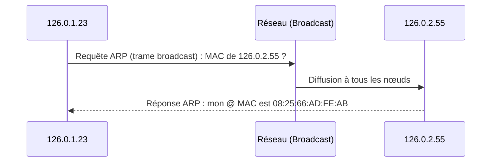

Date: 2026-10-25
Tags: [[Réseaux]], [[Protocoles]], [[Couche IP]], [[TCP]], [[UDP]], [[ARP]], [[Multicast]], [[Fragmentation]], [[ENSAM]]

---
# Réseaux et Protocoles — Multicast, Couche IP, Transport (TCP/UDP) et Outils de Maintenance

## 1. Unicast, Multicast et Broadcast

> [!info] Définition : Modes de diffusion
> - **Unicast :** le routeur transfère le datagramme reçu via **une seule** de ses interfaces (adressage d'une seule machine) ;
> - **Broadcast :** le datagramme est destiné à **toutes** les machines d'un réseau ;
> - **Multicast :** le routeur peut envoyer le datagramme reçu sur **plusieurs** de ses interfaces (adressage d'un groupe de machines).

![[Pasted image 20261025132410.png]]

> [!warning] Piège / Cas Particulier : Multicast vs Multiple Unicast
> Émuler le multicast par plusieurs unicasts (**multiple unicasting**) est **non efficace** et introduit un **délai non négligeable** : chaque destinataire reçoit une copie séparée du même datagramme.

> [!info] Définition : Adressage Multicast
> - Une adresse multicast est comprise entre $224.0.0.0$ et $239.255.255.255$ (préfixe binaire `1110`, 28 bits) ;
>   
>   ![[Pasted image 20261025132758.png]]
>   
> - Une adresse multicast **ne peut être que destinataire** : c'est l'adresse d'un **groupe** de machines abonnées à une session multicast ;
> - Les **sources** (émetteurs) sont désignées par leurs adresses **unicast**.
> 
> **Exemples d'adresses multicast :**
> 
> | Adresse | Signification |
> | :--- | :--- |
> | $224.0.0.1$ | Tous les systèmes sur ce sous-réseau |
> | $224.0.0.2$ | Tous les routeurs de ce sous-réseau |
> | $224.0.1.1$ | NTP (Network Time Protocol) |

### 1.1 Adresse physique Multicast (MAC)

> [!info] Définition : Mapping IP multicast → MAC
> - Les adresses physiques multicast s'étendent de `01:00:5E:00:00:00` à `01:00:5E:7F:FF:FF` ;
> - Le niveau liaison de données **n'utilise pas ARP** pour déterminer l'adresse physique ;
> - **5 bits ne sont pas utilisés** dans le mapping de l'adresse MAC $\Rightarrow$ l'adresse physique obtenue **ne sera pas unique** (plusieurs adresses IP multicast peuvent correspondre à la même MAC).
>   
>   ![[Pasted image 20261025132838.png]]

> [!example] Exemple d'Application : Conversion IP multicast → MAC Ethernet
> **Méthode :** recopier les **23 bits de poids faible** de l'adresse IP multicast dans les 23 bits de poids faible du préfixe `01:00:5E:00:00:00`.
> - $232.43.14.7$ : octets faibles $43 = 0010\,1011_2$, $14$, $7$ $\Rightarrow$ MAC = `01:00:5E:2B:0E:07` ;
> - $238.212.24.9$ : $212 = 1101\,0100_2 \Rightarrow$ bit de poids fort ignoré $\Rightarrow$ `54` ; MAC = `01:00:5E:54:18:09`.

> [!warning] Piège / Cas Particulier : Multicast et couche transport
> **Le multicast est toujours sous UDP.** On ne peut pas utiliser le multicast sous TCP (protocole orienté connexion point-à-point).
> 
> ![[Pasted image 20261025133022.png]]

> ![[Pasted image 20261025132707.png]]
> *(Description précise de l'illustration : (a) multicasting — un routeur multicast distribue vers D1–D4 ; (b) multiple unicasting — la source S1 duplique le flux vers chaque membre Gi du groupe via des routeurs unicast)*

---

## 2. La Couche IP

### 2.1 Structure du paquet IP

> [!info] Définition : Paquet IP
> Un paquet IP est composé de :
> - **Entête** : partie **fixe** + partie **variable** (options + padding), champs alignés sur des frontières de **32 bits** ;
> - **Data** : données des couches supérieures.

**Champs de l'entête :**

![[Pasted image 20261025133133.png]]

| Champ | Taille | Rôle |
| :--- | :---: | :--- |
| **Version** | 4 bits | Version d'IP utilisée (4 pour IPv4, 6 pour IPv6) |
| **IHL** | 4 bits | Longueur de l'entête en multiples de 32 bits (ex. $0101_2 = 5 \Rightarrow 5 \times 32 = 20$ octets) — indispensable car l'entête varie avec les options |
| **Type of Service (TOS)** | 8 bits | Qualité de service désirée : *Precedence* (2 bits de poids fort, priorité, défaut 0), Délai (0 normal / 1 élevé), Débit, Fiabilité, Coût, dernier bit à 0 |
| **Total Length** | 16 bits | Longueur totale du paquet IP |
| **Identification** | 16 bits | Numéro du paquet émis (compteur $0 \to 65535$ puis retour à 0) |
| **Fragment Offset** | 16 bits | Drapeaux **DF**, **MF** + position des données (13 bits) |
| **Time to Live (TTL)** | 8 bits | Durée de vie ; décrémentée à chaque routeur ; à 0 le paquet est détruit (évite les boucles infinies) |
| **Protocol** | 8 bits | Protocole au-dessus d'IP : $6 = $ TCP, $17 = $ UDP |
| **Header Checksum** | 16 bits | Checksum sur les octets de l'entête IP |
| **Source Address** | 4 octets | Adresse du nœud émetteur |
| **Destination Address** | 4 octets | Adresse du nœud destinataire |
| **Options + Padding** | variable | Sécurité, routage… toujours multiple de 32 bits |

### 2.2 Fragmentation

> [!abstract] Processus : Fragmentation et réassemblage
> - **Qui fragmente ?** Les **routeurs traversés**.
> - **Quand ?** Quand le **MTU** (Maximum Transfer Unit) du réseau physique est **inférieur** à la taille du paquet IP.
>   - MTU Ethernet = $1500$ octets ; MTU FDDI = $4500$ octets ; MTU 802.3/802.2 = $1492$ octets.
> - **Comment ?**
>   1. 1 paquet IP = $N$ fragments ;
>   2. Copie de l'entête du paquet initial devant chaque fragment ;
>   3. Modification des champs **FLAGS** et **FRAGMENT OFFSET** de chaque entête ;
>   4. **IDENTIFICATION** : conservé par les $N$ fragments (identifie le paquet d'origine) ;
>   5. **FLAGS** $(0, DF, MF)$ : $DF = 1 \Rightarrow$ fragmentation interdite ; $MF = 0 \Rightarrow$ dernier fragment ;
>   6. **FRAGMENT OFFSET** : position du fragment, champ de **13 bits** $\Rightarrow$ de $0$ à $8191$ blocs possibles.
> - **Réassemblage :** lorsque le MTU du réseau suivant redevient supérieur (ex. $TR_1 > MTU_{Eth1} \Rightarrow$ fragmentation ; $MTU_{Eth1} < MTU_{TR2} \Rightarrow$ réassemblage).

> ![[Pasted image 20261025133259.png]]
> 

### 2.3 Table de routage

> [!info] Définition : Table de routage
> IP possède une **table de routage** qu'il consulte toujours pour savoir :
> - sur quelle **interface de sortie** envoyer chaque paquet IP ;
> - si l'émission est **directe** ou doit être faite **via un routeur**.

### 2.4 Exercice d'analyse de trame

> [!example] Exemple d'Application : Lecture d'une trame capturée (checklist)
> - Dans l'entête Ethernet, quelles sont les 2 adresses MAC en hexa ?
> - Quel est le code du protocole et quel est ce protocole ?
> - La trame est-elle de type **Ethernet II** ou **802.2** ?
> - Adresses IP source et destination en notation décimale pointée **et** en hexa ?
> - Quel protocole est indiqué dans l'entête IP ?
> - Longueur de l'entête en mots de 32 bits et nombre d'octets correspondants ?
> - Numéro de ce datagramme IP ?
> - L'entête IP possède-t-il un champ « Options » ?

---

## 3. Le Protocole ARP

![[Pasted image 20261025133515.png]]

> [!info] Définition : ARP (Address Resolution Protocol)
> ARP résout une **adresse IP** en **adresse MAC** :
> - **Requête ARP** envoyée dans une trame Ethernet **Broadcast** : « Quelle est l'@ MAC du nœud dont l'@ IP est 126.0.2.55 ? » ;
> - **Réponse** unicast : « Mon @ MAC est `08 25 66 AD FE AB` ».

![[Pasted image 20261025133449.png]]



**Format du paquet ARP :**

![[Pasted image 20261025133419.png]]

| Champ | Taille (octets) | Valeur / Rôle |
| :--- | :---: | :--- |
| @ Eth Dest | 6 | Adresse Ethernet destination |
| @ Eth Source | 6 | Adresse Ethernet source |
| Type (entête Ethernet) | 2 | $0806_{}$ = ARP |
| Type de matériel | 2 | $1$ = Ethernet |
| Type de protocole | 2 | $0800_{}$ = IP |
| TM (taille matériel) | 1 | $6$ octets pour Ethernet |
| TP (taille protocole) | 1 | $4$ octets pour IP |
| OP (opération) | 2 | $1$ = requête, $2$ = réponse |
| @ IP Émetteur | 4 | Adresse IP de l'émetteur |
| @ Eth Émetteur | 6 | Adresse Ethernet de l'émetteur |
| @ IP Cible | 4 | Adresse IP de la cible |
| @ Eth Cible | 6 | **Non rempli dans la requête** (information recherchée) ; rempli dans la réponse |

---

## 4. La Couche Transport : UDP et TCP

> [!info] Définition : Rôle et implémentations
> Même rôle que la couche transport OSI. Deux implémentations seulement :
> - **TCP** (Transmission Control Protocol) : fiable, **orienté connexion**, acheminement sans erreur de paquets d'une machine d'un internet à une autre du même internet ;
> - **UDP** (User Datagram Protocol) : plus simple, **non fiable et sans connexion** ; présuppose qu'on n'a besoin ni du contrôle de flux ni de la conservation de l'ordre de remise.

### 4.1 UDP (RFC 768, 1980)

> [!info] Définition : UDP
> - Permet des échanges de **paquets de données individuels** ; chaque datagramme UDP est encapsulé dans un datagramme IP ;
> - **Sans connexion et non fiable** : pas d'accusés de réception $\Rightarrow$ perte, duplication ou déséquencement possibles ;
> - Efficace pour les applications utilisant la **diffusion** (pas de temps de connexion).

**Entête UDP (32 bits par rangée) :**

![[Pasted image 20261025133543.png]]

| Port Source | Port Destination |
| :---: | :---: |
| **Longueur** | **Checksum** |
| Octets de données | Octets de données |

- **Port Source** : numéro de l'application émettrice ; **Port Destination** : numéro de l'application destinataire ;
- **Longueur** : longueur du message UDP en octets ;
- **Checksum** : utilisé de façon **facultative** (souvent `0000` ; fonctionnel seulement si l'application le demande expressément).

### 4.2 TCP (RFC 793, 1981)

> [!info] Définition : TCP et circuits virtuels
> - Protocole de transmission **plus fiable** ; utilise des **circuits virtuels** (connexions simple-duplex entre les 2 applications dialoguant sur les 2 ordinateurs) ;
> - Avant toute transaction, le protocole à chaque extrémité **ouvre une connexion** ;
> - Chaque connexion correspond à un **port** : numéro alloué **dynamiquement côté client**, **bien défini côté serveur** ;
> - Les **segments TCP** comportent un entête + un champ de données ; l'ensemble est passé à la couche IP qui ajoute l'entête IP, puis le tout est inséré dans une trame.

**Entête TCP et champs clés :**

![[Pasted image 20261025133600.png]]

| Champ | Rôle |
| :--- | :--- |
| **Source Port / Destination Port** | Numéros des applications émettrice / destinatrice |
| **Sequence Number** | Numéro du **premier octet** de données transporté dans le paquet |
| **Acknowledgement Number** | Numéro du **prochain octet attendu** de la couche TCP distante (équivalent d'un accusé de réception) |
| **Data Offset** | Longueur de l'entête TCP en mots de 32 bits (nécessaire à cause des options) |
| **Window** | Nombre d'octets encore recevables **sans accusé** ; à 0 l'émetteur doit interrompre l'envoi (**contrôle de flux**) |
| **Checksum** | Checksum du paquet TCP **y compris l'entête** |
| **Urgent Position** | Pointeur de données urgentes, valide si flag URG = 1 |

**Drapeaux (Flags) :**

| Flag | Signification |
| :---: | :--- |
| **ACK** | Le paquet est un accusé de réception |
| **SYN** | Établissement d'une connexion |
| **FIN** | Fermeture de la connexion |
| **RST** | Réinitialisation suite à erreurs irrécupérables |
| **PSH** | Remise immédiate des données à la couche supérieure |
| **URG** | Données urgentes présentes (champ Urgent Position valide) |

**Ports bien connus (extrait) :**

| Service | Port | Description |
| :--- | :---: | :--- |
| Discard | 9/tcp | Discard all incoming data |
| Chargen | 19/tcp | Exchange streams of characters |
| FTP-Data | 20/tcp | File Transfer data transfer |
| FTP | 21/tcp | File Transfer control session |
| Telnet | 23/tcp | Telnet remote login |
| SMTP | 25/tcp | Simple Mail Transfer Protocol |
| HTTP | 80/tcp | World Wide Web |
| POP3 | 110/tcp | POP mail download service |
| IMAP | 143/tcp | IMAP mail server |
| SMTPs | 465/tcp | SMTP over SSL |
| HTTPS | 443/tcp | Web HTTP over SSL |
| FTPS-Data | 989/tcp | FTP data over SSL |
| FTPS | 990/tcp | FTP over SSL |
| Telnets | 992/tcp | Telnet over SSL |
| IMAPs | 993/tcp | IMAP over SSL |
| POP3s | 995/tcp | POP3 over SSL |

### 4.3 Fonctionnalités TCP

> [!abstract] Modélisation : Fiabilité, séquencement, flux, multiplexage
> 1. **Accusé de réception :** fiabilité assurée par ACK (flag positionné à 1) + champ Acknowledgement Number (prochain octet attendu $\Rightarrow$ dernier octet reçu connu) ;
> 2. **Séquencement et détection de pertes :** Sequence Number + Acknowledgement Number garantissent l'ordre correct des octets et détectent les octets perdus ;
> 3. **Contrôle de flux :** champ Window ; valeur 0 $\Rightarrow$ interruption de l'envoi, reprise quand la fenêtre redevient non nulle ;
> 4. **Multiplexage :** TCP peut servir plusieurs applications dans un même nœud ; chaque extrémité = (adresse IP, numéro de port) ;
> 5. **Connexions :** établies avant transmission (opération relativement longue, plusieurs paquets de dialogue) ; une connexion est symbolisée par ses 2 extrémités, ex. $(126.0.0.1, 80, 126.0.2.66, 1602)$.

> [!example] Exemple d'Application : Échange Seq/Ack entre deux nœuds
> 
> ![[Pasted image 20261025133719.png]]
> 
> | Étape | Émetteur | SeqN | AckN | Interprétation |
> | :---: | :---: | :---: | :---: | :--- |
> | 1 | A | 1000 | 0000 | Le 1er octet du paquet est le n° 1000 ; A attend le 1er octet de B |
> | 2 | B | 0000 | 1501 | B a bien reçu les 1500 premiers octets de A et attend le 1501 |
> | 3 | A | 1501 | 551 | A envoie à partir de 1501 ; A a reçu jusqu'à 550 de B et attend 551 |
> | 4 | B | 551 | 2001 | B envoie à partir de 551 ; il a reçu jusqu'à 2000 inclus et attend 2001 |

### 4.4 Couche Application du modèle TCP/IP

> [!info] Définition : Couche application
> Contrairement au modèle OSI, c'est la couche **immédiatement supérieure à la couche transport** (les couches présentation et session sont apparues inutiles). Elle contient tous les protocoles de haut niveau : **Telnet, TFTP, SMTP, HTTP**.

---

## 5. Outils de Maintenance

> [!example] Exemple d'Application : Commandes et sorties typiques
> **`ping`** — test de joignabilité et TTL :
> ```text
> C:\>ping -n 10 -l 500 126.0.0.1
> Pinging 126.0.0.1 avec 500 octets de données:
> Réponse de 126.0.0.1: octets=500 temps<10ms TTL=127   (x10)
> ```
> **`tracert`** — itinéraire vers une destination :
> ```text
> C:\>tracert www.renault.fr
> 1  150 ms 141 ms 140 ms  192.168.12.1
> 2  130 ms 140 ms 140 ms  AUB5.rain.fr [195.101.8.1]
> ...
> 7  160 ms 150 ms 150 ms  www.renault.fr [194.51.107.102]
> Routage terminé.
> ```
> **`ipconfig /all`** — configuration IP complète :
> ```text
> Nom d'hôte............: al_sta
> Adresse physique.........: 00-A0-24-A6-D1-22
> Adresse IP............: 125.0.0.1
> Masque de sous-réseau.......: 255.0.0.0
> Passerelle par défaut.......: 125.0.0.2
> ```
> **`netstat -e`** — statistiques interfaces :
> ```text
> Reçu       Envoyé
> Octets            13542338   544425
> Paquets unicast       9774     6648
> Paquets non-unicast     70       70
> Rejets 0   Erreurs 0
> ```
> **`netstat -n`** — connexions actives :
> ```text
> Proto  Adresse locale      Adresse extérieure  Etat
> TCP    125.0.0.1:139       126.0.0.1:1042      ETABLIE
> TCP    127.0.0.1:1026      127.0.0.1:1030      ETABLIE
> ```
> **`arp -a`** — cache ARP :
> ```text
> Interface: 125.0.0.1 on Interface 2
> Adresse Internet   Adresse physique      Type
> 125.0.0.2          00-10-7b-3c-3b-70     dynamique
> ```

> [!abstract] Synthèse des outils
> | Outil | Rôle |
> | :---: | :--- |
> | `ping` | Vérifier la pile IP locale et la joignabilité (TTL, délai) |
> | `tracert` | Tracer l'itinéraire hop par hop |
> | `ipconfig` | Afficher configuration IP / masque / passerelle / MAC |
> | `netstat` | Statistiques et connexions actives |
> | `arp -a` | Consulter la table de correspondance IP ↔ MAC |

---
# ~={red}References=~
*Réseaux et Protocoles — Pr. MOUGHIT Mohamed, ENSAM Casablanca (p. 148–207)*