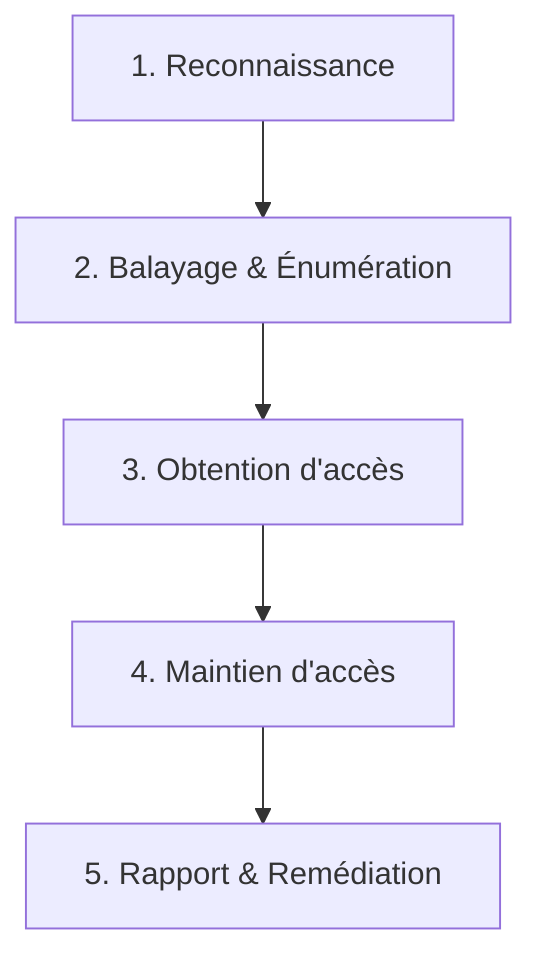

Date: 2026-10-11
Tags: [[Cybersecurity]], [[Networking]], [[MITRE ATT&CK]], [[Kill Chain]], [[Pentest]], [[OSINT]], [[ENSAM]]

---
# Cybersécurité — Fondamentaux, Anatomie d'une Attaque et Méthodologie Offensive

## 1. La Nécessité de la Cybersécurité

### 1.1 La Réalité de la Menace : Automatisation et Surface d'Exposition

> [!info] Définition : Surface d'exposition
> La **surface d'exposition** (ou surface d'attaque) d'un système est l'ensemble des points par lesquels un acteur extérieur peut interagir avec lui sans autorisation préalable : ports réseau ouverts, services exposés, comptes valides, formulaires web, objets connectés, employés joignables. 
> **Principe de réduction :** Réduire cette surface (désactiver un service, fermer un port) est presque toujours moins coûteux que de défendre un service exposé sans nécessité.

> [!warning] Piège / Cas Particulier : Le mythe de l'attaque ciblée
> L'immense majorité des tentatives d'intrusion ne visent pas une organisation choisie par jalousie ou rivalité, mais résultent d'un **balayage automatisé** de l'espace d'adresses Internet (via des moteurs comme Shodan). Une machine exposée sans authentification robuste reçoit ses premières tentatives de connexion en **quelques minutes**, non en quelques mois.

> [!info] Définition : Le cycle Vulnérabilité / Correctif
> Le délai entre la publication d'un correctif et la première exploitation automatisée de la vulnérabilité se compte désormais en **heures ou jours**. Les attaquants analysent le correctif (patch diffing) pour en déduire la faille.
> **Conséquence :** Un correctif disponible et non appliqué n'est pas un risque différé, c'est un risque immédiat et croissant.

### 1.2 La Triade CID (CIA Triad)

> [!info] Définition / Théorème : La Triade CID
> La cybersécurité cherche à garantir trois propriétés fondamentales :
> 1. **Confidentialité (C)** : Seules les personnes autorisées accèdent à l'information.
> 2. **Intégrité (I)** : L'information n'est modifiée que par les personnes autorisées, et toute altération est détectable.
> 3. **Disponibilité (D)** : L'information et les services sont accessibles aux personnes autorisées quand elles en ont besoin.
> 
> *Propriétés complémentaires :* **Authenticité** (l'origine est réelle) et **Non-répudiation** (l'auteur ne peut nier son action).

> ![[{A14BFB53-BFDB-4B6F-ACC1-C4E27372F8A8}.png]]

### 1.3 Acteurs de la Menace et Coûts Réels

> [!abstract] Modélisation : Typologie des acteurs
> | Acteur | Motivation | Moyens typiques | Sophistication |
> | :--- | :--- | :--- | :--- |
> | **Script kiddie** | Notoriété, curiosité | Outils publics, sans adaptation | Faible |
> | **Hacktiviste** | Revendication idéologique | Défiguration, DDoS, fuite ciblée | Faible à moyenne |
> | **Cybercriminalité** | Gain financier | Rançongiciel (RaaS), fraude, revente | Moyenne à élevée |
> | **APT (État-nation)** | Espionnage, sabotage | Vulnérabilités 0-day, implants, patience | Très élevée |
> | **Menace interne** | Vengeance, négligence | Accès légitime déjà accordé | Variable |

![[Pasted image 20261011215218.png]]

> [!info] Définition : Ordres de grandeur économiques (IBM / Verizon)
> - **Coût moyen mondial** d'une violation de données : **~4,5 millions $** (2023).
> - **Délai moyen de détection** et confinement : **~270 jours**.
> - **Impact de la rapidité** : Un incident contenu en $< 1$ mois coûte environ **1 million $ de moins** qu'un incident silencieux de $> 200$ jours.

> [!example] Exemple d'Application : WannaCry (Mai 2017)
> Rançongiciel exploitant une vulnérabilité SMB de Windows (corrigée 2 mois plus tôt, mais non appliquée). Propagation autonome (ver) sur $> 200\,000$ machines dans 150 pays. 
> **Analyse CID :** Atteinte massive à la **Disponibilité** (hôpitaux, usines paralysés).

### 1.4 Limites, Cadres et Éthique

> [!warning] Piège / Cas Particulier : Ce que la cybersécurité NE résout pas
> 1. **Ne ramène jamais le risque à zéro** (on arbitre un risque résiduel).
> 2. **Coût vs Valeur** : Une mesure disproportionnée est une erreur d'ingénierie.
> 3. **Ne remplace pas l'hygiène de base** (mots de passe, patchs, configurations par défaut).
> 4. **N'est pas un état, mais un processus** continu.

> [!info] Définition : Cadres de référence
> - **MITRE ATT&CK** : Catalogue des tactiques et techniques offensives observées dans la nature.
> - **NIST CSF** (Cybersecurity Framework) : Organise la défense en 5 fonctions : *Identifier, Protéger, Détecter, Répondre, Rétablir*.

![[{0E36AF64-62AA-48BE-A41B-564EE454994E}.png]]

> [!warning] Piège / Cas Particulier : Cadre légal marocain (Loi n° 07-03)
> Employer une technique offensive contre un système dont vous n'êtes pas le propriétaire **et sans autorisation écrite préalable** est une infraction pénale. L'ignorance de la loi ou l'intention ("je testais seulement") ne modifie pas la qualification pénale.
> **DGSSI** : Direction Générale de la Sécurité des Systèmes d'Information (Maroc).
> **Loi n° 09-08** : Protection des données à caractère personnel.

---

## 2. Anatomie d'une Attaque : Concepts et Techniques

### 2.1 La Cyber Kill Chain (Lockheed Martin)

> [!info] Définition / Théorème : La Cyber Kill Chain
> Modèle militaire décomposant une intrusion en 7 étapes successives. Rompre la chaîne à un seul maillon stoppe l'attaque.
> 1. **Reconnaissance** : Collecte d'infos (OSINT, balayage).
> 2. **Armement (Weaponization)** : Création de la charge utile (exploit + payload).
> 3. **Livraison (Delivery)** : Transmission (email, clé USB, service exposé).
> 4. **Exploitation** : Déclenchement de la vulnérabilité (exécution de code).
> 5. **Installation** : Persistance (backdoor, tâche planifiée).
> 6. **Commande et Contrôle (C2)** : Canal de communication avec l'attaquant.
> 7. **Actions sur objectifs** : Exfiltration, chiffrement, sabotage.


> [!abstract] Principe d'investissement défensif
> Plus une défense agit **tôt** dans la chaîne, moins l'incident coûte cher. Bloquer la livraison (étape 3) évite la remédiation complète (étape 7).

### 2.2 La Matrice MITRE ATT&CK

> [!info] Définition : MITRE ATT&CK
> Contrairement à la Kill Chain (linéaire), MITRE ATT&CK est une **matrice** où les colonnes sont des **Tactiques** (l'objectif immédiat, ex: *Accès initial*, *Mouvement latéral*) et les cellules sont des **Techniques** concrètes (ex: *T1566 Phishing*). Fournit des identifiants stables (ex: T1059) pour la corrélation d'alertes.

### 2.3 Vecteurs, Vocabulaire et Malwares

> [!info] Définition : Vecteurs d'attaque
> Le chemin par lequel l'attaquant atteint la cible :
> 1. **Réseau** (services exposés) 
> 2. **Applicatif/Web** (failles de code) 
> 3. **Humain** (ingénierie sociale) 
> 4. **Physique** (USB, locaux)
> 5. **Chaîne d'approvisionnement** (tiers, dépendances).

> [!example] Exemple d'Application : La brèche Target (2013)
> **Vecteur initial :** Chaîne d'approvisionnement (compromission d'un prestataire de climatisation ayant un accès légitime au réseau de facturation).
> **Vecteur secondaire :** Mouvement latéral réseau vers les serveurs de terminaux de paiement.
> **Impact :** 40 millions de cartes bancaires exfiltrées.

> [!info] Définition : Vocabulaire de l'exploitation
> - **Vulnérabilité** : Faiblesse de conception/configuration.
> - **Exploit** : Code qui déclenche la vulnérabilité.
> - **Charge utile (Payload)** : Ce qui s'exécute après (backdoor, ransomware).
> - **0-day** : Vulnérabilité inconnue de l'éditeur, sans correctif.
> - **n-day** : Vulnérabilité dont le correctif est publié (mais non appliqué partout).

> [!abstract] Modélisation : Familles de code malveillant (Malwares)
> | Famille | Mode de propagation / Comportement |
> | :--- | :--- |
> | **Virus** | S'attache à un hôte légitime, nécessite une action humaine. |
> | **Ver (Worm)** | Propagation autonome sur le réseau (ex: WannaCry). |
> | **Cheval de Troie** (trojan) | Se fait passer pour un logiciel légitime. |
> | **Rançongiciel** | Chiffre les données (Atteinte à la **Disponibilité**). |
> | **Rootkit** | Modifie le noyau (kernel) pour dissimuler sa présence. |
> | **Backdoor** | Accès distant persistant post-exploitation. |

![[{13D7F3D6-3803-480B-9E58-95367CC29474}.png]]

---

## 3. Les Hackers et leurs Outils

### 3.1 Éthique et Méthodologie de Pentest

> [!info] Définition : Les "Chapeaux" du Hacking
> - **Black Hat** : Agit sans autorisation, fins malveillantes.
> - **White Hat** : Hacker éthique, agit sous **mandat écrit** (Rules of Engagement).
> - **Grey Hat** : Découvre sans autorisation mais signale. **Attention :** Illégal au regard de la loi 07-03. L'accès non autorisé *est* l'infraction, peu importe l'intention ultérieure.

> [!abstract] Processus : Les 5 phases d'un Test d'Intrusion (Pentest)
> 1. **Reconnaissance** (Passive puis Active).
> 2. **Balayage et Énumération** (Scanning, identification des versions).
> 3. **Obtention d'un accès** (Exploitation).
> 4. **Maintien de l'accès** (Persistance, mouvement latéral).
> 5. **Rapport et Restauration** (Contrairement à l'attaquant qui efface ses traces, le pentester documente et nettoie).



### 3.2 Environnements et Cibles Légales

> [!info] Définition : Distributions et Cibles
> - **Kali Linux / Parrot OS** : Distributions regroupant les outils par catégories fonctionnelles (Collecte, Analyse Web, Exploitation, Post-exploitation).
> - **Cibles volontairement vulnérables** : Systèmes conçus pour être attaqués légalement (ex: **Metasploitable**, *vulnweb.com*, *HackTheBox*, *TryHackMe*). Aucune autorisation supplémentaire n'est requise au-delà de l'usage prévu.
![[{294A9692-5E23-4305-934E-4F2EE680617E}.png]]

### 3.3 Reconnaissance : OSINfstaT et Nmap

> [!warning] Piège / Cas Particulier : Passive vs Active
> La **reconnaissance passive** précède *toujours* la reconnaissance active. Elle ne laisse **aucune trace** réseau sur la cible et révèle souvent plus (mots de passe leakés, organigrammes).

> [!info] Définition : Outils OSINT (Reconnaissance Passive)
> - **theHarvester** : Emails, sous-domaines, hôtes depuis sources publiques.
> - **Sherlock** : Traque un pseudo sur des centaines de plateformes.
> - **Shodan** : Moteur de recherche des services exposés sur Internet (scanne le web, pas votre cible directement).

> [!info] Définition : Nmap (Reconnaissance Active)
> Outil de référence pour le balayage réseau (Phase 2). Identifie les machines actives, ports ouverts et **versions des services**.
> ```bash
> nmap -sV 203.0.113.10
> ```
> **Exemple de sortie critique :**
> ```text
> PORT   STATE SERVICE VERSION
> 21/tcp open  ftp     vsftpd 2.3.4
> ```
> *Analyse :* La version `vsftpd 2.3.4` contient une backdoor connue. L'analyste passe immédiatement à la phase d'exploitation sans même avoir lancé d'attaque.

> [!warning] Piège / Cas Particulier : L'outil ne remplace pas le cerveau
> 1. Un outil automatise une technique, pas la méthodologie.
> 2. Les scanners produisent des **faux positifs** : vérification manuelle obligatoire.
> 3. La maîtrise technique ne dispense jamais de la **documentation** (le rapport est le vrai livrable du pentester).

---
# ~={red}References=~
*Cybersécurité — Chapitres 1, 2 & 3 : La nécessité, Concepts et Outils — ENSAM Casablanca (2026-2027)*
